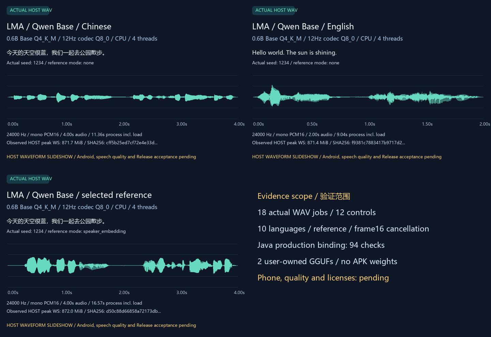

# Selection 11: trained Qwen3-TTS 0.6B Base validation

[中文](QWEN_TTS_TRAINED.md) · [User workflow and parameters](QWEN_TTS_ENGINE.en.md) · [Numbered delivery/full pending scope](releases/v0.3.0-dev.24-qwen-tts.md) · [Complete requirements](MULTIMODAL_RELEASE_PLAN.en.md)

This follow-up builds unchanged production Qwen C++ and Java on native Windows and executes both complete trained GGUFs. App **0.3.0-dev.24/code28**, APK inputs/bytes and signing identity remain unchanged. **Android execution, speech quality, complete target11 and the complete v0.3.0 Release remain unaccepted.** Developer-host tools are separate from product inference.

## 1. User choice and complete assets

Existing optional bundle `qwen3_tts_06b_base_q4_rb7ee2e8` uses recipe `qwen3_tts_06b_base_cpu_v1`. Users review task/dependency/license/device tags, components and sizes through All/search, then explicitly download or import. Local manages settings, updates, rollback and deletion. Installation, upgrade, browsing, API startup and missing-asset requests retrieve no models. All models are peers; Recommended remains m08→m06→m01.

| Component | Bytes | Full SHA256 |
| --- | --- | --- |
| `qwen-talker-0.6b-base-Q4_K_M.gguf` | 628,905,056 | `4b468ec7b1f62b90ef4ca316c0aa57deadfd54b2cf9651703ea753cedaf04226` |
| `qwen-tokenizer-12hz-Q8_0.gguf` | 291,150,624 | `1883beeed99348fc35e23dd225e9082f93f6f8c109330a33d935baa8acdbfd94` |

Total **920,055,680 bytes**, pinned [Serveurperso conversion](https://huggingface.co/Serveurperso/Qwen3-TTS-GGUF/tree/b7ee2e8c7459c3bea99da23e3d178125a7d1713c). Explicit acquisition used the selected HF mirror, strict ranges and whole-file SHA checks. Weights, cache and imported content objects remain ignored/user data, outside Git/APK. Talker embeds BPE, Code Predictor and speaker encoder; the codec supplies16 codebooks,24kHz and1920 samples/frame. Task audio, engine, pipeline, CPU, GGUF, dependencies, installation and evidence are independent labels. Publisher declares Apache-2.0 weights; pinned runtime/ggml are MIT. Runtime licensing does not replace model/reference terms.

## 2. Pipeline and checks

The [pinned Danmoreng runtime](https://github.com/Danmoreng/qwen3-tts.cpp/tree/16bb5afcd06311031c72a8488f8d59660dc2fb46), ggml and35 reviewed library files build with the existing production worker. Only [Windows CRT/parent/environment compatibility](../research/qwen_tts_host/NOTICE) is added. GPU, backend DLLs, OpenMP/BLAS, examples and implicit acquisition are disabled. No virtualization or global Python model environment is used.

Formatted BPE→autoregressive Talker→multi-codebook prediction→12Hz codec→mono PCM16 WAV executes completely. Optional speaker embedding uses the previous [unaltered Kokoro-generated reference](media/development/tts-trained-kokoro.wav), a three-second24kHz mono synthetic WAV. No real human identity, ICL reference transcript, named voice or VoiceDesign is claimed; no-reference synthesis fetches no default voice.

Baseline parameters are4 threads,512 input tokens,375 audio frames,temperature0.9,topP1,topK50,repetition1.05 and actual seed1234. Language follows each case; auto and seed5678 have separate cases. Editable/clamped parameters stay with this model; [application guards](QWEN_TTS_ENGINE.en.md#use-and-parameters) are separate from publisher training limits or phone performance.

Eighteen WAV jobs cover Chinese A/B, the other nine declared languages, auto, seed change, temperature0/topK1,16 frames, reference A/B and recovery A. Twelve controls cover schema, empty text, threads, language, seed, frame guard, negative prompt, actual BPE budget, missing codec, swapped component, invalid reference and cancellation. Cancellation waits for actual execution frame16; loading and the frame budget never become completion percentages. Errors/cancellation accept no partial WAV.

Raw requests, stdout protocols, stderr, hashes and20ms Windows process-memory observations are retained. Production Java additionally imports both full files, checks independent/clamped parameters and immutable requests, hardlinks fixed execution filenames, records random seeds, selects references, and exercises actual errors/cancellation/recovery, cleanup and restart persistence with zero network. Application/AtomicFile are explicit host ports; SAF, Service and Android playback remain untested.

## 3. Measurements and media

[Trained report](../verification/development/qwen-tts-trained.json) · [Production Java](../verification/development/qwen-tts-app-host.json) · [Independent capture audit](../verification/development/qwen-tts-capture-audit.json) · [Asset identities](../verification/development/qwen-tts-assets.json)

| Case | Audio seconds | Process seconds incl. load | HOST peak working set MiB |
| --- | --- | --- | --- |
| Chinese A | 4.00 | 11.363 | 871.7 |
| English | 2.00 | 9.039 | 871.4 |
| Japanese | 3.12 | 9.614 | 871.3 |
| Chinese with synthetic reference | 4.00 | 16.567 | 872.0 |
| Temperature0, topK1 | 30.00 | 100.230 | 2486.4 |
| Recovery A | 4.00 | 11.783 | 871.7 |

Eighteen successful jobs/twelve controls plus info equal31 actual native children. Seeded A/recovery A match byte-for-byte; changed text, seed, greedy settings, frame budget and reference differ from A. Cancellation-to-exit is approximately0.084s. Sixteen frames produce exactly30,720 samples/1.28s. The host was not an exclusive benchmark; these observations cannot establish Nubia Z20 fit, speed or endurance.

The fresh production Java run passes94 checks with six actual children, four WAVs and complete two-object/920,055,680-byte import, using zero network calls. Independent audit rereads145 raw files,31 protocol streams,22 WAVs including the four Java outputs, both full imported objects and the actual executable identity. All eight false Android/quality/similarity/target/Release promotions are rejected.

**The short greedy case produces exactly the375-frame/30-second budget.** This adapter does not expose a separate EOS/budget finish reason. This case and the truncated16-frame case cannot establish complete/correct reading or naturalness. Actual waveforms for ten languages do not establish language quality, and reference-conditioned output does not establish voice similarity.

| Original trained audio | File |
| --- | --- |
| Chinese, no reference | [WAV](media/development/qwen-tts-trained-zh.wav) |
| English, no reference | [WAV](media/development/qwen-tts-trained-en.wav) |
| Chinese, synthetic reference | [WAV](media/development/qwen-tts-trained-reference.wav) |



[Silent waveform GIF](media/development/qwen-tts-trained-waveforms.gif) · [Actual-audio MP4](media/development/qwen-tts-trained-speech.mp4) · [Media provenance](media/development/qwen-tts-trained-media.json)

WAV bytes are unchanged, without gain/normalization. MP4 is a labelled waveform slideshow with actual audio, documented AAC conversion and48kHz resampling. These are not App/phone recordings. Existing68 UI-fixture screenshots remain; no UI change or browser was needed.

## 4. Developer reproduction

Prepare the [native Windows toolchain](BUILD.en.md), explicitly acquire the pinned Qwen/ggml sources and existing JSON header, then run:

```powershell
python tools/fetch_qwen_tts_trained.py --download --hf-origin https://hf-mirror.com
python tools/build_qwen_tts_host.py
python tools/test_qwen_tts_trained.py
python tools/test_qwen_tts_app_host.py
python tools/check_qwen_tts_trained_evidence.py --recompute-raw --adversarial
python tools/render_qwen_tts_trained.py
python tools/export_development.py
python tools/check_repository.py --development
```

Acquisition without `--download` only verifies; tests never fetch assets. `--smoke` cannot produce an accepted full report. Each stage binds its own fingerprints; failed runs remain retained. The first Java harness incorrectly sought an unregistered Nano catalogue entry; it now uses the existing Kokoro entry for parameter independence and reruns completely. Production code and recipes are unchanged.

Independent checks reread original WAVs, protocol streams, imported full objects and the actual binary. Eight adversarial scope promotions must fail. Earlier header/81 contract checks retain their original scope and are not relabelled trained inference.

## 5. Remaining acceptance

Language quality/text completeness, reference similarity, long text/sampling degeneration, resources, actual Android load/unload/generation/cancellation/recovery,15-minute screen-off,one-hour API and upgrade/A1–A11/R01–R05 remain required. No phone is available. The [full P01–P09 table](releases/v0.3.0-dev.24-qwen-tts.md#完整待完成范围--full-remaining-scope) preserves F01–F12, existing text and every frozen01–14/16/17 subtarget in the same complete v0.3.0. APKs deliver foundation only; users control assets. All product inference stays on one Android without ROOT, remote fallback or ComfyUI nodes.
