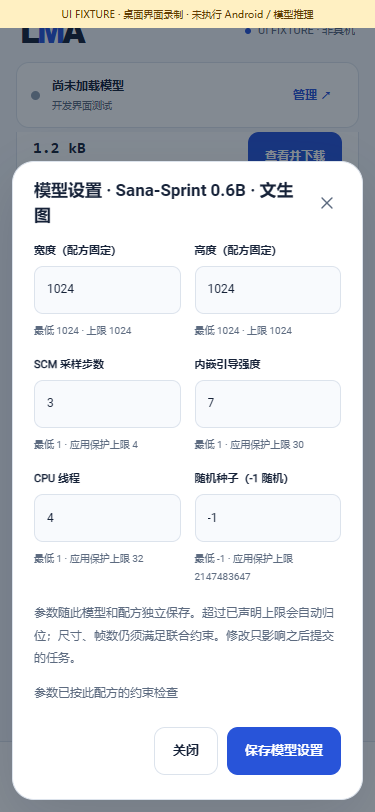
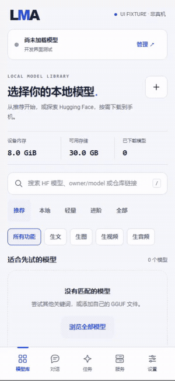

# Sana-Sprint 0.6B 本地文生图

[English](SANA_SPRINT.en.md) · [本轮交付](releases/v0.3.0-dev.45.md) · [程序验证规则](PROGRAM_VALIDATION.md)

dev.45 新增具名的 **Sana-Sprint 0.6B MNN** 文生图适配，作为编号 04 中允许的匹配移动配方。所有阶段在同一手机执行，复用模型库、本地管理、逐模型参数、任务队列和图片产物。它与既有 Sana Edit、普通 Sana 600M、1.6B 是不同配方；不能互换组件，也不把旧 Edit 灰图记录改为通过。

本轮只完成程序验证，没有运行完整模型、生成模型图片或验证手机性能。发布者的移动演示不等于 LMA 真机记录，**不宣称努比亚 Z20 可运行这套约 6.29 GiB 的资产**。分段编码器会依次释放，实际峰值内存仍未知；下载大小不是运行内存。

## 使用逻辑

1. 在「模型 → 全部 → 生图」找到 **Sana-Sprint 0.6B · 文生图**，查看组件、用途、下载总量与许可。推荐 m08 → m06 → m01 保留。
2. 用户明确点击下载后才取得这套配方披露的 14 个组件；也可以自行取得后按组件导入。安装 / 升级 App、浏览列表、查看设置均不下载权重。HF 搜索中其他 Sana 文件仍需选择正确配方，文件名建议不代表结构兼容。
3. 在「本地」暂停 / 继续下载、管理已安装资产、编辑并保存本模型设置。超限归位到此配方的上限，其他模型参数独立。
4. 完整安装后点击使用，填写正面提示词，确认本机运行。负面提示词输入框由引擎输入规则隐藏并禁用；本机接口也拒绝非空负面提示词。这套配方不接图片或 LoRA。
5. 提交创建不可变任务快照，复用本地队列、取消、资源检查、错误记录与 PNG 产物管理。任务内临时参数修改不覆盖保存的模型设置。停止子进程后才释放私有工作目录；启动与执行失败不会转到其他设备。

## 精确配方与组件

发布者 [simota1987/Sana_Sprint](https://huggingface.co/simota1987/Sana_Sprint) 固定提交 `c7b846e1cec3ec9ec7ae456cf7d3ceb36742d656`。原始模型见 [Sana Sprint 0.6B](https://huggingface.co/Efficient-Large-Model/Sana_Sprint_0.6B_1024px_diffusers)。[组件清单](../catalogue/model-bundles.json)记录每个文件的固定 URL、字节数和 SHA-256；[来源审计](../catalogue/sana-sprint-evidence.json)区分 HF 元数据、小图结构与局部 VAE 元数据读取。

| 数量 | 角色 | 用途 |
|---|---|---|
| 2 | `diffusion` / `diffusion_data` | `dit.mnn` 与独立 `.weight` |
| 8 | `gemma0`–`gemma3` 与各自 `_data` | 四段 Gemma2 编码器及对应外部权重 |
| 1 | `embeddings` | FP16 256000×2304 token embedding，只按所需行读取 |
| 1 | `encoder_config` | 固定六项布局描述，拒绝额外配置路径 |
| 1 | `tokenizer` | 配套 SentencePiece；与公开 HF tokenizer 的词表身份核对 |
| 1 | `vae` | 匹配的 DC-AE 图，输入 `latent`、输出 `image` |

14 件共 **6,754,581,137 bytes / 6.2907 GiB**。SentencePiece 来自固定的 Sana 600M tokenizer 提交 `28f3af7689de15f3883d5863059a2fca0aa9b829`；开发检查核对其 HF tokenizer JSON 身份，不能据此把普通 600M 神经网络组件混入 Sprint。APK 不含这些模型、词表或 embedding。Sana / DC-AE 与 Gemma2 的许可分别处理，**Gemma Terms 不能被整体 Apache-2.0 声明覆盖**；用户自行核对、接受和取得资产。

| 参数 | 默认 | 当前范围与来源 |
|---|---|---|
| 宽 / 高 | 1024 / 1024 | 匹配图固定 1024，不能通过少填像素降低此配方资源需求 |
| SCM 步数 | 2 | 1–4，当前程序保护；不是声称所有模型的理论上限 |
| 内嵌引导 | 4.5 | 1–30，当前程序保护；传入 DiT 时乘 0.1，无双路 CFG |
| CPU 线程 | 4 | 1–32，应用保护 |
| 种子 | -1 | -1 自动；其余 0–2147483647，实际种子写入执行记录 |

参数可编辑并有预设；UI、Java 请求准备与原生进程均实施约束。图的尺寸是导出约束，步数 / 引导 / 线程区间是本应用选择的范围，两者在设置中分别标注。

## 本机执行结构

`正面提示词 → 小写 / 首尾空白归一化 → 固定编码前缀 + SentencePiece → 按行 embedding → 四段 Gemma2 → 300 位置特征和 mask → SCM / DiT → DC-AE → PNG`

编码序列固定 506，超长时按此配方截断并发出阶段事件。扩散输入选择 BOS 加最后 299 个位置，保留 mask；这是具名 MNN 导出配置，不声称与任意版本的普通 Sana 全序列管线相同。四段编码图依次销毁；扩散各步使用相同私有组件，输出张量物化到 CPU 后再进入下一阶段。CPU MNN 与 SentencePiece 固定源码、原生子进程归属和用户资产校验复用基座，未引入外部执行服务或节点系统。

## 程序证据与复现

**448 项**检查：57 项 Java 契约、389 项原生算法 / 分词 / 小图检查、2 项生产进程协议检查。25 个分词用例覆盖控制 token、空白、Unicode 与截断；10 个采样步骤对照未修改的 Diffusers 0.35.1 `SCMScheduler.step`。两个小型 MNN 图仅有少量常量与加法，调用实际图加载函数；不是 Gemma、DiT 或完整模型生成。

另有 **19 项**当前页面交互检查，以及 Android ARM64 / API28 / 16KiB 编译、包依赖与签名核对。[程序报告](../verification/program/sana-sprint.json)与[原生编译记录](../verification/program/mnn-android.json)有源码指纹。完整模型、Android 推理、图片质量、速度与后台耐久均未测，也不重新列为后续程序发版待跑项。

开发环境需要原生 Windows MSVC、JDK、已缓存的固定 MNN / SentencePiece 源码、CPU Torch 和 HF tokenizers。参考依赖单独安装，以下命令只取约 37 MiB 的 tokenizer / 配置数据，不取完整神经权重：

```powershell
python -m pip install --no-deps --target build/sana-reference-python diffusers==0.35.1
python tools/fetch_sana_program_inputs.py
python tools/test_sana_sprint.py
# Android 构建：使用仓库既有原生 NDK 工具链；不运行模型
python tools/build_mnn.py
python tools/collect_mnn_notices.py
python tools/build.py
node tools/capture_workbench.cjs sana
```

截图 / 录屏采用当前实际页面和明确标记的模拟安装 / 队列数据，不创建占位模型图片。浏览器在 `finally` 中关闭。





[MP4 录屏](media/development/sana/sana-ui.mp4) · [14 组件截图](media/development/sana/01-sana-components.png) · [任务截图](media/development/sana/03-sana-task.png) · [队列截图](media/development/sana/04-sana-queue.png) · [媒体身份与检查清单](media/development/sana/manifest.json)
