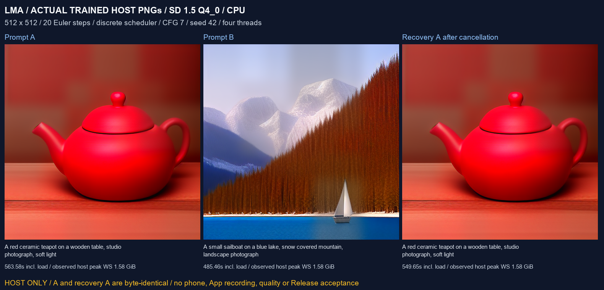

# SD 1.5: trained assets and production-source host execution

[中文](SD15_TRAINED.md) · [Diffusion foundation](DIFFUSION_ENGINE.en.md) · [Numbered delivery and full pending scope](releases/v0.3.0-dev.24.md)

For **0.3.0-dev.24 / code 28**. This checkpoint corrects production progress phases and adds actual trained-asset validation for the existing SD 1.5 recipe. Host execution, Android compilation, physical App execution, quality and background acceptance remain separate. One SD 1.5 candidate establishes no other image family, LoRA pairing or complete v0.3.0 acceptance.

## User workflow and asset separation

The App updates only the foundation. It contains none of these files and downloads no model during installation, upgrades or browsing. Users choose a candidate in All/search, review the checkpoint and tokenizer dependency, then explicitly download or import the files. Local manages its parameters, versions, transfers and deletion. Recommended m08 → m06 → m01 remains intact; image capability, installation, execution evidence and content labels are independent.

The fixed candidate is `sd15_ss_q4_0_r031b5f5`, recipe `sd15_cpu_v1`, pipeline `sd15`, engine `sd_cpp`, CPU. Its complete checkpoint includes CLIP/UNet/VAE, while CLIP merges remain an additional user asset. Compatibility does not extend automatically to another identically named checkpoint.

| Role | Pinned source | File | Bytes |
| --- | --- | --- | --- |
| model | [Second State, 031b5f5…](https://huggingface.co/second-state/stable-diffusion-v1-5-GGUF/tree/031b5f5df991f511b3f5fa8fed6d99048ababb69) | stable-diffusion-v1-5-pruned-emaonly-Q4_0.gguf | 1,566,768,416 |
| clip_merges | [Original SD1.5 repository, 451f4fe…](https://huggingface.co/stable-diffusion-v1-5/stable-diffusion-v1-5/blob/451f4fe16113bff5a5d2269ed5ad43b0592e9a14/tokenizer/merges.txt) | tokenizer/merges.txt | 524,619 |

Total **1,567,293,035 bytes**. Full revisions, sizes, SHA256 identities and source CreativeML Open RAIL-M terms are retained in the [catalogue](../catalogue/model-bundles.json) and [developer asset receipt](../verification/development/sd15-assets.json):

```text
model        b8944e9fe0b69b36ae1b5bb0185b3a7b8ef14347fe0fa9af6c64c4829022261f
clip_merges  9fd691f7c8039210e0fced15865466c65820d09b63988b0174bfe25de299051a
```

After installation users select the model, enter a prompt and its independent settings, and submit to the shared local queue. The validation snapshot uses 512×512, 20 steps, Euler/discrete, CFG 7, seed 42, four threads and VAE tiling; it does not overwrite saved user settings. Existing foreground-service/API/progress/artifact/cancellation infrastructure handles the task. Android output and screen-off acceptance remain pending.

## Execution and progress correction

The [production worker](../native/sd_worker.cpp) calls stable-diffusion.cpp for loading, architecture validation, CLIP/tokenization, denoising, VAE and PNG output. The [external vocabulary adapter](../native/vocab_external.cpp) replaces upstream embedded learned vocabularies. No Python, desktop inference server or external-device fallback enters the APK.

Upstream reuses one callback for tensor loading, sampling and VAE tiles. The old worker called every callback `sampling`. In dev.24 callbacks follow the actual top-level `loading` / `generating` phase. Generation includes lazy loading, denoising and VAE; its local step totals must not all be interpreted as diffusion steps. Model math, sampler and weights are unchanged.

The [Windows-only compatibility layer](../research/sd_host/NOTICE) compiles the same production worker/policy/external-vocabulary sources, replacing only POSIX parent-lifetime calls. It is a native developer executable, not Android or a remote provider. It cannot test Android `prctl`, Java Service or screen-off behavior. The build pins sd.cpp `be486498eadc29dc3cd234d944c2180ed42b1415` and GGML `a5915eb0e47adef21c3f25b889a008925ea838c2`, CPU, without embedded model data.

## Evidence and media

The [trained execution report](../verification/development/sd15-trained.json) retains two prompts, three complete A/B/A PNGs, invalid requests, actual sampler cancellation/recovery, request/log/image identities and sampled host memory. Cancellation requires the generation phase and completion of at least step 1 of this fixed 20-step sampler, excluding loading/VAE callbacks. Separate processes execute A/B/A, with recovery A after cancellation. Determinism compares complete PNG bytes.

The first attempt did generate a PNG, but revealed that the observer could cancel during loading because progress was misclassified. That attempt was deliberately stopped and retained with its reason in the ignored developer directory. Published acceptance uses the corrected rerun; loading cancellation is not counted as sampler cancellation.

Measured results follow. Times include process startup, loading and complete generation. Memory is sampled Windows child-process working set/private commit, not Android available memory or GPU VRAM.

| Run | Seconds | Observed peak working set (bytes) | Sampled peak private commit (bytes) | PNG bytes |
| --- | --- | --- | --- | --- |
| prompt-a | 563.58 | 1,698,885,632 | 513,703,936 | 367,115 |
| prompt-b | 485.46 | 1,698,828,288 | 513,474,560 | 598,785 |
| recovery-a | 549.65 | 1,698,816,000 | 513,548,288 | 367,115 |

All three runs recorded actual sampler steps 0–20 and complete 512×512 RGB PNGs. A and recovery A have identical whole-file SHA256; B differs. Cancellation after step 1/20 exited within **0.226 seconds**, with no completion event or output file. Unsupported schema, empty prompt and out-of-range threads produced explicit errors. A separate subsequent process loaded the model and completed recovery A.

Visual inspection identifies the red teapot in A and the sailboat, blue lake and snowy mountains in B. B has visible texture/surface artifacts in the trees and mountains. These are sample observations without a systematic prompt/detail/artifact quality rubric; `semantic_quality_accepted=false` remains.



The [GIF](media/development/sd15-trained-slideshow.gif) and [MP4](media/development/sd15-trained-slideshow.mp4) are labelled slideshows of actual host still images, **not App recordings, generated video or phone inference footage**. The [media receipt](media/development/sd15-trained-media.json) binds original PNGs and public results. Timings/resources describe this host at that time, without Nubia Z20 speed, memory-fit or endurance conclusions. Pixel variance and reproducibility do not replace model-quality acceptance.

## Developer reproduction

Native Windows/MSVC, the already acquired pinned sd.cpp/GGML sources, project-local CMake/Ninja and Python/Pillow are required. Media additionally uses native FFmpeg. No Docker, WSL, VM or Android emulator is used.

```powershell
# Explicit developer acquisition, not an App installation step
python tools/fetch_sd15_trained.py --download
# Optional explicit mirror; fixed revision/whole-file size/SHA256 still apply
python tools/fetch_sd15_trained.py --download --origin https://hf-mirror.com
python tools/build_sd_host.py
python tools/test_sd15_trained.py
python tools/render_sd15_trained.py
```

Without `--download`, acquisition only verifies existing files. Tests/builds do not fetch models. Assets, builds and raw outputs remain ignored under `build/`. Resume state binds the same asset identity; complete verification precedes atomic activation. Temporary ASCII drive aliases target only this workspace and are released by their owner.

The local dist APK retains the original signing identity and contains no developer weights, vocabulary or generated samples. No complete v0.3.0 Release is created. All frozen targets, independent user asset control, real phone output/quality/resources, three load/unload runs, 15-minute screen-off, one-hour API/upgrade tests and A1–A11/R01–R05 remain mandatory within the same release.
