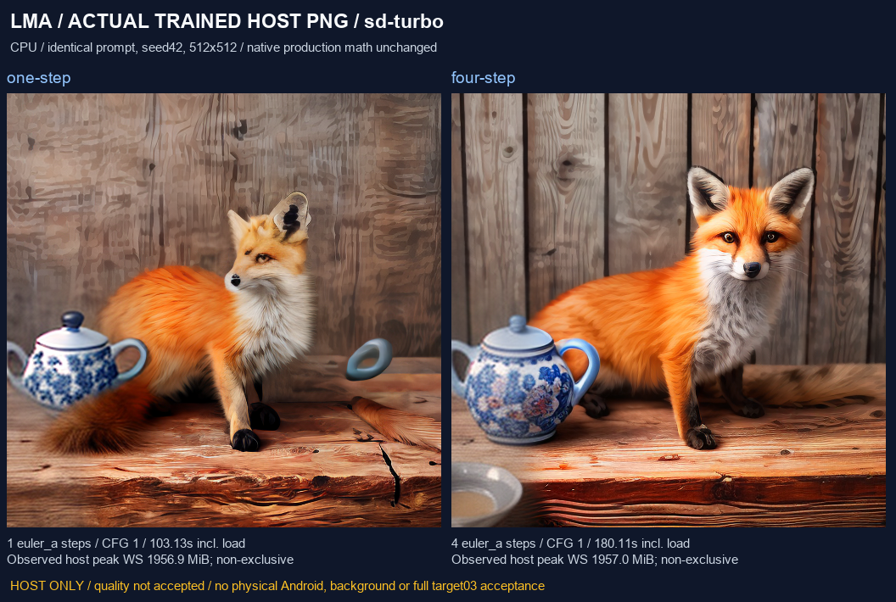
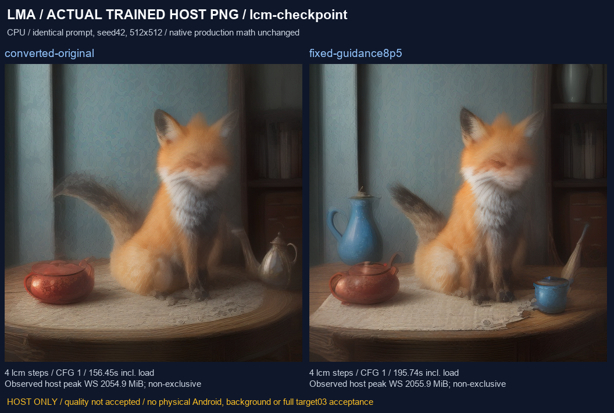
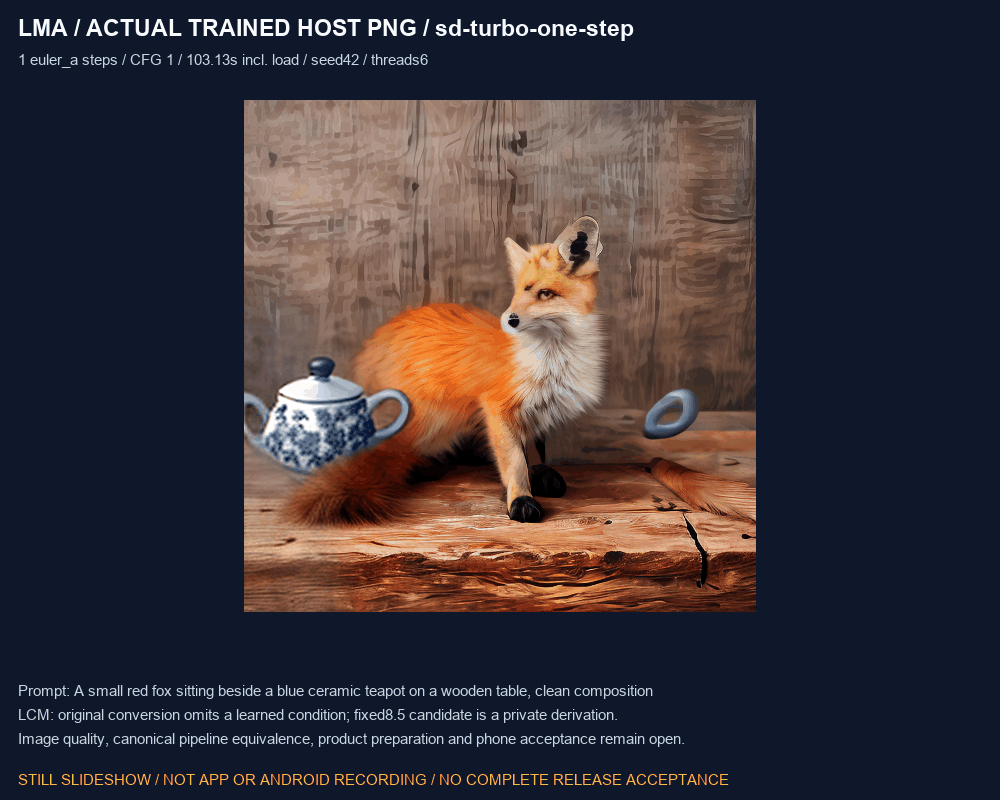

# SD-Turbo 与独立 LCM checkpoint：训练权重验证

[English](SD_DISTILLED_TRAINED.en.md) · [扩散基座](DIFFUSION_ENGINE.md) · [LCM-LoRA 与双架构适配器](SD_VARIANTS_TRAINED.md) · [编号交付 / 完整待办](releases/v0.3.0-dev.24-sd-distilled.md)

这轮在原生 Windows CPU 上验证独立 SD-Turbo 和 LCM checkpoint，复用 App 中未修改的 C++ 引擎、词表实现及 Java 绑定。SD-Turbo 走完生产 HF 配方、完整导入和真实推理；LCM 识别出转换遗漏、验证固定引导的数值修复候选并实际出图。它们分别是主机验证与开发实验，尚未通过画质、完整官方管线、手机资源或后台耐久验收。APK 仍为 **0.3.0-dev.24 / code 28**，本轮没有更改生产代码、APK 输入或字节，也不发布缩减版 v0.3.0。

## 1. 用户选择、下载与管理

App 交付基座；用户选择模型资产。安装、升级、浏览和缺组件任务不发起模型下载。开发参考 UNet、派生 checkpoint、Python 和本轮测试集合不是用户必装内容。所有产品推理阶段最终都必须在同一 Android 手机执行，无 ROOT、外部执行或隐式回退。

1. 在“模型 → 全部 / 搜索”打开 `Green-Sky/SD-Turbo-GGUF`，选择固定的 `sd_turbo-f16-q8_0.gguf`，进入“构建模型包 / LoRA 配方”，选择 **SD-Turbo · 完整 checkpoint**。不要将它声明为 SD1.5、普通 SD2 或 SDXL。
2. 核对版本、完整文件、许可和依赖。此文件含模型 / 编码器 / VAE，但仍需要单独的 CLIP merges 词表；模型和词表共 **2,024,269,995 字节 / 两个对象**。这是本次选定量化文件的完整依赖，不代表所有 HF 文件都可直接执行。
3. “加入本地并查看下载计划”只登记元数据。用户再确认下载，或按计划列出的 `model/...`、`clip_merges/...` 路径明确导入文件夹。在“本地”独立管理暂停 / 续传、设置、更新 / 回退和删除。
4. 参数跟着模型保存，输入框允许预设和直接输入，超限归位。此 SD-Turbo 配方固定 **1–4 步、CFG 1、Euler ancestral / discrete、空负面提示词**；512×512 是本轮实测尺寸。应用尺寸上限 2048 和线程上限 64 是保护范围，不能当作 Z20 或模型的质量 / 资源保证。
5. 任务持有不可变设置和组件租约。修改调用方对象不改变已提交请求；运行中的模型不能删除；错误 / 取消后清理实际子进程与私有请求，再由用户明确重试。

模型平级，生图、依赖、架构、后端、格式和设备证据标签独立；推荐保持 `m08 → m06 → m01`。导入和推理成功不会自动赋予“无审查”标签，仍需单独的作者依据。[SD-Turbo JSON](../research/sd_distilled_trained/sd_turbo_q8_0.json)是开发元数据参考，普通用户采用现有 HF 文件选择流程。

独立 LCM checkpoint 与 LCM-LoRA 分别验收。本轮没有将有遗漏的 LCM 转换推荐为已修复产品模型；已有 LCM 模板的存在也不代表本候选可用。原始 F32 UNet 只用于开发对照，App 不会为用户自动补下它。

## 2. 固定资产与许可边界

| 编号 | 来源 / 文件 | 字节 | 固定版本 |
| --- | --- | ---: | --- |
| A01 | [Green-Sky SD-Turbo GGUF](https://huggingface.co/Green-Sky/SD-Turbo-GGUF)，`sd_turbo-f16-q8_0.gguf` | 2,023,745,376 | `19a31586d02d64a73b4419bc193b3ecfaf38e1f0` |
| A02 | [Steward LCM DreamShaper GGUF](https://huggingface.co/Steward/lcm-dreamshaper-v7-gguf)，`LCM_Dreamshaper_v7-f16.gguf` | 2,134,675,232 | `ae3fa73e105d5f848a4ef122e2ce14c92123bf1a` |
| A03 | [原始 LCM DreamShaper](https://huggingface.co/SimianLuo/LCM_Dreamshaper_v7)，`unet/diffusion_pytorch_model.safetensors` | 3,438,495,328 | `a85df6a8bd976cdd08b4fd8f3b73f229c9e54df5` |

三对象合计 **7,596,915,936 字节**，只用于开发覆盖；既有 CLIP merges 另为 524,619 字节。来源、整文件 SHA-256、量化者 / 原模型链接和许可元数据见[资产锁](../research/sd_distilled_trained/assets.json)。权重、派生权重和词表数据均不进入 Git、APK 或源码附件。

量化 SD-Turbo 的发布者标记 `other / stability-ai-community-license-agreement`，并链接[原始 SD-Turbo 许可](https://huggingface.co/stabilityai/sd-turbo/blob/main/LICENSE.md)；转换者声明不能代替原模型条款。LCM GGUF 未提供许可元数据，原始 UNet 标记 MIT，但 DreamShaper / SD1.5 等基础组件仍需分别核对。完整许可审查保持未关闭，不因能够下载而推断可自由再分发。

## 3. 独立 LCM 遗漏与修复候选

原始 UNet 有 **687 张量 / 859,602,884 个 F32 参数**，其中 `time_embedding.cond_proj.weight` 为 `[320,256]`，81,920 个值全部非零。GGUF 只有 686 个对应 UNet 张量。逐个比对 **859,520,964 个值**，全部等于原始权重转换到其 F16 / F32 类型后的值，零不匹配；第一个时间 MLP 偏置也仍等于未加引导的原偏置。由此确认这份转换遗漏了引导条件，且没有预先折叠进偏置。

从固定官方源提取时间 / 引导嵌入函数，固定蒸馏引导值 **8.5**，将条件贡献折叠进第一个时间 MLP 偏置：`b0' = b0 + W0 × Wcond × guidance_embedding(8.5−1)`。这是进入 SiLU 之前的等价变换；**蒸馏引导 8.5 与采样 CFG 1 是两个不同量**，不能把当前界面 CFG 改为 8.5 来替代修复。

候选复制完整 GGUF，只允许一段 **5,120 字节**的偏置区域改变，实际 4,987 字节不同，其他字节及文件长度保持一致；原件保留。候选 SHA-256 为 `a307d7a72384ece75380ac91c0fe2d012dc9599c95224e1a5abe2a0bfaa6d298`。这份 2.13GB 开发派生文件没有进入 App，也不是生产资产准备实现；后续需在手机上明确准备、验证来源、管理派生资产，并评估小型张量覆盖以避免重复整份 checkpoint。

完整训练 UNet 做了 **30 次前向**：五组 × 六个 timestep（0 / 1 / 249 / 499 / 749 / 999），使用确定性合成 latent / 文本条件、8×8 / 16×16 的缩小 latent、CPU 单线程。原 F32 折叠对原条件分支、F16 转换权重折叠对同精度条件分支，两组都通过预先固定的 `max≤2e−4 / RMSE≤5e−5 / cosine≥0.99999`。六个遗漏分支负对照都超过 max 门槛。

| 对照 / Comparison | 最大绝对误差 / Max abs | 最大 RMSE | 最低 cosine |
| --- | ---: | ---: | ---: |
| `omitted-branch-vs-original` | 0.04063150287 | 0.01091605851 | 0.99988382767 |
| `f32-folded-vs-conditioned` | 8.165836334e-06 | 1.892911665e-06 | 0.999999999996 |
| `converted-conditioned-vs-original-f32` | 0.002236783504 | 0.000672562832 | 0.999999368979 |
| `converted-folded-vs-converted-conditioned` | 7.152557373e-06 | 1.755699476e-06 | 0.999999999996 |

参考 UNet 使用 SHA 固定的 diffusers 0.42.1 独立源码包，引导函数来自固定 diffusers 0.22.0；没有全局安装、下载模型或网络尝试。上述是完整 UNet 的缩小几何数值对照，**不是完整官方 512 图像管线等价性**。另执行实际原生调度器与 0.22.0 官方调度方法的比较：1 / 2 / 5 / 7 步相同，3 / 4 / 6 / 8 步不同；4 步分别为 `999/759/499/259` 与 `999/759/519/279`。这是版本差异观察，不能直接判定引擎错误或添加新的验收放宽；完整参考版本、边界处理、随机数和采样仍需核对。

## 4. 实际出图、错误、取消与恢复

生产 worker / 外部词表 C++ 未修改，固定 sd.cpp `be486498…` / ggml `a5915eb0…`，CPU 后端；Windows 只替换父进程生命周期适配。SD-Turbo 1 / 4 步与 LCM checkpoint 4 步均为 512×512、seed42、6 线程、CFG1，无 LoRA、空负面提示词，使用同一狐狸 / 蓝茶壶 / 木桌提示词。

| 任务 / Job | Steps | 含加载秒 / Seconds incl. load | 主机峰值 WS / MiB | PNG SHA 前12位 / Prefix |
| --- | ---: | ---: | ---: | --- |
| SD-Turbo / `one-step` | 1 | 103.128 | 1956.9 | `fcb9a5ae36e5` |
| SD-Turbo / `four-step` | 4 | 180.114 | 1957.0 | `5845daae68c1` |
| SD-Turbo / `recovery` | 4 | 189.637 | 1957.0 | `5845daae68c1` |
| LCM checkpoint / `converted-original` | 4 | 156.448 | 2054.9 | `7d25b2edc3d6` |
| LCM checkpoint / `fixed-guidance8p5` | 4 | 195.736 | 2055.9 | `3565db6b8185` |
| LCM checkpoint / `recovery` | 4 | 318.797 | 2055.2 | `3565db6b8185` |

两组共 **10 个原生子进程 / 6 张 PNG**，分别包含非法 CFG 拒绝、实际 sampler-step1 后终止与恢复。SD-Turbo 1 步与 4 步不同；LCM 修复前后不同；两组恢复分别与各自 4 步基准 PNG 完全一致。Windows 强制终止耗时与 Android 协作取消分别记录，不把生成阶段入口误当采样步骤。

生产 Java 完成 **60 项流程检查 + 20 项组件绑定检查、1 条实际 HF 配方构建、2 完整对象导入、5 个真实 worker / 3 张 PNG，零网络调用**。验证设置归位 / 隔离、不可变请求、租约保护、负面提示词预拒绝、原生错误、生成阶段入口取消、恢复和普通重启。三张 PNG 分别与直接原生同参数输出字节一致；Java 取消测试不声明实际采样步骤。

此主机测试直接调用生产配方 / 存储 / 参数 / SdEngine，不执行 Android Activity、LocalJobs Service 或本机 API。Java 采用现有 Windows 功能性元数据适配：原子替换 / 普通重启保留，**不执行元数据 fsync**，不验证 Android AtomicFile、断电持久性、SAF、Service 或锁屏。生产模型文件的完整复制、同步和 SHA 校验仍实际执行。主机耗时与工作集是非独占观察，不是 Z20 指标或性能基准。

质量观察：SD-Turbo 1 步已能识别狐狸、蓝色器皿和木质背景，但茶壶把手悬空 / 变形；4 步主体更清楚，壶嘴截断与细节仍需复核。LCM 原转换版和折叠候选的狐狸面部都明显模糊，蓝色茶壶等细节未可靠满足。**画质验收未通过**。数值折叠和像素差异不能替代完整提示词跟随 / 主体 / 颜色 / 伪影检查。







[MP4 静态轮播](media/development/sd-distilled-trained-slideshow.mp4) · [原图 / 媒体 SHA](media/development/sd-distilled-trained-media.json)。四张原始 PNG 字节不变；GIF 4 帧、MP4 88 帧 / 10fps，均为 8.8 秒。这些是实际主机图像的标明范围轮播；既有 68 张 UI 夹具和录像保持原范围。

## 5. 开发复核与产品缺口

独立审计通过：**89 个原始捕获文件、10 直接原生 + 5 Java 原生子进程、9 张实际生成 PNG、30 份 UNet 输出数组、4 个完整原始对象 / 2 个完整导入对象及 1 个派生 checkpoint**。重算数组误差，逐字节核对派生文件仅指定偏置区域变化，重新核对整文件 SHA；8 项错误证据控制均被拒绝。五份公开记录为[资产](../verification/development/sd-distilled-assets.json)、[原生执行](../verification/development/sd-distilled-native.json)、[LCM 数值分析](../verification/development/sd-distilled-lcm-analysis.json)、[Java 绑定](../verification/development/sd-turbo-app-host.json)、[独立复核](../verification/development/sd-distilled-capture-audit.json)，统一开发状态见 [status](../verification/development/status.json)。所有完整目标 / 质量 / Android / Release 标记继续未通过。

```powershell
python tools/fetch_sd_distilled_trained.py --download
python tools/replay_sd_turbo_native.py --execute
python tools/test_sd_turbo_app_host.py
python tools/check_sd_distilled_evidence.py
python tools/export_development.py
python tools/check_repository.py --development
```

上述都是开发命令，运行前需已有原生工具链、明确取得的完整权重 / 既有 CLIP merges 和对应实验输入。取得器默认只验证，`--download` 才允许显式开发下载。SD-Turbo 回放器保留旧捕获，不自动下载；Java 测试会重新导入完整文件并比对实际原生输出。全套审计还需要本轮 LCM 的原始捕获、30 个输出数组、参考包和派生候选，不能在缺少实验数据时伪造通过。

[十份原始实验源码](../research/sd_distilled_trained/experiments/README.md)保留实测字节与历史路径；LCM 历史协调等待和参考输入需要开发布局，不是可直接安装的手机修复工具。后续产品工作：手机侧明确准备 / 小型偏置资产与来源校验、版本化完整采样对照、质量 / 资源补测、真实 Android 接入与耐久。不能用 LCM-LoRA 替代独立 checkpoint，也不能把本轮候选放入 APK 作为内置模型。

完整下一版仍一次交付 F01–F12、既有生文、01–14 / 16 / 17 及全部冻结子目标，详见[完整编号待办](releases/v0.3.0-dev.24-sd-distilled.md)。当前没有可用 Android 真机；每模型三次装卸、15 分钟锁屏、1 小时 API、升级和 A1–A11 / R01–R05 均未关闭。没有创建正式 Release。本轮未使用 Docker / WSL / 虚拟机 / 模拟器，也没有创建浏览器标签页。
