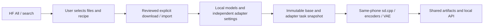
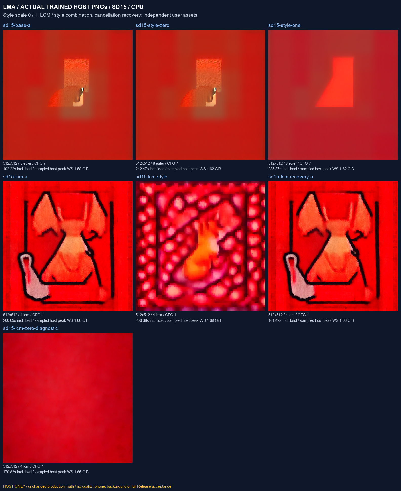
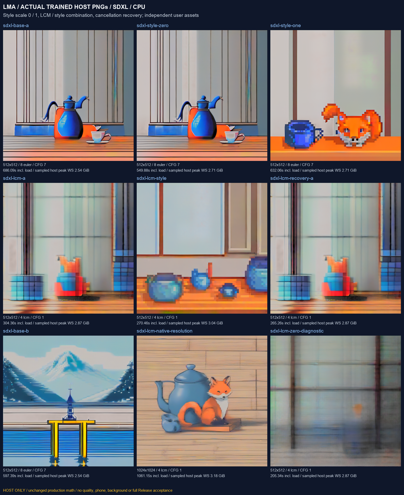
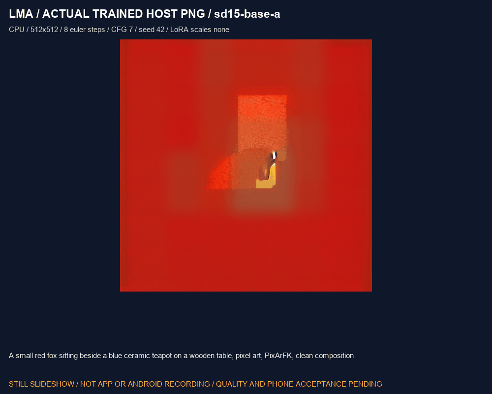

# Trained SDXL, SD 1.5 / SDXL LoRA and LCM-LoRA validation

dev.32 user-flow update: [curated diffusion and dependency review](CURATED_DIFFUSION.en.md). Fresh immutable All profiles now cover the five research sets below. Old research imports, trained-host evidence and custom HF instructions retain their original scope.

[中文](SD_VARIANTS_TRAINED.md) · [Diffusion workflow](DIFFUSION_ENGINE.en.md) · [HF component selection](HF_RECIPES.en.md) · [Adapters](ADAPTERS.en.md) · [Numbered work and complete pending scope](releases/v0.3.0-dev.24-sd-variants.md)

This work checks complete SDXL and real SD 1.5 / SDXL style and LCM adapters through the same production diffusion engine. Developer tests execute unchanged production C++ and Java on native Windows CPU. They do not establish Android execution, phone performance, image quality or complete v0.3.0 acceptance. The APK remains dev.24 / code 28; this follow-up adds developer tools, data descriptors, evidence and documentation.

## 1. User selection and management

App updates deliver the foundation. Users decide which assets to obtain. Installation, upgrades, browsing, recipe declaration and missing-component jobs start no model download. All product inference, tokenization, dual encoding, diffusion and VAE decoding must execute on the same Android phone, without ROOT, external inference or an implicit fallback.

1. Open the HF repository through Models → All / search, then choose files and “构建模型包 / LoRA 配方”. Select the complete SDXL checkpoint recipe, the matching SD 1.5 / SDXL style recipe, or the dedicated LCM-LoRA recipe.
2. Select the pinned files below and review their revision, hash, license and full dependencies. This complete SDXL file contains both CLIPs, UNet and VAE but still needs external `clip_merges`. A split diffusion file needs the complete separate encoders and VAE.
3. “加入本地并查看下载计划” registers metadata. Review the plan, then explicitly download or select a folder to import. Follow its import paths, including role directories for same-named files from different repositories. Local manages pause/resume, independent settings, updates/rollback and deletion. Installing every asset in this developer coverage set is unnecessary.
4. LoRAs are peer image-adapter records with `task:image`, `kind:adapter`, `dependency:base_model` and separate architecture/engine/backend/format tags. Pair one with an explicitly selected compatible installed base. A missing base is not downloaded automatically.
5. Each base retains its own dimensions, steps, CFG, threads and seed. Every adapter saves its own scale. Editable presets clamp excessive values to that record's upper boundary. Ordinary LoRA uses an application guard of −4 to 4; these LCM recipes declare 0.1 to 2. Application guards are not asserted training limits.



Successful imports or execution do not assign an uncensored label; existing independent publisher evidence still governs that tag. Recommended stays `m08 → m06 → m01`. The five [JSON manifests](../research/sd_variants_trained/manifests) support developer reproduction and describe the data format; ordinary App use follows existing HF component selection. Those manifests bind this exact tested base identity; generic templates continue to allow separately reviewed compatible recipes.

## 2. Pinned assets and license scope

| ID | Role / publisher | Full bytes | Revision |
| --- | --- | ---: | --- |
| A01 | [genai-archive SDXL Base 1.0 Q4_0](https://huggingface.co/genai-archive/stable-diffusion-xl-base-1.0-gguf), `sd_xl_base_1.0.q4_0.gguf` | 2,598,039,488 | `a02cea32a07b564a566d323785c853f1f545c04c` |
| A02 | [PixelArtRedmond SD 1.5](https://huggingface.co/artificialguybr/pixelartredmond-1-5v-pixel-art-loras-for-sd-1-5), `PixelArtRedmond15V-PixelArt-PIXARFK.safetensors` | 27,216,848 | `eb7c3bfe0c48e7fadd635a0cfb25c29b428c4e63` |
| A03 | [nerijs Pixel Art XL](https://huggingface.co/nerijs/pixel-art-xl), `pixel-art-xl.safetensors` | 170,543,052 | `8bf4a4d9ea283e00a51fafda8e0539f8248ea037` |
| A04 | [LCM-LoRA SD 1.5](https://huggingface.co/latent-consistency/lcm-lora-sdv1-5), `pytorch_lora_weights.safetensors` | 134,621,556 | `cf2fced511dbe7e26c8d1d397e728fbab875db4b` |
| A05 | [LCM-LoRA SDXL](https://huggingface.co/latent-consistency/lcm-lora-sdxl), independently stored same filename | 393,855,224 | `a18548dd4956b174ec5b0d78d340c8dae0a129cd` |

New assets total **3,324,276,168 bytes**. Including the [existing complete SD 1.5 Q4_0 and external CLIP merges](SD15_TRAINED.en.md), the seven unique test objects total **4,891,569,203 bytes**. This is a developer coverage set, not a mandatory user installation. The [asset lock](../research/sd_variants_trained/assets.json) records complete URLs, SHA-256 values, attribution and immutable model cards. Acquisition uses separate SHA directories for same-named files, requires `--download`, retains identified partials, respects server retry delays and verifies every full file.

The SDXL header contains **2,641 tensors**, both `[768,49408]` / `[1280,49408]` CLIP embeddings, full UNet and VAE. The production worker also identifies the actual loaded tensor architecture. Each adapter receives complete safetensors header/shape/dtype/data-span and full-hash checks. Exported tensor descriptions contain no learned values.

The quantizer declares CreativeML OpenRAIL-M while [original SDXL](https://huggingface.co/stabilityai/stable-diffusion-xl-base-1.0) declares OpenRAIL++; both are recorded separately. Quantizer metadata does not replace base terms. PixelArtRedmond declares a bespoke LoRA license; Pixel Art XL declares CreativeML OpenRAIL-M; both LCM adapters declare OpenRAIL++. These publisher declarations do not close the full component-license review. Model data never enters Git, APKs or source attachments.

## 3. Host checks and measurements

Direct tests execute production `native/sd_worker.cpp` / `vocab_external.cpp`, pinned sd.cpp `be486498…` / ggml `a5915eb0…`, with only the native Windows parent-lifetime port. Every invocation opens full trained base/adapter objects and the external user vocabulary. Images are actual generated outputs.

Standard comparisons use 512×512, eight Euler/discrete steps, CFG 7, seed 42 and six CPU threads. Both families compare no adapter, style scale 0 and scale 1; four-step LCM/CFG 1, LCM plus style, actual cancellation after sampler step 1 and recovery are separate cases. SDXL adds a different prompt and a 1024×1024 four-step LCM output. Low-step standard comparisons test execution and differences, without replacing a quality evaluation.

Visual review found large color regions and an unclear subject in the eight-step SD1.5 standard samples; four-step LCM is coarse, and LCM plus style has severe color blocks and loses the subject. The 512/eight-step SDXL base sample shows blue vessels and a cup but does not clearly depict the requested fox. These samples fail the quality requirement. Zero-scale equality and enabled pixel differences establish execution/effect only. Normal-step and recommended-size tests must still evaluate prompt following, subjects, colors and artifacts. Earlier twenty-step teapot/sailboat samples used different prompts and do not establish a repair under these conditions.

The SDXL scale 1 style image shows a recognizable pixel fox and a blue cup-shaped object, clearly changing the base image's appearance. The vessel does not reliably meet the requested teapot, and table details still need review. This is an observation of an actual style effect, without accepting every output's quality.

The 1024×1024 / four-step LCM native-size sample depicts a recognizable fox, blue spouted teapot and wooden background, better matching the main subjects than these 512 low-step cases. Smeared edges, lines across the image and other prompt details still need review. One better sample closes neither the full quality gate nor phone resource testing.

Explicit LCM-LoRA freezes `sampler=lcm`, `scheduler=lcm`, CFG 1 and 1–8 steps in the task snapshot, with recorded adjustments. Saved base settings remain independent. Negative prompts are rejected; an ordinary adapter name cannot silently enable LCM, and two consistency sources cannot stack. The [publisher's low-step guidance](https://huggingface.co/latent-consistency/lcm-lora-sdxl) is separately attributed. LCM-LoRA does not establish the independent LCM-checkpoint or SD-Turbo subtargets.

Two developer-only counterfactuals keep the base, prompt, seed, LCM steps, sampler and scheduler fixed while changing the same complete LCM adapter from scale 1 to 0. This checks the trained weights' actual effect. The App rejects zero-scale LCM tasks; this native diagnostic is not a new user recipe or recommended setting.

| Actual job | Size / steps / CFG | Seconds including load | Sampled peak working set (MiB) | First 12 PNG SHA-256 characters |
| --- | --- | ---: | ---: | --- |
| `sd15-base-a` | 512×512 / 8 / 7 | 192.225 | 1620.7 | `aabdd638176e` |
| `sd15-style-zero` | 512×512 / 8 / 7 | 242.467 | 1659.3 | `aabdd638176e` |
| `sd15-style-one` | 512×512 / 8 / 7 | 235.373 | 1659.6 | `f0a700c1b105` |
| `sd15-lcm-a` | 512×512 / 4 / 1 | 200.691 | 1702.1 | `c1a14c2da91e` |
| `sd15-lcm-style` | 512×512 / 4 / 1 | 256.379 | 1731.3 | `9e7da71e7947` |
| `sd15-lcm-recovery-a` | 512×512 / 4 / 1 | 161.417 | 1702.5 | `c1a14c2da91e` |
| `sdxl-base-a` | 512×512 / 8 / 7 | 686.094 | 2596.5 | `84ee117a6935` |
| `sdxl-style-zero` | 512×512 / 8 / 7 | 549.876 | 2778.0 | `84ee117a6935` |
| `sdxl-style-one` | 512×512 / 8 / 7 | 632.062 | 2777.1 | `e4469a991d88` |
| `sdxl-lcm-a` | 512×512 / 4 / 1 | 304.357 | 2937.0 | `ee7e1aa78ec5` |
| `sdxl-lcm-style` | 512×512 / 4 / 1 | 270.456 | 3108.0 | `4f5d862f813e` |
| `sdxl-lcm-recovery-a` | 512×512 / 4 / 1 | 265.255 | 2940.2 | `ee7e1aa78ec5` |
| `sdxl-base-b` | 512×512 / 8 / 7 | 597.388 | 2596.2 | `b790cca5911e` |
| `sdxl-lcm-native-resolution` | 1024×1024 / 4 / 1 | 1061.154 | 3253.8 | `814eebf5ce2a` |

Two additional native-only zero-LCM-scale diagnostics keep all other parameters fixed; both differ from scale 1:

| Native diagnostic, not an App recipe | Size / steps / CFG | Seconds including load | Sampled peak working set (MiB) | First 12 PNG SHA-256 characters |
| --- | --- | ---: | ---: | --- |
| `sd15-lcm-zero-diagnostic` | 512×512 / 4 / 1 | 170.834 | 1702.8 | `0847ab984123` |
| `sdxl-lcm-zero-diagnostic` | 512×512 / 4 / 1 | 205.336 | 2940.0 | `611f3751a81a` |

The main suite has **14 PNGs + 6 actual errors + 2 sampler cancellations + info**, comprising 23 native children/protocol streams; nine zero-scale/effect/prompt/recovery relations pass. The LCM weight-effect suite adds two PNGs/two children. Observed termination-to-exit after actual sampler step1: sd15-lcm-cancel-step1: 0.803 s; sdxl-lcm-cancel-step1: 0.594 s.

Java performs **231 checks / 5 production HF recipe compositions / 7 unique objects / 8 actual children / 4 PNGs / zero network calls**. All four images exactly match the corresponding direct native combination images. The independent audit's **raw files / direct protocols / PNGs / full original trained objects / full imported objects / rejected false-evidence controls** are **125 / 25 / 20 / 7 / 7 / 9**. The 25 direct protocols include info/diagnostics and are not 25 successful image generations.

Time includes loading, inference and decoding. Working sets sample this run's owned Windows children every 20 ms; they are neither exclusive benchmarks nor Android/Z20 RAM or GPU VRAM. Cancellation latency does not establish Android behavior. Public JSON retains complete numbers and 64-character hashes.

The production Java path first composes all five new selections through the shipped `RecipeCatalogue`, then uses `BundleTransfers`, `BundleStore`, `SdEngine` and `NativeWorker` to import seven full objects into six independent records. It checks real component identities, role-separated import paths, no catalogue/uncensored/phone-evidence promotion, both incompatible families, per-model clamping/isolation, group leases, immutable requests, actual native errors/cleanup/recovery and restart retention. The developer JSON examples do not provide an extra UI import feature. Java cancellation occurs at native generating-stage entry; the separate direct test terminates after actual sampler step 1. Neither Windows forced termination nor these distinct controls establish Android cooperative-cancellation acceptance.

The Windows filesystem port checks closed-metadata atomic replacement, bounded sharing retries and ordinary restart retention. This functional port does not flush metadata to storage media and does not test power-loss durability or Android `AtomicFile`; production persistence, full model-file sync and complete-file verification remain unchanged. Original captures retain the initial 300-second import timeout, a metadata-commit failure in the old Windows port and later synchronous-flush waits. Parameter comparisons use persisted JSON number representations, correcting a test comparator that treated `7` and `7.0` as changed settings; an isolated parameter probe confirms both families retain their saved values. The final run imports complete files afresh without prepopulating objects to bypass production verification. Its one-hour import deadline per recipe is not a phone-speed or storage-reliability claim.

Original requests, stdout/stderr, process state, PNGs and sampled memory survive under ignored `build/`. An independent audit re-reads file hashes, original protocol and outputs and rejects false promotions to quality/Android/Release acceptance. Public [acquisition](../verification/development/sd-variants-assets.json), [trained execution](../verification/development/sd-variants-trained.json), [Java binding](../verification/development/sd-variants-app-host.json) and [raw audit](../verification/development/sd-variants-capture-audit.json) retain separate scopes.

## 4. Actual images and demonstration media







[MP4: labelled actual-PNG still slideshow](media/development/sd-variants-trained-slideshow.mp4) · [Media hashes and scope](media/development/sd-variants-trained-media.json)

| Actual native job | Byte-identical original | Dimensions |
| --- | --- | --- |
| `sd15-base-a` | [PNG](media/development/sd-variants-sd15-base-a.png) | 512×512 |
| `sd15-style-zero` | [PNG](media/development/sd-variants-sd15-style-zero.png) | 512×512 |
| `sd15-style-one` | [PNG](media/development/sd-variants-sd15-style-one.png) | 512×512 |
| `sd15-lcm-a` | [PNG](media/development/sd-variants-sd15-lcm-a.png) | 512×512 |
| `sd15-lcm-style` | [PNG](media/development/sd-variants-sd15-lcm-style.png) | 512×512 |
| `sd15-lcm-recovery-a` | [PNG](media/development/sd-variants-sd15-lcm-recovery-a.png) | 512×512 |
| `sdxl-base-a` | [PNG](media/development/sd-variants-sdxl-base-a.png) | 512×512 |
| `sdxl-style-zero` | [PNG](media/development/sd-variants-sdxl-style-zero.png) | 512×512 |
| `sdxl-style-one` | [PNG](media/development/sd-variants-sdxl-style-one.png) | 512×512 |
| `sdxl-lcm-a` | [PNG](media/development/sd-variants-sdxl-lcm-a.png) | 512×512 |
| `sdxl-lcm-style` | [PNG](media/development/sd-variants-sdxl-lcm-style.png) | 512×512 |
| `sdxl-lcm-recovery-a` | [PNG](media/development/sd-variants-sdxl-lcm-recovery-a.png) | 512×512 |
| `sdxl-base-b` | [PNG](media/development/sd-variants-sdxl-base-b.png) | 512×512 |
| `sdxl-lcm-native-resolution` | [PNG](media/development/sd-variants-sdxl-lcm-native-resolution.png) | 1024×1024 |
| `sd15-lcm-zero-diagnostic` | [PNG](media/development/sd-variants-sd15-lcm-zero-diagnostic.png) | 512×512 |
| `sdxl-lcm-zero-diagnostic` | [PNG](media/development/sd-variants-sdxl-lcm-zero-diagnostic.png) | 512×512 |

Original PNGs are copied without re-encoding. Contact sheets only arrange outputs; the 1024 preview is scaled. GIF/MP4 media are labelled still-image slideshows, not App/phone recordings or real-time generation speed. Existing [68 UI-fixture screenshots and recordings](DEVELOPMENT.en.md) retain their original scope; this follow-up changes no product UI.

## 5. Reproduction and remaining acceptance

Use native Windows Python/MSVC within this repository, without Docker, WSL, virtual machines or emulators:

```powershell
python tools/sd_variants_manifests.py
# Optional explicit developer acquisition; ordinary checks and App never invoke it.
python tools/fetch_sd15_trained.py --download
python tools/fetch_sd_variants_trained.py --download
python tools/test_sd_variants_trained.py
python tools/test_sd_lcm_effect.py
python tools/test_sd_variants_app_host.py
python tools/check_sd_variants_trained_evidence.py
python tools/render_sd_variants_trained.py
python tools/export_development.py
python tools/check_repository.py --development
```

Both explicit acquisition commands accept `--origin https://hf-mirror.com` when needed. Revisions, lengths and full hashes stay fixed; the mirror transfers public assets only. Inference/tests have no network path. Acquisition, host compilation, generation, the Java filesystem port and Android execution are separate evidence layers.

Existing verified SD1.5 developer assets can be reused directly. Acquisition writes its receipt; changing source options requires refreshing older checks that depend on that receipt. Full development export/repository audit also requires all other current scoped records. This sequence is not a complete Release build script.

Same-phone Android, quality and resource-fit gates for 02/03/05 remain open. Independent SD-Turbo and LCM checkpoint, all other frozen models, six old-LTX numerical failures and subsequent candidate failures, each model's three load/unload cycles, a 15-minute screen-off run, one-hour API run, upgrade, A1–A11 and R01–R05 remain required within one complete v0.3.0. Stable Audio's [original weights](https://huggingface.co/stabilityai/stable-audio-open-small) and [matching TFLite distribution](https://huggingface.co/innermost47/stable-audio-open-small-tflite) require HF access; full trained assets are still unavailable. See [all numbered pending work](releases/v0.3.0-dev.24-sd-variants.md). These host checks do not authorize a reduced Release.
