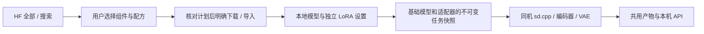

# SDXL、SD 1.5 / SDXL LoRA 与 LCM-LoRA：真实训练资产验证

[English](SD_VARIANTS_TRAINED.en.md) · [扩散使用](DIFFUSION_ENGINE.md) · [HF 组件选择](HF_RECIPES.md) · [独立适配器](ADAPTERS.md) · [编号交付与全部待办](releases/v0.3.0-dev.24-sd-variants.md)

这批工作验证同一套生产扩散引擎能否执行完整 SDXL，以及两种基础架构的真实 LoRA / LCM-LoRA。开发测试在原生 Windows CPU 上运行，采用 App 中未修改的 C++ 和 Java 实现。它们不是 Android 实测、手机速度、画质验收或完整 v0.3.0 验收。APK 继续为 dev.24 / code 28；本轮只增加开发工具、数据清单、证据与文档。

## 1. 用户如何选择和管理

App 更新基座；用户决定是否取得模型。安装、升级、浏览、声明配方以及缺少组件的任务都不触发模型下载。所有生成、分词、双编码器、扩散与 VAE 解码最终都必须在同一 Android 手机上执行，无 ROOT、外部推理或隐式回退。

1. 在“模型 → 全部 / 搜索”打开所需 HF 仓库，“选择文件 → 构建模型包 / LoRA 配方”。完整 SDXL 选择 `SDXL · 完整 checkpoint`；普通风格适配器选择对应 SD 1.5 / SDXL LoRA；LCM-LoRA 使用专用模板。
2. 按下表选择固定文件，核对版本、哈希、许可和完整依赖。完整 SDXL 文件包含两套 CLIP / UNet / VAE，仍需要独立的 `clip_merges`；分离 diffusion 文件必须补齐完整编码器和 VAE，不能冒充完整 checkpoint。
3. “加入本地并查看下载计划”只登记元数据。核对计划后单独下载，或明确选择文件夹导入；文件目录按计划中的导入路径摆放，同名跨仓库文件按角色区分。在“本地”统一暂停 / 续传、更新 / 回退、独立参数和删除；不需要把本轮全部模型都装上。
4. LoRA 是平级生图适配器记录，带 `task:image`、`kind:adapter`、`dependency:base_model`，并有架构 / 引擎 / 后端 / 格式标签。点击配对使用时明确选择兼容且已安装的基础模型；基础模型缺失时不自动下载。
5. 参数跟着模型走。基础模型保留自己的尺寸 / 步数 / CFG / 线程 / 种子；每个 LoRA 独立保存强度。编辑框支持预设和直接输入，超限回填该条目的最高边界。普通 LoRA 的应用保护范围是 −4 到 4；本轮 LCM-LoRA 配方为 0.1 到 2，不能把应用保护值说成模型训练极限。



普通模型不因为可执行或导入成功而获得“无审查”标签；该标签仍按原有独立作者依据管理。推荐继续保持 `m08 → m06 → m01`。附带的五份 [JSON 清单](../research/sd_variants_trained/manifests)供开发复现和格式参考；普通用户采用上述现有 HF 组件选择流程。清单只声明本次固定基础模型的配对身份，通用模板仍允许用户核对其他同架构配方。

## 2. 固定资产与许可范围

| 编号 | 角色 / 来源 | 完整字节数 | 固定版本 |
| --- | --- | ---: | --- |
| A01 | [genai-archive SDXL Base 1.0 Q4_0](https://huggingface.co/genai-archive/stable-diffusion-xl-base-1.0-gguf)，`sd_xl_base_1.0.q4_0.gguf` | 2,598,039,488 | `a02cea32a07b564a566d323785c853f1f545c04c` |
| A02 | [PixelArtRedmond SD 1.5](https://huggingface.co/artificialguybr/pixelartredmond-1-5v-pixel-art-loras-for-sd-1-5)，`PixelArtRedmond15V-PixelArt-PIXARFK.safetensors` | 27,216,848 | `eb7c3bfe0c48e7fadd635a0cfb25c29b428c4e63` |
| A03 | [nerijs Pixel Art XL](https://huggingface.co/nerijs/pixel-art-xl)，`pixel-art-xl.safetensors` | 170,543,052 | `8bf4a4d9ea283e00a51fafda8e0539f8248ea037` |
| A04 | [LCM-LoRA SD 1.5](https://huggingface.co/latent-consistency/lcm-lora-sdv1-5)，`pytorch_lora_weights.safetensors` | 134,621,556 | `cf2fced511dbe7e26c8d1d397e728fbab875db4b` |
| A05 | [LCM-LoRA SDXL](https://huggingface.co/latent-consistency/lcm-lora-sdxl)，同名文件独立存储 | 393,855,224 | `a18548dd4956b174ec5b0d78d340c8dae0a129cd` |

五个新对象合计 **3,324,276,168 字节**。沿用[既有 SD 1.5 Q4_0 与 CLIP merges](SD15_TRAINED.md)，七个唯一对象合计 **4,891,569,203 字节**；这只是开发覆盖集合，不是用户必装集合。每文件 URL、SHA-256、原作者与固定模型卡见[资产锁](../research/sd_variants_trained/assets.json)。取得器按 SHA 分目录，避免两个同名 LCM 文件混用；只在显式 `--download` 时下载，保存部分文件身份、遵守服务端重试等待并验证整个文件。

SDXL 文件头含 **2,641 张量**、两套 `[768,49408]` / `[1280,49408]` CLIP token embeddings、完整 UNet 和 VAE；同时由生产 worker 根据实际张量识别基础架构。LoRA 逐个检查完整 safetensors 头、形状、类型、连续数据范围与整体哈希。导出的是结构元数据，不含张量值。

量化仓库的许可元数据是 CreativeML OpenRAIL-M，[原始 SDXL](https://huggingface.co/stabilityai/stable-diffusion-xl-base-1.0)标记 OpenRAIL++，两者分别记录；量化者元数据不能替代原模型条款。PixelArtRedmond 使用其 bespoke LoRA 许可；Pixel Art XL 标记 CreativeML OpenRAIL-M；两套 LCM-LoRA 标记 OpenRAIL++。这些是发布者声明，完整逐组件许可审查仍未关闭，LMA 不将其统一改称 MIT。原始权重不进入 Git / APK / 源码附件。

## 3. 主机检查与实测

原生测试直接运行生产 `native/sd_worker.cpp` / `vocab_external.cpp`，使用固定 sd.cpp `be486498…` / ggml `a5915eb0…`；仅父进程生命周期部分使用原生 Windows 端口。每次推理都重新打开完整基础模型和选中的实际适配器，外部词表来自用户资产，不是下载包装或伪造图像协议。

标准对照为 512×512、8 Euler / discrete 步、CFG 7、seed 42、6 CPU 线程。每个架构比较无 LoRA、风格强度 0、强度 1；同时跑 4 步 LCM / CFG 1、LCM 加风格、实际采样第 1 步后的取消与恢复。SDXL 另有不同提示词和 1024×1024 的 4 步 LCM 输出。低步数标准对照用于执行和差异检查，不替代完整画质测试。

视觉复核已发现，本轮 SD1.5 的 8 步标准样例有大面积色块、主体不清，4 步 LCM 样例较粗糙，LCM 加风格的样例更出现严重色块与主体丢失。SDXL 的 512 / 8 步基础样例可见蓝色容器和杯具，但未清楚呈现要求的狐狸。这些样例未满足画质要求。强度 0 与无适配器一致、启用后像素变化只证明执行 / 生效，后续仍需按正常步数与模型建议尺寸补测提示词跟随、主体、颜色和伪影。此前 20 步茶壶 / 帆船样例使用了不同提示词，不作为本次同条件质量修复证据。

SDXL 的风格强度 1 图能辨认出像素狐狸和蓝色杯状物，与基础图的外观明显不同；但杯状物没有可靠满足茶壶要求，桌面等细节仍需复核。这是实际风格变化的观察，不是把所有输出统一判为合格。

SDXL 的 1024×1024 / 4 步 LCM 原生尺寸样例能辨认出狐狸、带壶嘴的蓝色茶壶和木质背景，比本次 512 低步数样例更符合主要主体要求。边缘涂抹、贯穿画面的条纹和其他提示词细节仍需复核；一张较好的样例不关闭完整画质验收，也不替代手机资源测试。

LCM-LoRA 的任务快照固定 `sampler=lcm`、`scheduler=lcm`、CFG 1、1–8 步，并记录调整；保存的基础模型设置不被改写。必须清空负面提示词，不能用普通适配器名称隐式开启 LCM，或叠加两个 LCM 加速来源。此策略与[作者的低步数使用说明](https://huggingface.co/latent-consistency/lcm-lora-sdxl)分别记录，本轮不把 LCM-LoRA 等同于完整 LCM checkpoint 或 SD-Turbo。

另做两个仅供开发的反事实对照：基础模型、提示词、种子、LCM 步数 / 采样器 / 调度保持一致，只将同一完整 LCM-LoRA 的强度从 1 改为 0，检查实际训练权重是否改变输出。App 会拒绝强度 0 的 LCM 任务；该原生诊断不是新增用户配方或建议设置。

| 实际任务 | 尺寸 / 步数 / CFG | 含加载耗时（秒） | 采样观察峰值工作集（MiB） | PNG SHA-256 前 12 位 |
| --- | --- | ---: | ---: | --- |
| `sd15-base-a` | 512×512 / 8 / 7 | 192.225 | 1620.7 | `aabdd638176e` |
| `sd15-style-zero` | 512×512 / 8 / 7 | 242.467 | 1659.3 | `aabdd638176e` |
| `sd15-style-one` | 512×512 / 8 / 7 | 235.373 | 1659.6 | `f0a700c1b105` |
| `sd15-lcm-a` | 512×512 / 4 / 1 | 200.691 | 1702.1 | `c1a14c2da91e` |
| `sd15-lcm-style` | 512×512 / 4 / 1 | 256.379 | 1731.3 | `9e7da71e7947` |
| `sd15-lcm-recovery-a` | 512×512 / 4 / 1 | 161.417 | 1702.5 | `c1a14c2da91e` |
| `sdxl-base-a` | 512×512 / 8 / 7 | 686.094 | 2596.5 | `84ee117a6935` |
| `sdxl-style-zero` | 512×512 / 8 / 7 | 549.876 | 2778.0 | `84ee117a6935` |
| `sdxl-style-one` | 512×512 / 8 / 7 | 632.062 | 2777.1 | `e4469a991d88` |
| `sdxl-lcm-a` | 512×512 / 4 / 1 | 304.357 | 2937.0 | `ee7e1aa78ec5` |
| `sdxl-lcm-style` | 512×512 / 4 / 1 | 270.456 | 3108.0 | `4f5d862f813e` |
| `sdxl-lcm-recovery-a` | 512×512 / 4 / 1 | 265.255 | 2940.2 | `ee7e1aa78ec5` |
| `sdxl-base-b` | 512×512 / 8 / 7 | 597.388 | 2596.2 | `b790cca5911e` |
| `sdxl-lcm-native-resolution` | 1024×1024 / 4 / 1 | 1061.154 | 3253.8 | `814eebf5ce2a` |

另外两个 LCM 强度 0 诊断保持所有其他参数不变，输出均与强度 1 不同：

| 原生诊断，不是 App 配方 | 尺寸 / 步数 / CFG | 含加载耗时（秒） | 采样观察峰值工作集（MiB） | PNG SHA-256 前 12 位 |
| --- | --- | ---: | ---: | --- |
| `sd15-lcm-zero-diagnostic` | 512×512 / 4 / 1 | 170.834 | 1702.8 | `0847ab984123` |
| `sdxl-lcm-zero-diagnostic` | 512×512 / 4 / 1 | 205.336 | 2940.0 | `611f3751a81a` |

主专项为 **14 PNG + 6 实际错误 + 2 采样取消 + info**，23 个原生子进程 / 协议流；9 个零强度 / 生效 / 提示词 / 恢复关系成立。两个 LCM 权重反事实另计 2 PNG / 2 原生子进程。采样第 1 步后终止到退出观察：sd15-lcm-cancel-step1: 0.803 s; sdxl-lcm-cancel-step1: 0.594 s。

Java 为 **231 项检查 / 5 条生产 HF 配方构建 / 7 唯一对象 / 8 实际子进程 / 4 PNG / 0 网络调用**；4 图逐字节等于对应直接原生组合图。独立原始复核的“文件 / 直接协议流 / PNG / 完整训练原对象 / 完整导入对象 / 拒绝错误证据控制”计数为 **125 / 25 / 20 / 7 / 7 / 9**。25 个直接协议流包含 info 和诊断，不代表 25 个成功生图。

耗时包含加载、推理和解码；工作集每 20 毫秒观察本次拥有的 Windows 子进程，不是独占基准、Android / Z20 内存或 GPU 显存，取消延迟也不代表 Android 行为。完整数值和 64 字符哈希见公开 JSON。

生产 Java 检查先通过随 App 分发的 `RecipeCatalogue` 构建五条实际文件选择，再使用 `BundleTransfers`、`BundleStore`、`SdEngine`、`NativeWorker` 完整导入七对象 / 六条独立记录。覆盖真实组件身份、按角色区分的导入路径、不提升推荐 / 无审查 / 手机证据、两个不兼容基础架构的拒绝、模型参数归位与隔离、适配器组引用、请求快照、真实原生错误 / 清理 / 恢复及重启保留；开发 JSON 参考不代表新增 UI 导入功能。Java 取消发生于生产 worker 的 generating 阶段入口；直接原生检查才在实际采样第 1 步之后终止。不能把这两种控制或 Windows 强制终止当成 Android 协作式取消验收。

Windows 文件系统端口只检查元数据关闭后的原子替换、有界共享冲突重试与普通重启保留。这个功能性端口不对元数据执行介质同步，也不验收断电持久化或 Android `AtomicFile`；生产持久化代码、完整模型文件的同步与整文件校验保持执行。早期的 300 秒导入等待到期、旧 Windows 文件替换端口的一次元数据提交失败，以及同步写盘等待均保留原始记录。参数比较先使用持久化后的 JSON 数字表示，修正将 `7` 与 `7.0` 误判为设置改写的测试比较器；单独参数核对确认两架构的保存值未变。最终检查重新完整导入，未通过预放对象绕过生产校验。大文件导入等待每条配方上限为一小时，这不是手机速度或存储可靠性结论。

原始请求、stdout / stderr、子进程状态、PNG 和内存采样保留在忽略的 `build/`，独立复核逐文件 SHA / 原始协议 / 输出内容，并测试错误提升质量 / Android / Release 标记是否会被拒绝。公开[取得](../verification/development/sd-variants-assets.json)、[真实推理](../verification/development/sd-variants-trained.json)、[Java 接入](../verification/development/sd-variants-app-host.json)、[原始复核](../verification/development/sd-variants-capture-audit.json)范围分开。

## 4. 实际图片与演示媒体


[MP4: labelled actual-PNG still slideshow](media/development/sd-variants-trained-slideshow.mp4) · [Media hashes and scope](media/development/sd-variants-trained-media.json)

| Actual native job | Byte-identical original | Dimensions |
| --- | --- | --- |
| `sd15-base-a` | [PNG](media/development/sd-variants-sd15-base-a.png) | 512×512 |
| `sd15-style-zero` | [PNG](media/development/sd-variants-sd15-style-zero.png) | 512×512 |
| `sd15-style-one` | [PNG](media/development/sd-variants-sd15-style-one.png) | 512×512 |
| `sd15-lcm-a` | [PNG](media/development/sd-variants-sd15-lcm-a.png) | 512×512 |
| `sd15-lcm-style` | [PNG](media/development/sd-variants-sd15-lcm-style.png) | 512×512 |
| `sd15-lcm-recovery-a` | [PNG](media/development/sd-variants-sd15-lcm-recovery-a.png) | 512×512 |
| `sdxl-base-a` | [PNG](media/development/sd-variants-sdxl-base-a.png) | 512×512 |
| `sdxl-style-zero` | [PNG](media/development/sd-variants-sdxl-style-zero.png) | 512×512 |
| `sdxl-style-one` | [PNG](media/development/sd-variants-sdxl-style-one.png) | 512×512 |
| `sdxl-lcm-a` | [PNG](media/development/sd-variants-sdxl-lcm-a.png) | 512×512 |
| `sdxl-lcm-style` | [PNG](media/development/sd-variants-sdxl-lcm-style.png) | 512×512 |
| `sdxl-lcm-recovery-a` | [PNG](media/development/sd-variants-sdxl-lcm-recovery-a.png) | 512×512 |
| `sdxl-base-b` | [PNG](media/development/sd-variants-sdxl-base-b.png) | 512×512 |
| `sdxl-lcm-native-resolution` | [PNG](media/development/sd-variants-sdxl-lcm-native-resolution.png) | 1024×1024 |
| `sd15-lcm-zero-diagnostic` | [PNG](media/development/sd-variants-sd15-lcm-zero-diagnostic.png) | 512×512 |
| `sdxl-lcm-zero-diagnostic` | [PNG](media/development/sd-variants-sdxl-lcm-zero-diagnostic.png) | 512×512 |

原始 PNG 逐字节复制，无重编码；联系图只是排版，1024 原图预览会缩小。GIF / MP4 是明确标记的静态图片轮播，不是 App / 手机录屏或实时生成速度。原[68 张 UI 夹具截图与录屏](DEVELOPMENT.md)保留其原始范围，本轮没有产品界面改动。

## 5. 复现和剩余验收

在仓库内使用本机 Windows Python / MSVC，不使用 Docker / WSL / 虚拟机 / 模拟器：

```powershell
python tools/sd_variants_manifests.py
# 可选，明确取得开发验证资产；普通检查和 App 均不会调用此命令。
python tools/fetch_sd15_trained.py --download
python tools/fetch_sd_variants_trained.py --download
python tools/test_sd_variants_trained.py
python tools/test_sd_lcm_effect.py
python tools/test_sd_variants_app_host.py
python tools/check_sd_variants_trained_evidence.py
python tools/render_sd_variants_trained.py
python tools/export_development.py
python tools/check_repository.py --development
```

网络需要时，两个显式取得命令可选择 `--origin https://hf-mirror.com`；固定版本、长度与整体 SHA 不变，镜像只用于公开资产下载。推理和检查不会访问网络。取得、主机构建、生成、Java 文件系统端口与 Android 执行是不同证据层。

已有通过校验的 SD1.5 开发资产可直接复用；取得命令会生成自己的回执，改变来源选项后也需同步重做依赖该回执的旧专项。完整开发导出 / 仓库审计要求其他全部当前专项记录也已准备好，上述命令不是完整 Release 的一键构建脚本。

02 / 03 / 05 的同机 Android、画质、资源适配仍未验收。03 中独立 SD-Turbo 和 LCM checkpoint、其他全部冻结模型、旧 LTX 六项数值失败与后续候选失败、每模型 3 次装卸 / 15 分钟锁屏 / 1 小时 API / 升级 / A1–A11 和 R01–R05 继续属于同一个完整 v0.3.0。Stable Audio [原模型](https://huggingface.co/stabilityai/stable-audio-open-small)及[匹配 TFLite 发行包](https://huggingface.co/innermost47/stable-audio-open-small-tflite)需 HF 授权，当前完整训练资产仍未取得。完整待办见[编号交付](releases/v0.3.0-dev.24-sd-variants.md)，不以这些主机证据发布缩减 Release。
