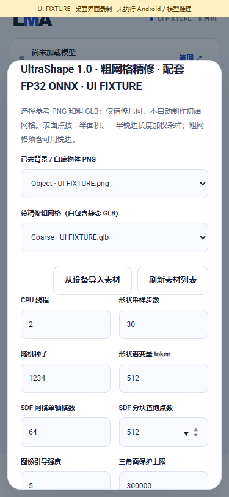

# Hunyuan3D 形状与 UltraShape 精修

开发源码 v0.3.6 已另增独立 [Paint / PBR 路线](LOCAL_MATERIALS.md) 和 [F5 官方兼容前端](F5_FRONTEND.md)；最新缺口见[完整编号清单](REMAINING_ADAPTATION.md)。下文 v0.3.5 数量、旧缺口与证据保留为当时记录，形状 / 精修配方本身仍不包含 Paint。

[English](SPATIAL_SHAPE.en.md) · [编号实现与缺口](IMPLEMENTATION_V035.md) · [v0.3.5](releases/v0.3.5.md)

LMA v0.3.5 新增两条平级、可选的本机 CPU 路线：Hunyuan3D 2.1 从参考图片生成几何，UltraShape 1.0 用参考图片精修已有粗网格。两者复用 `spatial_ort`，通过配套 FP32 ONNX 执行，输出无贴图 GLB。App 更新只提供程序；模型、词表、图片和网格均由用户选择。

## 1. 精确支持范围

| 配方 | 输入 | 能力与基座标签 | 不包含的流程 |
| --- | --- | --- | --- |
| `hunyuan3d_21_shape_onnx_cpu_v1` | 一张 RGB / RGBA PNG | 生 3D、image_to_3d、image_conditioning、sdf_geometry、spatial_ort、cpu | 独立的 Hunyuan3D Paint、自动抠图 |
| `ultrashape_1_refine_onnx_cpu_v1` | 参考 PNG＋自包含静态粗 GLB | 生 3D、mesh_refinement、coarse_mesh_conditioning、image_conditioning、sdf_geometry、spatial_ort、cpu | 自动生成初始粗网格、贴图 |

没有已核实的公开配套完整 ONNX 下载包。因此这两项是**自选转换 / 导入配方**，不冒充一键可下载模型，也不改变现有 82 个目录包。原始 `.pt` / `.ckpt` / `.safetensors` 不能直接交给 Android 引擎。普通 HF 搜索仍可查找其他模型，是否可执行取决于架构、格式、组件和资源，不能仅看扩展名。

所有模型平级；推荐 `m08 → m06 → m01`、原有文本、F-01–F-12、01–14／16／17、社区、语音、单图和四视图路线保留。NSFW、Uncensored、功能和安装状态各自标记；不从 Hunyuan / UltraShape 的架构名称推断内容分级。

## 2. 用户操作闭环

1. 用户取得符合原许可的本地模型和配置。先执行下节的离线资产转换，得到一套匹配文件。转换电脑只是准备资产，不参与手机上的推理；App 没有远端执行入口。
2. 把导出目录复制到手机。在模型清单入口导入 `lma-bundle.json`，逐一选择其组件文件。LMA 检查实际字节数和 SHA256；只导入 JSON 不等于权重已经安装。
3. 在“模型 → 本地”找到新模型。用户独立管理导入、暂停、删除和参数，App 不自动下载、加载或替换已有权重。
4. 导入已去背景或白底的参考 PNG。UltraShape 还必须导入待精修 GLB；可以使用自己持有的网格或已有本机任务的结果，不会自动调用其他模型生成粗网格。
5. 点击“使用”，按该模型编辑步数、tokens、SDF 格数等。可编辑预设与输入框共用逐模型 schema，超过上限自动归位；导出配置的 `maxTokens` 进一步限制本模型。
6. 先预检、保存草稿。对尚无设备记录的模型，用户自行明确允许尝试后加入共用队列。缺输入时不提交；预检不启动推理。
7. 查看图片编码、形状采样、SDF 与网格导出阶段，按需取消。成功 GLB 经校验后才进入结果库；可预览、导出或再次作为本地素材。失败 / 取消不提交半成品，等待子进程退出后清理私有执行目录。

后台沿用 Android 前台服务、通知与任务恢复机制；系统仍可限制进程。此处没有 Z20 内存、速度、模型质量或锁屏耐久的实测承诺。

## 3. 离线资产转换

开发工具使用原生 Windows Python / PyTorch；不调用 Docker、WSL、VM 或 Android 模拟器。检查环境为 Python 3.13、PyTorch 2.14.0 CPU、transformers 4.57.6、diffusers 0.35.1、einops 0.8.1、ONNX 1.19.0、safetensors、PyYAML、NumPy / Pillow；图对照使用主机 ORT 1.24.3。预处理检查另用 OpenCV 4.12.0.88、trimesh 4.8.3，均不属于模型文件。

```powershell
# 仅取固定的源码 / 配置 / 许可；不下载权重、不执行上游安装脚本
python tools/fetch_spatial_sources.py --fetch
python tools/fetch_spatial_sources.py

# 路径仅为用户自行准备的资产示例
python tools/export_spatial.py --pipeline hunyuan3d_21_shape --config E:/my-assets/hy3d/config.yaml --checkpoint E:/my-assets/hy3d/model.safetensors --output E:/my-assets/hy3d-lma
python tools/export_spatial.py --pipeline ultrashape_1_refine --config E:/my-assets/ultra/infer_dit_refine.yaml --checkpoint E:/my-assets/ultra/model.pt --image-config E:/my-assets/dino/config.json --image-snapshot E:/my-assets/dino --output E:/my-assets/ultra-lma
```

输出目录必须全新。DINO 配置已在 YAML 内时无需 `--image-config`；主 checkpoint 已含完整 conditioner 时无需 `--image-snapshot`。后者只能指向已有的本地 safetensors 快照，禁止隐式联网和 pickle 回退。PT / CKPT 只允许 `torch.load(weights_only=True)` 读取的纯 tensor 字典或一层嵌套字典；其他训练对象须用户另行明确转换。

转换器检查固定模型 target，不按用户配置动态导入代码，不执行任意上游安装器。模型和图保持 FP32 / opset17，保留全部专家权重；它不是任意 ONNX、其他架构、FP16 或量化格式的通用转换器。导出会执行虚拟输入前向计算；本轮只做随机小网络检查，**没有执行完整训练 checkpoint 的导出或推理**。大模型转换的 RAM、磁盘、图尺寸和时间仍可能超限。

| 必需组件角色 | 文件 |
| --- | --- |
| config | `spatial-config.json` |
| image_encoder | `image_encoder.onnx` |
| flow | `flow.onnx` |
| cache | `cache.onnx` |
| query | `query.onnx` |

每个实际生成的同名 `.onnx.data` 也必须导入，角色为对应 `_data`。额外生成 `lma-bundle.json` 和 `export-receipt.json`，清单记录本次文件的真实大小 / SHA256 和空 URL，不能用其他导出批次的同名文件替换。

## 4. 执行与数学边界

固定源码：[Hunyuan3D 2.1 82920d6](https://github.com/Tencent-Hunyuan/Hunyuan3D-2.1/tree/82920d643c0dc2f7bfd7255f45f62d386edfe60c)、[UltraShape 5e8dcef](https://github.com/PKU-YuanGroup/UltraShape-1.0/tree/5e8dcef05df101ab00ab6cd5fdd0ed0c74fbca66)。[逐文件源码锁](../third_party/spatial-shape-source-lock.json)同时锁定对照用的 UniForge / SAM 稀疏规则；原许可与模型、每个文件条款分别适用，仓库许可不覆盖模型的附加限制。

```text
参考 PNG → alpha 包围框 / 面积缩放 / 居中 / 白色合成 → DINOv2
UltraShape: 粗 GLB → 场景变换 → 归一化 → 面积＋锐边采样 → FP16 舍入 → 占据体素
  → HunYuanDiTPlain 或 RefineDiT（voxel RoPE、MoE、逐步 CFG）
  → 缩放 / post_kl / VAE transformer cache → 分块 SDF query
  → 有界均匀网格 marching tetrahedra → 自包含 GLB
```

- Hunyuan 对应实际发布配置的 `HunYuanDiTPlain`，不混用相邻文件中的另一种 DiT。UltraShape 对应 `dit_mask.RefineDiT`，保留 voxel 条件与 masked image tokens。
- MoE 保留 top-k **未再归一化**路由概率与 shared expert。CPU 依次计算各专家的输出并按原路由合成；没有把 MoE 换成平均模型，全部专家权重仍需存放，可能非常慢。
- sigmas 按固定源码从 0 向 1 排列并使用 shift；状态更新为 `(sigma_next - sigma_now) * velocity`。不能套用 RF Shape 路线的相反方向。CFG 的条件 / 无条件预测分开执行，0 / 1 引导也保留原步骤。
- UltraShape 保留其特殊 cross-attention KV 打包、mask 的 nearest / max-pool 与有效行选择；FP32 小图已逐项对照。
- 粗网格表面点一半按三角形面积、另一半按原规则检测的锐边长度采样；保留重复有向边的权重，点坐标先经 FP16 舍入，再体素化。直接从分布采样以减少上游大中间池内存；随机流不追求 NumPy / Torch 逐位一致。
- 锐边计算使用角度加权共享顶点法线。GLB 应提供连接正确的三角网格；不自动焊接不相连的重复顶点、重拓扑或修复网格。无可用锐边会失败，不自动退回其他精修算法。
- 每次只驻留一个阶段 ORT session；query 复用 VAE cache。均匀网格提取与上游 Flash / octree 不同，不声称复现原测评输出。

## 5. 参数、输入和资源

| 字段 | 默认 / 范围 |
| --- | --- |
| threads / steps / seed | 2 / 1–16；30 / 1–100；1234 / 0–2,147,483,647 |
| tokens | Hunyuan 4096、Ultra 8192；512 对齐；受实际导出 `maxTokens`、应用上限 32768 和 decoder 内存保护共同限制 |
| grid / queryChunk | 64 / 32–256，16 对齐；512 / 128–4096 |
| guidance / maxTriangles | 5 / 0–15；300000 / 1000–1000000 |
| meshScale（仅 Ultra） | .99 / .1–1；归一化半边长 |
| surfaceSamples（仅 Ultra） | 65536 / 1024–409600；面积 / 锐边总采样点数，奇数时面积多一个 |

参考图限 8-bit RGB / RGBA PNG、16 MiB、4,194,304 像素；不自动抠图。粗 GLB 限 256 MiB、一百万三角面、三百万顶点，必须静态、自包含；支持 scene 节点变换与镜像翻转，拒绝外部 buffer、skin、animation、morph、压缩 / sparse accessor、循环 scene 与越界数据。

格点数为 `(grid+1)^3`；tokens × queryChunk 不超过 33,554,432。上限是程序保护，不是 Z20 容量保证；缩小 queryChunk 不会减少 DiT 权重或全部专家内存。超限报错，不静默裁掉曲面。

## 6. 同一任务 API

先通过现有素材上传流程获得 PNG / GLB 的 artifact ID，选定实际已安装的导出 bundle ID。使用原有鉴权、幂等键、事件、取消与结果 API，不接受任意文件路径或远端执行地址。

```json
{
  "bundleId": "your_installed_ultrashape_export",
  "type": "mesh.generate",
  "input": {
    "prompt": "Generate local 3D geometry from the explicitly selected inputs.",
    "artifacts": [
      {"role": "reference_image", "artifactId": "your_imported_png"},
      {"role": "coarse_mesh", "artifactId": "your_imported_glb"}
    ]
  },
  "parameters": {"steps": 10, "tokens": 512, "grid": 32, "queryChunk": 256},
  "allowUnmeasured": true
}
```

`POST /v1/jobs` 提交，`GET /v1/jobs/ID` 查询；Hunyuan 仅保留 `reference_image`，选择对应 bundle。提示文本为固定操作说明，不是任意文本生成条件；不支持 negative prompt。`allowUnmeasured` 是用户尝试意愿，不改变资源 / 输入 / 模型检查。[上传详情](LOCAL_INPUTS.md) · [API](API.md)

## 7. 程序证据、媒体与未完成工作

| 编号 | 检查 | 证据 |
| --- | --- | --- |
| SP01 | 固定上游随机小网络，动态 latent / image tokens、cache / query、MoE、schedule；60 项 | [spatial-graphs.json](../verification/program/spatial-graphs.json) |
| SP02 | PNG / OpenCV / Torch 预处理、GLB、锐边 / FP16、实际 native worker 成功与失败、离线 CLI；188 项 | [spatial.json](../verification/program/spatial.json) |
| SP03 | 五个编译进 APK 的 CPU sparse custom op，真实导出 ONNX 在 native ORT 执行；109 项 | [spatial-sparse.json](../verification/program/spatial-sparse.json) |
| SP04 | Java 生产 adapter、存储、角色、schema、取消 / 清理；共用扩展 533 项 | [expansion.json](../verification/program/expansion.json) |
| SP05 | 20 个新页面检查，生产页面夹具、素材过滤、独立设置、预检、草稿和防重复提交 | [UI](../verification/program/ui.json) |
| SP06 | ARM64 / API28 / 16 KiB、原签名、依赖与包内容；不内置模型 | [spatial-android.json](../verification/program/spatial-android.json) |



[五张截图及哈希](media/development/spatial/manifest.json) · [GIF](media/development/spatial/spatial-ui.gif) · [MP4](media/development/spatial/spatial-ui.mp4)。媒体来自真实生产页面与明确模拟桥接，非 Android 真机或模型输出；浏览器在 finally 中关闭。

共用稀疏运算保留 UniForge 与 SAM 不同的池化分母、细分坐标顺序、spatial/channel 布局及 packed attention。它们**不等于**已经完成 UniForge、SAM、MV-SAM 或 SUPRA 的模型适配。D04 UltraTex、D05 UniForge、D07 Paint、D08 SAM、D09 MV-SAM、D10 SUPRA 仍有真实实现缺口；F5 中文前端仍未与完整官方分词 / 变调等价。见[完整待办](IMPLEMENTATION_V035.md)与[审计](../research/portability/audit-v0.3.5.json)。

按用户要求，本轮完整模型下载 / 复制 / 运行、Android 真机推理与耐久验证均不执行，不能标为通过。缺失的代码适配仍需继续开发，不能以省略模型验证为由视为完成。
