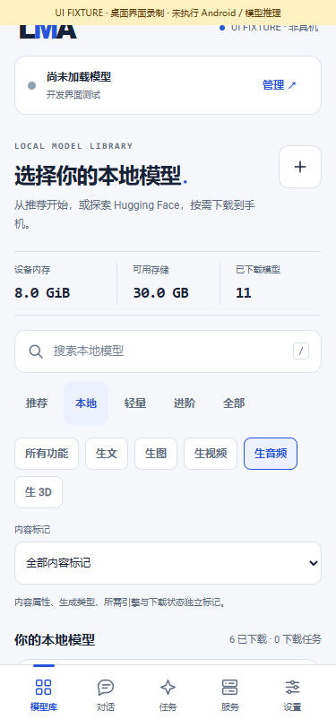
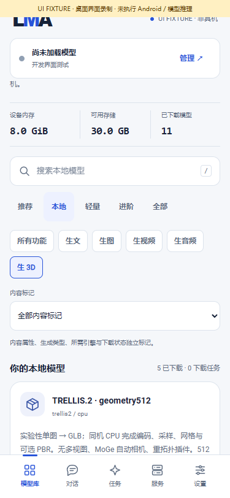
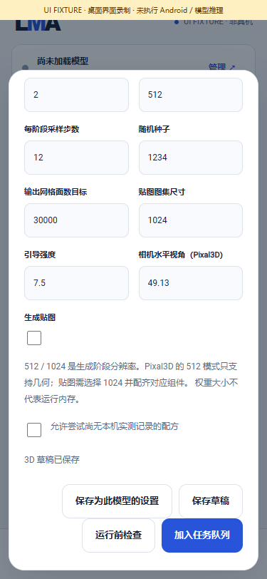
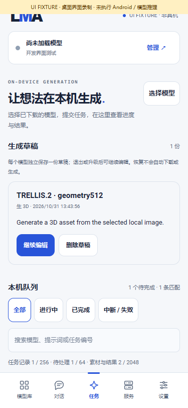
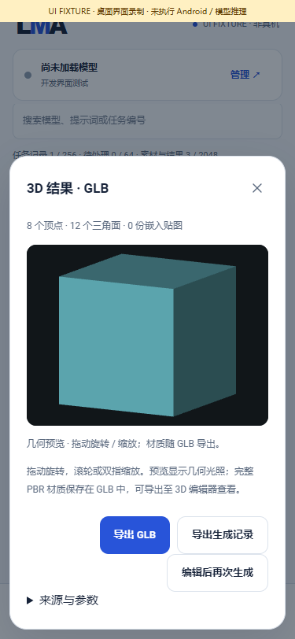

# Speech and local 3D in v0.3.2

> Development v0.3.6 implements the [official-compatible F5 segmentation / sandhi frontend](F5_FRONTEND.en.md) and separate [Hunyuan Paint / PBR](LOCAL_MATERIALS.en.md). See the [current numbered work list](REMAINING_ADAPTATION.en.md). Experimental frontend limitations and missing-port statements below belong to v0.3.2; they do not overwrite current implementations.

> This page records v0.3.2. v0.3.3 additionally integrates the actual D03 Pixal3D MV subset; see [the current guide and remaining architecture work](MULTIVIEW_DIAGNOSTICS.en.md). Old counts/evidence below retain their release context.

[中文](SPEECH_3D_EXPANSION.md) · [User guide](USER_GUIDE.en.md) · [API](API.en.md) · [Release notes](releases/v0.3.2.md)

This release extends the existing foundation with four speech families and single-image TRELLIS.2 / Pixal3D routes. Encoding, inference, decoding, mesh processing and export execute on the same Android phone. The APK supplies code; weights, voices, vocabularies, tokenizers and pronunciation dictionaries remain explicit user downloads or imports.

“Integrated” means the actual worker is compiled into the ARM64 APK and connected to components, settings, inputs, jobs and outputs. Following the user's instruction, this round verifies programs only: no complete model downloads, trained-model execution or physical Android tests. Integration does not establish quality, numerical parity, speed, peak RAM or lock-screen endurance.

## 1. The four requested speech families

| Number | Requested model | Current Android route | Format and scope |
| --- | --- | --- | --- |
| S01 | Kokoro PyTorch | Existing sherpa-onnx Kokoro, plus a matched optional INT8 bundle | Executes a matched ONNX export, not arbitrary raw `.pth`. The new bundle has an English frontend; a multi-lang repository name does not establish all-language support. Existing 54-speaker controls remain |
| S02 | MeloTTS Chinese | sherpa-onnx VITS/Melo Chinese, INT8 and FP32 bundles | ONNX, tokens, phones/tones lexicon and four normalization FSTs; a fixed Chinese speaker, not voice cloning |
| S03 | F5-TTS v1 Base | New `audio_cpp` CPU / `f5_v1` | Original v1 safetensors, Vocos and vocabulary; Chinese additionally uses two user-selected pronunciation dictionaries. Reference audio and its transcript are required |
| S04 | OmniVoice | New `audio_cpp` CPU / `omnivoice` | Integrated Q8 GGUF, or original safetensors with text tokenizer and audio codec; auto / reference-clone / voice-description parameters; complete WAV output |

Primary projects: [Kokoro](https://github.com/hexgrad/kokoro), [MeloTTS](https://github.com/myshell-ai/MeloTTS), [sherpa VITS](https://k2-fsa.github.io/sherpa/onnx/tts/pretrained_models/vits.html), [F5-TTS](https://github.com/SWivid/F5-TTS), [OmniVoice](https://github.com/k2-fsa/OmniVoice). A supported family does not make every similarly named repository or checkpoint compatible.

### 1.1 Optional download choices

The totals sum required components at pinned revisions. Shared assets can reduce actual transfers. Download bytes are not RAM requirements. Exact files, revisions, hashes and sources are in the [bundles](../catalogue/expansion-bundles.json) and [evidence](../catalogue/expansion-bundle-evidence.json).

| Number | Bundle ID | Required bytes | Notes |
| --- | --- | ---: | --- |
| S01a | `kokoro82_int8_57adb37` | 148,710,413 | INT8 ONNX with the existing voices, English lexicon and tokens; independent main-model identity |
| S02a | `melo_zh_int8_a0d5c6a` | 60,589,996 | Chinese INT8; model-specific speed, silence, noiseScale / noiseScaleW and threads |
| S02b | `melo_zh_fp32_a0d5c6a` | 177,502,116 | FP32 alternative; do not substitute it inside the INT8 bundle identity |
| S03a | `f5_tts_v1_base_84e5a41` | 1,413,398,722 | Original F5 v1, Vocos, vocabulary and character / phrase pronunciation resources |
| S04a | `omnivoice_q8_874fcb4` | 1,350,296,096 | One integrated GGUF; do not attach another family's codec |
| S04b | `omnivoice_original_c5fdb5c` | 3,267,439,234 | Original model, tokenizer, configs and audio codec in a fixed private layout |

Kokoro and Melo are the smaller choices here. F5 and OmniVoice still require large weights, codec work and intermediate activations; inclusion does not mean every phone can run them.

### 1.2 Inputs, frontends and licenses

1. **Kokoro:** keeps the existing English lexicon and speaker controls. Raw PyTorch files cannot become ONNX by renaming them. The main model's Apache-2.0 license does not replace separate shared-lexicon terms; the catalogue retains that review notice.
2. **Melo Chinese:** uses the phones/tones, longest-phrase lexicon actually read by the pinned sherpa implementation. An unused `dict_dir` is not counted as Chinese support. `date.fst`, `number.fst`, `phone.fst` and `new_heteronym.fst` are explicit dependencies alongside tokens. Model, dictionary and rule terms apply individually.
3. **F5 v1:** requires a **24 kHz mono PCM16 or float32 WAV, 1–12 seconds, at most 8 MiB**, and an accurate transcript. External character / phrase dictionaries provide longest-phrase matching and tone conversion for Chinese. Unknown characters or missing vocabulary fail explicitly instead of dropping text. Full parity with official Python segmentation, tone sandhi and every pronunciation rule has not been established; Chinese remains experimental. Code is MIT; F5 weights are **CC-BY-NC-4.0**; Vocos and pronunciation resources have separate MIT terms. [F5 weights](https://huggingface.co/SWivid/F5-TTS), [Vocos](https://huggingface.co/charactr/vocos-mel-24khz), [characters](https://github.com/mozillazg/pinyin-data), [phrases](https://github.com/mozillazg/phrase-pinyin-data).
4. **OmniVoice:** reference cloning likewise needs a transcript and the same WAV format, with **1–30 seconds** allowed. Design mode uses voiceInstruction; auto can omit a reference. “600+ languages” is an upstream claim, not a language-by-language result from this round. The worker produces a complete WAV; native incremental PCM and pseudo-streaming are not claimed. Code is Apache-2.0, weights CC-BY-NC-4.0, with codec terms applying separately. [Original](https://huggingface.co/k2-fsa/OmniVoice), [GGUF](https://huggingface.co/audio-cpp/audio.cpp-gguf).

F5 uses the original v1 architecture, without applying a Habibi dialect prompt or treating other F5 variants as equivalent. Vocos `.bin` is read by a restricted C++ tensor-storage parser; this introduces no Python pickle execution environment and is not arbitrary PyTorch-program support.

## 2. Audit of the requested RTX 3080 3D collection

The [collection](https://benchmark.sidcloud.cn/collections/3080-3d) contains **12 newer configurations and 4 older configurations, 16 records in total**, not 16 independent architectures. It does not contain a TripoSR case. Per-case URLs, downloaded source identities, project README identities and the corrected project link are preserved in the [audit](../research/expansion/benchmark-audit.json).

These are native Windows / RTX 3080 results. Success, failure, timing and installed-weight GB are not Android measurements. Texturing an existing mesh, refining a coarse mesh and multiview fusion are different tasks from single-image geometry generation.

| Number | Benchmark record / model | This release | Boundary or remaining port |
| --- | --- | --- | --- |
| D01 | `3d-20261030-TRELLIS2` / TRELLIS.2 | Single-image subset integrated | GGUF / CPU; 512 geometry with optional 512 / 1024 texture components. Not an exact port of the benchmark's workflow, normal / AO outputs or numerical results |
| D02 | `3d-20261030-Pixal3D` / Pixal3D | Single-image subset integrated | Geometry only at 512; optional textures at 1024. Manual camera FOV; no MoGe estimation |
| D03 | `3d-20261030-Pixal3D-MV` | Not integrated | Multiview fusion and camera conditioning are outside this single-image C++ route; separate single-image jobs are not MV support |
| D04 | `3d-20261030-UltraTex` | Not integrated | Existing mesh plus image to PBR textures; needs its own texture backend and mesh-input flow |
| D05 | `3d-20261030-UniForge3D` | Not integrated | The test covers four-view BF16 / 512 geometry; matched operators, exports and a multiview backend remain. No inferred 1024 / PBR claim |
| D06 | `3d-20261030-UltraShape1` | Not integrated | Geometry refinement requires a coarse input mesh and a separate refiner |
| D07 | `3d-20261030-Hunyuan3D21` | Not integrated | The benchmark covers geometry, not Paint texture acceptance |
| D08 | `3d-20261030-SAM3D` | Not integrated | Image, mask, depth and custom-operator port remains; vertex color is not UV / PBR |
| D09 | `3d-20261030-MV-SAM3D` | Not integrated | Depends on SAM and multiview fusion, with additional camera / mask processing |
| D10 | `3d-20261030-SUPRA-Tex` | Not integrated | Benchmark stack failed at dependencies including NATTEN / CuMesh / NVCC. That environment failure is not proof of permanent impossibility on every device |
| D11 | `3d-20261030-TripoSG` | Not integrated | Geometry route still needs matched exports, operators and reconstruction. A blue display material is not recovered model texture |
| D12 | `3d-20261030-PartCrafter` | Not integrated | Part generation needs its own worker and multipart outputs. The benchmark's project link returned 404; the canonical project was checked |
| D13 | `3d-TRELLIS2` / older | Same architecture subset as D01 | Old “passed” does not establish Android acceptance or exact vertex-color workflow parity |
| D14 | `3d-Pixal3D` / older | Same architecture subset as D02 | Does not count as another architecture or multiview support |
| D15 | `3d-TripoSG` / older | Not integrated | Same family as D11; older desktop geometry success does not remove the port |
| D16 | `3d-PartCrafter` / older | Not integrated | Same family as D12; three editable parts in the benchmark do not establish this APK's output support |

Primary projects: [TRELLIS.2](https://github.com/microsoft/TRELLIS.2), [Pixal3D](https://github.com/TencentARC/Pixal3D), [UltraTex](https://github.com/yiboz2001/UltraTex), [UniForge3D](https://github.com/xibushu/UniForge3D), [UltraShape](https://github.com/PKU-YuanGroup/UltraShape-1.0), [Hunyuan3D 2.1](https://github.com/Tencent-Hunyuan/Hunyuan3D-2.1), [SAM 3D Objects](https://github.com/facebookresearch/sam-3d-objects), [MV-SAM3D](https://github.com/devinli123/MV-SAM3D), [SUPRA-Tex](https://github.com/Supra-3D/SUPRA-Tex), [TripoSG](https://github.com/VAST-AI-Research/TripoSG), [PartCrafter](https://github.com/wgsxm/PartCrafter) / [paper](https://arxiv.org/abs/2506.05573). README and environment review is not a complete numerical operator audit of unported models.

### 2.1 Five current 3D download choices

| Number | Bundle ID | Required bytes | Output option |
| --- | --- | ---: | --- |
| D01a | `trellis2_geometry512_cpu_v1` | 2,626,483,168 | 512 geometry; textures off by default |
| D01b | `trellis2_pbr512_cpu_v1` | 4,202,445,664 | 512 geometry and textures |
| D01c | `trellis2_pbr1024_cpu_v1` | 4,932,966,240 | 512 early / 1024 later stages and textures |
| D02a | `pixal3d_geometry512_cpu_v1` | 6,623,961,632 | 512 geometry, manual FOV |
| D02b | `pixal3d_pbr1024_cpu_v1` | 13,020,618,336 | 1024 geometry and textures; these source flow files are large, not a lightweight phone starting point |

The backend uses the portable C++ / GGML single-image implementation in [trellis.cpp](https://github.com/pwilkin/trellis.cpp). Actual CPU encoders, flows, decoders, sparse geometry, simplification, UV and PNG material export are compiled. [TRELLIS GGUF](https://huggingface.co/ilintar/trellis2-gguf) and [Pixal3D GGUF](https://huggingface.co/vegax87/Pixal3D) have separate provenance. Shared encoders / decoders do not make their main models or licenses identical. Upstream component and conversion terms apply individually; the C++ backend's MIT license is not a blanket model license.

An optional BiRefNet component can be selected in a custom recipe; it is not included in the totals above. Without it, input alpha / threshold processing is used, so a transparent-background PNG is preferable. Pixal3D has no 512 texture flow: both UI and backend return that combination to textures off. Selecting 1024 or textures requires corresponding components; missing files cause preflight failure, never an automatic download.

The nubia Z20 is an example target, not a tested device this round. Encoders, flows, sparse intermediates, meshes and atlases need memory beyond weight files. Several GB of downloads do not establish that a 6 / 8 GB phone can execute the route. Upstream desktop CPU timing or RSS is not extrapolated into phone guarantees. Users may explicitly attempt unmeasured recipes; existing RAM, storage, thermal and cancellation checks continue to apply.

## 3. User workflow

### 3.1 Speech

1. Find a recipe in Models → All / search, review components and licenses, then explicitly download or import it. Installing or updating the APK chooses no model.
2. Open that model's settings in Local. Speed, speaker, steps, threads, duration protection and Omni language / voice description persist under its identity. Presets remain editable. Hard program limits clamp excessive input; application guards are distinguished from publisher capability limits.
3. Select Use and enter text. Import a matching WAV and transcript for F5; supply a reference or description for the selected Omni mode. Import stays on the device.
4. Review preflight, explicitly allow an unmeasured recipe when appropriate, then submit to the same local queue. Saving a draft generates nothing.
5. Open successful WAV output from tasks / artifacts, listen, and export audio and provenance. Empty or incomplete files are not published as successful outputs.

### 3.2 3D

1. Explicitly download one of the five choices, or associate matching GGUF components through the single-image 3D recipe.
2. Choose Local → 3D → Use. Import one object **PNG / JPEG, at most 16 MiB and 4,194,304 pixels**; refresh the list of previously imported images if needed.
3. Edit or select resolution, per-stage steps, seed, face target, atlas size, guidance, FOV and textures. Resolution is 512 / 1024, face target 1,000–150,000 and atlas 256–2048. These are this implementation's supported ranges, not theoretical model maxima. Simplification targets do not guarantee an exact triangle count for every topology.
4. Save model defaults independently, or save the current image and parameters as a revisioned draft. Restoring a draft requires fresh execution consent and does not queue work.
5. Preflight checks components, image, parameters and current resources without inference. Submit explicitly when ready. Repeated clicks send one queue request. Existing cancellation, retry and restart-interruption behavior applies.
6. Outputs are self-contained **GLB 2.0**, with vertex / triangle / texture counts, source identities and effective parameters. Drag to rotate; pinch or wheel to zoom. Preview uses geometric lighting; complete PBR materials are exported in GLB rather than presented as a PBR preview.
7. Preview reads at most 128 MiB and supports one million vertices / two million indices; larger files remain exportable. Closing or replacing the modal aborts reads and releases WebGL resources. Export provenance separately, or restore the input for an explicitly submitted new job.

All models remain peers. Task, engine / CPU, dependency, content-source and installation tags are independent. New families acquire no inferred NSFW label. Existing community labels and `m08 → m06 → m01` recommendations remain.

## 4. The same local API

Uses the existing `/v1/jobs/preflight`, `/v1/jobs`, events, cancellation / retry and `/v1/artifacts` routes. No remote inference address or external computing service is introduced. Authentication and idempotency rules stay the same. Obtain an `artifactId` with the [upload protocol](LOCAL_INPUTS.en.md), then construct:

```json
{
  "bundleId": "trellis2_geometry512_cpu_v1",
  "type": "mesh.generate",
  "input": {
    "prompt": "Generate a 3D asset from the selected local image.",
    "artifacts": [{"role": "reference_image", "artifactId": "REPLACE_WITH_IMPORTED_IMAGE_ID"}]
  },
  "parameters": {"resolution": 512, "texture": false, "steps": 12, "faces": 30000},
  "allowUnmeasured": true
}
```

The prompt is this image-conditioned route's fixed description, not text-to-3D input. Negative prompts are unsupported. Review preflight before explicitly posting to `/v1/jobs` with an `Idempotency-Key`. Set `allowUnmeasured` only after user consent; it neither downloads models nor bypasses hard missing-file errors.

F5 example:

```json
{
  "bundleId": "f5_tts_v1_base_84e5a41",
  "type": "speech.synthesize",
  "input": {
    "prompt": "Today we introduce local models.",
    "artifacts": [{"role": "reference_audio", "artifactId": "REPLACE_WITH_IMPORTED_WAV_ID"}],
    "transcripts": {"reference_audio": "The accurate text spoken in this reference recording."}
  },
  "parameters": {"steps": 32, "maxAudioSeconds": 30, "threads": 2},
  "allowUnmeasured": true
}
```

OmniVoice uses the same speech task, with `voiceMode` (auto / clone / design), `language`, `voiceInstruction` and `durationSeconds`. Target duration clamps against `maxAudioSeconds`. Neither new speech route claims incremental audio streaming in this release.

## 5. Implementation, rebuild and program cases

| Number | Production implementation | Verification scope |
| --- | --- | --- |
| P25a | `AudioCppSpec / MeshSpec / ExpansionEngine` | New bundle roles, formats, backends, independent defaults, hard limits, missing components and reference rules |
| P25b | ARM64 CPU workers and Melo frontend | Actual NDK builds; F5 longest phrase, tones, strict UTF-8 and OOV errors with tiny synthetic dictionaries |
| P25c | Process protocol and private layouts | Production Java `ExpansionEngine.generate` launches real host fixture children for F5, Omni GGUF / original, TRELLIS and Pixal; checks hardlinks, nested codec paths and cleanup |
| P25d | `GlbFile / ArtifactStore / glb-preview.js` | Synthetic GLB publication and restart reads, malformed / out-of-bounds / external-URI rejection and bounded preview; not model output |
| P25e | Pages and media | Production pages with an explicit simulated bridge: 32 added interaction checks, five screenshots, GIF / MP4; browser context closes afterward |

The [source lock](../third_party/expansion-source-lock.json) pins audio.cpp `4f5afb6…`, trellis.cpp `11b8732…` and its GGML `f8697b3…`. Fetching obtains code only. The audio build includes F5 / Omni CPU runtime libraries, not CLI / HTTP server / downloaders. GGUF family rules come from compiled application code, not arbitrary resource paths supplied by model metadata. Complete license notices have a separate new-engine viewer.

Continue the [full Windows-native build](BUILD.en.md) with JDK / MSVC / Android NDK:

```powershell
python tools/fetch_expansion_sources.py --fetch
python tools/build_expansion.py speech_extra
python tools/build_expansion.py mesh
python tools/build_tts.py
python tools/collect_expansion_notices.py
python tools/test_expansion.py
python tools/build.py
python tools/verify_package.py
python tools/test_android_lint.py
node tests/ui-smoke.cjs
node tools/capture_workbench.cjs expansion
```

Use each script's `--help` for current fetching options. Temporary owned ASCII path aliases are removed after builds; no Docker, WSL, VM or Android emulator is used. A release must also pass the existing suites required by the [current evidence](../verification/program/status.json), not only the added test.

## 6. Pages, recordings and remaining scope

All media below is **UI FIXTURE / desktop pages / no inference**. The cube is synthetic test geometry, not a TRELLIS or Pixal output.

| Speech choices | 3D choices | Task form |
| --- | --- | --- |
|  |  |  |

| Queue | Synthetic GLB preview |
| --- | --- |
|  |  |


[MP4](media/development/expansion/expansion-ui.mp4) · [Media hashes and 32 checks](media/development/expansion/manifest.json)

| Number | Remaining item | Status |
| --- | --- | --- |
| R01 | Trained speech quality, pronunciation and official numerical comparisons | Not executed under the program-only instruction; Chinese F5 frontend differences are explicit |
| R02 | Complete TRELLIS / Pixal execution, RAM, speed and PBR quality | Not executed; no Z20 or other physical Android acceptance |
| R03 | Multiview, other 3D architectures, parts, texture-only and refinement pipelines | Not integrated; see D03–D12 / D15–D16. Not advertised as runnable bundles |
| R04 | Physical lock-screen / background endurance and system termination behavior | Not tested; no remote substitute was introduced |
