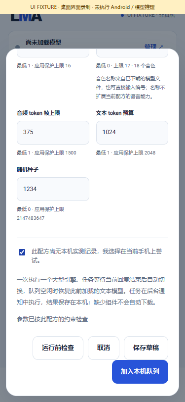
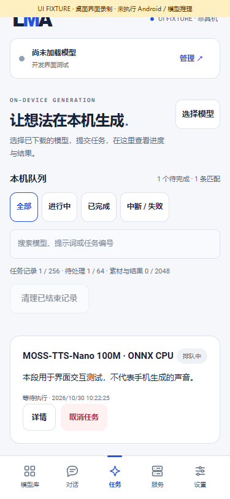

# 本地语音模型选择与音色设置

[中文](SPEECH_SELECTION.md) · [English](SPEECH_SELECTION.en.md) · [文档导航](README.md) · [版本与完整待办](releases/v0.3.0-dev.33.md)

dev.33 将 Nano 100M 完整方案加入“全部”，并让音色名称跟随用户下载的具体文件。App 仅提供基座、模型清单与运行代码，不附带权重、预设声音、提示音频码或音色表；安装、浏览和更新不会下载模型。

## 使用流程

1. 打开“模型 → 全部 → 生音频”，或使用 HF 搜索。保留原“推荐”顺序 `m08 → m06 → m01`。HF 发现结果仍需检查格式、架构、完整组件与设备资源，搜索可见不代表手机可运行。
2. 查看模型详情、许可、来源、全部所需组件及大小。Nano 的新清单 ID 为 `moss_nano_100m_onnx_catalogue_v1`，共 **11 个文件、717,414,286 字节**；包含模型、文本分词、音频 codec 及预设提示数据。点击下载只提交用户明确选择的整套模型请求；不下载其他模型。
3. 在“本地”管理下载、暂停 / 继续、导入、独立设置和删除。部分组件已有时可复用，但 App 不静默替换用户已有文件。旧导入 Nano ID `moss_nano_100m_onnx_f52645c_ceff0d0`、原配置及旧任务保留；新清单使用独立身份。
4. 完成相关文件下载后，模型设置和生成表单读取本地文件中的音色数量、名称。输入框可选择“编号 · 名称”、直接输入编号，或输入唯一的完整音色名称。大于实际或配方上限的编号自动归位；名称缺失时使用编号，元数据异常时明确显示配方范围待核对。
5. 生成时填写文本、检查所选模型的参数与设备提示，再明确提交。任务保存数字音色 ID 与参数快照，后续修改其他模型设置不会改写已提交任务。由共享本机队列生成 WAV，再使用已有的播放、导出及任务管理功能。

| 方案 | 固定文件中的音色 | 当前限制 |
|---|---|---|
| Kokoro 82M | 54 个名称，编号 0–53；该文件 **53 = em_santa** | 使用实际文件顺序；当前完整配方的英文词典不会因选择其他语言名称而变成多语言配方 |
| Piper Lessac | 1 个，编号 0；无命名表 | 显示编号，不编造名称 |
| Matcha LJS | 1 个，编号 0；无命名表 | 显示编号，不编造名称 |
| MOSS Nano 100M | 18 个，编号 0–17；名称来自本地 manifest 的 `display_name` | 不将 learned prompt codes 复制到 APK 或参数快照；语音质量、各语言与手机资源仍待验收 |
| Qwen3-TTS 0.6B Base | 不增加命名音色选择 | 保留现有参考音色条件能力；不冒充 CustomVoice / VoiceDesign；输出预算不等于已确认 EOS 或完整句子，历史短文本长输出质量问题仍待处理 |

名称是文件的显示信息，不构成声音身份、音质或语言支持的额外承诺。每个模型仍是平级条目，分别显示“生音频”、引擎依赖和内容标签。

## 基座实现

`LocalEngine.schema(bundle)` 统一向基座提供有效参数，既有文本和 LTX 使用原有约束，语音适配器增加本地元数据约束；队列和页面无需按具体模型 ID 新增分支。

ONNX 读取器用文件定位跳过 graph / tensor，只读取 `n_speakers`、`speaker_names`、`id2speaker`，限制字段数量、字符串长度、UTF-8、映射一致性及音色数量。不会为查看音色启动推理引擎或把整个模型载入内存。Nano 读取受大小限制的用户 manifest，仅将名称和数量用于显示；缓存最多 32 份名称 / 数量，文件路径、大小或修改时间变化后重新读取。

参数 schema 的数字 `choices` 是建议项，不是排斥其他合法数字的枚举。名称在界面展示，保存、API 和任务继续使用数字。App 同时验证重复 / 非法选项、数值范围及步长；实际文件数量只能收紧配方范围。错误或缺失数据不会发起下载或选择外部执行方式。

## 本轮证据与边界

生产 Java 测试覆盖异常 protobuf、非法 / 冲突映射、缓存失效、数字建议、上限、设置隔离及新旧 Nano 身份共存；并对三个已下载 ONNX 和 Nano manifest 做完整 SHA 核对后，用 **48 MiB JVM 堆**检查其真实名称 / 数量。最大 ONNX 为 325,560,556 字节。此结果是**文件元数据检查，不是模型推理或 Android 内存测量**。

[公开元数据检查](../verification/development/speech-voices.json) · [界面检查与媒体清单](media/development/speech/manifest.json) · [录屏 MP4](media/development/speech/speech-ui.mp4) · [GIF](media/development/speech/speech-ui.gif)。界面录制使用生产页面与明确模拟的桥接，下载、安装和排队状态是测试数据；没有实际下载或生成声音。本轮没有重跑旧训练模型，历史音频保留原证据范围。

| 可选语音模型 | 本地音色选择 |
|---|---|
|  |  |

| Nano 独立参数 | 冻结任务 |
|---|---|
|  |  |

当前仍是内部开发检查点。所有冻结模型的完整支持、实际质量与资源、三次加载、锁屏 15 分钟、API 一小时、升级 A1–A11 / R01–R05 和完整 v0.3.0 Release 门槛保留；没有物理手机，不能声称后台持续生成已验收。全部推理与媒体阶段仍必须在同一 Android 上完成，无 ROOT，无外部推理回退，无 ComfyUI 画布 / 用户节点 / 插件体系。
