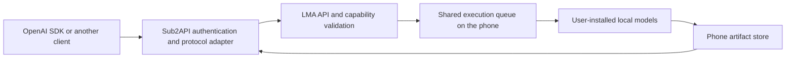

# LMA × Sub2API: OpenAI forwarding and scheduling contract

[中文](SUB2API_OPENAI.md) · [Current API](API.en.md) · [Machine-readable profile](proposals/sub2api-openai-profile.json) · [OpenAPI 3.1 draft](proposals/sub2api-openai.openapi.json) · [Draft validation](proposals/sub2api-openai-validation.json) · [Maintenance record](releases/v0.3.11-sub2api-design.md)

**Design only, checked 2026-11-01. This is not an implemented endpoint list.** The APK remains v0.3.11/code61. This change does not modify Android runtime code, the deployed Sub2API service, accounts, groups, billing, tags or release assets. The image/speech compatibility facade and gateway multimodal extensions remain unimplemented. The current working multimodal submission route is `POST /v1/jobs`; the proposed examples below require future implementation.

## 1. Direction and execution boundary

LMA is the OpenAI-compatible upstream. Sub2API authenticates callers, resolves public model aliases, admits requests, forwards traffic and tracks ownership. All tokenization, inference, decoding, media encoding and 3D processing execute on **the same Android phone**. LMA does not acquire an external inference provider. Users continue to choose, download, import and replace model assets explicitly.



Forwarding requires an already reachable phone. `127.0.0.1:8080` belongs to the phone itself; another machine needs the existing explicitly enabled LAN listener and an allowed destination. A publicly hosted gateway does not automatically gain access to the phone. This contract does not open public ports, create tunnels or install external execution nodes.

## 2. Source audit

The local deployment reference identifies Sub2API **v0.2.19**, published 2026-10-28. GitHub's latest-release query returned the same version during this review. The audited source is pinned to **`dece26153621959ccd7635814f4b2d08304e681a`**; all 15 downloaded source blobs matched its tree. Only public source and sanitized deployment metadata were reviewed. No deployment private directory, paid generation or live configuration change was needed. [Profile JSON](proposals/sub2api-openai-profile.json) records source identities and LMA file hashes. A deployment reference is not a fresh production-service acceptance test.

| ID | Source finding | Integration consequence |
| --- | --- | --- |
| F01 | OpenAI API Key accounts accept custom `base_url` and model mappings | Useful entry point; mappings alone do not enable every modality |
| F02 | Unknown Responses capability can select Chat→Responses conversion | LMA has no `/v1/responses`; use `extra.openai_responses_mode = force_chat_completions`, not Responses passthrough |
| F03 | Image validation checks client, routed and mapped upstream model families | Plain `lma-image-*` names are rejected; implement capability admission instead of mapping around validation or impersonating GPT models |
| F04 | No generic `/v1/audio/speech` route; voice routes such as `/tts` are Grok-specific | Add API Key speech forwarding and binary responses |
| F05 | Video create/status/content paths dispatch to Grok handlers | Ordinary OpenAI accounts cannot forward phone Wan/LTX; do not masquerade as Grok |
| F06 | No LMA jobs/uploads/artifacts or music/mesh extension | Add bounded routes and owner mappings, not an arbitrary-target proxy |
| F07 | `/v1/models` is built from account/group mappings and configuration | Not a live phone inventory; explicitly publish ready models and avoid default OpenAI names |
| F08 | Inspected request-header allowlist omits idempotency, event-resume and range headers | Define endpoint-specific header forwarding before claiming those behaviors survive the gateway |
| F09 | An asynchronous image wrapper and failure reselection already exist | Some infrastructure is reusable; this does not establish durable LMA bindings, cancellation or recovery for all modalities |

Pinned sources: [routes](https://github.com/Wei-Shaw/sub2api/blob/dece26153621959ccd7635814f4b2d08304e681a/backend/internal/server/routes/gateway.go), [image parsing/forwarding](https://github.com/Wei-Shaw/sub2api/blob/dece26153621959ccd7635814f4b2d08304e681a/backend/internal/service/openai_images.go), [Responses routing](https://github.com/Wei-Shaw/sub2api/blob/dece26153621959ccd7635814f4b2d08304e681a/backend/internal/pkg/openai_compat/upstream_capability.go), [model listing](https://github.com/Wei-Shaw/sub2api/blob/dece26153621959ccd7635814f4b2d08304e681a/backend/internal/handler/gateway_handler.go), [header allowlist](https://github.com/Wei-Shaw/sub2api/blob/dece26153621959ccd7635814f4b2d08304e681a/backend/internal/service/openai_gateway_service.go).

## 3. Compatibility profiles and routes

Compatibility is tested per declared endpoint, field, status code, content type and stream format. It does not mean every OpenAI product is implemented. Image JSON and speech binary responses follow the official [image](https://developers.openai.com/api/reference/resources/images/methods/generate) and [speech](https://developers.openai.com/api/reference/resources/audio/subresources/speech/methods/create) contracts. The official Videos API shut down on **2026-09-24**, as recorded in [deprecations](https://developers.openai.com/api/docs/deprecations); do not market a local video endpoint as a currently supported universal OpenAI API. No general official music/mesh generation endpoint was identified; use explicit LMA extensions.

| ID | Client-facing gateway route | Phone route/execution | Contract and status |
| --- | --- | --- | --- |
| P01 | `GET /v1/models`, `GET /v1/models/{model}` | Model registration; new detail/capability information | Standard model objects; improve publishing and readiness checks |
| P02 | `POST /v1/chat/completions` | Same path and shared execution gate | Existing text subset; currently requires the App-selected text model; alias selection remains pending |
| P03 | `POST /v1/images/generations` | New facade→`image.generate` | Proposed: synchronous `200`, `created` and `data[].b64_json` |
| P04 | `POST /v1/images/edits` | New bounded input adapter→`image.generate` | Proposed: only models with actual editing support; bounded multipart required |
| P05 | `POST /v1/audio/speech` | New facade→`speech.synthesize` | Proposed: audio bytes on success, never a job JSON object |
| P06 | `GET /v1/lma/capabilities` | New `GET /v1/capabilities` | Proposed: capabilities, parameters, sourced tags, readiness and evidence scope |
| P07 | `/v1/lma/jobs...` | Adapt identities/fields and map to native `/v1/jobs...` | Proposed async image/video/speech/music/mesh extension; submission `202` |
| P08 | `/v1/lma/uploads...` | Native `/v1/uploads...` | Proposed owner-bound chunked uploads; no caller-supplied local paths |
| P09 | `/v1/lma/artifacts...` | Native `/v1/artifacts...` | Proposed metadata and authenticated range downloads |
| P10 | `/v1/responses`, `/v1/videos`, Realtime | No current LMA compatibility facade | Not advertised; any historical-video profile must be separately declared |

P03–P09 are design targets, **not new live routes**. They belong to one integration work package. Preserve the six generation operations: `text.generate`, `image.generate`, `video.generate`, `speech.synthesize`, `audio.generate`, `mesh.generate`.

## 4. Model identities, capabilities and parameters

| ID | Normative requirement |
| --- | --- |
| R01 | Model objects expose stable `id/object/created/owned_by`; `x_lma` contains task/foundation/format/content-source tags, installation state, input roles, parameter schema and stream capabilities. OpenAI-shaped timestamps use Unix seconds, not native milliseconds. |
| R02 | Register `public_model → instance_id → bundle_id → operation`, with model/recipe versions and digests. Instance identity survives phone restart and changes after replacement/reset. An unchanged address is not an unchanged instance. Do not infer operations from names or dispatch by NSFW classification. |
| R03 | Preserve Recommended, All/HF search and Local management, with equal-peer models. Publish only explicitly shared models with complete assets and a registered runner. Discovery, installation, preflight, real output and accepted quality remain separate. |
| R04 | Current text requests require the App-selected model. Future selection by `model` must load the selected installed model inside the shared gate; never forward an unselected ID as if it already worked or trigger downloads. |
| R05 | Merge each model's saved defaults with request overrides, normalize to its limits, disclose adjustments and freeze the result/schema version. Requests do not change saved settings. Preflight and submission share one resolver. |
| R06 | Accept quality, voice, speed and related fields only when the adapter can implement them. Disclose size/step corrections; reject unsupported tools, masks, transparency, voices and streams instead of silently ignoring them. |

Use `platform=openai`, `type=apikey`, the phone destination and an independent upstream credential. A group contains only this phone; start with one heavy request at a time and preserve the shared UI/API gate. Publish real `lma-*` aliases. Do not mix OAuth/Grok accounts or allow arbitrary unknown models. This is a field-level illustration, not a complete admin import request:

```json
{
  "platform": "openai",
  "type": "apikey",
  "concurrency": 1,
  "credentials": {
    "base_url": "http://PHONE_ADDRESS:8080",
    "api_key": "<LMA_UPSTREAM_KEY>",
    "model_mapping": { "lma-image-selected": "lma-image-selected" }
  },
  "extra": { "openai_responses_mode": "force_chat_completions" }
}
```

SDK `base_url` points to the gateway's `/v1`; store the phone origin in the upstream account and let the URL builder append paths. Explicitly permit the intended private/HTTP destination through existing validation without disabling all target checks. Unknown aliases, incomplete models and changed instances fail explicitly.

Image LoRA selection uses public `model` aliases in facade `lma.adapters` or async `adapters`. Resolve each to a registered bundle, verify base compatibility and freeze effective scale. Do not accept caller-supplied internal bundle IDs or run LoRA independently. This does not add unimplemented video/speech LoRA support.

Cache capability metadata by model/configuration revision and use lightweight job snapshots. Idle discovery must not repeatedly scan weights, load models or start a probe per candidate. Perform actual resource checks during explicit preflight and execution so the new API does not recreate idle UI stalls.

## 5. Image and speech examples

These examples target the **future facade**. Names are illustrative aliases, not new catalogue/recommendation entries. `lma` is an extension transported through SDK `extra_body`. Explicit caller consent is required for `allow_unmeasured`; the gateway must not inject true automatically.

This profile requires Idempotency-Key for non-idempotent generation, an explicit gateway requirement above the OpenAI subset, usable through SDK `extra_headers`. Do not promise universal SDK compatibility by changing only the address: actual parsing, parameter subsets and retries require A01–A20 acceptance.

```python
import os
from openai import OpenAI

client = OpenAI(
    base_url=os.environ["LMA_GATEWAY_BASE_URL"],
    api_key=os.environ["LMA_GATEWAY_KEY"],
    max_retries=0,  # enable only after gateway idempotency is verified
    timeout=180.0,
)
result = client.images.generate(
    model="lma-image-selected",
    prompt="A small wooden boat on a calm lake",
    n=1,
    size="512x512",
    response_format="b64_json",
    extra_headers={"Idempotency-Key": "example-image-001"},
    extra_body={"lma": {"allow_unmeasured": True}},
)
print(len(result.data[0].b64_json))
```

Initially advertise `n_max=1`, `stream=false`, `response_format=b64_json`, `output_format=png`; reject other values with `400`. Encode files in bounded chunks rather than holding unlimited Base64 output or enlarging request buffers. Preserve source artifacts and execution metadata on the phone. Omit unknown token usage instead of fabricating it from elapsed time.

```python
with client.audio.speech.with_streaming_response.create(
    model="lma-speech-selected",
    input="Hello. This speech is generated locally on the phone.",
    voice="default",  # alias for the model's frozen configured voice
    response_format="wav",
    extra_headers={"Idempotency-Key": "example-speech-001"},
    extra_body={"lma": {"allow_unmeasured": True}},
) as response:
    response.stream_to_file("speech.wav")
```

`with_streaming_response` means incremental HTTP consumption, not necessarily incremental model generation. Initially return complete WAV files. Speech defaults to MP3 in the official contract: without a phone MP3 encoder, an omitted format must produce an explicit unsupported-MP3 error, **not WAV bytes labeled as MP3**. Genuine incremental PCM is separately declared per engine. Native MOSS Realtime chunks do not establish a completed Speech or Realtime facade.

Image edits require bounded multipart parsing into temporary files, validation and artifact-role binding. Do not put complete images through the current 256 KiB JSON buffer. Model capabilities determine image count, masks, MIME and size. Image-only 3D adapters should permit absent text; the current shared nonempty-prompt requirement needs schema-based correction rather than dummy prompts.

The current phone transport requires known Content-Length and rejects HTTP chunked request bodies. Application-level upload chunks are a separate protocol. New edit transport must use explicit lengths and bounded disk spooling, not a globally enlarged JSON buffer or an assumption that arbitrary SDK streaming uploads already work.

## 6. Async video, music and mesh contract

Do not return a native `202` job object as the successful result of a synchronous standard endpoint. Long or queued operations should use `POST /v1/lma/jobs`:

```json
{
  "model": "lma-video-selected",
  "type": "video.generate",
  "input": { "prompt": "A sailboat moving slowly across a lake" },
  "parameters": { "seed": 42 },
  "allowUnmeasured": true
}
```

Resolve `model` to the registered phone bundle. Reject caller-supplied internal `bundleId`. Use `audio.generate` for music and `mesh.generate` for 3D; other generation operations share the same async contract. Parameters follow each model's schema, without universal video dimensions/frames/steps. `/v1/lma/jobs/preflight` returns effective values and adjustments without generation or automatic asset preparation/download.

Upload creation additionally requires public `model` to bind the instance, then forwards only name/bytes/sha256 to the phone. Persist owner-bound offset/completion/artifact IDs. Reusing an input with another model requires the same instance and compatible role; never send one phone's file ID to another. Gateway responses use external IDs and declared fields, not simple URL-prefix removal.

Outputs contain an external artifact ID, MIME, bytes, SHA256, available dimensions/duration/sample rate and an authenticated content path. Current output families are PNG, MP4, WAV and GLB; do not advertise OBJ/FBX/MP3 conversions. Optional stages use the model recipe and same-phone runners, not gateway inference or a public node graph.

## 7. Scheduling, ownership, retries and recovery

| ID | Normative requirement |
| --- | --- |
| R07 | Route creation only to the registered instance. Persist principal/key/external-job/account/instance/upstream-job/model/bundle/request-hash bindings. Follow-up reads, cancellation, retry, media and audio chunks use this binding, not account reselection. |
| R08 | Verify ownership for every upload/artifact/job. Do not expose the shared upstream key or complete native task list. Deletion is owner-scoped; never forward global history clearing. |
| R09 | Look up a stable Idempotency-Key by caller, endpoint and caller key first; then verify the immutable public model and original body. Do not put body hashes into the lookup namespace and bypass conflicts. Derive an internal key within the native 160-character limit; freeze file digests, versions, effective parameters and consent. Reuse returns the original job; changed bodies/models return 409. |
| R10 | Persist destination and internal key before sending. Confirm uncertain submission by replaying the original body with the same key to the same instance, never another model/phone/key. Retain active/uncertain bindings until resolved and terminal records for at least 24 hours; publish the window and do not promise retries beyond it. Preserve independent tombstones through history cleanup; the current native JobStore needs this addition. |
| R11 | One heavy phone execution at a time; control/downloads do not hold that gate. Separate queue, HTTP-wait and execution budgets. Limit synchronous waiters so they cannot exhaust the current 12 HTTP workers. |
| R12 | Publish the phone's synchronous budget; gateway/client timeouts must exceed it. Timeout returns 504 with a queryable job association. Work may continue; recover through the original job/key instead of creating again. Do not commit HTTP 200 early with whitespace keepalives and hide later errors. |
| R13 | Async work survives subscriber disconnection; cancellation is explicit. Restart restores records, not missing model checkpoints. Interrupted retry creates a new task while preserving the original. |
| R14 | Request SSE with Accept: text/event-stream; otherwise poll JSON. Native connections last at most 120 seconds. Resume by Last-Event-ID and resnapshot on history reset. Unknown progress stays null; stage events are not output media. Multiplex an upstream stream per instance and filter by ownership rather than creating one phone stream per client; only two native streams are available. |
| R15 | Forward Range/If-Range only with matching phone behavior; preserve 206/416 and range/ETag/MIME/length headers. Native Range and SHA ETag already exist; If-Range is still an implementation requirement. |
| R16 | Every stage remains on the phone, without cross-instance/cloud fallback. Program checks, real outputs, accepted quality and endurance are distinct. A zero worker exit code must not upgrade quality evidence. |

Track client request ID, gateway job ID and phone job ID separately. New per-endpoint request-header rules cover Idempotency-Key, Last-Event-ID, Range and Upload-Offset. Preserve X-Request-ID, X-LMA-Job-ID, Retry-After and required media headers; do not relay client-supplied upstream Authorization, arbitrary Host or unrestricted headers. These are proposed changes, not existing whitelist behavior.

Register an external intent before forwarding standard image/speech requests. Rewrite phone job associations returned on success/timeout into external IDs. Add authenticated upstream-only POST `/v1/idempotency/lookup` with `{"key":"<INTERNAL_IDEMPOTENCY_KEY>"}` for read-only confirmation; this HTTP route does not currently exist. Resolve uncertain acceptance through it or replay the original body/key to the same instance. A not-seen result is not proof of rejection while the first submission is in flight. Persist cancel_pending and confirm/cancel the actual phone job instead of declaring cancellation early. Never expose unrestricted internal-key lookup to ordinary gateway users.

Gateway-only states include submitting, acceptance_unknown and cancel_pending. After confirmation, map native queued/loading/running/cancelling and terminal states. Encoding is a stage, not an invented native execution state or completion percentage.

## 8. Errors and accounting

Use `{"error":{"message":"...","type":"invalid_request_error","param":"model","code":"lma_model_not_installed"}}`. Preserve the native API's historical errors and translate explicitly at the gateway/facade.

| HTTP | Example code | Behavior |
| --- | --- | --- |
| 400 | `lma_unsupported_parameter`, `lma_unsupported_operation` | Correct the field/operation; do not silently choose another model |
| 401/403 | `invalid_api_key`, `lma_owner_mismatch` | Correct authentication/ownership |
| 404 | `model_not_found`, `lma_job_not_found` | No substituted results; hide resources belonging to other owners |
| 409 | `lma_model_not_installed`, `lma_instance_changed`, `lma_idempotency_conflict` | Explicit asset/request action, no automatic download |
| 429 | `lma_queue_full` | Retry-After is usable only before task creation |
| 503 | `lma_backend_unavailable`, `lma_device_offline` | Report local state; query accepted or uncertain work |
| 504 | `lma_wait_timeout` | Return the job association; do not blindly resubmit |

Retryability depends on acceptance certainty, not status alone. Measure queue/load/inference/encoding durations and actual artifacts separately. Unknown tokens are not measured zero, and elapsed time is not OpenAI token usage/pricing. Verify Sub2API's local-alias pricing/accounting behavior independently. No real prices or balances are changed by this design.

## 9. One implementation work package

| ID | Pending work | Acceptance |
| --- | --- | --- |
| D01 | LMA model details/capabilities/alias selection | Accurate readiness, schemas/tags and independent settings |
| D02 | Image/speech facade and edit inputs | Correct status/body/MIME; explicit unsupported fields/formats |
| D03 | Generic Sub2API modality routes and model admission | Real local names accepted without GPT/Grok impersonation or Responses conversion |
| D04 | Bounded extensions and persistent instance/owner bindings | Video/music/mesh/input/cancel/retry/download close the loop |
| D05 | Idempotency tombstones, timeout recovery, event resume and media headers | Lost connections do not duplicate work; range/long-job behavior is verifiable |
| D06 | Service UI, bilingual examples and program contracts | Accurate capability display and bounded protocol fixtures without full-model execution |

## 10. Numbered acceptance scenarios

| ID | Program scenario | Required result |
| --- | --- | --- |
| A01 | Text JSON/SSE and Responses mode | Direct chat works; unsupported Responses fails explicitly |
| A02 | Local image names at client/channel/upstream stages | All stages admit registered image capability and reject unknown models |
| A03 | Image success/failure/empty result | Only valid image output returns 200; 202 is never parsed as image data |
| A04 | Unsupported n/mask/stream/transparency | Field errors without execution/download |
| A05 | WAV, omitted MP3 format, unknown voice | Correct binary MIME; explicit unsupported format/voice |
| A06 | Defaults/overrides/clamps across two models | Effective values disclosed; saved settings unchanged |
| A07 | Missing assets/runner/mode | Preflight/submission agree, no installation |
| A08 | Image-only mesh, reference speech, multiview inputs | Schema-based requirements and owner-bound roles, no dummy prompt |
| A09 | Concurrent modalities/text/UI | One heavy phone execution; control/downloads remain available |
| A10 | Repeated key/changed body/lost response | One job, conflict rejection and same-instance confirmation |
| A11 | Saved defaults changed before original-key retry | Frozen original parameters and request remain authoritative |
| A12 | Gateway/phone restart or address reused by another instance | Durable bindings and explicit changed-instance rejection |
| A13 | More than 120 seconds, SSE reconnect/history reset | Cursor continuation or resnapshot without cancellation |
| A14 | Sync timeout/client retry/background continuation | Explicit timeout/job association without false success or duplicate jobs |
| A15 | Cross-owner reads/media/cancel/cleanup | No resource or upstream-key exposure |
| A16 | Upload offset/hash/size/multipart boundaries | Bounded buffers/temp cleanup; malformed inputs never execute |
| A17 | Range/416/If-Range/ETag/large media | Actual advertised semantics, no unimplemented pass claims |
| A18 | Stage events/HTTP audio consumption/genuine PCM | Distinct behaviors, no false token or Realtime claim |
| A19 | Memory pressure/cancel/interruption/retry | Real failure retained; no off-device fallback or fictitious checkpoint resume |
| A20 | SDK objects/gateway reselection/accounting | Real response parsing, no duplicate dispatch or invented usage |

These scenarios are **pending implementation acceptance**, not fresh additions to the existing 68 API checks. This turn covers source review, contracts and file consistency only. Preserve the [v0.3.11](releases/v0.3.11.md) Wan quality limits, incomplete TRELLIS/Pixal results and unverified sustained background inference.
