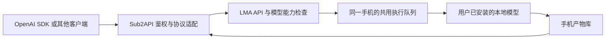

# LMA × Sub2API：OpenAI 转发与调度规范

[English](SUB2API_OPENAI.en.md) · [当前 API](API.md) · [机器可读方案](proposals/sub2api-openai-profile.json) · [OpenAPI 3.1 草案](proposals/sub2api-openai.openapi.json) · [草案校验记录](proposals/sub2api-openai-validation.json) · [维护记录](releases/v0.3.11-sub2api-design.md)

**v0.3.12/code62 已实现声明的接口子集，并附带可选择启用的 Sub2API 源码扩展。** 请以[当前用法与边界](LOCAL_API_V0312.md)和[实机测评](DEVICE_BENCHMARK_V0312.md)为运行依据。本次没有修改生产 Sub2API 部署、数据库或计费。下文保留 v0.3.11 初始设计及原版上游审计；其中“设计／缺失／当前未实现”描述针对历史基线，不是本 APK 的状态。multipart 编辑、Responses、Videos、Realtime 继续明确排除。

## 历史基线与合同要求

## 1. 接入方向与范围

LMA 作为 OpenAI 兼容上游；Sub2API 负责客户端鉴权、模型别名、准入、转发和任务归属。全部 tokenizer、推理、解码、音视频编码与 3D 后处理仍在**同一 Android 手机**完成。LMA 不新增调用其他机器模型的 provider。下载、导入和更换权重继续由用户明确操作。



Sub2API 只在已能访问手机的部署位置转发。默认手机地址 `127.0.0.1:52187` 仅对手机自身有效；其他设备需用户明确启用现有局域网监听，并限定可访问地址。部署在公网的网关不会因此自动连通手机，本规范不自动开公网端口、创建隧道或安装其他执行节点。

## 2. 实际核对依据

本机部署参考是 Sub2API **v0.2.19**，发布于 2026-10-28；2026-11-01 的 GitHub latest 查询返回该版。源码固定到提交 **`dece26153621959ccd7635814f4b2d08304e681a`**，15 个源文件的 blob ID 与该提交树一致。仅检查公开源码和去敏部署元信息，没有读取部署私密文件内容、调用收费生成或修改在线服务。源码哈希、LMA 文件身份与结论记录在[方案 JSON](proposals/sub2api-openai-profile.json)。部署参考不等于本轮在线服务验收。

| 编号 | 源码检查发现 | 对接影响 |
| --- | --- | --- |
| F01 | OpenAI API Key 账号有自定义 `base_url` 和模型映射 | 可作为 LMA 上游入口，但映射本身不保证所有模态可转发 |
| F02 | 未确定 Responses 能力时可能走 Chat→Responses 转换 | 当前 LMA 不提供 `/v1/responses`；使用 `extra.openai_responses_mode = force_chat_completions`，不能只打开 Responses 透传 |
| F03 | 图片入口存在，但校验客户端名、路由后模型名和映射后模型名的家族 | 普通 `lma-image-*` 名称会被拦截；须修改能力准入，不能靠映射或伪装成 GPT 图片模型解决 |
| F04 | 通用 `/v1/audio/speech` 未注册；`/tts` 等语音入口限定 Grok | 需要新增通用 API Key 语音路由和二进制响应转发 |
| F05 | `/v1/videos` 及查询／内容路由走 Grok／Composite 的 Grok 处理器 | 普通 OpenAI 账号不能直接转发本地 Wan／LTX；不能将手机账号伪装为 Grok |
| F06 | 没有 LMA 的任务、上传、产物与音乐／3D 扩展路由 | 网关须新增有限路由与归属映射，不能开放任意 URL 代理 |
| F07 | `/v1/models` 根据账号配置、映射和分组构造列表 | 不是实时镜像手机目录；须实现本地已下载／已配置目录自动同步，不能展示默认 OpenAI 模型冒充本机资产 |
| F08 | 已检查的请求头白名单不包含 `Idempotency-Key`、`Last-Event-ID`、`Range` | 需要按端点扩展头部规则，现有任务幂等、进度续读和范围下载不能直接假定透传 |
| F09 | 已有异步图片任务包装与失败重选逻辑 | 可复用部分基础设施；不等同于持久绑定 LMA 任务、取消和重启恢复，不能直接视作全部多模态异步支持 |
| F10 | LMA 原生列表已含文本与多模态 bundle，也会含部分下载／准备条目 | 必须补统一发布资格筛选、配置验证和目录修订；已有条目不等于 Sub2API 自动广播 |

源码入口：[路由](https://github.com/Wei-Shaw/sub2api/blob/dece26153621959ccd7635814f4b2d08304e681a/backend/internal/server/routes/gateway.go)、[图片解析与 API Key 转发](https://github.com/Wei-Shaw/sub2api/blob/dece26153621959ccd7635814f4b2d08304e681a/backend/internal/service/openai_images.go)、[Responses 能力开关](https://github.com/Wei-Shaw/sub2api/blob/dece26153621959ccd7635814f4b2d08304e681a/backend/internal/pkg/openai_compat/upstream_capability.go)、[模型列表](https://github.com/Wei-Shaw/sub2api/blob/dece26153621959ccd7635814f4b2d08304e681a/backend/internal/handler/gateway_handler.go)、[请求头白名单](https://github.com/Wei-Shaw/sub2api/blob/dece26153621959ccd7635814f4b2d08304e681a/backend/internal/service/openai_gateway_service.go)。

## 3. 兼容边界与路由

“OpenAI 兼容”按声明的端点、字段、状态码、内容类型和流格式验收，不代表支持 OpenAI 全部产品。图片 JSON 和 Speech 二进制遵循对应的[图片规范](https://developers.openai.com/api/reference/resources/images/methods/generate)与[语音规范](https://developers.openai.com/api/reference/resources/audio/subresources/speech/methods/create)。官方 Videos API 已于 **2026-09-24** 关闭，见[官方弃用记录](https://developers.openai.com/api/docs/deprecations)；不能称本地视频接口为仍受官方支持的通用视频标准。未核对到通用音乐／3D 官方端点，使用明确的 LMA 扩展。

| 编号 | 网关客户端路径 | 手机上游路径／执行 | 协议与本轮状态 |
| --- | --- | --- | --- |
| P01 | `GET /v1/models`、`GET /v1/models/{model}` | 已下载且配置有效的本地模型；新增详情与能力数据 | 全模态标准模型列表；须实现自动发布、目录同步和独立就绪状态 |
| P02 | `POST /v1/chat/completions` | 同路径；共用执行槽 | 已有纯文本子集；当前只接受 App 已选文本模型，完整别名选择仍待适配 |
| P03 | `POST /v1/images/generations` | 新兼容层→`image.generate` | 设计：同步成功 `200`，`created`＋`data[].b64_json` |
| P04 | `POST /v1/images/edits` | 新兼容层→图片输入绑定→`image.generate` | 设计：仅对确实支持编辑的模型开放；需实现有界 multipart |
| P05 | `POST /v1/audio/speech` | 新兼容层→`speech.synthesize` | 设计：同步成功返回音频二进制，不能返回任务 JSON |
| P06 | `GET /v1/lma/capabilities` | 新增 `GET /v1/capabilities` | 设计：能力、参数、标签、安装状态、验证范围与限制 |
| P07 | `/v1/lma/jobs...` | 适配身份与字段后映射原 `/v1/jobs...` | 设计：生图／视频／语音／音乐／3D 统一异步扩展；提交 `202` |
| P08 | `/v1/lma/uploads...` | 原 `/v1/uploads...` | 设计：带归属映射的分块输入，不接受任意本机路径 |
| P09 | `/v1/lma/artifacts...` | 原 `/v1/artifacts...` | 设计：结果元信息、鉴权内容与范围下载 |
| P10 | `/v1/responses`、`/v1/videos`、Realtime | 当前不提供 LMA 对应兼容层 | 不声明可用；历史视频形状如需支持须单独声明，不能绕过 P07 |

P03—P09 是本次设计目标，**不是当前部署可直接使用的新增路由**。全部目标属于同一接入工作包，不拆成几个已完成版本。当前六种生成类型保持为 `text.generate`、`image.generate`、`video.generate`、`speech.synthesize`、`audio.generate`、`mesh.generate`。

## 4. 模型身份、能力与参数

| 编号 | 必须遵守的规则 |
| --- | --- |
| R01 | 模型对象包含稳定 `id/object/created/owned_by`；新增 `x_lma` 存放任务、基座、格式、内容来源标签、安装完整度、输入角色、参数 schema 和流能力。时间在 OpenAI 兼容对象中用 Unix 秒；原接口毫秒不得直接搬入。 |
| R02 | 网关登记 `public_model → instance_id → bundle_id → operation`，同时保存模型／配方版本与摘要。实例身份在手机重启后保持，更换手机或清空数据后改变；地址相同不代表实例相同。不能从名称猜任务，也不能把 NSFW 标签当作运行引擎选择。 |
| R03 | 推荐、全部／HF 搜索、本地管理保持原样；所有模型平级。开启 API 即允许按 R17–R24 自动公布符合条件的本地模型，无须逐模态再次添加。资产完整、配置有效且运行器存在才具备资格；HF 发现、下载完成、预检、真实输出和质量通过分别记录。 |
| R04 | 当前文本入口依赖 App 已选模型。新兼容层如支持通过 `model` 选择其他已安装模型，须在共用执行槽内完成选择和加载；不得直接转发一个尚未选中的 ID，也不得触发下载。 |
| R05 | 保存的逐模型设置为默认值，本次请求覆盖后按模型约束归位；最终值、调整项和版本冻结到任务。请求不得改写保存设置；需持久修改时走单独明确操作。预检和提交必须使用同一解析器。 |
| R06 | `quality`、`voice`、`speed` 等只有在适配器能真实映射时才允许。尺寸／步数按已有规则修正并披露；不支持的工具、掩码、透明背景、音色或流方式返回字段级错误，不能静默丢弃。 |

Sub2API 账号使用 `platform=openai`、`type=apikey`、实际手机入口和独立上游密钥。仅含此手机的分组，重型并发先限制为 1；内部 UI 与 API 仍共享手机执行槽。模型映射填写真实 `lma-*` 名称。不要将现有 OAuth／Grok 账号混入此分组，也不要启用未知模型透传。配置示例仅是字段约定，不是可直接导入管理 API 的完整账号请求：

```json
{
  "platform": "openai",
  "type": "apikey",
  "concurrency": 1,
  "credentials": {
    "base_url": "http://PHONE_ADDRESS:52187",
    "api_key": "<LMA_UPSTREAM_KEY>",
    "model_mapping": { "lma-image-selected": "lma-image-selected" }
  },
  "extra": { "openai_responses_mode": "force_chat_completions" }
}
```

客户端 SDK 的 `base_url` 使用网关的 `/v1`；Sub2API 账号建议保存手机 origin，由上游 URL 构造器拼接端点。私网或 HTTP 手机入口须按现有 URL 校验规则明确允许该目标；不为此关闭全部目标检查。未知别名、模型未安装、实例变化均应明确失败。

LoRA 在图片请求的 `lma.adapters` 或异步请求的 `adapters` 中用公开 `model` 别名选择，网关解析为已登记的 bundle，检查与基础模型兼容并冻结实际强度；不直接接受客户端内部 bundle ID，也不允许 LoRA 独立生成。语音和视频不因此获得尚未实现的 LoRA 能力。

能力目录按模型／配置修订缓存并失效；任务状态查询只取轻量快照。空闲时不反复扫描权重、加载模型或为每个候选启动探测进程。真实资源检查在用户预检和执行时进行，避免新增接口再次造成无模型空闲卡顿。

当前 [ApiHost.models()](../app/src/main/java/com/lma/app/ApiHost.java) 已列出本地文本和多模态 bundle，但也会包含具有可复用文件的未完成条目，未按配置有效性统一过滤；缺少标准 `created`、目录修订和 Sub2API 自动同步。以下规则明确这些待改差异。

### 4.1 本地模型自动加入广播目录

这里的“广播”是已鉴权客户端调用 **`GET /v1/models`** 获取模型目录。**已下载且已配置的生图、生视频、生音频（语音／音乐）和生模型（3D）必须与生文模型一起列出**；不要求先在 App 中逐个加载。手机公布目录，Sub2API 同步后再按调用方分组／权限公布可见别名。这是新增接入要求，当前 APK 与原版 Sub2API 尚未完成这一闭环。

| 编号 | 自动发布要求 |
| --- | --- |
| R17 | 开启已有 API 服务后，自动登记符合条件的本地 `text.generate / image.generate / video.generate / speech.synthesize / audio.generate / mesh.generate` 模型。所有模态处于同一个 `data[]`，以任务标签区分，不限于文本或“推荐”。无需逐模态再次添加；关闭服务即停止提供目录。不得自动打开局域网／公网监听或向网络主动广播。 |
| R18 | 发布条件为：已通过现有下载或导入流程登记，当前配方要求的权重／组件／必要准备产物完整，逐模型保存参数有效，选定 Android 后端与运行器已集成。合法默认配置也算已配置，不强迫用户先修改参数、加载或生成一次。仅 HF 搜索命中、部分／暂停下载、缺组件、准备／组装未完成及配置错误条目不进入发布列表；本地管理仍保留并解释原因。 |
| R19 | 发布资格与运行状态分别记录。未加载条目仍公布，调用时在共用队列内加载；繁忙或暂时资源不足的条目保留，`ready.status / available / reason_codes` 解释排队或拒绝原因。手机离线／目录过期不得伪装就绪。未有手机输出／画质／耐久证据不单独阻止发布，但对应标记仍为 false，调用方仍须明确提供 `allow_unmeasured`。最终预检检查真实文件、资源和输入；出现在列表不保证每次请求成功。 |
| R20 | 同一实例、模型／用户已保存的完整变体使用稳定公开 ID；修改上下文、尺寸、步数、音色不改 ID。`publication` 记录 bundle／模型／配置修订；`saved_parameters` 只公布可公开的参数默认值及 schema，不含本机绝对路径、历史提示词、参考音频内容或凭据。请求覆盖不改默认值或目录修订；已提交任务继续使用冻结配置。别名冲突须显式解决，不合并不同手机／模型随机调度。 |
| R21 | 下载／导入完成、必要准备／组装完成、保存配置／后端修改、删除／失效及服务重启触发轻量快照重建；有实质变化才递增持久 `revision`。重启从登记恢复，不重下权重。删除／失效从后续目录移除，旧任务、幂等绑定和产物仍在原实例可查询，不改写历史。外部文件变更未被登记事件感知时，执行前检查仍须拦截缺失文件。 |
| R22 | Sub2API 新增受限目录同步器，用上游手机密钥获取能力快照，校验实例身份和完整响应后，原子更新该账号的注册表／映射／分组可见列表。保留用户自定义别名和权限，不自动扩大访问。标准模型列表与扩展能力目录使用同一快照。中断、解析失败或实例变化不得部分覆盖、清空原记录或退回默认 OpenAI 目录。当前账号映射不会自行实现这一功能，必须修改网关代码。 |
| R23 | 手机按登记／配置事件维护缓存，读取不逐个探测引擎或扫描权重。网关仅在相关账号启用时默认每 30 秒同步，允许 ±20% 抖动；失败退避上限 300 秒，连接／读取超时为 3／5 秒。用 `If-None-Match / ETag`，未改变返回无正文 304，`revision / updated_at` 保持稳定。超过 90 秒未确认标 stale，已确认连接失败标 offline；保留可见的最后目录，但新任务不可调度。首次获取失败且无快照返回 503。旧任务仅重试原实例。客户端 ETag 按权限过滤后的可见视图计算，权限变化使其失效；不向客户端透传上游密钥。 |
| R24 | 条目保留任务、基座、格式及有来源的 NSFW／Uncensored 标签，标签不等于运行／质量通过。单独 LoRA、VAE、编码器属于组件，不伪装为生成模型；`adapters` 仍可经独立组件注册表解析公开 LoRA 别名。用户已配置的“基础模型＋兼容 LoRA”完整变体可有独立模型 ID；查询不自动创建变体或下载依赖。图生视频、参考 TTS、图生 3D 可以公布，其必需素材由 `input_schemas` 声明。 |

| 本地状态 | 是否进入 `/v1/models` | 调用规则 |
| --- | --- | --- |
| 完整生图／视频／语音／音乐／3D 模型，有效默认配置，尚未加载 | 是 | 共用队列内加载，检查输入和资源 |
| 完整配置，正在生成或暂时资源不足 | 是，带 busy／resource_limited 状态 | 按实际队列容量排队或明确拒绝 |
| 完整配置，手机输出／质量未验 | 是，证据保持 false | 不自动打开 `allow_unmeasured` |
| 下载／准备未完成、配置无效、后端不支持、未登记散落文件 | 否 | 本地管理说明原因，不自动补下载／转换 |
| 单独 LoRA／VAE／编码器 | 否，属于依赖组件 | 完整模型可引用已登记 LoRA 适配器 |
| 删除／失效的模型 | 否；网关下次成功同步更新 | 保留旧任务／产物，新调用失败 |
| 网关暂时联系不上手机 | 可保留最后目录，标为 offline／stale | 拒绝新任务，无跨设备回退 |

[示例目录 JSON](proposals/sub2api-local-models.example.json) 给出同级的生文、生图、生视频、语音、音乐和 3D 六个条目、保存参数及未加载状态。**这是未来协议示例，不是手机已安装模型或实测响应**；示意别名不会改变已有推荐。标准客户端读取 `id/object/created/owned_by`，需要筛选功能的客户端读取 `x_lma.operations / tags / ready / publication`。模型列表、详情和能力接口的参数／状态须一致。

## 5. 标准图片与语音请求

以下为**未来兼容层的调用示例**，模型名为示意别名，并不添加推荐或下载项。`lma` 是 LMA 扩展字段；SDK 可使用 `extra_body` 传入。当前未实测配方的 `allow_unmeasured` 必须由调用方明确设置，网关不能自动补为 true。

本配置要求非幂等生成携带 `Idempotency-Key`；这是 OpenAI 接口子集之上的网关要求，SDK 通过 `extra_headers` 使用。不能宣称所有 SDK 仅更换地址即兼容，实际对象解析、参数子集与重试规则须按 A01–A28 验收。

```python
import os
from openai import OpenAI

client = OpenAI(
    base_url=os.environ["LMA_GATEWAY_BASE_URL"],  # e.g. http://gateway:52187/v1
    api_key=os.environ["LMA_GATEWAY_KEY"],
    max_retries=0,  # re-enable only after gateway idempotency is verified
    timeout=180.0,
)
result = client.images.generate(
    model="lma-image-selected",
    prompt="A small wooden boat on a calm lake",
    n=1,
    size="512x512",
    response_format="b64_json",
    extra_headers={"Idempotency-Key": "example-image-001"},
    extra_body={"lma": {"allow_unmeasured": True}},
)
print(len(result.data[0].b64_json))
```

图片初始声明 `n_max=1`、`stream=false`、`response_format=b64_json`、`output_format=png`；超出声明返回 `400`。大图片按有界分块读取文件并进行 Base64 编码，不能为生成结果无限扩大请求体或常驻内存。原图和全部执行信息仍存手机产物库。未知 token 使用量省略，不按耗时伪造 `usage`。

```python
with client.audio.speech.with_streaming_response.create(
    model="lma-speech-selected",
    input="你好，这是在手机本地生成的语音。",
    voice="default",  # explicit alias for this model's frozen configured voice
    response_format="wav",
    extra_headers={"Idempotency-Key": "example-speech-001"},
    extra_body={"lma": {"allow_unmeasured": True}},
) as response:
    response.stream_to_file("speech.wav")
```

`with_streaming_response` 只说明客户端按块接收 HTTP 内容，不证明模型边生成边输出。初始支持完整 WAV 文件；OpenAI Speech 的缺省格式是 MP3，手机未实现 MP3 编码时，省略格式应按缺省请求返回明确“不支持 MP3”错误，**不能发送 WAV 却标记为 MP3**。PCM 增量输出只能在真实支持的引擎上另行声明；当前 MOSS Realtime 的原生分段接口不等于已完成 Speech 或 Realtime 兼容。

图片编辑的 multipart 须流式落到临时文件、校验后导入输入库，再绑定素材角色；不用 256 KiB JSON 正文缓存承载整张图。支持多少张参考图、是否有 mask、允许的 MIME 和大小均按模型声明。仅图生 3D 的适配器应允许无文本输入；当前所有生成强制非空 prompt 的限制需按输入 schema 修复，不能让用户填写伪提示词绕过。

手机当前请求传输需要已知 `Content-Length`，不接受 HTTP chunked 请求体；分块上传是应用层协议，与 HTTP chunked 不是一回事。新增编辑传输应明确长度并使用有界磁盘暂存，不能仅扩大全局 JSON 内存限制或假定 SDK 的任意流式上传都能通过。

## 6. 视频、音乐与 3D 的异步契约

标准同步端点不能用 `202` 的 LMA job 对象冒充 SDK 所需结果。可能长时间排队或运行的请求优先使用显式扩展 `POST /v1/lma/jobs`：

```json
{
  "model": "lma-video-selected",
  "type": "video.generate",
  "input": { "prompt": "A sailboat moving slowly across a lake" },
  "parameters": { "seed": 42 },
  "allowUnmeasured": true
}
```

`model` 解析成登记的手机 bundle；客户端不能同时传入内部 `bundleId`。音乐改为 `audio.generate`，3D 改为 `mesh.generate`，图像、语音和文本也可用同一契约。参数取各模型自己的 schema，不能给所有视频强加某个步数、帧数或分辨率。先用 `/v1/lma/jobs/preflight` 检查，返回最终值与调整项；预检不启动生成，不自动准备或下载资产。

上传创建额外携带公开 `model` 来确定实例，再将 `name/bytes/sha256` 转交原手机接口；后续偏移上传、完成与产物 ID 均由网关持久绑定。换模型仍需确认同一实例与输入角色兼容，不能将一个手机的素材 ID 交给另一台手机。网关响应使用外部 ID 和规范字段，不只是删除 URL 前缀的透明代理。

输出对象统一包含外部产物 ID、MIME、字节数、SHA256、尺寸／时长／采样率等可获得信息以及鉴权下载路径。分别使用 PNG、MP4、WAV、GLB；不宣称已实现 OBJ、FBX、MP3 或其他转换。可选阶段继续走模型配方与同机运行器，不能由网关执行媒体推理或创建用户节点图。

## 7. 调度、归属、重试与恢复

| 编号 | 必须遵守的规则 |
| --- | --- |
| R07 | 新建任务只路由到登记实例；提交成功后持久保存 `principal/api_key_id/external_job_id/account_id/instance_id/upstream_job_id/model/bundle_id/request_hash`。之后查询、取消、重试、素材访问和音频分段按绑定回原实例，不重新随机选账号。 |
| R08 | 每个外部文件、上传与任务都验证调用者归属；网关不能把共享上游密钥或手机原始全部任务列表暴露给普通客户端。删除／清理仅作用于本人资源，不能透传全库历史清理。 |
| R09 | 提交使用稳定 `Idempotency-Key`；先按调用者、端点和客户端键查找既有记录，再核对不可变的公开模型和原始正文；不能将正文散列加入查找命名空间而绕过冲突。生成不超过原接口 160 字符限制的内部键，冻结输入摘要、模型版本、有效参数和明确授权。相同键重试返回原任务；不同正文／模型返回 `409`。 |
| R10 | 网关须在发请求前持久记录路由与内部键。提交响应丢失时仅向同一实例用相同键重放原请求以确认，不能换模型、换手机或以新键再创建。活跃／提交结果未知的记录保留至确定终态，终态后至少保留 24 小时并公布窗口；客户端不能在窗口外假定重试保证。历史清理不能在窗口内删除幂等墓碑；当前原 JobStore 没有独立墓碑，需补实现。 |
| R11 | 手机只并行一个重型执行，控制与下载不占该执行槽。队列、HTTP 等待和生成预算分开；同步等待不能占满现有 12 个 HTTP 工作线程，须预留控制容量并设置等待名额。 |
| R12 | 同步完成预算由手机公布，网关和客户端超时应更长；超时返回 `504` 和可回查的任务 ID，不返回伪成功。任务可能仍继续；只能通过幂等键／任务回查，不能因错误码自动重建任务。图像保活空白不能提前提交 200 掩盖之后的失败。 |
| R13 | 原异步任务断开连接仍继续，取消必须明确调用。手机进程中断可恢复任务记录，但无模型中间检查点；`interrupted` 不能宣称断点续算。显式 retry 创建新的、同模型任务并保留原记录。 |
| R14 | 使用 `Accept: text/event-stream` 订阅 SSE，否则是 JSON 轮询；单连接现有上限 120 秒，重连携带 `Last-Event-ID`。历史截断收到 reset 后重新查询快照。未知进度保持 null，阶段消息不冒充输出。网关按实例复用上游流并按归属分发；手机最多 2 路 SSE，不能每个客户端各占一路。 |
| R15 | 下载透传 `Range/If-Range`，仅在手机实际支持相应条件语义时声明；保留 `206/416/Content-Range/Accept-Ranges/ETag/Content-Type/Content-Length`。原手机内容接口已支持 Range 与 SHA ETag，但 If-Range 尚须实现，不能直接宣称完整条件下载。 |
| R16 | 所有 stage 仍在手机，禁止跨实例或云模型回退。程序验收、真实输出、可用质量和后台耐久分别记录；网关不能因为退出码为零就改写模型质量标签。 |

网关建议保留三种标识：客户端请求 ID、网关任务 ID、手机任务 ID。请求头按端点明确允许 `Idempotency-Key`、`Last-Event-ID`、`Range`、`Upload-Offset`；响应保留 `X-Request-ID`、`X-LMA-Job-ID`、`Retry-After` 和必要媒体头。拒绝转发客户端上游 Authorization、任意目标 Host 或任意响应头。上述头部规则是**新增要求**，不是当前白名单已有的行为。

标准图片／语音请求在网关发出前先登记外部任务意向，成功或超时时将手机返回的任务关联重写成外部 ID。手机还需新增仅供受信上游使用的 `POST /v1/idempotency/lookup`，正文为 `{"key":"<INTERNAL_IDEMPOTENCY_KEY>"}`，只查询原任务，不触发生成；当前没有这个 HTTP 入口。响应未知时用它确认绑定，或用原正文／原键向原实例确认。原提交尚在途中时，“暂未查到”不等于未接受；取消应记录 `cancel_pending`，确认手机任务后再取消，不能提前回报已取消。网关不向普通用户开放此内部键查询。

网关扩展状态包含 `submitting`、`acceptance_unknown`、`cancel_pending`，确认后再映射手机原有 queued／loading／running／cancelling 与终态。`encoding` 等属于阶段，不能据此捏造新的手机执行状态或完成百分比。

## 8. 错误与计量

兼容层统一错误为 `{"error":{"message":"...","type":"invalid_request_error","param":"model","code":"lma_model_not_installed"}}`。Native `/v1/jobs` 的历史错误保持兼容，网关做显式转换。

| HTTP | 典型业务码 | 调度行为 |
| --- | --- | --- |
| 400 | `lma_unsupported_parameter`、`lma_unsupported_operation` | 修改对应参数／操作，不换模型重试 |
| 401 / 403 | `invalid_api_key`、`lma_owner_mismatch` | 修正鉴权或归属 |
| 404 | `model_not_found`、`lma_job_not_found` | 不伪造其他模型结果；其他用户资源也按不存在处理 |
| 409 | `lma_model_not_installed`、`lma_instance_changed`、`lma_idempotency_conflict` | 用户管理资产或核对请求，不自动下载 |
| 429 | `lma_queue_full` | 尚未创建任务时可按 Retry-After 再尝试 |
| 503 | `lma_backend_unavailable`、`lma_device_offline` | 返回本地状态；已提交／提交结果未知时仅回查 |
| 504 | `lma_wait_timeout` | 返回任务关联信息，禁止盲目创建第二个任务 |

是否可重试取决于“是否已提交或可能提交”，不能仅按 HTTP 状态决定。计量分别记录排队、加载、推理、编码时间和实际产物，不把未知 token 写成真实 0，也不伪造 OpenAI 价格。Sub2API 现有计费／定价逻辑是否接受本地图片别名须单独验证；本次不调整实际价格或余额。

## 9. 同一工作包的实现清单

| 编号 | 待实现内容 | 完成判据 |
| --- | --- | --- |
| D01 | LMA 能力描述、全模态本地自动发布、标准模型详情和别名选择 | 下载／配置有效即可公布，未加载可见、缺失条目剔除；目录修订、任务／标签／schema 与逐模型设置一致 |
| D02 | 图片与语音兼容层，编辑输入适配 | 标准状态／正文／MIME；未知字段、格式和模式明确报错 |
| D03 | Sub2API 通用模态路由、名称校验和本地目录原子同步 | 列表反映手机已有模型及权限；真实名称可用，不回退默认 OpenAI 名单，无 Responses 隐式转换 |
| D04 | 网关有限扩展、持久归属和同实例绑定 | 视频／音乐／3D、输入、取消、重试和下载可闭环 |
| D05 | 幂等墓碑、超时恢复、目录 ETag、进度续读与媒体头 | 连接丢失不重复生成；目录刷新／离线及长任务／Range 行为可验证 |
| D06 | 服务页、双语例子与分层验收 | 程序合同与本轮授权实机测评分开记录；不宣称全模型质量或长期后台通过 |

## 10. 编号验收场景

| 编号 | 程序验证场景 | 预期 |
| --- | --- | --- |
| A01 | 纯文本 JSON 与 SSE；Responses 模式开／关 | 直转聊天可用；未实现 Responses 明确失败，不隐式转换 |
| A02 | 客户端名／通道名／上游名均为本地图片别名 | 三阶段校验都接受登记的图片能力；未登记名称拒绝 |
| A03 | 图片成功、引擎失败、空结果 | 仅真实有效图片返回 200；不会把 202 job 解析为图片 |
| A04 | `n>1`、不支持 mask／流式／透明背景 | 参数级错误，无任务或额外下载 |
| A05 | 语音 WAV、缺省 MP3、错误音色 | 二进制 MIME 正确；不支持格式和音色明确失败 |
| A06 | 同模型默认值／覆盖／超限与两模型隔离 | 返回实际修正值，保存设置不改变 |
| A07 | 手机缺组件、运行器或不支持当前模式 | 预检和提交一致失败，不自动安装 |
| A08 | 图生 3D 无文本、参考音频与多视图 | schema 决定必需输入，无伪提示词；素材角色／归属正确 |
| A09 | 五类生成加文本并发，UI 同时提交 | 单手机重型任务串行；控制／下载保持可用 |
| A10 | 相同幂等键重复／不同正文／响应丢失 | 一个任务、409 冲突、同实例确认，不二次生成 |
| A11 | 更换模型默认值后重试旧键 | 原请求／有效参数仍冻结，不变成新任务 |
| A12 | 网关或手机重启、手机地址被另一实例复用 | 任务归属持久；实例变化阻止错误查询／调度 |
| A13 | 运行超过 120 秒、SSE 断连、历史截断 | 同游标续读或 reset 后快照，不取消任务 |
| A14 | 同步超时、客户端重试、异步后台继续 | 明确 504／任务关联；不伪造 200 或重复任务 |
| A15 | 越权查询／素材访问／取消／清理 | 不泄露任务、原密钥或其他用户的输入 |
| A16 | 上传边界、错误 SHA、偏移、过大 multipart | 有界内存与临时文件清理，错误不进入生成 |
| A17 | Range、416、If-Range、ETag、大 MP4／GLB | 返回实际条件语义；未实现能力不宣称通过 |
| A18 | 图像阶段事件、TTS HTTP 读取、PCM 真增量 | 不把三者混称 token 流或 Realtime |
| A19 | 低内存、取消、进程中断与显式重试 | 保留真实失败，无跨设备回退或伪断点恢复 |
| A20 | SDK 合同、网关重选与计量 | 校验 SDK 实际对象／字节、禁止重复调度、未知用量不造值 |
| A21 | 已下载／已配置的生图、视频、语音、音乐、3D 与生文 | 同一标准 `data[]` 发现全部六类；标签、ID、保存参数与详情一致，不限推荐 |
| A22 | 未加载、繁忙、资源不足、无质量证据 | 保留条目，状态／证据独立；按规则加载／排队，不伪造可用状态 |
| A23 | 部分下载、缺组件、无效配置、未完成准备、独立 LoRA | 不进入生成目录；组件仍按独立注册表解析，无下载／推理副作用 |
| A24 | 配置修改、请求覆盖、安装／准备完成、删除与重启 | 实质变化更新修订，ID 稳定；覆盖不污染默认值；旧任务／产物不变 |
| A25 | 目录同步、中断／解析失败、别名／实例冲突 | 账号／映射／分组原子更新，不扩大权限，不部分覆盖或回退默认云模型 |
| A26 | 30 秒同步、304、超过 90 秒、离线／重连 | 条件请求与过期／离线状态正确；新任务不绕过不可用状态，仅同实例恢复 |
| A27 | 两种调用方权限、私人配置、ETag 与目录筛选 | 仅见有权模型，ETag 随可见视图变化；无凭据、路径、提示词／参考素材泄露 |
| A28 | 反复读取模型／能力目录、未变更的空闲手机 | 缓存读取，不加载模型、扫描权重、启动探测或下载，不增加空闲卡顿 |

这些是**待执行的实现验收场景**。本轮只完成源码核查、规范与文件一致性检查，不将场景数量计入现有 68 项 API 门禁。Wan 画质、TRELLIS／Pixal 未完成输出及长线后台未验边界仍按 [v0.3.11 记录](releases/v0.3.11.md) 保留。

## 11. 复核设计文件

[设计校验工具](../tools/validate_sub2api_design.py)只检查 schema、示例、双语编号及源文件身份，不调用手机、网关或模型。保存[官方 OpenAPI 3.1 元 schema](https://spec.openapis.org/oas/3.1/schema/2022-10-07)到下列缓存路径，环境需有 `jsonschema`。`--upstream-cache` 可选，仅用于复核此前保存的公开源文件。

```powershell
python tools/validate_sub2api_design.py --meta-schema build/research/openapi-3.1-schema-2022-10-07.json
```
