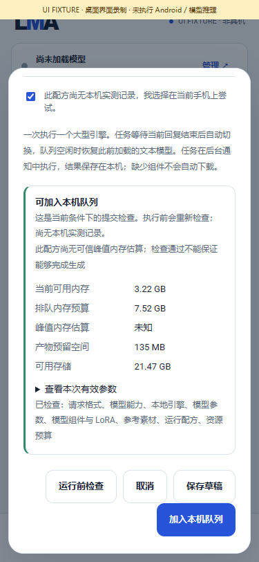
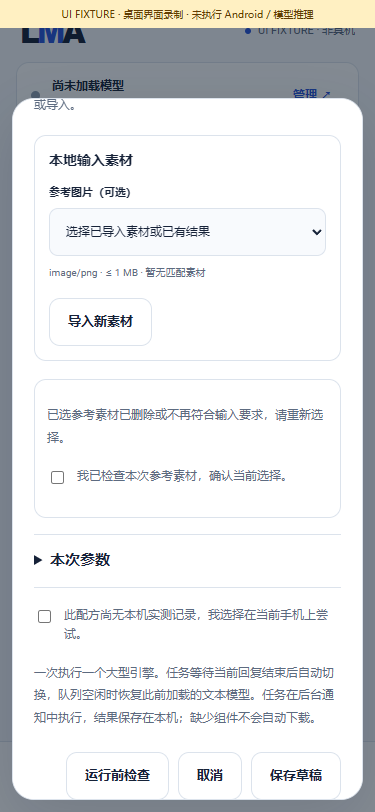

# Task preflight and input review

[中文](TASK_PREFLIGHT.md) · [Generation workbench](TASK_WORKBENCH.en.md) · [API](API.en.md) · [Numbered implementation and full pending scope](releases/v0.3.0-dev.26.md)

Internal **0.3.0-dev.26 / code 30** adds “运行前检查” to the generation form. Inspect whether the current request can enter the phone queue, resolve missing requirements, then submit explicitly. A check creates no job, starts no inference, downloads nothing, changes no model defaults and starts neither the background service nor the API listener.

## User flow

1. Choose an installed model in Local and enter text, reference media, LoRAs and request parameters. Existing Recommended entries remain intact; HF All/search and explicit imports provide other models.
2. Click “运行前检查”. Inspect parameters and resources before opting into an unmeasured recipe; the App never checks that choice for you.
3. Missing model/LoRA reports list the selected bundle, component roles, sizes and import requirements, with a Local management action. Users explicitly select download, resume or import. Reusable components alone do not constitute installation.
4. Input diagnostics can open the actual media section in Tasks. Edit parameters in the current form; save a draft before leaving if needed. Completed imports refresh choices in an open form while preserving typed text and valid selections.
5. If selected media disappears or no longer matches the contract, clear that reference and require explicit review before submission. Required roles must still be filled.
6. Editing text, parameters, LoRAs, consent or media invalidates the result. Responses received after edits cannot mark the changed request ready.
7. “可加入本机队列” means current admission checks passed. Only the separate submit action creates a job. Submission and execution recheck their requirements. Continue through task details, outputs, editable requests and reference reuse as described in the workbench guide.

## Checks and boundaries

| Stage | Production behavior |
|---|---|
| Request / model / engine | Generation request shape, model capability, local engine and recipe; no standalone LoRA generation |
| Parameters | Per-model defaults plus request overrides, clamping, joint limits and engine guards; effective values and adjustments |
| Assets | Explicitly selected installed base model/LoRAs, required components and adapter compatibility |
| Inputs | Existing media, MIME/size/dimension/duration rules and reference transcript contracts |
| Resources | Total-memory queue budget after reserve, current available RAM, known peak estimate plus adapter guard, output storage |
| Consent | Explicit opt-in to an unmeasured recipe, never manufactured by a check |

Admission uses total RAM; execution uses then-available RAM. Transient memory pressure may permit queuing with a warning; execution still rejects low memory, severe thermal pressure or insufficient storage. Unknown peak RAM remains unknown. The check reads current storage metadata; execution retains integrity revalidation. Results reserve neither assets nor resources and cannot guarantee eventual generation.

UI, API and submission use the same production `LocalJobs.GenerationPlan`. Existing idempotency and immutable queued snapshots remain. This endpoint accepts text/image/video generation, speech synthesis and audio generation. Model preparation/association retain their own signed plans; no external execution stages are accepted.

## Local API

`POST /v1/jobs/preflight` accepts the generation body used by `POST /v1/jobs`, under the existing Bearer authentication. Explicitly start the API listener first; this request does not start one. Existing browser-Origin rejection and request size/type limits apply.

```http
POST /v1/jobs/preflight
Authorization: Bearer YOUR_LMA_API_KEY
Content-Type: application/json

{"bundleId":"YOUR_INSTALLED_BUNDLE_ID","type":"image.generate","input":{"prompt":"a quiet garden"},"parameters":{"steps":20},"allowUnmeasured":true}
```

Valid JSON inspection returns `200` with `canEnqueue=true` or `false`; a blocked report creates no failed job. Fields include `schema=lma.task-preflight/1`, `checkedAt`, `submissionHash`, `checkedStages`, `issues[{code,message,action}]`, `warnings`, and the resolved `modelAssets`, `effectiveParameters`, `adjustments` and `resources`. Unreached fields may be absent. Validation stops at the first blocking stage rather than claiming a complete scan.

Actions are suggestions: `manage_models`, `manage_inputs`, `edit_request`. Resolve the issue and explicitly submit to `/v1/jobs`. `submissionHash` identifies input; it is not a reservation, authorization or permission to skip validation. Missing authentication returns `401`, incorrect methods `405`; malformed/oversized bodies retain protocol errors. Unavailable foundation stores can return `503`.

## Verification and media

[Current evidence](../verification/development/status.json) covers the production resolver, real desktop persistence/children and HTTP, separately from immutable historical model experiments. Physical Android inference/background tests remain zero; this change adds no model inference passes.

| Admission and resources | Changed input review |
|---|---|
|  |  |

[MP4 recording](media/development/preflight/preflight-ui.mp4) · [GIF](media/development/preflight/preflight-ui.gif) · [Media hashes and page fingerprints](media/development/preflight/manifest.json). Recordings show actual production-page interaction with a labelled desktop UI FIXTURE bridge; no Android/model execution. All created browser resources are closed.
