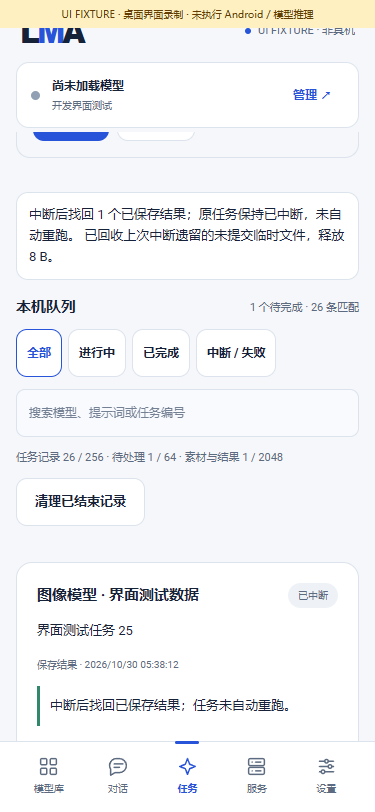
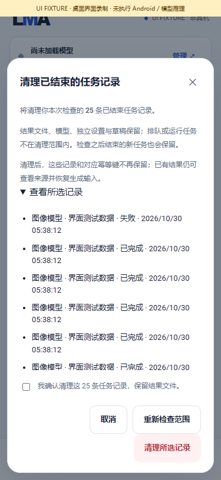

# Task recovery, capacity and history

[中文](TASK_RECOVERY.md) · [Documentation](README.md) · [Numbered delivery and complete pending scope](releases/v0.3.0-dev.27.md)

Internal **0.3.0-dev.27 / code 31** updates the shared task foundation. Models remain equal peers with independent settings, immutable queued requests, same-phone execution and user-controlled assets. No model weights or new model/Android acceptance claims are included.

## 1. User flow

1. Open Tasks to see startup recovery information and separate task, pending-work and media capacities. Startup inspection never downloads models or repeats generation.
2. Filter all, active, successful or failed/interrupted/cancelled tasks; search model name/ID, job ID or prompt summary. The latest 20 matching records appear first; Load more adds 20. Filters combine with search.
3. An interrupted task with a recovered saved output stays interrupted. Its details retain the original error and expose the output. Open/export the result or explicitly edit and submit a new request; recovery does not imply resumed steps or successful inference.
4. Choose Clear finished records, review the exact selection and check confirmation. Jobs finishing after review remain. If another operation changes selected records, the whole request fails and requires a fresh review.
5. Cleanup removes selected terminal job records and their idempotency keys. Results/provenance, drafts, models, independent settings and queued/running jobs remain. Saved results can still restore editable generation inputs. File deletion is a separate explicit action.

| Recovery and capacity: desktop fixture | Reviewed history: desktop fixture |
|---|---|
|  |  |

[Filters](media/development/recovery/02-filters.png) · [Conflict](media/development/recovery/04-conflict.png) · [Recording](media/development/recovery/recovery-ui.mp4) · [GIF](media/development/recovery/recovery-ui.gif) · [Media fingerprints](media/development/recovery/manifest.json). These operate production pages with a visibly labelled simulated native bridge, without Android/model execution. Browsers close afterward.

## 2. Startup reconciliation and temporary files

Initialization restores persistent jobs, opens outputs, recovers resumable input uploads, reconciles committed results and restores engine workspaces before admitting services/workers. Reconciliation rejects active tasks or output readers.

`JobStore` changes former loading/running jobs to interrupted and cancelling jobs to cancelled, without inventing an engine checkpoint. `ArtifactStore.reconcile` uses the committed private index and checks file presence/size. It appends an output link only to an interrupted generation task whose generated origin, same-phone provenance, complete immutable request and bundle ID match. It persists an `output_recovered` event. Existing links are not duplicated; cancelled jobs are not revived. Mismatched provenance and missing files retain records and appear in the report.

Startup does not rehash large media or run inference. This restores links to indexed committed output; it cannot detect same-size file changes or recover an output that never committed to the index. Selected reference media still undergo full integrity validation before actual execution.

Cleanup handles only regular generator-owned files in private output storage: `staging/job_<32hex>_<32hex>.<suffix>` and unindexed `media/artifact_<32hex>.<png|jpg|wav|mp4|txt|json>`. It does not recurse or follow symbolic links. Indexed results, unknown entries, registered resumable inputs and model directories remain. A file moved before its index commit is uncommitted and reclaimed; this update does not add a cross-store transaction journal. Failed deletions are reported for another startup attempt.

`outputRecovery` reports recovered, missing, rejected and unlinked outputs, discarded temporary files, cleanup failures and actual reclaimed bytes. `executionResumed` and `modelDownloads` are false. Independent results left after history deletion are allowed and do not trigger an error banner.

## 3. Capacity and admission

| Storage | Limit | At capacity |
|---|---|---|
| Persistent task history | 256 including terminal records | Review and clear finished records; retain result files |
| Pending tasks | 64 queued/loading/running/cancelling | Wait or explicitly cancel; history cleanup cannot cancel active work |
| Input/result index | 2,048 entries | Explicitly delete unwanted files; clearing history cannot free this capacity |

UI/API preflight and generation admission share real capacity checks. Preview is read-only and reserves no slot; durable submission checks again. Existing idempotent requests remain retrievable at full history capacity. Execution admission and output publication check media capacity; accepted jobs can still start when task history itself is full. Conditions can change after preview, so actual submission remains authoritative.

## 4. Local API

Existing authentication, body limits, origin restrictions and service controls apply to the same native stores:

| Method | Behavior |
|---|---|
| `GET /v1/jobs/history` | Read-only terminal `ids`, `count`, `review` and job `capacity` |
| `POST /v1/jobs/history/clear` | Submit `{"ids":["JOB_ID"],"review":"RETURNED_REVIEW"}`; return `removed` and current `capacity` |

Fetch a plan, review it, then submit its original `ids`/`review`; do not include `count`/`capacity`. The service verifies every unique terminal ID and its state/timestamp fingerprint before one atomic write. Changed records return 409; other invalid input follows existing rejection rules. Cleanup neither generates tasks nor starts engines or deletes media. Success refreshes App state. Repeating a deleted plan conflicts instead of expanding the selection. Existing individual terminal-record deletion remains available.

## 5. Checks and limits

`tools/test_recovery.py` compiles production core code, commits an output in a real host child, calls `halt(37)`, then restarts stores in the parent and checks actual bytes, links, events and cleanup boundaries. It also exercises durable files and authenticated HTTP sockets. This is neither an emulator nor Android execution. The production scheduler suite adds full-queue/read-only preflight checks; full UI regression covers search, filters, pagination, confirmation, concurrent selection preservation, conflicts and capacity navigation.

[Current and historical evidence](../verification/development/status.json) remain separate. F01–F12, existing text, selections 01–14/16/17, every frozen subtarget, both SD1.5/SDXL LoRA, assets/numerics/quality/resources/Android/background endurance and the formal Release remain required in the same complete v0.3.0. See the [complete pending table](releases/v0.3.0-dev.27.md).
