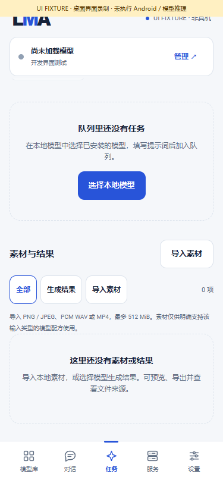
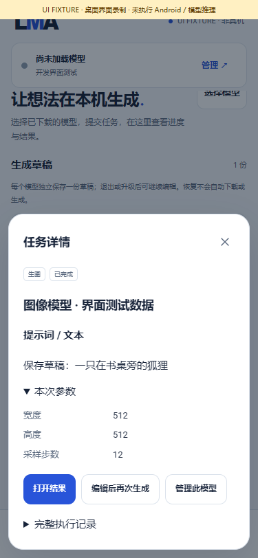

# Generation workflow: drafts, tasks and reusable media

Dev.26 adds [preflight and input review](TASK_PREFLIGHT.en.md). Counts below describe the dev.25 checkpoint; use the [current evidence index](../verification/development/status.json) and [dev.26 notes](releases/v0.3.0-dev.26.md) for current checks. Workbench features remain available.

[中文](TASK_WORKBENCH.md) · [Home](../README.en.md) · [Complete release scope](MULTIMODAL_RELEASE_PLAN.md) · [Numbered delivery](releases/v0.3.0-dev.25.md)

`0.3.0-dev.25` connects the generation form, saved drafts, task history and media library. These changes are packaged in the APK. Desktop filesystem, socket and UI checks do not establish Android inference or background endurance. App updates provide the foundation; users continue to choose, download, import and manage model assets.

## Using the workflow

1. Select models through All / HF search and review their text, image, video or audio tasks, engines, dependencies and device status. Download or import explicitly. Recommended remains `m08 → m06 → m01`.
2. Open an installed model in Local. Set the prompt, per-request parameters, LoRAs and references accepted by its recipe. Saved model settings provide defaults; request edits remain independent.
3. Choose **Save draft** when you want to continue later. A blank prompt is allowed, and no trial-execution consent is needed. Each model has one draft; saving again updates it.
4. Choose **Continue editing** under Tasks → Drafts to restore the task type, prompt, parameters, LoRA strengths, reference IDs and reference transcripts. Restoring waits for explicit confirmation and submission.
5. Task details display readable inputs, parameters, LoRAs, references and errors. Open completed results directly or edit the request for another generation. The complete execution record remains expandable.
6. A result can restore its generation parameters or become a reference for another task. Reference selection lists installed recipes whose available engines and declared input roles accept that media's type and size / duration. It fills a form; you then supply the prompt and submit.

Imported media has no generation provenance to restore, but can be selected as a compatible reference. A retained result can restore its request after the task history entry is deleted. If a reference is removed, retained task or result provenance can still restore the request; missing inputs must be replaced or explicitly reviewed before omission.

## Request restoration

The shared `TaskRequests` code serves UI, API and retries. It retains editable model IDs, task type, inputs, parameters and LoRAs. Execution receipts, old integrity checks, resource decisions and future server-only fields are excluded from the new client request.

Editing or loading a draft clears the previous trial-execution choice. Explicit retry retains the user's original choice while rechecking current assets, recipes, parameters and resources. Preparation / association retries retain their signed plans for fresh validation and cannot open as generation forms.

If a current recipe no longer accepts a parameter, LoRA or reference, the form lists each issue and requires review. Numeric fields still clamp to the model's current bounds. Required references remain mandatory. New submissions pass through production `LocalJobs` and receive a fresh immutable snapshot. Restoration does not promise identical pixels or audio after weight changes.

## Draft persistence and independent management

Drafts use `AtomicFile` in the App-private `task-drafts/drafts.json`. Persistence requires clicking Save; closing an unsaved form does not submit or download anything. Drafts are designed to survive restarts and normal App upgrades; actual Android upgrade retention remains an acceptance gate.

There is one draft per model, with at most 128 drafts and an 8 MiB index. Drafts store references, not weights or media copies. They hold no inference slot or model/media lease. Model assets, settings, jobs, drafts and artifacts have independent lifecycles, with references checked again on use. A corrupt draft index is retained and reported separately so other foundation modules can initialize.

Each committed write returns a monotonically increasing `revision`. Saving or deleting requires the observed `expectedRevision`; stale edits fail instead of overwriting another editor. Delete/recreate cannot reuse an old revision. Failed writes preserve the last saved record.

## Local API

All routes retain the existing Bearer authentication, browser-origin restrictions, size limits and listener policy. Clients submit to the phone; every inference stage executes there.

| Method and path | Behavior |
|---|---|
| `GET /v1/drafts` | Draft summaries with model/task IDs, time, revision and input preview |
| `GET /v1/drafts/{bundleId}` | Full saved request and revision |
| `POST /v1/drafts` | Save `{request, expectedRevision}`; use `0` for a new draft |
| `POST /v1/drafts/{bundleId}/delete` | Delete the observed `{expectedRevision}` |
| `GET /v1/jobs/{id}/request` | Read an editable generation request without submitting |
| `GET /v1/artifacts/{id}/request` | Restore a locally generated result's request; excludes imported media |
| `POST /v1/jobs` | Submit an edited, explicitly confirmed request through the existing queue |

Example, replacing the model ID with the user's selection:

```json
{
  "expectedRevision": 0,
  "request": {
    "bundleId": "selected_model_id",
    "type": "image.generate",
    "input": {"prompt": ""},
    "parameters": {"seed": 42},
    "allowUnmeasured": false
  }
}
```

Stale writes / deletions return `409`, missing drafts `404`, and invalid requests `400`. Committed API writes notify the App view. Reading requests never enqueues tasks. Submission still requires a compatible model and its complete assets, without automatic downloads.

## Checks, media and remaining gates

The [current evidence index](../verification/development/status.json) separates this APK's checks from historical experiments at `6b1f345`. Historical JSON is compared byte for byte with that commit. Failed experiments stay failed; historical results are not current-APK inference acceptance. The full Release exporter retains its complete gates.

The eight scoped groups passed 1,264 assertions. Android Lint reported 0 errors and 16 warnings. Checks cover actual durable files, restarted stores, revision conflicts, isolation, local HTTP, result provenance, production scheduling, model parameters / updates / components, input files, migration, text requests, complete UI regression, APK signing and Android static analysis.

These are production pages driven by a clearly labelled desktop bridge fixture, without Android or model inference. The [media manifest](media/development/workbench/manifest.json) records hashes, inputs and browser cleanup.

| Saved drafts | Readable task details |
|---|---|
|  |  |

[MP4 recording](media/development/workbench/workbench-ui.mp4) · [GIF](media/development/workbench/workbench-ui.gif) · [Missing-reference review](media/development/workbench/05-missing-reference.png)

This update adds no complete-model inference pass. F01–F12, existing text, selections 01–14 / 16 / 17, every frozen subtarget, and both SD 1.5 / SDXL LoRAs remain in one complete v0.3.0. The failed LCM pixel comparison, old LTX numerical issues, other models' quality / assets / resources, and every Android/background gate remain open.
