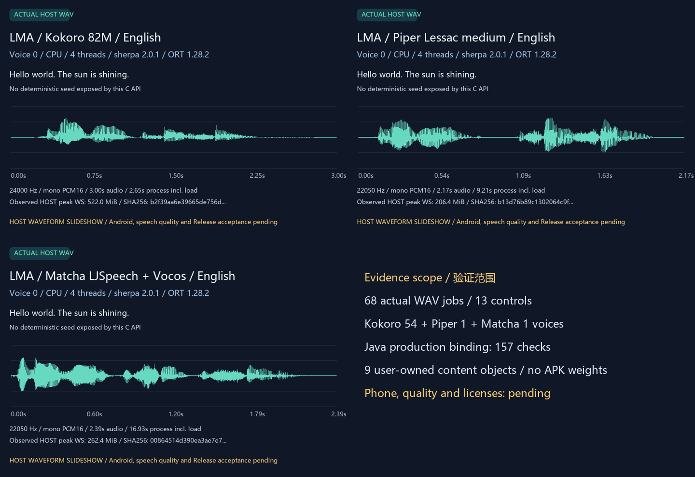

# 编号10：Kokoro、Piper、Matcha真实训练资产验证

[English](TTS_TRAINED.en.md) · [语音基座与用户流程](TTS_ENGINE.md) · [编号实现与全部待办](releases/v0.3.0-dev.24-tts.md) · [完整版本需求](MULTIMODAL_RELEASE_PLAN.md)

这是同一个完整v0.3.0内的开发验证，App仍为 **0.3.0-dev.24/code28**。新增工具在原生Windows执行未修改的生产C++及Java链路，使用真实训练文件；没有把电脑变成App的推理服务。现有Android APK输入和字节不变。**语音质量、逐组件许可、Android日志绑定、手机资源与后台耐久、编号10完整验收及正式Release均未完成。**

## 1. 冻结配方与用户资产

覆盖[冻结范围](proposals/multimodal-release-scope.json)编号10的三套既有配方；其他Piper语言/音色和Matcha权重需要独立配方与验证，不能由本轮外推。所有模型平级，生音频/TTS功能与sherpa_tts/CPU/ONNX依赖、设备证据、许可、内容标签分别记录。

| 配方ID | 固定来源提交 | 本轮音色范围 | 用户组件总字节 |
| --- | --- | --- | --- |
| `kokoro82_en_v1_rf7b96bb` | `csukuangfj/kokoro-multi-lang-v1_0` / `f7b96bb6bef5c5da4d3aa4f4e0498fbbf62dc78b` | 实际模型报告54；ID0–53逐项生成同一英语文本 | 360,067,976 |
| `piper_lessac_en_r83f7470` | `csukuangfj/vits-piper-en_US-lessac-medium` / `83f7470750b36549037551ef7007fa3b4b8697e0` | Lessac，ID0 | 69,508,119 |
| `matcha_ljs_en_rbe5535c` | `csukuangfj/matcha-icefall-en_US-ljspeech` / `be5535c9e754d0dfd3ab66dac34f78c5b5d66d50` | LJSpeech，ID0；独立Vocos声码器 | 134,348,008 |

共11个组件引用、9个不同内容对象，去重后 **551,312,557字节**。三者复用同一6,305,773字节英语lexicon；Matcha另需53,884,024字节Vocos。每文件长度、SHA256、固定URL与GitHub资产ID见[开发资产锁](../research/tts_trained/assets.json)，与既有[App配方](../catalogue/model-bundles.json)逐字段复核。所有真实权重、voices.bin、tokens、lexicon和声码器均在忽略目录或用户存储；Git/APK只保存代码及元数据。

Kokoro的54个音色ID均使用这套**英语词典**测试，不能据音色名称或多语种权重宣称其他语言通过；有效波形也不证明其朗读准确度或音色质量。Kokoro发布者LICENSE为Apache-2.0，但共享词典许可仍待复核；Piper需核对MODEL_CARD/Lessac数据条款，Matcha声学模型卡未明确声明权重许可。引擎Apache-2.0不替代这些模型数据条款，详见[说明](../research/tts_trained/NOTICE)。

用户在“模型→全部→生音频”检查配方、大小、来源和许可，再自行下载；已经取得的完整组件也可按[组件配方与文件夹导入](HF_RECIPES.md)流程导入，在“本地”管理和设置。安装/升级/浏览/接口启动/缺资产请求均不取得模型。下载、暂停、恢复、更新、回退、删除仍由用户控制；推荐保留m08→m06→m01，开发模型不成为必装项。

## 2. 真实执行与参数

原生Windows构建直接编译 `native/tts/worker.cpp`，仅用[CRT/父进程兼容层](../research/tts_host/NOTICE)；生产神经代码未改。固定官方sherpa-onnx **2.0.1** Windows C API及ORT **1.28.2**，`--info`实际返回这两个版本。官方压缩包7,899,712字节，SHA256 `afa4de3ca4ab0afd53bb4aab40d28ee15608364b549ffc0fe0caf6489bfc39a5`；每个DLL/导入库另有[独立固定身份](../research/tts_host/runtime.json)。没有全局安装、虚拟机、Docker、WSL或模拟器。

Windows与Android虽然ORT版本相同，平台、CPU和日志路径仍不同；**Windows库不经过Android liblog截获**。本轮不能证明Android未知词拒绝或日志隐私行为，公开 `android_log_interposition_tested` / `host_oov_guard_accepted` 均为false，不能用这批英语结果覆盖漏词、数字或标点问题。

三套模型各执行A、B、1.5语速、超限speaker归位、时长上限错误、实际部分合成后的取消、恢复A；Kokoro额外执行音色1–53。成功音频检查单声道PCM16、采样率、实际样本数、有限波形、非静音、上限和有效参数；错误/取消不接受部分WAV。所有stdout协议、原始请求、原始输出和20ms主机进程内存观测保留在忽略的独立run目录；时间含进程启动和模型加载，不是手机速度，且主机并非独占基准环境。

参数仍随模型保存，预设可手填，超限归位。生产Java测试实际导入全量文件并校验9对象复用，保存三套不同参数，冻结请求快照，通过 `SherpaEngine` → `NativeWorker` 启动真实worker；每套完成首次输出、部分合成后取消、1秒时长错误、恢复输出，并检查子进程退出、请求文件删除、进程归属释放和重启后的模型/参数保留。Application/AtomicFile是明确主机端口，未执行Android Service、SAF、MediaPlayer或锁屏流程。

三者C API未提供确定性种子控制。A与恢复A是否逐字节相同按实际结果记录；不把随机差异当成失败，也不据差异宣称语义/音色正确。首次直接运行的语速实验只证明当前文本输出时长缩短，不代表每个输入的语速线性或听感通过。

Java验证工具首次编译的同名方法冲突已修正；随后实际Piper测试发现测试错误要求double逐位相等。独立真实调用确认C API的float语速将1.1记录为1.100000023841858；验证改为要求**精确等于该IEEE float转换**，没有使用宽松误差容忍或修改生产参数逻辑。旧失败现场保留，公开结果来自修正后重新完整执行。

## 3. 实际结果与媒体

完整数值与独立复核见[训练报告](../verification/development/tts-trained.json)、[Java实际运行](../verification/development/tts-app-host.json)、[原始捕获复核](../verification/development/tts-capture-audit.json)。下方三份WAV直接复制真实输出、无增益或归一化；GIF无声，MP4是波形轮播并使用实际音频，AAC转换/48kHz重采样另有标记。它们**不是App或手机录屏**。

68次成功WAV、13个控制、info共82个原生子进程全部通过；Kokoro54/Piper1/Matcha1音色ID均有实际结果。三套A/恢复A在本次均不逐字节相同，报告保留原值，不声称确定性。独立原始复核覆盖394文件、82协议流、74WAV（含Java的6份输出）及9个导入对象。

| 管线 | Hz | A音频秒 | 语速1.5音频秒 | A进程秒（含加载） | HOST峰值工作集MiB | 取消到退出秒 |
| --- | --- | --- | --- | --- | --- | --- |
| kokoro | 24000 | 3.000 | 2.000 | 2.653 | 522.0 | 0.062 |
| piper_vits | 22050 | 2.171 | 1.382 | 9.213 | 206.4 | 0.042 |
| matcha | 22050 | 2.392 | 1.591 | 16.929 | 262.4 | 0.052 |

| 实际语音 | 原字节文件 |
| --- | --- |
| Kokoro voice0 | [WAV](media/development/tts-trained-kokoro.wav) |
| Piper Lessac voice0 | [WAV](media/development/tts-trained-piper_vits.wav) |
| Matcha LJSpeech/Vocos voice0 | [WAV](media/development/tts-trained-matcha.wav) |



[波形GIF](media/development/tts-trained-waveforms.gif) · [含真实音频MP4](media/development/tts-trained-speech.mp4) · [媒体身份与来源](media/development/tts-trained-media.json)

## 4. 开发复现

完成[原生工具链](BUILD.md)和既有固定sherpa源码取得后，在仓库目录使用原生Windows Python/MSVC/Java/FFmpeg；所有临时目录与模型文件留在用户指定工作路径：

```powershell
$env:PYTHONIOENCODING='utf-8'
$env:PYTHONDONTWRITEBYTECODE='1'
$env:TEMP="$PWD/build/tmp"
$env:TMP="$PWD/build/tmp"
python tools/fetch_tts_host_runtime.py --download
python tools/fetch_tts_trained.py --download
python tools/build_tts_host.py
python tools/test_tts_trained.py
python tools/test_tts_app_host.py
python tools/check_tts_trained_evidence.py --raw --self-test
python tools/render_tts_trained.py
python tools/export_development.py
python tools/check_repository.py --development
```

仅前两条明确下载命令会取得开发依赖/资产；无 `--download` 时只验证现有文件。HF主站不可达时，开发资产命令可显式加 `--hf-origin https://hf-mirror.com`，仍检查同一固定提交/长度/完整SHA，不改App下载设置。首次镜像Piper tokens的Range响应声明长度与收到字节不一致，工具拒绝并保留现场；核对固定Git blob与完整响应后确认清单原921字节/SHA正确，工具对可一次取得的小文件不请求Range，同时继续整文件校验。没有放宽哈希、修改模型清单或将失败记录拼装成成功。

媒体工具拒绝覆盖已经公开的同名媒体；重做时使用新的有来源文件名并同步引用。开发审计校验当前输入指纹及错误范围提升，不能凭绿色检查宣布目标或Release完成。所有后续门槛继续按[完整编号待办](releases/v0.3.0-dev.24-tts.md)执行；原LTX失败门槛保留，全部冻结范围不拆版、不默认顺延。
