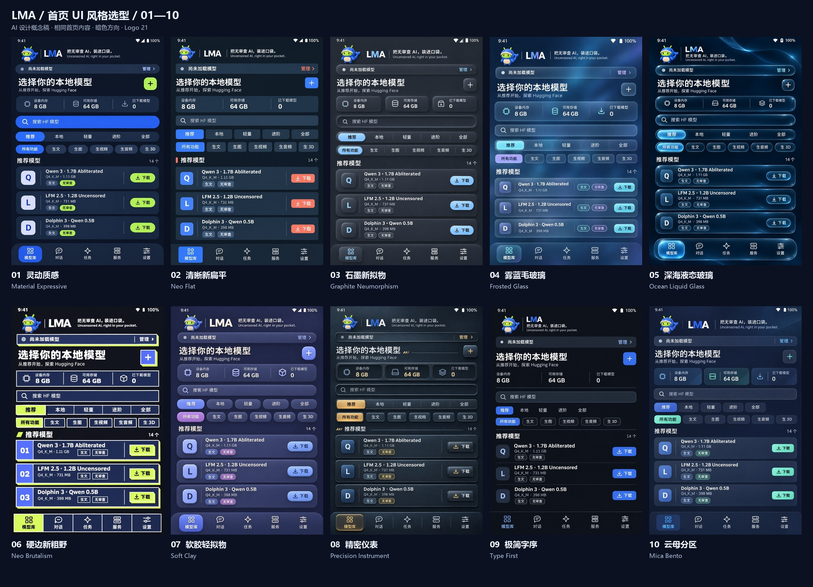

# LMA home-screen visual selection · 20261103

**Selection finalized on 2026-11-03: UI 10, Mica Bento.** [Accepted specification](design/MICA_BENTO.en.md), [components](design/COMPONENTS.en.md) and [light/dark adaptive layouts](design/RESPONSIVE.en.md) govern implementation. Logo 21 and slogan 04 remain approved. This page retains the original proposals; application integration is pending.

**Batch 2 adds 11–20:** [Ten more directions and a separate selector](UI_HOME_SELECTION_20261103_BATCH2.en.md). This page and the first batch retain their original artwork.

[中文](UI_HOME_SELECTION_20261103.md) · [Offline selector](../output/imagegen/lma-home-ui-selection-20261103/index.html) · [All ten](../output/imagegen/lma-home-ui-selection-20261103/overview.jpg) · [01–05](../output/imagegen/lma-home-ui-selection-20261103/overview-01-05.jpg) · [06–10](../output/imagegen/lma-home-ui-selection-20261103/overview-06-10.jpg)

Ten independently generated **dark-mode homepage concepts** explore visual languages for the existing Model Library → Recommended screen. They compare hierarchy, density, typography, geometry and materials. UI 10 is now selected; this documentation decision leaves the application, APK, v0.4.0 tag and published Release assets at their original identity.

## 1. Existing frontend review

The v0.4.0 `index.html`, `app.css`, `app.js` and pinned catalogue were inspected. [Source context](../output/imagegen/lma-home-ui-selection-20261103/source-context.json) records their hashes. Startup opens `models` with `recommended` selected, rather than a conversation.

| ID | Finding | Design response |
| --- | --- | --- |
| H01 | Branding, runtime status, title, resource data and two filter groups consume much of the first viewport. | Compact groups and spacing; target two complete model cards plus a visible third. |
| H02 | Recommended/Local/Light/Advanced/All and task type represent different dimensions. | Retain both groups, clear selection, HF search and local management. |
| H03 | Task, content label, size and download action need to remain distinguishable. | Separate text-generation and uncensored tags; keep `m08 → m06 → m01`. |
| H04 | Dark mode, Logo 21 and Slogan 04 are established product choices. | Preserve these constraints throughout all ten directions. |
| H05 | Animated or translucent materials may add rendering work. | A design selection is not a performance acceptance; glass effects need bounded layers and static alternatives. |

The image references are the [approved Logo 21](media/branding/lma-logo.png) and the [historical v0.3.13 physical homepage](media/device/v0.3.13/01-recommended.png). The latter supplies content context; its old light styling and branding are not the new target or fresh v0.4.0 device evidence.

## 2. Ten visual languages

| ID | Direction | Visual signature | Implementation concern | Original |
| --- | --- | --- | --- | --- |
| 01 | Material Expressive | Tonal layers, broad pills, soft geometry, cobalt/lime. | Prefer opaque surfaces and clear Android grouping. | [PNG](../output/imagegen/lma-home-ui-selection-20261103/01-material-expressive.png) |
| 02 | Neo Flat | Solid color, compact rows, crisp type, coral accents. | Establish hierarchy through alignment and separators. | [PNG](../output/imagegen/lma-home-ui-selection-20261103/02-neo-flat.png) |
| 03 | Graphite Neumorphism | Paired soft shadows, inset search, raised same-tone cards. | Protect text/state contrast and limit shadow layers. | [PNG](../output/imagegen/lma-home-ui-selection-20261103/03-neumorphism.png) |
| 04 | Frosted Glass | Diffused blue background, matte translucent panels, fine bright edges. | Keep text readable and bound live blur. | [PNG](../output/imagegen/lma-home-ui-selection-20261103/04-frosted-glass.png) |
| 05 | Ocean Liquid Glass | Clear lens rims, specular highlights and floating navigation. | Refraction is concept artwork, not a promised WebView effect or cost. | [PNG](../output/imagegen/lma-home-ui-selection-20261103/05-liquid-glass.png) |
| 06 | Neo Brutalism | Thick outlines, hard offset shadows, assertive type and lime actions. | Avoid excessive visual competition between tags and buttons. | [PNG](../output/imagegen/lma-home-ui-selection-20261103/06-neo-brutalism.png) |
| 07 | Soft Clay | Matte inflated controls, muted periwinkle and cream. | Keep volume subtle and preserve useful list space. | [PNG](../output/imagegen/lma-home-ui-selection-20261103/07-claymorphism.png) |
| 08 | Precision Instrument | Anodized metal, recessed readouts, engraved lines and amber indicators. | Use quiet static textures; add no irrelevant gauges or invented measurements. | [PNG](../output/imagegen/lma-home-ui-selection-20261103/08-industrial-skeuomorphic.png) |
| 09 | Type First | Borderless model rows, fine rules, model-name hierarchy, one blue accent. | Keep touch targets and action affordances explicit. | [PNG](../output/imagegen/lma-home-ui-selection-20261103/09-minimal-typography.png) |
| 10 | Mica Bento | Subtle opaque layers, resource tiles and restrained geometry. | Express through existing Android WebView surfaces, without another platform's material APIs. | [PNG](../output/imagegen/lma-home-ui-selection-20261103/10-fluent-bento.png) |

These are design/implementation judgments, not phone benchmark rankings. A common content brief makes the material and hierarchy differences easier to compare.

## 3. View and select

Open the [selector](../output/imagegen/lma-home-ui-selection-20261103/index.html), enlarge any original and select up to three for side-by-side comparison. Copy the IDs; choices persist locally when browser storage is available. The page has no external scripts, fonts, analytics or network requests and can open offline. It received static program checks, without launching a browser this round.

UI10 is now accepted. The selector remains a historical comparison tool. Implement the canonical Mica Bento rules across the model library, conversations, jobs, service, settings and dialogs, then verify both themes, controls, accessibility, adaptive layouts and performance.

Original bundles: [01–05 ZIP](../output/imagegen/lma-home-ui-selection-20261103/LMA-home-ui-01-05.zip) / [06–10 ZIP](../output/imagegen/lma-home-ui-selection-20261103/LMA-home-ui-06-10.zip). Each contains that group's native PNGs and prompts; the complete offline selector resides in the repository output directory.

## 4. Generation and evidence limits

- The explicitly requested local **sub2-image-gen** skill script generated every image using **gpt-image-2.5 / high / 1024×1536 / PNG**. The script's `edit` command uploaded both the approved logo and historical homepage as references to the configured gateway. No provider or model fallback was used.
- All ten originals are independent image generations, not code recolors or filters. [Manifest](../output/imagegen/lma-home-ui-selection-20261103/manifest.json) records dimensions, bytes and SHA256. Boards/previews only arrange and resize originals.
- The mascot inside each image is reference-generated; production work should reuse the approved logo bitmap. AI typography, icons, spacing and materials require correction after selection. `8 GB / 64 GB / 0` are illustrative design data, not measurements.
- Application frontend files were not changed. No complete model, Android generation, glass performance, accessibility or physical UI acceptance is established by these pictures.
- Public files exclude gateway configuration, credentials and headers. No browser or virtualization was launched. The desktop image-generation workflow does not add a remote inference provider to the Android app.

[Artifact checks](../output/imagegen/lma-home-ui-selection-20261103/validation.json) cover files and provenance only; script syntax, offline resources and repository documentation links receive separate program checks. [Maintenance note](releases/v0.4.0-home-ui-selection.md)

| ID | Work | State |
| --- | --- | --- |
| C01 | Existing homepage review and ten visual directions. | Delivered with originals and provenance. |
| C02 | Previews, three boards, offline selector, bilingual guidance and original bundles. | Delivered; selector validation is static only. |
| P01 | Select a direction. | Complete: UI10 Mica Bento; see the accepted design system. |
| P02 | Implement the accepted system across app pages and validate themes, adaptation and performance. | Pending implementation; specification defined, no app changes in this documentation round. |
| P03 | Existing v0.4.0 phone/codec/endurance evidence, three visual-component identities, historical video/3D quality gaps. | Retain their original pending state; concept artwork does not close them. |
