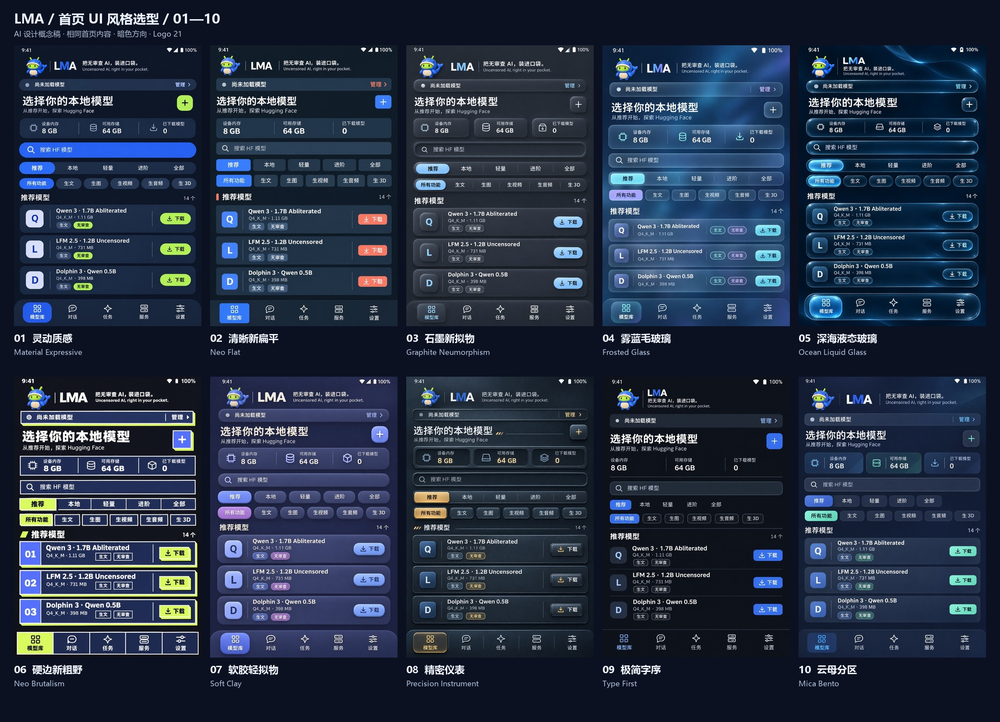

# LMA 首页 UI 风格选型 · 20261103

[English](UI_HOME_SELECTION_20261103.en.md) · [离线选型页](../output/imagegen/lma-home-ui-selection-20261103/index.html) · [十套总览](../output/imagegen/lma-home-ui-selection-20261103/overview.jpg) · [01–05](../output/imagegen/lma-home-ui-selection-20261103/overview-01-05.jpg) · [06–10](../output/imagegen/lma-home-ui-selection-20261103/overview-06-10.jpg)

本轮以当前默认的“模型库 → 推荐”首页为蓝本，提供 **01–10 十套独立生成的暗色设计概念稿**。用于比较设计语言、信息层级、布局密度和控件材质。用户尚未选择 UI 风格；App、APK、v0.4.0 标签和已有 Release 附件保持原身份。

## 1. 现有首页检查

已检查 v0.4.0 的 `index.html`、`app.css`、`app.js` 和固定模型目录；具体文件哈希记录在[来源清单](../output/imagegen/lma-home-ui-selection-20261103/source-context.json)。初始页面是 `models`，初始列表为 `recommended`，而不是对话页面。

| 编号 | 观察 | 本轮设计处理 |
| --- | --- | --- |
| H01 | 顶部品牌、运行状态、标题、资源条和两组筛选叠加，占用较多首屏空间。 | 合并视觉分组、缩短垂直间距，目标为显示至少两张完整模型卡片和第三张模型。 |
| H02 | “推荐／本地／轻量／进阶／全部”和功能筛选是不同维度。 | 两组独立保留，选中态清楚；不为美化移除 HF 搜索或本地管理。 |
| H03 | 模型类型、内容属性、体积和下载动作需要同时辨认。 | 保留独立“生文”和“无审查”标签，固定推荐前缀 `m08 → m06 → m01`。 |
| H04 | 当前默认暗色，Logo 21 和 Slogan 04 已定稿。 | 十套均以暗色方向和已定稿品牌为约束，不重新做 Logo 选型。 |
| H05 | 动态材质可能增加渲染工作。 | 风格选择与性能验收分开；毛玻璃、液态玻璃等落地时需限制效果层，并准备静态替代。 |

参考图包括[已定稿 Logo 21](media/branding/lma-logo.png)与[历史 v0.3.13 真机首页](media/device/v0.3.13/01-recommended.png)。后者只用于内容对照；其浅色、字号与旧品牌不是本轮视觉目标，也不作为 v0.4.0 的新真机证据。

## 2. 十套设计语言

| 编号 | 方向 | 主要视觉差异 | 实现时需关注 | 原图 |
| --- | --- | --- | --- | --- |
| 01 | 灵动质感 / Material Expressive | 色调分层、大胶囊、柔和圆角、钴蓝与青柠。 | 优先用不透明面板与圆角，适合 Android 整体语言。 | [PNG](../output/imagegen/lma-home-ui-selection-20261103/01-material-expressive.png) |
| 02 | 清晰新扁平 / Neo Flat | 二维色块、清楚字级、紧凑列表、珊瑚辅助色。 | 依靠排版与分隔建立层次，减少装饰。 | [PNG](../output/imagegen/lma-home-ui-selection-20261103/02-neo-flat.png) |
| 03 | 石墨新拟物 / Graphite Neumorphism | 同色基底、双向软阴影、凹入搜索与凸起卡片。 | 保证文字／选中态对比，限制阴影数量。 | [PNG](../output/imagegen/lma-home-ui-selection-20261103/03-neumorphism.png) |
| 04 | 雾蓝毛玻璃 / Frosted Glass | 漫射背景、烟蓝半透明层、细亮边框。 | 保证卡片文字清楚，避免大面积实时模糊。 | [PNG](../output/imagegen/lma-home-ui-selection-20261103/04-frosted-glass.png) |
| 05 | 深海液态玻璃 / Ocean Liquid Glass | 透镜边缘、镜面高光、悬浮导航。 | 图像折射是概念效果；不预先承诺移动端实现或开销。 | [PNG](../output/imagegen/lma-home-ui-selection-20261103/05-liquid-glass.png) |
| 06 | 硬边新粗野 / Neo Brutalism | 粗线框、硬投影、大字重、青柠强调。 | 控制描边密度，避免标签和按钮争抢注意力。 | [PNG](../output/imagegen/lma-home-ui-selection-20261103/06-neo-brutalism.png) |
| 07 | 软胶轻拟物 / Soft Clay | 哑光体积、蓬松控件、蓝紫与奶油色。 | 小范围模拟体积，不让公仔装饰挤占模型列表。 | [PNG](../output/imagegen/lma-home-ui-selection-20261103/07-claymorphism.png) |
| 08 | 精密仪表 / Precision Instrument | 阳极金属、嵌入式读数、细刻线与琥珀指示。 | 使用克制静态纹理，不增加无关仪表或虚构性能数字。 | [PNG](../output/imagegen/lma-home-ui-selection-20261103/08-industrial-skeuomorphic.png) |
| 09 | 极简字序 / Type First | 弱卡片、细分隔、模型名称主导、单一蓝色。 | 排版与触控区都要明确，避免极简变成难操作。 | [PNG](../output/imagegen/lma-home-ui-selection-20261103/09-minimal-typography.png) |
| 10 | 云母分区 / Mica Bento | 静态色层、资源分区格、克制圆角与层叠。 | 在现有 Android WebView 中表达层次，不依赖其他系统的材质接口。 | [PNG](../output/imagegen/lma-home-ui-selection-20261103/10-fluent-bento.png) |

表内为设计与落地判断，不是手机性能排名。所有方案复用同一内容简报，但允许材质、卡片、字级和导航表达发生变化。

## 3. 查看和选择

打开[选型页](../output/imagegen/lma-home-ui-selection-20261103/index.html)，点击任一图片查看原图；勾选最多三套后并排比较，复制编号。选择会在浏览器允许时保存在本机。页面可离线打开，没有外部脚本、字体、统计或网络请求；本轮没有启动浏览器进行页面验收。

可以直接说明“选 03”，或组合偏好，例如“03 的卡片、01 的色板、09 的底部导航”。定稿后再将一套统一规则覆盖模型库、对话、任务、服务、设置及弹窗，校正控件、文本、无障碍和窄屏状态。

原图包：[01–05 ZIP](../output/imagegen/lma-home-ui-selection-20261103/LMA-home-ui-01-05.zip)／[06–10 ZIP](../output/imagegen/lma-home-ui-selection-20261103/LMA-home-ui-06-10.zip)。ZIP 包含该组原始 PNG 与提示词；完整离线选型页位于仓库的对应输出目录。

## 4. 生成方式与边界

- 使用用户指定的 `sub2-image-gen` 本地技能脚本，以 **gpt-image-2.5／high／1024×1536／PNG** 逐套生成；实际调用为脚本支持的 `edit`，Logo 与历史首页均作为图片参考上传至已配置网关。没有更换模型或供应商。
- 这十张是独立生成的原图，未通过滤镜或程序换色制造风格。原始字节、实际尺寸和 SHA256 见[素材清单](../output/imagegen/lma-home-ui-selection-20261103/manifest.json)。预览与总览只做缩放排版。
- 图中 Logo 是参考生成的形象，落地时应复用正式 Logo 位图；AI 生成文字、图标、间距和材质仍需人工校正。展示的 `8 GB／64 GB／0` 为统一设计数据，不是设备测量。
- 本轮未修改应用前端，未下载或运行手机模型，未测试玻璃材质性能。设计稿不代表 Android 页面已实现、可访问性已通过或手机运行效果。
- 公开文件不含网关地址配置、密钥或请求头。未使用 Docker、WSL、虚拟机、模拟器或浏览器。用于生成样例的电脑绘图网关不构成 LMA App 的远程推理功能。

[文件检查](../output/imagegen/lma-home-ui-selection-20261103/validation.json)仅核对图像、包与来源；静态脚本语法、离线资源和仓库文档链接另做程序检查。[维护说明](releases/v0.4.0-home-ui-selection.md)

| 编号 | 本轮事项 | 状态 |
| --- | --- | --- |
| C01 | 检查首页内容和选型约束，生成十种设计语言的首页稿。 | 已交付，详见原图与来源清单。 |
| C02 | 原图、预览、三份总览、离线选择／对比页、双语说明。 | 已交付；页面仅做静态程序检查。 |
| P01 | 用户确定整体风格或组合偏好。 | 待选择。 |
| P02 | 将所选设计统一应用到全部页面，并验证布局、交互与性能。 | 待定稿后实施，本轮未改 App。 |
| P03 | v0.4.0 原有真机／视觉编解码／后台耐久补证、三组视觉组件身份、历史视频与 3D 质量问题。 | 保留原状态，不由设计稿替代验收。 |
