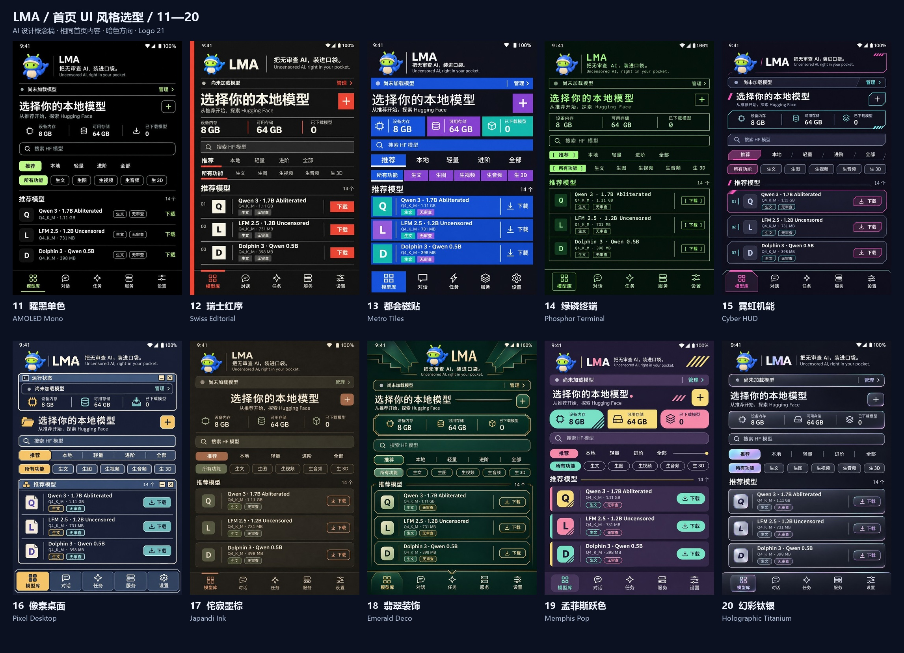

# LMA homepage visual selection, batch 2 · 11–20

[中文](UI_HOME_SELECTION_20261103_BATCH2.md) · [Offline selector](../output/imagegen/lma-home-ui-selection-20261103-batch2/index.html) · [Overview](../output/imagegen/lma-home-ui-selection-20261103-batch2/overview.jpg) · [First batch 01–10](UI_HOME_SELECTION_20261103.en.md)

The user requested ten more directions. **11–20 are ten independently generated homepage concepts**, bringing the total to twenty. All retain dark mode, Logo 21/Slogan 04, HF search, separate catalogue/task filters, the `m08 → m06 → m01` prefix, explicit downloads and five navigation destinations. Layout, typography, geometry and materials vary; no filter or program recolor creates the alternatives.

## 1. Directions

| ID | Direction | Signature | Original |
| --- | --- | --- | --- |
| 11 | AMOLED Mono | Pure black, fine rules, limited lime accents and borderless rows; no battery claim. | [PNG](../output/imagegen/lma-home-ui-selection-20261103-batch2/11-amoled-monochrome.png) |
| 12 | Swiss Editorial | Vermilion spine, square controls, strict grid and strong type hierarchy. | [PNG](../output/imagegen/lma-home-ui-selection-20261103-batch2/12-swiss-editorial.png) |
| 13 | Metro Tiles | Rectangular color tiles, resource cells and flat download areas. | [PNG](../output/imagegen/lma-home-ui-selection-20261103-batch2/13-metro-tiles.png) |
| 14 | Phosphor Terminal | Monospace green text, single rules, bracketed controls and file-list organization. | [PNG](../output/imagegen/lma-home-ui-selection-20261103-batch2/14-retro-terminal.png) |
| 15 | Cyber HUD | Clipped corners, restrained cyan/magenta emphasis and technical outlines. | [PNG](../output/imagegen/lma-home-ui-selection-20261103-batch2/15-cyberpunk-hud.png) |
| 16 | Pixel Desktop | Stepped borders, small pixel icons, grouped panels and amber selection. | [PNG](../output/imagegen/lma-home-ui-selection-20261103-batch2/16-pixel-desktop.png) |
| 17 | Japandi Ink | Warm dark ink, quiet paper texture, terracotta and sage. | [PNG](../output/imagegen/lma-home-ui-selection-20261103-batch2/17-japandi-ink.png) |
| 18 | Emerald Deco | Dark emerald, champagne lines, stepped symmetry and controlled ornament. | [PNG](../output/imagegen/lma-home-ui-selection-20261103-batch2/18-art-deco.png) |
| 19 | Memphis Pop | Aubergine, pink/mint/yellow, flat geometric marks and mixed outlines. | [PNG](../output/imagegen/lma-home-ui-selection-20261103-batch2/19-memphis-pop.png) |
| 20 | Holographic Titanium | Opaque graphite plates, pearlescent edges, cool silver actions and limited iridescence. | [PNG](../output/imagegen/lma-home-ui-selection-20261103-batch2/20-holographic-metal.png) |

These are visual interpretations, not full platform-spec implementations or measured phone performance. Production work must translate the pictures into coherent typography, controls, layouts and states.

## 2. Selection and files

The [second selector](../output/imagegen/lma-home-ui-selection-20261103-batch2/index.html) enlarges originals and compares up to three choices. It copies IDs, uses its own local storage key and links back to batch 1. Choose a complete direction or describe a combination, such as “14 lists with 18 colors.”

- Group boards: [11–15](../output/imagegen/lma-home-ui-selection-20261103-batch2/overview-11-15.jpg) / [16–20](../output/imagegen/lma-home-ui-selection-20261103-batch2/overview-16-20.jpg).
- Original/prompt bundles: [11–15 ZIP](../output/imagegen/lma-home-ui-selection-20261103-batch2/LMA-home-ui-11-15.zip) / [16–20 ZIP](../output/imagegen/lma-home-ui-selection-20261103-batch2/LMA-home-ui-16-20.zip). The full offline selector resides in the repository output directory.
- [Dimensions and hashes](../output/imagegen/lma-home-ui-selection-20261103-batch2/manifest.json), [source context](../output/imagegen/lma-home-ui-selection-20261103-batch2/source-context.json), [artifact checks](../output/imagegen/lma-home-ui-selection-20261103-batch2/validation.json).

## 3. Generation and evidence scope

The requested **sub2-image-gen / gpt-image-2.5 / high / 1024×1536 / PNG** route is retained. The skill script's `edit` command uploads Logo 21 and the historical v0.3.13 homepage as image references; current v0.4.0 structure is checked against source. No provider or model fallback is used. Native PNG bytes are preserved; previews and boards only resize/arrange them.

The generated mascot is a reference interpretation; production work should reuse the approved bitmap. AI text, icons, touch targets and narrow layouts require correction. `8 GB / 64 GB / 0` are design data, not measurements. Terminal/HUD styling adds no command execution, invented runtime statistics or remote inference.

Checks cover visual inspection of each image, decoding/dimensions/hashes, static offline assets, script syntax, archives and documentation links. No browser-interaction, Android, complete-model or material-performance acceptance is established. No browser or virtualization is launched; public artifacts exclude gateway configuration, credentials and headers.

Batch 1 images, packages and selector retain their bytes. The shared design-material packager supports another ID range and separate choice storage; application behavior, APK, tags and published Release assets remain unchanged. [Maintenance note](releases/v0.4.0-home-ui-selection-batch2.md)

| ID | Delivery or remaining work | State |
| --- | --- | --- |
| C01 | Ten additional originals, previews, three boards and two bundles. | Delivered. |
| C02 | Offline comparison, separate stored choices, prompts, provenance and bilingual documentation. | Delivered; static checks only. |
| P01 | User chooses a direction or combination from 01–20. | Pending. |
| P02 | Apply the chosen language throughout the app and verify interaction/layout/performance. | After selection. |
| P03 | Existing v0.4.0 device/codec/endurance evidence, three projector identities and historical video/3D quality gaps. | Retain their original pending state. |
