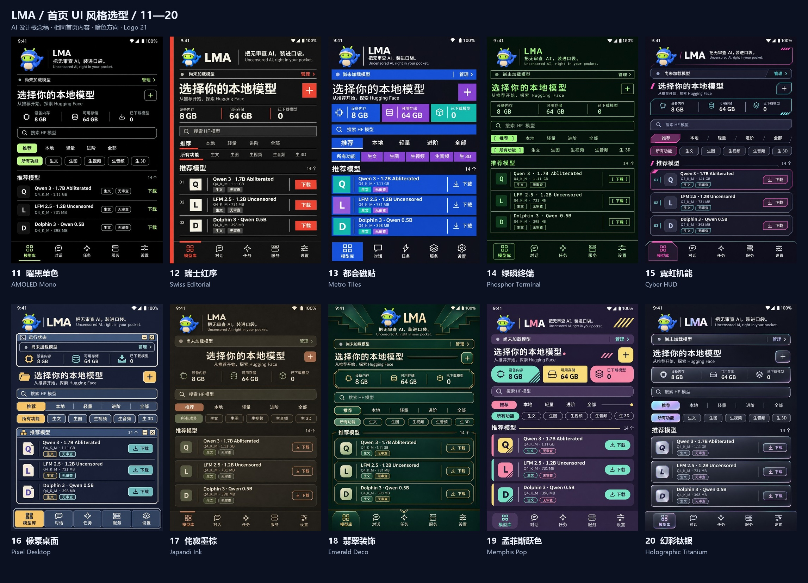

# LMA 首页 UI 第二批选型 · 11–20

**2026-11-03 已定稿：10 号「云母分区」。** 后续以[完整设计规范](design/MICA_BENTO.md)、[组件](design/COMPONENTS.md)和[明暗／宽窄机型适配](design/RESPONSIVE.md)实施。Logo 21 与标语 04 保留；本页原稿作为档案，App 改造待完成。

[English](UI_HOME_SELECTION_20261103_BATCH2.en.md) · [第二批离线选型页](../output/imagegen/lma-home-ui-selection-20261103-batch2/index.html) · [总览](../output/imagegen/lma-home-ui-selection-20261103-batch2/overview.jpg) · [第一批 01–10](UI_HOME_SELECTION_20261103.md)

按用户“再出 10 种”的要求，新增 **11–20 十套独立生成的首页设计稿**，与第一批合计 20 套。继续以“模型库 → 推荐”为页面内容，保留暗色、Logo 21／Slogan 04、HF 搜索、两组独立筛选、推荐前缀 `m08 → m06 → m01`、逐模型下载以及五项底部导航。十套主要改变版式、字级、几何与材质，不通过换色或滤镜扩充数量。

## 1. 设计方向

| 编号 | 名称 | 主要差异 | 原图 |
| --- | --- | --- | --- |
| 11 | 曜黑单色 / AMOLED Mono | 纯黑画布、细分隔、少量青柠与无框列表；不预设省电结论。 | [PNG](../output/imagegen/lma-home-ui-selection-20261103-batch2/11-amoled-monochrome.png) |
| 12 | 瑞士红序 / Swiss Editorial | 红色轴线、方形操作区、严格网格和强字级。 | [PNG](../output/imagegen/lma-home-ui-selection-20261103-batch2/12-swiss-editorial.png) |
| 13 | 都会磁贴 / Metro Tiles | 直角磁贴、彩色资源格、平面下载区与轻字重。 | [PNG](../output/imagegen/lma-home-ui-selection-20261103-batch2/13-metro-tiles.png) |
| 14 | 绿磷终端 / Phosphor Terminal | 等宽文字、单线框、方括号按钮与文件列表感。 | [PNG](../output/imagegen/lma-home-ui-selection-20261103-batch2/14-retro-terminal.png) |
| 15 | 霓虹机能 / Cyber HUD | 切角线框、青粉双强调与克制发光。 | [PNG](../output/imagegen/lma-home-ui-selection-20261103-batch2/15-cyberpunk-hud.png) |
| 16 | 像素桌面 / Pixel Desktop | 阶梯描边、像素图标、面板分组与琥珀选中态。 | [PNG](../output/imagegen/lma-home-ui-selection-20261103-batch2/16-pixel-desktop.png) |
| 17 | 侘寂墨棕 / Japandi Ink | 暖墨棕、纸感细纹、陶土和鼠尾草、安静留白。 | [PNG](../output/imagegen/lma-home-ui-selection-20261103-batch2/17-japandi-ink.png) |
| 18 | 翡翠装饰 / Emerald Deco | 深翡翠、香槟金细线、阶梯几何和对称分区。 | [PNG](../output/imagegen/lma-home-ui-selection-20261103-batch2/18-art-deco.png) |
| 19 | 孟菲斯跃色 / Memphis Pop | 茄紫底、粉薄荷黄、平面几何点缀和混合轮廓。 | [PNG](../output/imagegen/lma-home-ui-selection-20261103-batch2/19-memphis-pop.png) |
| 20 | 幻彩钛银 / Holographic Titanium | 不透明钛灰面板、珠光细边、冷银按钮和局部幻彩。 | [PNG](../output/imagegen/lma-home-ui-selection-20261103-batch2/20-holographic-metal.png) |

这些为视觉方向描述，不是对某套平台规范的完整实现，也不是性能或手机画面验收。定稿时需把 AI 稿中的字体、控件间距、材质和状态转换成一致的前端规则。

## 2. 选择与文件

在[第二批选型页](../output/imagegen/lma-home-ui-selection-20261103-batch2/index.html)可查看原图，勾选最多三套并排比较并复制编号；页面提供返回第一批的链接。第二批的本机选择记录与第一批隔离。当前已选择第一批 10 号，本页仅保留历史比较能力，不构成新的待选任务。

- 分组总览：[11–15](../output/imagegen/lma-home-ui-selection-20261103-batch2/overview-11-15.jpg)／[16–20](../output/imagegen/lma-home-ui-selection-20261103-batch2/overview-16-20.jpg)。
- 原图与提示词包：[11–15 ZIP](../output/imagegen/lma-home-ui-selection-20261103-batch2/LMA-home-ui-11-15.zip)／[16–20 ZIP](../output/imagegen/lma-home-ui-selection-20261103-batch2/LMA-home-ui-16-20.zip)。ZIP 为原图包；完整离线页面位于仓库输出目录。
- [尺寸、原始字节与 SHA256](../output/imagegen/lma-home-ui-selection-20261103-batch2/manifest.json)、[来源清单](../output/imagegen/lma-home-ui-selection-20261103-batch2/source-context.json)、[文件检查](../output/imagegen/lma-home-ui-selection-20261103-batch2/validation.json)。

## 3. 生成与检查范围

仍使用用户指定的 **sub2-image-gen／gpt-image-2.5／high／1024×1536／PNG**。通过技能脚本的 `edit` 命令上传正式 Logo 21 与历史 v0.3.13 首页两张参考图；当前 v0.4.0 页面结构由源码核对。没有切换模型或供应商。十张原图独立生成，保留原始字节，预览和总览只缩放排版。

图中 Logo 为参考生成的形象；实施时应复用正式品牌位图，校正中文与模型字段、图标、触控区和窄屏。`8 GB／64 GB／0` 为设计示意数据，不是设备测量。复古终端和 HUD 仅为视觉语言，不新增命令执行、运行统计或远程推理。

本轮仅做逐张视觉查看、图像解码／尺寸／哈希、离线资源、脚本语法、包及文档链接检查；没有浏览器交互、Android、模型或材质性能验收。未启动浏览器、Docker、WSL、虚拟机或模拟器。公开材料不包含网关配置、密钥或请求头。

第一批原图、包和选型页均保留。仅更新共用的设计材料打包工具以及本批静态页面，不修改 App／APK、发布标签或已有 Release 附件。[本轮维护说明](releases/v0.4.0-home-ui-selection-batch2.md)

| 编号 | 本轮实现／待办 | 状态 |
| --- | --- | --- |
| C01 | 11–20 十种新方向、原图、预览、三份总览及两组原图包。 | 已交付。 |
| C02 | 独立选择记录的离线对比页、提示词、来源、双语文档和更新说明。 | 已交付；页面检查为静态程序范围。 |
| P01 | 从 01–20 选择整体风格。 | 已完成：第一批 10 号；第二批保留档案。 |
| P02 | 将定稿风格应用到各页面并验证明暗、适配、交互与性能。 | 待实施；已有完整约束规范。 |
| P03 | 既有 v0.4.0 真机、视觉编解码、后台耐久、三组视觉组件身份和历史视频／3D 质量补证。 | 保留版本文档中的原状态，不由设计稿代替。 |
