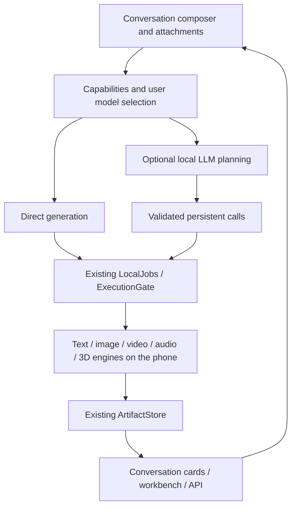

# LMA · 20261102 update direction

[中文](UPDATE_DIRECTION_20261102.md) · [Documentation](README.md) · [Structured plan and language-model tags](proposals/update-direction-20261102.json)

Date: 2026-11-02, Asia/Taipei. Baseline: stable **v0.3.13 / code63**, commit `6957f30d7ced8a68e33446424740b9b7bf4eae89`. This document specifies the next functional update. **Proposed features are not implemented by this documentation change.** No future app version is assigned and published attachments remain immutable. This maintenance delivers the plan, a per-model selection-tag inventory and evidence rules; app filters, attachment conversations and generation cards remain implementation work.

## 01 · Product direction and one delivery

Develop LMA into **a local multimodal creation app with conversation as its entry point**. Users enter text, attach local assets and choose models in one conversation to generate text, images, video, audio and 3D assets. Conversations, tasks, artifacts, model management and the API share the existing foundation. “Model generation” here means 3D assets, not language-model or LoRA training.

Recommend **① manual creation modes + ② an optional local language-model planner + ③ reusable task templates** in the same functional delivery. Dependency order does not create separate release tracks. A fully autonomous looping Agent is neither the default interaction nor a new requirement of this update.

| Choice | Interaction | Scope | Benefit and boundary |
| --- | --- | --- | --- |
| ① | Select image/video/audio/3D manually | Required; establish the direct path first | Works without installing or loading a text LLM |
| ② | A local LLM interprets intent and proposes typed calls | Required optional entry point | Users can disable it; validate the model, template and arguments, and retain an editable draft on failure |
| ③ | Ordered conversation tasks and templates | Required | Trace, cancel and reuse image→video or text→speech without a node canvas |
| ④ | Fully autonomous long-running Agent | Not the default; outside the new mandatory scope | Core creation must not depend on repeated guesses and model reloads |

Preserve the entire existing scope: **F01–F12, text, selections 01–14/16/17, every frozen subtarget, SD 1.5/SDXL LoRA, 62 recipes, 82 default bundles, 18 extension engines plus text and 14 recommendations**. This update adds interaction and capability descriptions; it does not remove adapters or turn outstanding quality checks into passes. The [original plan](MULTIMODAL_RELEASE_PLAN.en.md) retains its historical scope; this dated plan defines the new conversation integration.

## 02 · Continuing requirements

| ID | Requirement |
| --- | --- |
| R01 | APK updates deliver the foundation and catalogue metadata. Users explicitly select/download/import weights, vision encoders, projectors, tokenizers, codecs and voices. Installation, upgrades, browsing and planning never download them implicitly. |
| R02 | Preprocessing, tokenization, planning, inference, decoding and composition run on the same Android phone, without ROOT. LAN API access invokes that phone; there is no off-device inference or fallback. |
| R03 | Models remain peers. Generation, understanding, dependencies, format, content, installation, device suitability and evidence are independent dimensions. |
| R04 | Preserve the `m08 → m06 → m01` recommendation prefix, labels and the other 11 recommendations. All/HF discovery remains open to other models; Local manages user assets. |
| R05 | Context/output/sampling/backend settings remain per model. Editable presets and native/UI clamping enforce limits. A task override does not silently update model defaults. |
| R06 | Do not impose a fixed model-generation deadline. HTTP wait/connection budgets are independent; explicit cancellation, memory protection and genuine errors remain. |
| R07 | Newly generated videos must have actual duration **>5 seconds**, without looping/repeated frames or retiming to pass. Explain incompatible model configurations. This does not restrict input-video duration. |
| R08 | Preserve port **52187**, existing migration, signing identity, model IDs, settings and history. Keep released tags/assets immutable. |
| R09 | No ComfyUI wiring, infinite canvas, public user nodes or plugin ecosystem. Internal versioned adapters and dependent task execution remain appropriate. |
| R10 | Regular validation uses program contracts and bounded fixtures. Record necessary authorized phone checks separately from source checks, actual output, quality and endurance. |
| R11 | Default to a dark appearance. Fresh installs and upgrades without a stored theme use dark even when the system is light. Preserve valid dark/light/system preferences; appearance is an app-level setting. |

## 03 · Existing code and missing integration

| ID | Current implementation | Required addition |
| --- | --- | --- |
| B01 | `Chats` uses SQLite version 1 with text content/reasoning; snapshots contain up to 40 sessions/80 messages and generation history has separate bounds | Typed parts, attachments, job relations, lossless migration and older-history pagination |
| B02 | `ChatRunner.send` requires a text model; its stream handles content/reasoning without executing `tool_calls` | Direct media creation without an LLM and streamed tool-call assembly/execution/result continuation |
| B03 | `llama-server` already uses `--jinja` | Verify exact models/templates; the flag alone is not an orchestration loop |
| B04 | LocalJobs already provides frozen arguments, idempotency, persistent jobs/events, cancellation/retry and the common execution slot | Reliable conversation links to those same jobs, without another execution queue |
| B05 | ArtifactStore already validates media and provenance and protects leases/job references; workbench results can become inputs | Persistent conversation references, lineage, deletion protection and contextual asset selection |
| B06 | Background snapshots, UI signature caching and active-page refresh already exist; changed chat content still rebuilds all message DOM | Keyed message/part updates, lazy media, scoped state and pagination |
| B07 | The GLB viewer already opens on demand and disposes resources | Reuse it and bound active media/3D instances in conversation |
| B08 | The language catalogue uses `llama_text`; a projector cannot be selected as a standalone text model | Explicit compatible vision bundles and a local multimodal bridge, retaining the standalone-projector guard |
| B09 | The API publishes eligible installed/configured models and supports image/speech subsets plus LMA asynchronous jobs | Use the same jobs from conversations and extend capability metadata without advertising planning as native generation |

Source: [Chats.java](../app/src/main/java/com/lma/app/Chats.java), [ChatRunner.java](../app/src/main/java/com/lma/app/ChatRunner.java), [EngineHost.java](../app/src/main/java/com/lma/app/EngineHost.java), [app.js](../app/src/main/assets/app.js), [LocalJobs.java](../app/src/main/java/com/lma/app/LocalJobs.java), [ArtifactStore.java](../app/src/main/java/com/lma/app/core/ArtifactStore.java) and [ModelPublication.java](../app/src/main/java/com/lma/app/ModelPublication.java). This is a source/design review, not a new performance measurement.

## 04 · Language-model selection tags

Selection must expose **native inputs, native outputs, tool support, operations available in LMA, missing requirements and evidence**. Calling an image tool does not make a text LLM an image generator. Reading its answer through TTS does not make that LLM a native speech model.

| ID | Dimension | Labels / stable identifiers | Rule |
| --- | --- | --- | --- |
| T01 | Native inputs | Text, image/video/audio understanding; `input:text/image/video/audio` | Identify the exact variant. Native video requires temporal information and its processor; sampled-image descriptions are a separate composition |
| T02 | Native outputs | Text/image/video/audio/3D; `output:text/image/video/audio/3d` | Distinguish speech from music/effects and geometry from materials |
| T03 | Understanding tasks | Image QA, OCR, transcription, audio QA, video summaries, spatial understanding | Require evidence per task; vision input alone does not establish OCR or mesh understanding |
| T04 | Tools and structure | Tool calling, structured JSON; `tool:calling`, `output:json` | Separate training/template claims, parser checks and actual model behavior; `--jinja` is insufficient |
| T05 | Composed capabilities | Voice conversation, sampled-video understanding, visual description with narration, image-tool orchestration | Show the ASR/vision/TTS/generator dependencies; do not add these to one LLM's native input/output list |
| T06 | Foundation requirements | llama.cpp/mtmd, ORT, MNN, sd.cpp, sherpa-onnx, components/recipes | Expand architecture, backend, format, license and verified component pairing |
| T07 | LMA integration | Integrated, not integrated, unsupported, unknown | Independent of native capability; unknown never means immediately runnable |
| T08 | Assets and device | Not downloaded, missing vision component, configured, resources unknown, insufficient memory | Compute from the actual phone/user assets; catalogue metadata does not reveal installation |
| T09 | Evidence | Official card, publisher metadata, family candidate, program checks, phone output, quality acceptance | Store capability, export, integration and device evidence separately, with date/source/revision/hash and limits |
| T10 | Content | NSFW, Uncensored/Abliterated | Preserve separate content labels and publisher-vs-metadata evidence; do not merge them with capability/quality |

Evidence values: `publisher_declared` is an explicit author statement; `publisher_metadata` is repository task/configuration metadata; `family_candidate` applies only to an upstream family; `not_supported` needs variant-specific grounds; `unknown` means insufficient evidence. Missing claims do not establish non-support. None of these states grants phone validation.

Show the most useful 4–6 labels on cards, with expandable details. Use text/icons as well as color. An example is `Text output`, `Image understanding · upstream metadata`, `Video understanding · family candidate`, `LMA vision pending`, `Uncensored`. Only show “missing vision component” after checking actual installed assets.

Recommended, All/HF, Local and conversation model selectors must share descriptors and filters for input, output, tool use, local availability/downloadability/pending integration and evidence. Filtering must not rewrite recommendation order. HF discovery uses bounded pages and user-triggered metadata reads, not background scans of the Hub; cached offline results show their update time.

### Tags for all 14 existing language models

These are **selection-plan records**, also available in the [structured inventory](proposals/update-direction-20261102.json). Their current APK entries still use the text path. This table does not claim attachment chat or per-model text inference has passed.

| ID | Existing model | Native/candidate tags | Current LMA multimodal boundary |
| --- | --- | --- | --- |
| m08 | Qwen 3 1.7B Abliterated | Text input/output; existing recommendation | Text entry; verify tool behavior per template |
| m06 | LFM 2.5 1.2B Uncensored | Text input/output; existing recommendation | Does not inherit capabilities of other LFM vision/audio products |
| m01 | Dolphin 3 Qwen 2.5 0.5B | Text input/output; existing recommendation | Not Qwen2.5-VL |
| m05 | Gemma 3 1B Abliterated | Text input/output | The 1B text variant does not inherit 4B vision |
| m04 | Dolphin 3 Llama 3.2 1B | Text input/output | Not Llama Vision |
| m03 | Qwen 3.5 0.8B Abliterated | Text output; image understanding · publisher metadata; video · family candidate | LMA vision not integrated; selected GGUF/projector pairing unverified |
| m09 | Qwen 3.5 2B Abliterated | Text output; image understanding · publisher metadata; video · family candidate | Same; upstream capability does not prove a complete quantized export |
| m11 | Dolphin 3 Qwen 2.5 3B | Text input/output | Not Qwen2.5-VL |
| m12 | Dolphin 3 Llama 3.2 3B | Text input/output | Text variant; does not inherit vision from other sizes |
| m13 | Llama 3.2 3B Uncensored | Text input/output | Same |
| m14 | Qwen 3 4B Instruct 2507 Abliterated | Text input/output | Does not inherit Qwen3-VL/Qwen3.5 capabilities |
| m16 | Gemma 3 4B Abliterated v2 | Text output; image understanding · publisher metadata | LMA vision/export pairing pending; do not label native video |
| m10 | LFM 2.5 2.6B Uncensored | Text input/output | Does not inherit other LFM vision/audio products |
| m15 | Qwen 3.5 4B HauhauCS Aggressive | Text output; image/video understanding · publisher declared | Author lists mmproj; exact pinned pairing, download management and Android bridge pending |

Sources: Qwen [0.8B](https://huggingface.co/Qwen/Qwen3.5-0.8B), [2B](https://huggingface.co/Qwen/Qwen3.5-2B) and [4B](https://huggingface.co/Qwen/Qwen3.5-4B), plus [Huihui 0.8B](https://huggingface.co/huihui-ai/Huihui-Qwen3.5-0.8B-abliterated) and [Huihui 2B](https://huggingface.co/huihui-ai/Huihui-Qwen3.5-2B-abliterated) publisher metadata. Upstream vision does not prove the selected GGUF includes its visual parts. The [HauhauCS 4B card](https://huggingface.co/HauhauCS/Qwen3.5-4B-Uncensored-HauhauCS-Aggressive) explicitly lists a vision encoder and image/video inputs; its fixed export still needs pairing checks.

Google's [1B](https://huggingface.co/google/gemma-3-1b-it) and [4B](https://huggingface.co/google/gemma-3-4b-it) have different inputs; [m16 publisher metadata](https://huggingface.co/mlabonne/gemma-3-4b-it-abliterated-v2-GGUF) lists image-text-to-text. Text selections are additionally grounded in [Qwen3](https://huggingface.co/Qwen/Qwen3-1.7B), [Qwen2.5 0.5B](https://huggingface.co/Qwen/Qwen2.5-0.5B-Instruct), [Qwen2.5 3B](https://huggingface.co/Qwen/Qwen2.5-3B-Instruct), [Llama3.2 3B](https://huggingface.co/meta-llama/Llama-3.2-3B-Instruct), [LFM 1.2B](https://huggingface.co/LiquidAI/LFM2.5-1.2B-Instruct) and [LFM 2.6B](https://huggingface.co/LiquidAI/LFM2.5-2.6B). Assess derivatives/quantizations against their exact source separately.

This review used public pages and downloaded no weights. Native Windows requests for four fixed-revision HF metadata records timed out; complete file trees/projector hashes were not obtained. Export pairing therefore remains unverified. Neither a live card nor a network failure establishes compatibility or non-support for a pinned artifact.

## 05 · Conversation behavior

The composer provides **Auto / Chat / Image / Video / Audio / 3D** and local attachments. Show the selected model, available capabilities, temporary parameters and explicit asset references. A 3D generator and an LLM understanding mesh input are separate capabilities; a GLB viewer establishes neither.

| ID | User action | Required behavior |
| --- | --- | --- |
| U01 | Only an image model is installed; select Image and send | Create a conversation card and submit the existing image job without requiring a text LLM |
| U02 | Ask Auto to generate a sunset image | Optional local planning produces a typed draft; show target/assets/settings and use user-selected defaults, never guess/download models |
| U03 | Attach an image and ask about it | Send actual image content only to an integrated vision model with matching assets; text-only models require reselection |
| U04 | Ask to turn “this image” into a six-second video | Resolve the exact asset and require an image-conditioned video route; text-only video generation is not I2V |
| U05 | Select narration, or record a question | TTS can run directly; understanding a recording requires a native audio model or an explicit local ASR→LLM composition |
| U06 | Generate 3D from an image and export | Use a compatible image→mesh route and existing viewer; expose geometry/material outputs and real failures |
| U07 | Switch sessions, lock the phone or reopen the app | Recover by persisted job ID; opening a page does not generate again and native services retain ownership |
| U08 | Edit a previous prompt/settings or retry | Create a related revision/job; preserve old inputs, errors and results. Only an explicit “save model defaults” action persists defaults |

Auto does not promise that every LLM can plan. Missing planners, incompatible tool formats or invalid outputs retain an editable draft and the manual path. When “this image/previous audio” has multiple candidates, users explicitly select the intended asset.

### Default dark appearance and saved preferences

**Added requirement: dark is the default theme.** A fresh installation opens with dark gray/near-black surfaces, distinguishable cards and readable text, even when Android uses light mode. Keep Dark / Light / System choices and persist the user's selection without resetting it on launch or upgrade.

Only upgrades without a saved theme adopt the dark default. Preserve every valid stored value; when historical records cannot establish whether a value was explicitly selected, retain it. Appearance belongs to app settings rather than individual models and must not change model parameters, downloads, jobs, artifacts or API behavior.

Cover launch backgrounds, native windows/status/navigation bars, the first WebView frame, model/chat/job/artifact/service/settings screens, dialogs, loading, error and empty states. Native and web surfaces apply the same choice without a white flash. Labels, inputs, disabled controls and focus remain readable. Preserve original image/video/3D material colors and exported/model-generated content. Include this work in **D10**, validate through **A33**, and deliver it with the same functional update.

## 06 · Shared architecture and data

| Object | Suggested fields/ownership | Constraint |
| --- | --- | --- |
| Conversation | ID, title and current selections; preserve old session IDs | Several models may execute in one session; old session.model is not universal provenance |
| Message | ID, role, parts, status, timestamps and parent/revision | Typed text, artifact_ref, job_ref, tool_call, tool_result; preserve content/reasoning compatibility |
| AttachmentRef | Managed artifactId/inputId, MIME, bytes, digest and purpose | No raw paths, temporary authorized URLs or large base64 in chat records; retain leases/validation |
| ConversationJobLink | sessionId, messageId, jobId, requestKey and status | Reference the canonical existing job, whether manual/tool/template initiated |
| ToolCallRecord | callId, originating model, parsed arguments, jobId and summary | Admit once, validate before dispatch, link results before continuation |
| ArtifactLineage | Output, parent assets/jobs, model file identities and frozen parameters | Retrying never overwrites output; deleting a conversation does not implicitly delete media |
| TaskTemplate / Chain | Version, steps, dependencies, settings and IO contracts | Controlled internal operations; no arbitrary scripts or external graph/plugin imports |

Implement actual schema migration and rollback. Convert old text to text parts while retaining reasoning, errors, timestamps and order; add cursor pagination. **The SQLite chat store and existing job store do not share one transaction.** Use persisted submission intents/outbox, stable request keys, job lookup and startup reconciliation so crashes before/after admission cannot duplicate generation.

Extend asset reference protection to conversations. Active leases, pending jobs and pinned conversation references are tracked separately. Show referencing owners before cleanup. Removing a session normally releases its own references without deleting shared outputs, models or other sessions' assets. History pruning must respect existing JobStore/ArtifactStore capacity limits.

## 07 · Native understanding and local tool execution

Vision-language execution is explicit foundation work. Inspect the packaged native runtime/build options, then implement a compatible mtmd/multimodal bridge, main-GGUF/projector bundle descriptors, explicit transfers, image preprocessing, timestamp-aware video sampling/templates, visual-token/context budgets and cancellation/resource release. Frame count, resolution, timespan and visual tokens must fit model/device constraints; do not promise unlimited long-video input.

The [llama.cpp multimodal guide](https://github.com/ggml-org/llama.cpp/blob/master/docs/multimodal.md) describes model/projector loading; its current upstream list is not the supported list of LMA's packaged build. HF's [multimodal template guide](https://huggingface.co/docs/transformers/chat_templating_multimodal) distinguishes typed content and model-specific processors. Android adaptation remains required; Python/desktop examples are not phone acceptance.

Implement streamed `tool_calls` aggregation → JSON/schema validation → tool/operation allowlist → model/asset preflight → durable job admission → result-summary insertion → LLM continuation. Keep text and reasoning separate. Never execute arbitrary prose or code blocks as commands. See [official llama.cpp tool documentation](https://github.com/ggml-org/llama.cpp/blob/master/docs/function-calling.md).

The initial controlled tools cover `image.generate`, `video.generate`, `speech.synthesize`, `audio.generate`, `mesh.generate`, job status and asset selection; local composition needs its own operation. These tools grant no implicit download, destructive-data, arbitrary-path, shell or external-inference authority. Validate JSON structure separately from the model's ability to choose an appropriate tool.

Default to at most **8 automatic steps per plan and 1 automatic model repair**. These are loop-count limits, not generation timeouts. Explicit user retries create new attempts. Persist planning state and release heavy planner residency before media computation. Reuse the existing execution slot and text restoration, avoiding a text reload while a media stage still needs the memory.

## 08 · Task templates and phone composition

| ID | Template | Requirements |
| --- | --- | --- |
| W01 | Prompt→image | Image generator; LLM optional |
| W02 | Image→short video | Actual image-conditioned route and duration >5 seconds; not a T2V substitute |
| W03 | Prompt→narration text→TTS | Local LLM or user text plus TTS; select speech/music separately |
| W04 | Image→3D geometry→optional materials | Compatible mesh/material stages; empty previews are not successful geometry |
| W05 | Image/video + narration/music→finished media | New local composition operation with explicit track/gain/mix/trim/silence rules; preserve originals |
| W06 | Understand image/recording/video→text | Integrated native model or explicitly labeled local composition, not a media generator masquerading as perception |

Chain states include draft, awaiting assets/models, ready, queued, running, succeeded, failed, cancelled and dependency-blocked. Every step references an existing job and frozen inputs. Failed dependencies block descendants while successful outputs remain. Reuse requires explicit selection and matching identities/settings. Parent cancellation prevents new stages and cancels active work; terminal states follow actual exit. Existing video encoding alone is not general audio/video editing.

## 09 · Performance and observability

| ID | Work | Acceptance focus |
| --- | --- | --- |
| P01 | Incremental message/part updates | A token/progress event must not rebuild the full conversation; retain throttling/active-page guards |
| P02 | Pagination/thumbnails | Cursor history and image thumbnails; no raw media in message records |
| P03 | Player/GLB lifecycle | Decode/play on demand, release offscreen/on exit, reuse existing GLB disposal and bound active instances |
| P04 | One heavy execution scheduler | Chat/tools/workbench/API share ExecutionGate; avoid planner/generator memory overlap |
| P05 | Scoped state and caches | Conversation/job/model revisions; token events do not rescan every model/artifact or rehash disk files |
| P06 | Phone diagnostics | Actual stages, queue wait, available RSS/thermal/error observations; mark unavailable measurements unknown |
| P07 | Background/cancellation | Native ownership, no duplicate on reopen, confirmed worker/media cleanup after cancel |
| P08 | Reproducible comparisons | Same device/scenario, exact APK, cold/warm state and history scale; separate UI latency from inference cost |

Suggested program fixtures contain **100 sessions, 1,000 mixed messages and 100 asset references**, mounting only the latest page of roughly 40–80 messages. Check targeted updates, lazy decoding and complete older-page access. These are test inputs/budgets, **not measured phone capacity or speed promises**. Establish same-device interaction/frame-time/memory baselines before reporting gains.

The existing 6.125-second Wan output took about 732 seconds on the phone; that evidence belongs to [v0.3.12](DEVICE_BENCHMARK_V0312.en.md). Conversation integration reduces interaction work, not inference cost. The tested device was motorola edge plus/SM8250; it does not validate Nubia Z20 or Motorola X30.

## 10 · API, publication and shared capabilities

Keep `/v1/models` limited to **complete installed/configured models** on the phone, including unloaded entries. HF search results and uninstalled candidates are not callable models. Preserve stable IDs and `x_lma`; distinguish native model capabilities, implemented LMA operations, component requirements and evidence. Label translation must not change API identifiers.

| ID | Contract |
| --- | --- |
| Q01 | Selectors, preflight, tools and publication share one source and native/UI validation; unknown/pending capabilities cannot dispatch. |
| Q02 | Preserve standard image/speech subsets; video/music/3D/chains use explicit asynchronous LMA extensions, without an invented standard OpenAI 3D block. |
| Q03 | Multimodal Chat Completions remains a proposed per-type subset. An upstream `video_url` example does not establish standard client or LMA compatibility. |
| Q04 | Conversations, workbench and API show the same job ID/status/output; retries, restart and SSE reconnection do not regenerate. |
| Q05 | Public metadata excludes private paths, conversation text, credentials, system prompts and user media. |
| Q06 | Preserve revisions, caching/ETag, pagination, authentication, instance binding and permission filtering. Sub2API dispatches only real operations from this phone. |

See [API](API.en.md), [current multimodal API](LOCAL_API_V0312.en.md) and [Sub2API contract](SUB2API_OPENAI.en.md). This plan does not implement Responses, standard Videos, Realtime or image edits. Complete WAV output remains distinct from true incremental speech.

## 11 · Errors and recovery

| ID | Failure | Required handling |
| --- | --- | --- |
| E01 | Missing/unverified model/projector/codec pairing | Explain exact missing/unverified components before execution; users select assets, with no implicit download/model switch |
| E02 | Image sent to text-only model, transcription to TTS, I2V to T2V | Reject by capability and retain draft; never discard attachment content and continue silently |
| E03 | Invalid tools, duplicate calls, excess steps | Schema validation, idempotency and loop bounds; preserve diagnostics/editable plan without endless self-repair |
| E04 | OOM, unsupported backend, hash mismatch, `empty_structure` | Preserve real classification/provenance, release resources and offer a new user-configured attempt |
| E05 | HTTP wait expires, SSE disconnects or app backgrounds | Native service keeps admitted jobs; query/reconnect by ID, without interpreting disconnect as cancel |
| E06 | Process death/device restart | Reconcile persisted state and show interruption; claim compute resume only for genuine checkpoint-capable backends |
| E07 | Corrupt media/export error/deleting referenced media | Validate actual files, preserve inputs, protect references and offer reselection/export; no placeholder success |

Continue tracking genuine TRELLIS/Pixal3D output failures and `empty_structure`. Chat integration does not replace native model repairs. Export diagnostics through an allowlist excluding private prompts, reference recordings, keys and filesystem paths.

## 12 · Work packages and feasibility

All **D01–D12 belong to one functional update**. Implementation/check ordering does not automatically defer mandatory items to another version. App integration is feasible; quality, memory and model reliability still depend on exact artifacts and devices.

| ID | Work | Reuse/risk | Completion |
| --- | --- | --- | --- |
| D01 | Capability descriptors, tags/evidence and all 14 language records | Reuse catalogues; avoid family-name inference | Shared across Recommended/All/Local/chat/API with explicit unknowns |
| D02 | Local vision-language assets and execution bridge | Higher architecture/pairing/build risk | Supported matrix, transfer management, preprocessing/templates, cancellation/resources and bounded evidence |
| D03 | Typed messages and lossless migration | History/pagination/cross-store recovery | Preserve IDs/text/reasoning/errors; reconcile without duplicated admission |
| D04 | Composer, attachments, manual creation, model selector | Reuse workbench schemas | Admit all four media families without a text LLM; reject incompatible inputs |
| D05 | Conversation cards and persistent job links | Reuse LocalJobs/events | Progress/cancel/result/retry match workbench/API |
| D06 | Tools, schema validation, continuation and loop limits | Template/model reliability | Durable paired calls/results; validate, deduplicate and recover to drafts |
| D07 | Asset context, lineage and reference cleanup | Extend existing leases | Deterministic references and no accidental shared-file deletion |
| D08 | Dependent steps and reusable templates | Reuse one execution slot | Block/cancel/retry correctly, freeze settings and explicitly reuse outputs |
| D09 | Local audio/video composition | New operation, synchronization/encoding | Validate real inputs/output, cancellation, errors and duration rules |
| D10 | Default dark appearance, rendering, media memory and scoped state | Reuse theme choices and preserve idle fixes | Dark defaults, preference retention and first-frame consistency; pagination, incremental updates, lazy decoding, cleanup and comparable baselines |
| D11 | API/publication/Sub2API consistency | Preserve existing contracts | Real operations, ownership, auth/idempotency/events regressions |
| D12 | Entire frozen-scope regression, docs/media and stable release | Preserve historical quality/3D limits | Relevant program checks, necessary phone integration, bilingual scenarios/failures/screens/GIF/video and a new stable release |

Dependencies: D01 supports D02/D04/D06/D11; D03 supports D05/D07; D05/D06 support D08; D09 joins D08; D10 applies throughout; D12 consolidates acceptance. D02 architecture mismatches require adaptation rather than a “supported” label.

## 13 · Unified acceptance

These are **future acceptance conditions, not passes from this maintenance turn**.

| ID | Condition |
| --- | --- |
| A01 | Installation/upgrade/browsing/planning never downloads models implicitly; files/settings/signer/port are preserved. |
| A02 | All 14 records expose input/output/tools/LMA state/evidence while preserving recommendations and Uncensored tags. |
| A03 | No false vision on Gemma1B, Qwen2.5 or Llama1B/3B; Qwen3.5 candidates do not imply LMA integration. |
| A04 | Missing claims stay unknown; family/metadata/pinned-export/program/phone/quality evidence stays separate. |
| A05 | Combined filters, offline cache and local readiness agree across four model-selection surfaces. |
| A06 | GGUF/projector identities, terms and compatibility are traceable with explicit component transfers and shared deletion protection. |
| A07 | Actual typed image input reaches an adapted bridge; text-only paths do not pretend to see discarded attachments. |
| A08 | Native video and sampled-image composition remain distinct; temporal/frame/token budgets and cancellation work. |
| A09 | Pending audio/transcription/OCR/3D-understanding features remain explicit, not opened by a generic multimodal tag. |
| A10 | Migration/rollback preserve IDs/text/reasoning/errors/order, with complete cursor history access. |
| A11 | Manual image/video/audio/3D admission works without a text model. |
| A12 | One card links to one canonical job; crashes around cross-store admission cannot duplicate it. |
| A13 | Streamed calls/IDs/arguments/errors/results correlate; ordinary prose is not executable. |
| A14 | Excess steps, invalid tools/models/arguments and duplicate calls are blocked while drafts remain editable. |
| A15 | Model settings are independent and clamped; temporary overrides do not persist and frozen inputs/settings remain auditable. |
| A16 | Contextual asset references resolve deterministically, with a selector for ambiguity. |
| A17 | Leases/jobs/conversations protect references; session deletion does not remove assets used elsewhere. |
| A18 | Image→video requires the corresponding input capability; actual generated duration exceeds five seconds without fabricated repetition. |
| A19 | TTS, music/effects and image→geometry/materials route by their actual input contracts. |
| A20 | Local composition checks tracks/length/gain/cancel/corruption/file validity and preserves originals. |
| A21 | Chains block dependencies, cancel parents and retry steps correctly without implicit re-execution of successes. |
| A22 | Chat/tools/workbench/API share one heavy slot; planner release/text restoration do not contend with media. |
| A23 | HTTP/SSE disconnects never cancel admitted generation; no fixed generation deadline. |
| A24 | Interrupt/recovery states are truthful and non-checkpoint backends do not claim compute resume. |
| A25 | Long-history fixtures update only target blocks; invisible media stays undecoded and players/GLB release on exit. |
| A26 | Idle/model-free pages perform no inference/weight scans; scoped snapshots retain prior performance fixes. |
| A27 | Chat/task list/API agree on IDs/status/cancel/artifacts/idempotency. |
| A28 | Publication includes only eligible local models; tags cannot expand real operations and privacy/auth/cache contracts remain. |
| A29 | OOM/hash/unsupported/empty_structure/corrupt-media errors are classified and actionable; original failures are retained. |
| A30 | Regress all 62 recipes/82 bundles/18 extension engines plus text, 14 recommendations and every frozen target. |
| A31 | Separate program/selected phone/output/quality/endurance evidence with exact versions/APKs; no restored all-model long-run prerequisite. |
| A32 | Synchronize complete bilingual docs/scenarios/failures, labeled real/fixture media and release notes; push normally and publish a new stable release. |
| A33 | Fresh installs and upgrades without a saved theme default to dark even on a light system. Preserve valid preferences and persist Dark/Light/System changes. Launch/native bars/WebView/screens/dialogs agree without white flashes; labels remain readable and media colors intact. Theme changes do not affect model assets/parameters/jobs/API. |

## 14 · Delivered and outstanding

| ID | Delivered this turn | Boundary |
| --- | --- | --- |
| C01 | Dated bilingual plan, tag vocabulary and all 14 selection records | Documentation/catalogue proposal, not an app feature |
| C02 | Unified chat/vision/jobs/artifacts/tools/composition/performance/API work packages | D01–D12, one functional delivery |
| C03 | Numbered acceptance, sources and preserved real-failure boundaries | A01–A33 are future conditions; no inference this turn |
| C04 | Default dark requirement, preference retention and first-frame/surface rules | R11/D10/A33; current APK appearance behavior is unchanged |

| ID | Outstanding | Meaning |
| --- | --- | --- |
| D01–D12 | Implement and deliver the functional plan | Documents/JSON/model cards are not implementation acceptance |
| V01 | Verify pinned visual exports/projector pairing and implement the Android bridge | Keep insufficient metadata unknown |
| V02 | Existing 3D empty_structure, image/video quality and resource limits | Repair/test independently from conversation integration |
| V03 | Comparable phone performance, selected integration and background scope | Report actual results without all-device/all-model/endurance claims |

No APK/UI changes are made here, so no new screen/GIF/video capture or republishing of the same version is warranted. Existing media retains its identity. D12 requires updated media and a new stable release with the functional changes. Documentation/JSON checks stay separate from v0.3.13 program/device counts.
