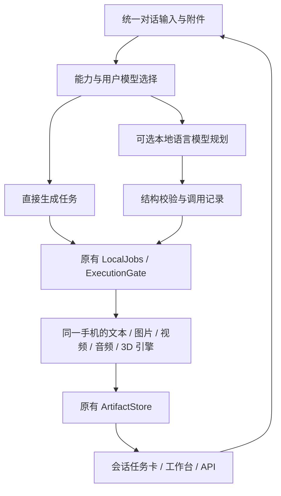

# LMA · 20261102 内容更新方向方案

[English](UPDATE_DIRECTION_20261102.en.md) · [文档目录](README.md) · [结构化方案与语言模型标签](proposals/update-direction-20261102.json)

日期：2026-11-02，Asia/Taipei。方案基线：正式版 **v0.3.13 / code63**，提交 `6957f30d7ced8a68e33446424740b9b7bf4eae89`。本文是下一次功能更新的需求与实施方案，**不表示下列功能已进入现有 APK**，不预先指定新版本号，也不改写已发布的附件。此次维护交付文档、逐模型标签清单和选型规则；App 内新标签筛选、多模态对话与任务链均待按本文开发。

## 01 · 产品方向与统一交付范围

将 LMA 建设为**以对话为入口的本地多模态创作工具**。用户在同一个会话中输入文字、附加本地素材、选择模型，完成生文、生图、生视频、生音频和生 3D；任务、产物、本地模型管理及 API 共用现有基座。这里“生模型”指生成 3D 资产，不包含训练语言模型或 LoRA。

推荐组合为 **①手动创作模式＋②可选语言模型调度＋③可复用任务模板**。三者进入同一次功能交付；工作包的依赖顺序不构成分版本路线。④完全自主反复执行的 Agent 不作为默认交互，也不列为本次新增必需功能。

| 编号 | 交互方案 | 本次定位 | 用户收益与限制 |
| --- | --- | --- | --- |
| ① | 手动选择生图／视频／音频／3D | 必需，优先打通 | 没装或没加载语言模型也能从对话窗口生成 |
| ② | 本地语言模型理解意图、生成结构化调用 | 必需的可选入口 | 用户可关闭；模型、模板和参数校验通过后才调度，失败可退回同一任务草稿 |
| ③ | 会话中的有序任务与模板 | 必需 | 图片→视频、文本→配音等过程可追踪、取消、复用；没有无限画布 |
| ④ | 全自动长链 Agent | 不设为默认，不纳入本次新增必需项 | 不用它承担基础创作流程，避免连续猜测和反复加载模型 |

既有全部范围保留：**F01–F12、生文、01–14／16／17、全部冻结子目标、SD 1.5／SDXL LoRA、62 个配方、82 个默认模型包、18 类扩展引擎加文本、14 项推荐**。本方案增加交互与能力描述，不删减既有适配，也不把尚未完成的质量验收改成通过。旧范围见[完整基线](MULTIMODAL_RELEASE_PLAN.md)，本日期方案负责描述新的对话集成方向。

## 02 · 必须持续满足的规则

| 编号 | 规则 |
| --- | --- |
| R01 | APK 更新只提供基座与目录元数据；模型、视觉编码器、projector、tokenizer、codec、音色等由用户明确选择后下载或导入。安装、升级、浏览、自动规划不触发下载。 |
| R02 | 分词、预处理、规划、推理、解码、合成均在同一 Android 手机完成。内网 API 只是手机的调用入口；不接入远程推理或异机回退。无需 ROOT。 |
| R03 | 模型全部平级。生成、理解、依赖、格式、内容、安装状态、设备适配和验证状态分别描述。 |
| R04 | 保留推荐前缀 `m08 → m06 → m01`、现有标签及其余 11 项推荐；全部／HF 搜索允许其他模型，本地页统一管理用户资产。 |
| R05 | 上下文、输出上限、采样、后端等跟随模型保存。编辑框允许手填，原生和界面共同检查上限并回填；任务临时覆盖不自动改写模型默认值。 |
| R06 | 单次生成不设固定耗时上限。HTTP 等待、连接预算与任务生命周期分开；主动取消、内存保护和真实错误继续有效。 |
| R07 | 新生成视频的真实媒体时长必须 **>5 秒**；不重复帧、变速或循环补足时长。模型配置无法满足时说明限制。输入视频不受这个生成验收条件限制。 |
| R08 | 保留默认端口 **52187**、已有迁移、签名、模型 ID、参数和用户历史；旧标签／Release 附件保持原身份。 |
| R09 | 不建设 ComfyUI 连线、无限画布、公共用户节点或插件生态；内部版本化适配器和有依赖的任务调度继续使用。 |
| R10 | 常规验证优先程序合同和有界夹具；必要的已授权真机检查单独记录。代码通过、真实模型输出、质量和后台耐久分别验收。 |
| R11 | 软件默认采用暗色调。首次安装及无主题记录的升级使用暗色，不受系统浅色模式影响；已有有效的暗色／浅色／跟随系统选择保留，主题属于应用级偏好。 |

## 03 · 当前程序与新增工作的边界

| 编号 | 当前代码事实 | 本次需要补齐 |
| --- | --- | --- |
| B01 | `Chats` 使用版本 1 SQLite，消息主要是 content／reasoning 文本；快照最多 40 会话／80 条消息，发送历史另有限额 | 带类型的内容块、附件和任务关系、旧记录无损迁移、历史分页 |
| B02 | `ChatRunner.send` 要求文本模型；流只处理文字／思考，没有执行 `tool_calls` | 无语言模型的生成入口、工具调用片段汇集／执行／结果回填 |
| B03 | `llama-server` 已带 `--jinja` | 核对模板和具体模型能力；已有参数不等于完整工具闭环 |
| B04 | 已有 LocalJobs、冻结参数、幂等、持久任务／事件、取消／重试和统一执行槽 | 会话与原任务可靠关联，不能复制出另一套任务或另开重计算队列 |
| B05 | ArtifactStore 已有校验、来源、租约、任务引用保护；工作台可将结果作为下次素材 | 会话长期引用、素材来源链、删除保护及上下文素材选择 |
| B06 | 已有后台快照、界面签名缓存、按页面刷新；聊天变更时仍整体重建消息 DOM | 按消息／内容块更新、附件懒加载、增量状态与分页 |
| B07 | GLB 查看器已有资源清理和按需打开 | 会话复用现有查看器，限制活跃播放器和 3D 实例 |
| B08 | 文本目录当前走 `llama_text`；HF 文件选择不允许把 projector 单独作为文本模型 | 增加匹配视觉组件的独立包路线与本地多模态运行桥，保留单独 projector 禁载规则 |
| B09 | API 已公布合格的已下载／已配置模型，支持图片／语音子集与 LMA 异步任务 | 对话复用相同任务；扩展能力描述，不把规划能力当作可执行生成能力 |

依据：[Chats.java](../app/src/main/java/com/lma/app/Chats.java)、[ChatRunner.java](../app/src/main/java/com/lma/app/ChatRunner.java)、[EngineHost.java](../app/src/main/java/com/lma/app/EngineHost.java)、[app.js](../app/src/main/assets/app.js)、[LocalJobs.java](../app/src/main/java/com/lma/app/LocalJobs.java)、[ArtifactStore.java](../app/src/main/java/com/lma/app/core/ArtifactStore.java)、[ModelPublication.java](../app/src/main/java/com/lma/app/ModelPublication.java)。本轮只是审查和设计，没有重新测量运行性能。

## 04 · 语言模型多模态标签规范

选型时必须同时回答：**模型能接收什么、原生输出什么、能否调度工具、当前 LMA 能调用什么、还缺什么、证据到哪一级**。语言模型调用生图工具，不会因此获得“原生生图”标签；TTS 播放回答也不会让原文本模型变成原生语音模型。

| 编号 | 标签维度 | 显示示例／稳定标识 | 规则 |
| --- | --- | --- | --- |
| T01 | 原生输入 | 文字、图片理解、视频理解、音频理解；`input:text/image/video/audio` | 精确到模型变体。视频需保留时间信息与对应处理器；抽帧图片描述单独标为组合能力 |
| T02 | 原生输出 | 生文、生图、生视频、生音频、生 3D；`output:text/image/video/audio/3d` | 按实际输出类型。音频再区分语音、音乐／音效；3D 区分几何／材质 |
| T03 | 理解任务 | 看图问答、OCR、转写、音频问答、视频摘要、空间理解 | 有来源或适配证据才声明；有视觉输入不直接保证 OCR、3D 理解或全部细分任务 |
| T04 | 工具与结构 | 工具调用、结构化 JSON；`tool:calling`、`output:json` | 模型训练／模板声明、解析器程序检查和实际模型能力分别记录，不能仅凭 `--jinja` 打“已验证” |
| T05 | 组合能力 | 语音对话、抽帧理解、读屏后配音、调度生图 | 显示所需的 ASR／视觉／TTS／生成模型，不写入单个语言模型的原生输入输出 |
| T06 | 基座依赖 | llama.cpp／mtmd、ORT、MNN、sd.cpp、sherpa-onnx、组件／配方 | 架构、后端、格式、必需组件、许可和哈希配对可展开查看 |
| T07 | LMA 接入状态 | 已接入、待接入、不支持、未知 | 与模型原生能力独立；未知不能显示成可立即运行 |
| T08 | 资产与设备状态 | 未下载、缺视觉组件、配置有效、资源待评估、内存不足 | 按当前手机和用户资产实时计算，不从公共目录猜测用户安装情况 |
| T09 | 能力证据 | 官方说明、发布者元数据、家族候选、程序通过、真机输出、质量验收 | 能力、导出、LMA 接入、真机结果分字段记录；每项带来源、日期、revision／哈希及限制 |
| T10 | 内容属性 | NSFW、Uncensored／Abliterated | 保留专门标签；作者声明与元数据线索分开，不与多模态能力或质量合并 |

**状态表达：** `publisher_declared` 表示发布者文字声明；`publisher_metadata` 表示仓库任务／配置元数据；`family_candidate` 只代表上游家族存在能力；`not_supported` 需要明确变体依据；`unknown` 表示没有足够证据。缺少声明不等于“不支持”。这些都不能自动升级为手机验证通过。

建议卡片首屏只显示选型最相关的 4–6 个标签，其他信息放“全部能力”。所有状态带文字／图标，不仅依赖颜色。可见例子：`生文`、`图片理解·上游声明`、`视频理解·家族候选`、`LMA视觉待接入`、`Uncensored`；“缺视觉组件”只能在检查本地资产后显示。

在推荐、全部／HF 搜索、本地、会话模型选择器使用同一能力描述与筛选器。增加“输入类型”“输出类型”“工具调用”“本机可用／可下载／待适配”“证据级别”，支持组合筛选。推荐顺序不因筛选数据回写而改变。HF 搜索采用有界分页和用户触发的元数据读取，不后台扫描整个 Hub；离线使用缓存并显示更新时间。

### 现有 14 个语言模型的标签清单

以下是**选型方案标签**，对应[结构化清单](proposals/update-direction-20261102.json)。当前 APK 的这 14 个目录项仍走文本入口；本表不声称已经实现附件对话或逐个完成文本运行验证。

| ID | 现有模型 | 应显示的原生能力／候选标签 | 当前 LMA 多模态状态 |
| --- | --- | --- | --- |
| m08 | Qwen 3 1.7B Abliterated | 文字输入、生文；现有推荐保留 | 纯文本入口；工具能力按具体模板另核对 |
| m06 | LFM 2.5 1.2B Uncensored | 文字输入、生文；现有推荐保留 | 不继承其他 LFM 视觉／音频型号的能力 |
| m01 | Dolphin 3 Qwen 2.5 0.5B | 文字输入、生文；现有推荐保留 | 不是 Qwen2.5-VL |
| m05 | Gemma 3 1B Abliterated | 文字输入、生文 | 1B 是文本变体，不套用 4B 视觉标签 |
| m04 | Dolphin 3 Llama 3.2 1B | 文字输入、生文 | 不是 Llama Vision |
| m03 | Qwen 3.5 0.8B Abliterated | 生文；图片理解·发布者元数据；视频理解·家族候选 | LMA 视觉待接入；所选 GGUF 与视觉组件配对待核对 |
| m09 | Qwen 3.5 2B Abliterated | 生文；图片理解·发布者元数据；视频理解·家族候选 | 同上，不从原版模型推断量化包已完整 |
| m11 | Dolphin 3 Qwen 2.5 3B | 文字输入、生文 | 不是 Qwen2.5-VL |
| m12 | Dolphin 3 Llama 3.2 3B | 文字输入、生文 | 3B 文本变体，不继承其他体量的视觉能力 |
| m13 | Llama 3.2 3B Uncensored | 文字输入、生文 | 同上 |
| m14 | Qwen 3 4B Instruct 2507 Abliterated | 文字输入、生文 | 不套用 Qwen3-VL／Qwen3.5 标签 |
| m16 | Gemma 3 4B Abliterated v2 | 生文；图片理解·发布者元数据 | LMA 视觉待接入；导出配对待核对；不直接标原生视频理解 |
| m10 | LFM 2.5 2.6B Uncensored | 文字输入、生文 | 不继承 LFM 的其他视觉／音频产品能力 |
| m15 | Qwen 3.5 4B HauhauCS Aggressive | 生文；图片／视频理解·发布者声明 | 作者列出 mmproj；当前固定量化版本的配对／下载／本机桥仍待接入 |

依据：Qwen 的[0.8B](https://huggingface.co/Qwen/Qwen3.5-0.8B)、[2B](https://huggingface.co/Qwen/Qwen3.5-2B)、[4B](https://huggingface.co/Qwen/Qwen3.5-4B)资料，以及 [Huihui 0.8B](https://huggingface.co/huihui-ai/Huihui-Qwen3.5-0.8B-abliterated)、[Huihui 2B](https://huggingface.co/huihui-ai/Huihui-Qwen3.5-2B-abliterated)发布元数据。上游支持视觉不证明当前 GGUF 包已带视觉部件。HauhauCS [4B 发布说明](https://huggingface.co/HauhauCS/Qwen3.5-4B-Uncensored-HauhauCS-Aggressive)明确列出视觉编码器及图片／视频输入；仍须核对固定文件版本。

Google 的 [1B](https://huggingface.co/google/gemma-3-1b-it) 与 [4B](https://huggingface.co/google/gemma-3-4b-it)属于不同输入配置；[m16 发布仓库](https://huggingface.co/mlabonne/gemma-3-4b-it-abliterated-v2-GGUF)的任务元数据是图文输入。纯文本组选型依据还包括 [Qwen3](https://huggingface.co/Qwen/Qwen3-1.7B)、[Qwen2.5 0.5B](https://huggingface.co/Qwen/Qwen2.5-0.5B-Instruct)、[Qwen2.5 3B](https://huggingface.co/Qwen/Qwen2.5-3B-Instruct)、[Llama3.2 3B](https://huggingface.co/meta-llama/Llama-3.2-3B-Instruct)、[LFM 1.2B](https://huggingface.co/LiquidAI/LFM2.5-1.2B-Instruct)、[LFM 2.6B](https://huggingface.co/LiquidAI/LFM2.5-2.6B)。派生／量化文件的完整能力仍按精确来源单独核对。

本轮通过公开页面核对声明，没有下载权重。原生 Windows 直连 HF 对 4 个固定版本元数据请求超时，未取得完整文件树或 projector 哈希；因此保留“导出配对待核对”，不能把实时页面或网络失败当作固定量化资产的通过／不支持证据。

## 05 · 对话窗口的使用逻辑

输入区统一提供 **自动／对话／生图／生视频／音频／3D**，附件入口可选择本地图片、音频、视频及受支持资产。显示当前处理模型、可用能力、临时参数和素材引用。3D 生成入口与 3D 理解输入分别判断；能预览 GLB 不代表语言模型能读懂网格。

| 编号 | 用户操作 | 程序行为 |
| --- | --- | --- |
| U01 | 只装生图模型，切换“生图”并发送提示词 | 建立会话任务卡，直接提交现有图片任务，不要求加载文本模型 |
| U02 | 自动模式输入“给我生成一张海边日落” | 可选本地规划器输出调用草稿；显示目标模型／素材／参数，使用用户已选默认模型，不猜测或自动下载模型 |
| U03 | 附图后问“图里有什么” | 仅向已接入并满足组件条件的视觉语言模型发图；仅文本模型提示改选，不能只把文件名发给模型冒充看图 |
| U04 | 对图片结果说“把这张做成 6 秒视频” | 将明确引用的图片交给支持图片输入的视频路线；T2V 专用模型不伪装成 I2V |
| U05 | 输入文字并选择配音；或录音提问 | 配音可直接选 TTS；录音理解需原生音频模型或明确的本地 ASR→语言模型组合，不能默认所有 TTS 都可转写 |
| U06 | 选图片生成 3D，查看模型并导出 | 使用兼容的 image→mesh 路线；卡片显示 GLB／几何／材质结果及真实错误，复用现有查看器 |
| U07 | 返回应用／切换会话／锁屏后恢复 | 按持久任务 ID 恢复进度；重新进入页面不重复生成，任务仍属于原生服务 |
| U08 | 修改前一次提示词、参数或重试 | 创建有父关系的新任务／修订，保留旧输入、失败和结果；仅“保存为模型默认值”写回模型配置 |

“自动”是入口模式，不承诺任意语言模型都能规划。没有可用规划模型、工具格式不适配或输出不合法时，保留可编辑草稿，用户仍能使用手动模式。多个“这张图／上一段音频”候选同时存在时，在输入区明确选定素材，不静默猜测。

### 默认暗色调与主题偏好

**新增需求：默认主题为暗色。** 新安装第一次进入即使用深灰／近黑背景、分层卡片和清晰文字；系统处于浅色模式也不改变这个默认。继续提供“暗色／浅色／跟随系统”选项，用户主动选择后独立保存，不在每次启动或升级时重置。

升级仅在没有主题偏好记录时采用暗色；已有有效主题值一律保留。旧值无法区分是否由用户手选时，也按现有记录保留。主题是应用级设置，不随模型切换而改变，不影响模型参数、下载、任务、产物或 API。

覆盖启动背景、原生窗口与状态栏／导航栏、WebView 首帧、模型／对话／任务／素材／服务／设置页面及弹窗、加载、错误和空状态。原生与网页应用相同主题，避免进入页面先闪白再变暗。标签、输入框、禁用状态和焦点保持可读；图片、视频、3D 材质、媒体导出和模型生成内容不因主题被反色。该项并入 **D10**，按 **A33** 验收，与本方案同次交付。

## 06 · 共用架构与消息数据

| 对象 | 建议字段与归属 | 关键约束 |
| --- | --- | --- |
| Conversation | id、标题、当前选择；保留旧 session ID | 会话可有多个执行模型，不能只用旧 session.model 代表全部来源 |
| Message | id、role、parts、状态、时间、修订／父消息 | parts 支持 text、artifact_ref、job_ref、tool_call、tool_result；保留旧 content／reasoning 的兼容读取 |
| AttachmentRef | artifactId／受管 inputId、MIME、大小、摘要、所选用途 | 不保存裸文件路径、临时授权 URL 或巨量 base64；继续使用租约与格式校验 |
| ConversationJobLink | sessionId、messageId、jobId、requestKey、状态 | jobId 指向原任务，卡片不是第二个任务；来源可为手动、工具或模板 |
| ToolCallRecord | callId、原始模型引用、解析后参数、jobId、结果摘要 | 同一调用只接纳一次；参数先验证，工具结果与原调用关联后再续写 |
| ArtifactLineage | 输出、父素材／任务、模型文件身份、参数快照 | 来源可追踪，重试不覆盖旧产物；删除会话与删除素材为独立动作 |
| TaskTemplate / Chain | 版本、步骤、依赖、参数、输入输出约束 | 仅受控内部步骤与模板，不执行任意脚本或导入外部节点图 |

需要真实数据库升级与失败回滚，不仅在 JSON 中加几个字段。旧纯文本消息迁移为 text 块，原思考、错误、时间和会话次序保留；使用游标分页补足历史访问。**SQLite 会话与现有任务存储不在同一事务中**：采用持久提交意图／outbox、稳定 requestKey、任务查询和启动时对账，使“卡片写入后崩溃”和“任务接纳后崩溃”都能恢复且不重复生成。

会话引用要纳入素材删除保护；活动租约、待运行任务、会话固定素材各自计数。清理前显示引用来源；删除会话默认解除该会话引用，不自动删除共享产物、模型或另一会话的素材。历史容量与清理规则必须兼容现有 JobStore／ArtifactStore 的容量上限。

## 07 · 本地多模态理解与工具调度

语言模型视觉接入单独列为基础工作，不能只给现有模型增加漂亮标签。先检查打包的原生运行器／构建选项，再增加兼容的 mtmd／多模态桥、主 GGUF＋匹配视觉部件的包描述、显式下载管理、图片预处理、带时间信息的视频采样与消息模板、上下文预算和取消释放。视频的帧数、分辨率、时间跨度及视觉 token 必须计入模型与手机资源约束；不承诺长视频可无限输入。

llama.cpp 的[多模态运行说明](https://github.com/ggml-org/llama.cpp/blob/master/docs/multimodal.md)提供主模型与 projector 的加载方式；其上游支持范围不能直接当作 LMA 打包版本的可用清单。HF 的[多模态模板说明](https://huggingface.co/docs/transformers/chat_templating_multimodal)区分带类型的内容与对应预处理器。本项目仍需原生 Android 适配，不将 Python／桌面示例搬成手机已支持的结论。

工具调度必须实现：流式 `tool_calls` 片段合并→参数 JSON 校验→工具／operation 白名单→模型与资产预检→持久任务接纳→结果摘要回填→语言模型续写。与普通文本流、思考流分开处理，不从任意回答文本或代码块直接执行命令。依据见[官方工具调用说明](https://github.com/ggml-org/llama.cpp/blob/master/docs/function-calling.md)。

初始工具目录覆盖现有 `image.generate`、`video.generate`、`speech.synthesize`、`audio.generate`、`mesh.generate`、任务状态与素材选择；本地合成另建受控 operation。工具不具有下载、删除用户数据、访问任意路径、执行 shell 或调用外部网络推理的隐含权限。结构化 JSON 能力和工具选择正确性分别验证，未知模型不默认标为可靠规划器。

默认一个会话计划最多 **8 个自动步骤**，自动模型修复最多 **1 次**；这是规划循环次数上限，不是生成时长上限。用户明确的重试可建立新任务。开始媒体计算前保存规划状态并释放规划器的重型驻留；延续使用原执行槽与文本恢复机制，避免媒体阶段又自动加载文本争抢内存。

## 08 · 任务链、模板与本地合成

| 编号 | 模板 | 必需能力与限制 |
| --- | --- | --- |
| W01 | 提示词→图片 | 图片生成器；语言模型可选 |
| W02 | 图片→短视频 | 实际支持 image-conditioned video 的路线；生成时长 >5 秒，不用纯 T2V 冒充 |
| W03 | 提示词→旁白文本→TTS | 本地语言模型或用户已有文本＋TTS；语音／音乐分开选 |
| W04 | 图片→3D 几何→可选材质 | 兼容 image→mesh 与材质步骤；几何失败不能以预览空壳算成功 |
| W05 | 图片／视频＋配音／音乐→成片 | 新增同手机媒体合成能力；明确声轨、音量、混音、裁剪／静音补齐规则，保留输入原件 |
| W06 | 图片／录音／视频理解→文字回答 | 已接入的原生理解模型或明确标记的本地组合，不依赖媒体生成器来“理解”素材 |

链状态包含草稿、待素材／模型、就绪、排队、运行、成功、失败、取消和依赖阻断。每一步都有原任务与输入快照；上一步失败，依赖步骤停止，已成功步骤保留。再次执行只复用用户明确选择且身份／参数匹配的产物；取消父链必须阻止新步骤并向活动任务发送取消，最终状态根据实际退出确认。合成是新的程序能力，不应把现有视频编码器描述为已完成任意音视频剪辑。

## 09 · 性能优化与可观测性

| 编号 | 工作 | 验收重点 |
| --- | --- | --- |
| P01 | 增量更新消息和内容块 | 输出一个 token／任务进度时不重建全部聊天记录；保留现有节流与页面活跃判断 |
| P02 | 分页与缩略图 | 长历史按游标读取，图片先缩略图；消息记录不携带媒体原始字节 |
| P03 | 播放器／GLB 生命周期 | 用户点击才解码／播放；离屏、切页、停止后释放；复用已有 GLB 清理，限制同时活跃实例 |
| P04 | 单一重计算调度 | 对话、工具、工作台、API 共用 ExecutionGate；计划步骤有序运行，避免规划器和生成器重叠驻留 |
| P05 | 定向状态与缓存 | 按会话／任务／模型修订发送变更；不在 token 更新时重扫所有模型、素材或磁盘哈希 |
| P06 | 手机资源诊断 | 展示真实阶段、排队等待、可测 RSS、温度与错误原因；无法测量标未知，不伪造百分比和 ETA |
| P07 | 后台／取消 | 原生服务持有任务；界面关闭不再生成第二份，取消后确认工作器与媒体资源释放 |
| P08 | 可复现性能对比 | 同手机、相同 APK 身份／场景、冷暖状态、历史规模，分开记录交互延迟与推理耗时 |

建议程序验收夹具包括 **100 个会话／1,000 条混合消息／100 个素材引用**，默认只挂载最近一页约 40–80 条消息；断言流更新只修改目标行、不可见媒体不启动解码、历史可完整分页访问。这是测试输入与程序预算，**不是已测手机承载量或速度承诺**。点击响应、帧耗时和内存峰值先做相同设备基线，再给出可复核优化幅度。

既有手机 Wan 6.125 秒视频约耗时 732 秒，记录属于 [v0.3.12](DEVICE_BENCHMARK_V0312.md)。整合窗口能降低操作成本，不能消除模型计算成本；在同一手机上做内存调度和模型选型仍是关键。实际测试设备为 motorola edge plus／SM8250；不据此宣称努比亚 Z20 或摩托罗拉 X30 已验证。

## 10 · API、模型广播和标签一致性

保持 `/v1/models` 为当前设备上**已下载完整且配置有效**的调用目录，未加载仍可公布；HF 搜索结果与未下载候选不混入调用名单。对外继续使用稳定模型 ID 和已有 `x_lma` 扩展，在能力对象中分别提供模型原生能力、LMA 已实现 operation、组件要求和证据状态；内部标签翻译不改写 API ID。

| 编号 | 合同要求 |
| --- | --- |
| Q01 | App 选择器、任务预检、工具选择、API 目录使用一个能力来源，前后端共同验证；未知／未接入能力不会被自动路由。 |
| Q02 | 图片／语音标准兼容子集保留，视频／音乐／3D／任务链走明确的 LMA 异步扩展；没有标准 OpenAI 3D 对话块的虚构承诺。 |
| Q03 | 多模态 Chat Completions 输入为待开发的兼容子集，逐类型公布；不要因上游示例出现 `video_url` 就宣布全部 OpenAI 客户端或 LMA 已兼容。 |
| Q04 | 同一任务在会话、工作台与 API 显示同一 ID、状态和产物；请求重试、进程重启、SSE 重连不重新生成。 |
| Q05 | 公共目录仅暴露允许公开的能力与状态，不暴露本地路径、会话内容、密钥、系统提示词或用户媒体。 |
| Q06 | 保留目录修订、缓存／ETag、分页、鉴权、实例绑定和权限过滤；Sub2API 只调度本手机公开的真实 operation，不因候选标签扩大能力。 |

现有协议见[API](API.md)、[当前多模态接口](LOCAL_API_V0312.md)、[Sub2API 规范](SUB2API_OPENAI.md)。Responses、标准 Videos、Realtime、图片编辑等未实现的兼容层不因本方案被视为完成。完整 WAV 和真正增量语音流继续区分。

## 11 · 错误、恢复与用户操作

| 编号 | 场景 | 必需处理 |
| --- | --- | --- |
| E01 | 模型／projector／codec 缺失或配对未知 | 在运行前指出缺少／未核实的组件，让用户选择兼容资产；不隐式下载或换模型 |
| E02 | 文本模型收到图片、TTS 收到转写请求、T2V 收到图生视频请求 | 能力检查拒绝并保留草稿，给出可选模型入口；不丢弃附件继续运行 |
| E03 | 工具输出无效、重复 call、自动步骤过多 | 参数校验、幂等、次数上限；保留原输出／诊断和可编辑计划，不循环自修复 |
| E04 | OOM、后端不支持、组件哈希不符、3D `empty_structure` | 保留真实分类错误和来源，释放资源；用户可调整参数再建新尝试，不假装已修好 |
| E05 | HTTP 等待结束／SSE 断开／App 退后台 | 已接纳任务持续由服务管理，客户通过 ID 查询／重连；连接结束不等于任务取消 |
| E06 | 系统杀进程／设备重启 | 对账恢复已持久状态，明确已中断；只有后端真正支持断点时才称“续算”，否则显式重试 |
| E07 | 媒体损坏／导出失败／用户删除有引用素材 | 校验真实文件，保持输入原件，引用保护并提供重选／导出操作；不把占位图或空 GLB 算成功 |

现有 TRELLIS／Pixal3D 未通过的真实输出与 `empty_structure` 原因继续追踪；对话集成不能替代原生模型修复。导出的诊断按白名单处理，排除私人提示词、参考音频、密钥和磁盘路径。

## 12 · 编号开发工作包与可行性

所有 D01–D12 属于**同一次功能更新**。可先后实现和检查；不把必需项自动排到另一个版本。接口与 UI 的实现可行，模型效果、手机内存和准确率仍受精确模型／组件与设备制约。

| 编号 | 实施内容 | 复用／主要风险 | 完成条件 |
| --- | --- | --- | --- |
| D01 | 能力描述、标签、证据与 14 个语言模型清单 | 复用目录；不能从家族名称误判 | 推荐／全部／本地／会话／API 同源，未知值和证据可解释 |
| D02 | 视觉语言模型的本地组件与运行桥 | 新适配风险较高；检查打包引擎、量化和组件配对 | 明确支持矩阵、下载管理、预处理／模板、取消与资源合同；每项标出实际验证范围 |
| D03 | 消息内容块与数据库无损迁移 | 旧会话、分页、跨存储恢复 | 旧 ID／文本／思考／错误不丢失，重启对账无重复任务 |
| D04 | 统一输入、附件、手动创作与模型选择 | 大量复用工作台 schema | 无 LLM 也可创建四类媒体任务；能力不符明确阻止 |
| D05 | 会话任务卡和持久关系 | 复用 LocalJobs／事件 | 进度、取消、结果、失败／重试与 API 一致 |
| D06 | 工具调用、结构校验、续写与循环限制 | 模板能力和小模型可靠性 | call／result 成对持久化；合法调用才执行，幂等和失败回退可检查 |
| D07 | 素材上下文、来源链与引用清理 | 扩展现有租约／引用 | “这张”指向确定素材，共享文件不被误删 |
| D08 | 有依赖任务与可复用模板 | 复用单执行槽 | 依赖阻断／取消／单步重试、参数快照、已完成结果复用 |
| D09 | 同手机音视频合成 | 新 operation／媒体同步与编码 | 图片／视频／WAV 等真实输入可生成校验输出，错误／时长规则明确 |
| D10 | 默认暗色主题、对话渲染、媒体内存与定向状态 | 复用现有主题选项，保留空闲性能修复 | 暗色默认／偏好保留／首帧一致；分页、增量更新、按需解码、资源释放与相同手机基线对比 |
| D11 | API／广播／Sub2API 能力一致性 | 保持既有合同 | 当前可执行 operation、任务归属、鉴权／幂等／事件回归 |
| D12 | 原冻结范围回归、文档／媒体与正式交付 | 保留质量／3D 历史问题，不以目录完整替代功能 | 受影响程序检查、必要真机联调、双语 README／示例／截图／录屏／GIF、变更说明和新正式 Release |

依赖关系：D01 支撑 D02／D04／D06／D11；D03 支撑 D05／D07；D05／D06 支撑 D08；D09 与 D08 汇合；D10 贯穿实现；D12 汇总验收。D02 的架构不匹配是需要解决的具体适配问题，不能靠添加“已支持”标签关闭。

## 13 · 统一验收清单

以下是待执行的验收条件，**不是本轮测试通过数**。

| 编号 | 验收条件 |
| --- | --- |
| A01 | 安装／升级／浏览／规划均零隐式模型下载；保留用户文件、设置、签名和端口。 |
| A02 | 14 个语言模型全部有输入／输出／工具／LMA 状态／证据字段；保留原推荐与 Uncensored 标签。 |
| A03 | Gemma 1B 不标视觉，Qwen2.5 不套 VL，Llama 1B／3B 不套 Vision；Qwen3.5 候选不冒充 LMA 已接入。 |
| A04 | 缺声明为未知，家族／发布者元数据／固定导出／程序／真机／质量证据不混为一项。 |
| A05 | 多标签组合筛选、离线缓存和本地可用状态在四个入口一致。 |
| A06 | 主 GGUF 与 projector 的固定身份、许可和兼容配对可追踪；组件独立下载／导入并有共享删除保护。 |
| A07 | 已适配的图文输入正确传给视觉桥；只有文本的模型不丢弃附件假装回答。 |
| A08 | 原生视频理解与抽帧组合区分；时间／帧数／视觉 token 预算和取消均有效。 |
| A09 | 未接入的原生音频、转写、OCR 或 3D 理解保持明确状态，不因通用多模态标签开放。 |
| A10 | 旧数据库升级与失败回滚保留全部会话 ID、文本、思考、错误和次序；历史可分页完整访问。 |
| A11 | 无文本模型时，手动入口可接纳图片／视频／音频／3D 的合法任务。 |
| A12 | 每个任务卡对应一个原任务；崩溃发生在跨存储提交前后均不重复接纳。 |
| A13 | 流式工具片段、调用 ID、参数、错误和结果正确关联，普通文本不被当命令执行。 |
| A14 | 超步数、无效工具、错误模型、无效参数或重复调用被阻止，草稿仍可编辑。 |
| A15 | 参数按模型隔离、手填超限回填；临时覆盖不改写默认值，素材／参数冻结可复核。 |
| A16 | “这张图／上一段音频”引用确定素材；歧义有选择入口。 |
| A17 | 活跃租约／任务／会话引用阻止误删；删除会话不级联删除其他地方使用的素材。 |
| A18 | 图片→视频只调支持相应输入的模型；视频真实输出时长 >5 秒，无补帧循环伪造。 |
| A19 | 文字→TTS、音乐／音效、图像→几何／材质分别依据输入合同路由。 |
| A20 | 本地合成操作验证声轨、长度、音量、取消、损坏输入和文件有效性，保留原件。 |
| A21 | 任务链依赖失败阻断、父级取消和步骤重试正确；成功步骤不被隐式重算。 |
| A22 | 对话、工具、工作台、API 共用单重计算执行槽；规划器释放和文本恢复不争抢媒体内存。 |
| A23 | 连接超时／SSE 断开不取消已接纳生成；没有固定生成耗时上限。 |
| A24 | 系统中断与恢复状态真实，不支持 checkpoint 的后端不声称续算。 |
| A25 | 长历史夹具的流更新只修改目标块；不可见媒体不解码，离页释放播放器／GLB。 |
| A26 | 空闲无模型页面不扫描权重／推理，定向快照保留原性能优化且无明显回退。 |
| A27 | 会话、任务列表和 API 的任务 ID、状态、取消、产物和幂等一致。 |
| A28 | 广播只包含合格本地模型；标签不能扩大真实 API operation，鉴权／缓存／隐私合同保留。 |
| A29 | OOM、哈希不符、unsupported、empty_structure、损坏媒体等失败有分类及可操作下一步，旧失败不改写。 |
| A30 | 原 62 配方／82 包／18 扩展引擎加文本、14 推荐及全部冻结目标回归，不缩减必需范围。 |
| A31 | 程序检查、选定真机／模型运行、质量和耐久分别给出精确版本／APK 与结果；不恢复逐个完整模型长跑作为常规门槛。 |
| A32 | 同步完整中英文档、用例、失败案例、真实／夹具媒体和版本说明；普通推送并发布新的正式 Release，不替换旧附件。 |
| A33 | 新安装与无主题记录的升级默认暗色，即使系统为浅色；已有有效主题保留，三种主题切换可持久化。启动／原生栏／WebView／页面／弹窗一致且不闪白，文字／标签可读、媒体原色不变；切换不影响模型、参数、任务和 API。 |

## 14 · 本轮交付与未完成项

| 编号 | 本轮完成 | 范围 |
| --- | --- | --- |
| C01 | 20261102 中英方案、选型标签规范、14 个语言模型标签清单 | 文档／目录方案，不是 App 功能上线 |
| C02 | 统一对话、视觉桥、任务／素材、工具、合成、性能和 API 的完整工作包 | D01–D12，同一功能交付 |
| C03 | 编号验收、来源与既有真实失败边界 | A01–A33 均为后续验收条件；本轮无模型推理 |
| C04 | 新增默认暗色需求、偏好保留与首帧／全页面规则 | R11／D10／A33，尚未修改当前 APK 主题行为 |

| 编号 | 待处理 | 完成含义 |
| --- | --- | --- |
| D01–D12 | 按本方案进行程序实现与交付 | 不能将本文、JSON 标签或模型卡说明当作实现通过 |
| V01 | 视觉候选的固定量化文件／projector 配对与 Android 运行桥 | 当前元数据不足部分继续核对，未知状态保留 |
| V02 | 已有 3D empty_structure、图片／视频质量与设备资源限制 | 与对话集成分别修复／验收，不承诺凭 UI 改造解决 |
| V03 | 同手机性能比较、选定实机联调与后台边界 | 后续记录真实结果；不宣称所有模型、所有设备或长期耐久已通过 |

本轮不修改 APK／UI，所以不新增程序截图、录屏或 GIF，也不重发相同版本；现有媒体保留原身份。后续实际功能更新按 D12 同步媒体与正式 Release。全文与 JSON 的状态和链接应通过维护检查，检查结果不并入 v0.3.13 的既有程序／实机计数。
