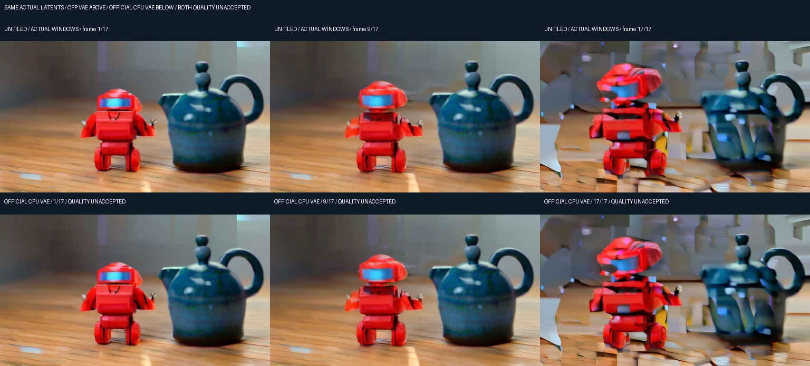

# Wan 按模型解码参数与画质对照

[English](WAN_DECODER.en.md) · [完整视频使用流程](WAN_VIDEO.md) · [dev.40 交付与全部待办](releases/v0.3.0-dev.40.md)

dev.40 补齐 Wan 解码参数从模型配置到原生执行的链路。App 仍只更新基座，不附带、自动下载或替换模型。完整 v0.3.0 的范围不变；本页的主机对照不代表 Android 或完整 Release 通过。

## 1. 用户如何操作

1. 在“全部”筛选“生视频”，或在 HF 搜索中选择匹配的 Wan 2.1 T2V 1.3B 配方。检查四个组件后明确下载 / 导入；浏览、修改设置和提交任务不会偷偷再下载。
2. 在“本地”打开该模型的设置。除尺寸、帧数、采样步数和 CFG 外，可编辑 **VAE 空间分块大小**与**VAE 按时间分段解码（实验）**。空间分块只有开启 VAE 空间分块时生效。
3. 分块大小范围为 **128–1024 像素、64 的倍数**。自填 999 归位到 960，超过 1024 归位到 1024；原生入口独立拒绝未归位的非法请求。没有声明这是模型训练上限，界面按应用保护约束标注。
4. 保存后只影响该模型后续任务。每次提交冻结完整参数与组件身份，之后改设置不影响已有任务；重启保留各模型设置。
5. 按时间分段开启时，Wan 使用一个 latent 时间帧的块解码。它是实验选项，**不能保证省内存或修复画质**。其他管线不会被静默套用此选项。

新字段默认 **128 / 关闭按时间分段**，保留原来的内存策略。既有已安装模型通过引擎参数 schema 获得新选项；不重写用户 manifest、权重或旧任务。旧任务缺少新字段时，原生继续使用旧的 128 / 关闭行为，实际回归要求输出 SHA 与 dev.39 对应旧任务完全一致。

共用任务进度还修复了快速采样时的漏报：新阶段、第一个已完成步骤及最终进度及时转发，其余进度保持节流。此问题由本轮真实 Java / 原生取消检查发现，修复生产代码后新增快速子进程回归；没有通过放宽取消条件绕过失败。

## 2. 真实画质诊断

所有行使用完整四组件、512×288、17 帧、8fps、20 步、CFG6、seed42。测量来自原生 Windows，未测 GPU 显存或手机资源，运行环境未作为受控性能基准。使用原始 RGB 帧判断，MP4 只负责展示。

| 编号 | 明确选择的配置 | 观测耗时 | Windows 进程峰值 | 结果 |
|---|---|---:|---:|---|
| Q01 | 原 dev.39：128 空间分块，时间分段关，flow3 | 1012.16 秒 | 4,973,056,000 B | 后段块状伪影，保留原片 |
| Q02 | 空间分块关，时间分段关，flow3 | 440.46 秒 | 11,291,410,432 B | 后段伪影仍在 |
| Q03 | 空间分块关，上游默认 4 latent 帧时间分段，flow3 | 406.92 秒 | 13,261,283,328 B | RGB SHA 与 Q02 相同 |
| Q04 | 明确选择 512 空间分块、1 latent 帧时间分段，flow3 | 317.46 秒 | 12,558,258,176 B | RGB SHA 与 Q02 相同；不是默认配置 |
| Q05 | Q04 仅把 flow 改为 8 | 312.57 秒 | 12,561,133,568 B | 输出变化，后段伪影仍在 |

这些观测没有证明提高分块大小适合努比亚 Z20，因此不把 512 / 时间分段开改为默认值。原有完整 Q01 与所有失败画质记录保留，不能以缩小几何参数或仅展示首帧宣告修复。

另外运行隔离诊断程序，保存 VAE 前的真实采样 latent；该程序故意不解码，生产 worker 返回生成失败，**不计作完成视频**。再以原版 [Wan VAE 源码](https://github.com/Wan-Video/Wan2.1/blob/9737cba9c1c3c4d04b33fcad41c111989865d315/wan/modules/vae.py)、相同完整权重、严格参数加载和 CPU F32 独立解码。与 Q02 对比，所有帧每通道最大差 **1/255**、平均绝对字节差约 **0.4951**，同样出现末帧伪影。这说明伪影能够在另一套解码实现中复现，不能把换 MP4 编码器或 VAE 分块当作修复；尚未证明具体原因是采样实现、量化、组件配对或该分辨率下的模型表现，完整生成器数值与画质仍待验收。

[原版失败画质 GIF](media/development/wan-quality/legacy-default.gif) · [原版 MP4](media/development/wan-quality/legacy-default.mp4) · [完整诊断记录](../verification/development/wan-quality.json)

## 3. 复现与证据边界

`tools/probe_wan_quality.py` 显式运行保留完整几何尺寸的实验，不自动下载；`tools/build_wan_latent_probe.py` 只在构建目录复制一处上游解码前接缝，固定上游源码不变，诊断程序不注册进 App、不进入 APK。`tools/probe_wan_latents.py` 支持 `--capture` 与 `--decode`，需要开发者明确准备上游固定源码、独立 Python 依赖及匹配权重。CPU VAE 使用原版均值 / 标准差，所有维度、权重和输出严格核对。

七份原报告按原字节归档到 [research evidence](../verification/research/wan-quality/)，保留每次实际编译身份、参数、输出 SHA、日志和内存观测。当前聚合没有把早先实验重标为本版推理验证。完整 RGB / latent / 原始进程日志留在忽略的开发目录；模型、缓存与诊断依赖不进入 Git 或 APK。

本轮实际原生业务检查包含旧任务逐字节回归、非法分块拒绝、提示词 / 步数变化、真实采样取消及恢复；生产 Java 检查包含显式导入、参数持久化、不可变任务、真实模型子进程及两份编码输入与原生 RGB 完全一致的 MP4。Windows FFmpeg 为明确测试端口，不能替代同手机 Android MediaCodec、后台长跑、模型质量或资源验收。
