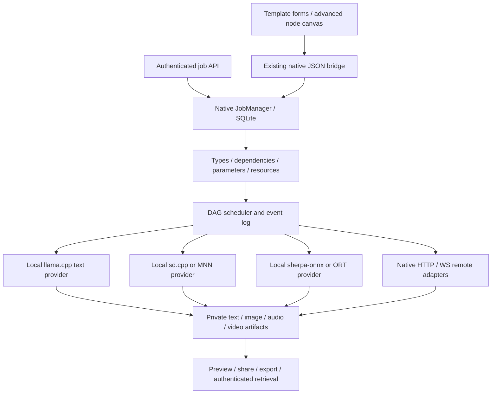

# Android multimodal workflow framework proposal

[中文](WORKFLOWS.md) · [Model feasibility and sources](MULTIMODAL.en.md) · [Current architecture](ARCHITECTURE.en.md)

Status: **design proposal, 2026-10-27; not implemented in the APK**. The [JSON draft](proposals/hybrid-video.workflow.json) illustrates a data contract. It is not executable/importable in current LMA or ComfyUI. No ROOT, Docker, WSL, virtual machines or emulators are required by this design.

## Framework choice

A ComfyUI-like typed node graph, connections, templates, queue, previews and artifact management are feasible. Use **a small LMA DAG executor, native local providers and a remote ComfyUI adapter**. Connections represent actual execution dependencies, not merely a visual canvas.

Do not package a full Python/PyTorch/CUDA environment and arbitrary ComfyUI custom nodes into Android. Implement phone-side contracts independently and retain the remote GPU ecosystem. The framework can support entirely local, entirely remote or mixed workflows. Review licenses when reusing upstream code; similar graph interaction does not establish universal node compatibility.

Default phone interaction: choose template, models and execution location, edit parameters, run, inspect results. The node editor is advanced mode. Templates are reusable; each run saves the effective versions/settings. Preserve Recommended `m08 → m06 → m01`, order and labels, and manage additional models through All/search and Local.

## Move beyond a single-file model record

[Store.java](../app/src/main/java/com/lma/app/Store.java) currently maps an ID to one `.gguf`, while [Downloads.java](../app/src/main/java/com/lma/app/Downloads.java) caps an individual file at 12GiB. Add a separate bundle layer before multimedia execution; accepting a Safetensors URL is insufficient.

| Object | Required information |
| --- | --- |
| ModelBundle | Stable ID, task, architecture, provider/minimum version, provenance, license and support status |
| Component | Role, HF repo/pinned revision/relative path, bytes, SHA256, format/quantization; tokenizer/config/external ONNX data included |
| Dependency | Exact encoder, VAE, codec, dictionary and LoRA requirements, optionality and base compatibility |
| RuntimeCapability | ABI, minimum Android, CPU/GPU/NPU backend, operator requirements, tasks and parameter bounds |
| ModelProfile | Persistent settings per model, separately scoped for local/remote configurations |
| Artifact | Private URI, MIME, bytes, digest, job and generation settings; no absolute path as a cross-device protocol |

Estimate full-bundle storage and peak runtime memory. Resume/check individual components and mark a bundle loadable only when required files pass. Show missing or damaged files. Share content-addressed dependencies with reference counts so removing one bundle cannot break another. Preserve old GGUF records/settings through migration; new shards/bundles need their own acceptance, without rewriting recommendations.

HF remains a discovery source. Show local candidate, local experimental, remote only or unsupported before downloading, together with dependencies and total size. Remote weights normally belong on the server rather than being duplicated on the phone. An HF `custom_code` repository is not automatically executable Android code.

## Providers and nodes

Proposed provider methods: `capabilities`, `validate`, `prepare`, `estimateResources`, `run`, `cancel`, `unload`. Declare tasks, typed inputs/outputs and bounds; report precise missing-component, operator or memory errors.

| Provider | Responsibility | Boundary |
| --- | --- | --- |
| llama.cpp | Existing text generation | Preserve current API; speech GGUF requires specialized implementation |
| sd.cpp | Initial SD 1.5/LoRA; later architecture-specific additions | NDK ARM64 CPU baseline; enable GPU only after operator/driver checks |
| MNN | Converted mobile SD/Sana recipes | Pin converted assets and versions; do not conflate its capabilities with sd.cpp |
| sherpa-onnx / ORT | Explicit TTS bundles, Nano graphs and decoding | Include text/phoneme/tokenizer handling; arbitrary ONNX is not end-to-end support |
| ComfyUI adapter | Entire remote GPU workflows/subgraphs | Server-installed nodes/models and hardware determine support |
| Audio service adapter | MOSS/SoulX/YuE2 services outside ComfyUI | Implement actual protocols; not automatically native ComfyUI nodes |
| Android media | Resizing, PCM playback, compatible encoding/muxing and sharing | Use MediaCodec/MediaMuxer according to device capabilities; encoding is not generative video |

Use types such as `Text`, `ImageArtifact`, `AudioArtifact`, `VideoArtifact` and `ModelBundleRef`. A `Latent` belongs to a particular provider; incompatible VAE, sample-rate or architecture connections are invalid. Keep large tensors native/on the GPU. Pass IDs/private URIs/small events across the WebView bridge, not full video base64 or tensors.

Start with acyclic graphs. Validate node types, required inputs, edges, cycles, output types, providers, dependencies and settings before execution. Use bounded batch/iteration parameters initially; explicit loops need later design with cancellation boundaries. Cache keys include input hashes, model/engine versions and effective settings. Record random seeds; node names alone are insufficient cache keys.

## Keep settings with the model

Retain Local model settings, editable preset combos and automatic clamping. Multimedia tasks require task-specific settings rather than treating text context length as a universal constraint.

| Task | Typical model settings |
| --- | --- |
| Text | Existing independent context/output/threads/temperature/reasoning/system prompt |
| Image | Dimensions, batch, steps, sampler, scheduler, CFG, seed, VAE mode, LoRAs/strengths |
| TTS | Language, voice, speed, chunks, sample rate/channels, reference audio and architecture-specific length |
| Music / video | Audio duration or frame count/duration, fps, dimensions, steps, references and encoding |

Use the intersection of model metadata, provider support and device budgets. Validate combined dimensions/batch/frame counts and required alignment, not just individual maxima. Clamp edited out-of-range numeric values with an explanation. Label unknown limits as temporary application/recipe bounds. Unsupported enums/combinations should request a valid choice instead of silently replacing a model.

Snapshot effective settings at submission. Editing defaults affects future runs, while active runs retain their snapshots. Template overrides use the same validation. Record remote defaults and final effective values.

## Remote ComfyUI adapter

Official APIs support graph submission, node discovery, queues and artifacts without embedding the server in Android. [Routes](https://docs.comfy.org/development/comfyui-server/comms_routes) · [WebSocket example](https://github.com/Comfy-Org/ComfyUI/blob/master/script_examples/websockets_api_example.py)

| Protocol | Adapter use |
| --- | --- |
| `GET /object_info` | Check required nodes/inputs and model dependencies |
| `POST /prompt` | Submit an **API prompt graph**, persist returned `prompt_id` |
| `/ws` | Associate events/progress/previews with owned jobs; disconnect is not remote cancellation |
| `GET /history/{prompt_id}`, `GET /queue` | Reconcile status after reconnect |
| `POST /upload/image`, `GET /view` | Upload selected references and retrieve outputs |
| `POST /interrupt` | Requires isolation on shared services, not unconditional per-job cancellation |

**Editor workflow JSON and API prompt JSON differ.** Detect the format, retain layout and translate only explicitly mapped nodes for local execution. Python custom nodes belong on a version-pinned remote server. Report unsupported nodes instead of claiming every workflow runs offline. [Execution protocol](https://docs.comfy.org/development/comfyui-server/comms_routes)

Place a remote subgraph together to avoid round trips of latents. Users configure their HTTPS/WSS endpoint; LAN HTTP is an explicit configuration. Native code owns networking and credential references, retaining the offline WebView CSP. Exported workflows contain no real secrets. Upload selected material rather than sending phone `content://` URIs to the server.

Persist client job ID, server instance/prompt ID, event cursor and artifact references. A lost submission response creates `submission_unknown`, followed by reconciliation. Stock ComfyUI does not guarantee idempotence for every request; avoid blindly resubmitting paid work. Cancellation must respect job/instance ownership. Shared-server global interruption must not cancel another user's work; use dedicated instances or a gateway with isolation and idempotence.

## Background execution, resources and persistence

The native service owns work; closing Activity/WebView removes a UI subscriber. Add SQLite jobs/nodes/events/artifacts with settings snapshots. States include `queued → preparing → running → succeeded / failed / cancelled`, plus `cancelling`, `submission_unknown` and `interrupted`; model preparation exposes component progress.

Default low-memory devices to one large-engine resource lease: unload text before diffusion rather than keeping every pipeline resident. Enable parallelism only with measured headroom. Text-to-speech can use a bounded sentence queue with playback backpressure instead of accumulating unbounded tokens/PCM. Thermal/battery constraints can reduce concurrency, pause or stop with a recorded reason.

Foreground services, visible notifications and scoped wake locks need no ROOT, but do not guarantee immortality. Select service types for the actual task/Android version. Current `specialUse` is not evidence of unlimited arbitrary background execution. On Android 15+ with target 35+, background `dataSync`/`mediaProcessing` have separate six-hour totals per 24 hours; this is not a universal Z20/all-service limit, and renaming tasks is not a workaround. [Android timeouts](https://developer.android.com/develop/background-work/services/fgs/timeout)

After process death, recover job records. Resume intermediate inference only if an engine supports checkpoints; otherwise restart that node and record the retry. Reuse completed artifacts. Remote jobs can continue if the server survives, with later reconciliation/retrieval. A powered-off phone cannot continue local inference. WorkManager can handle recovery scheduling/result synchronization, not an infinite-runtime guarantee.

## Proposed API and example

Start with asynchronous `POST /v1/jobs`, `GET /v1/jobs/{id}`, `POST /v1/jobs/{id}/cancel`, sequenced SSE events and authenticated artifact retrieval. Later adapt genuine subsets of `/v1/images/generations` and `/v1/audio/speech`. **These multimedia routes are not implemented** and are not current API features.

Differentiate text-token, diffusion-step, audio-chunk and artifact-ready events. Return job IDs for long tasks instead of promising a synchronous HTTP request survives hours. Keep loopback/authentication defaults and user-enabled LAN access.

The [hybrid video JSON](proposals/hybrid-video.workflow.json) describes text → local LLM video prompt/narration → configured remote Wan template plus local TTS → phone muxing → saved artifact. Connections are typed. Model/service references are deliberately unbound and must resolve to pinned versions/capabilities before execution. The draft downloads no weights, starts no server and claims no implemented provider.

## First acceptance boundary

Deliver templates, real execution and recoverable queues before the canvas. Minimal acceptance paths are offline TTS, SD 1.5 plus a compatible licensed LoRA, and one fixed remote ComfyUI video recipe, with artifacts, errors/cancellation, background and restart evidence. Also check invalid ports/cycles, missing dependencies, per-model independence, combined parameter clamping, shared-file deletion, remote deduplication and cancellation isolation.

A structurally valid proposal is not engine validation. This change checks documents/JSON structure only, adds no phone inference passes and preserves existing release assets. A future implementation needs a new APK version, matching bilingual guides and accurately scoped demonstrations.
