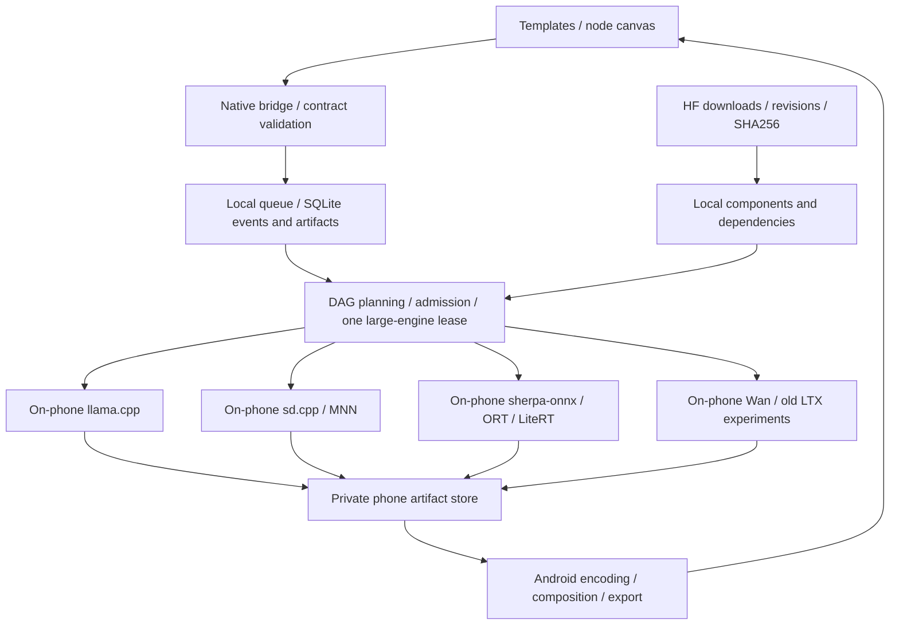

# Fully local Android workflow framework

[中文](WORKFLOWS.md) · [Local-model feasibility](MULTIMODAL.en.md) · [Current architecture](ARCHITECTURE.en.md)

Status: **design proposal dated 2026-10-27, not implemented in the APK**. Two JSON drafts review contracts; they are not executable imports for current LMA or ComfyUI: [local narrated image clip](proposals/local-narrated-image.workflow.json), [on-phone Wan video experiment](proposals/local-wan-video.workflow.json). Every stage runs on the same Android phone, without ROOT, Docker, WSL, VMs or emulators.

## Execution boundary

Use an **LMA typed DAG, native Android job executor and on-phone providers**. Nodes describe real dependencies and data types. Deliver runnable templates, queue and previews before the advanced canvas.

Model download is a separate, user-visible operation before generation. Execution performs text processing, encoding, sampling, codecs, composition and saving on the phone. There are no external inference providers, service-address settings or off-device fallbacks. Missing assets, unsupported operators or resource exhaustion produce a specific local error; users may download components or choose another supported local recipe.

This is a proposed architecture, not a claim that these engines are installed. Current LMA's single-file `.gguf` downloader and single text process cannot directly execute every task. [Current implementation](ARCHITECTURE.en.md)

## Bundles and providers

Separate model identity from multi-component bundles: `model → pinned recipe → components → compatible provider/device profile`. Each bundle records:

- Source, task, exact version/revision, license, tags and evidence level; file paths, sizes, SHA256 and dependency roles.
- Backbone, text encoders, tokenizers/dictionaries, VAEs/codecs, voices and optional adapters. Any missing mandatory component prevents ready status.
- Provider, ABI/minSdk/engine version, backend and required operators. QNN also pins SoC/Hexagon, QAIRT libraries and compiled graph shapes.
- Editable per-model settings, caps, enumerations, joint constraints and defaults. Reference download bytes, measured peak RAM and elapsed time are separate fields.
- States `available → downloading → verifying → ready`, with `paused / incomplete / incompatible / failed`; component and total progress.

Download to private `.part` files and publish atomically after verification. Share components by content hash/reference count; show remaining references before deletion. Reserve space for staging and outputs, and support resume after cancellation/restart. Current single-file caps are not a multi-component bundle limit: file, bundle and free-space checks require separate design.

| Proposed provider | On-phone responsibility | Boundary |
| --- | --- | --- |
| `llama_text` | Preserve compatible text GGUF, structured text/token output | Do not send arbitrary audio/video GGUF to the generic text interface |
| `sd_cpp` | SD 1.5/matching LoRA, later exact image and Wan recipes | Check architecture, operators and all components; baseline CPU, Vulkan after probing |
| `mnn_diffusion` | Specific SD/Sana mobile bundles | Matching converted graphs, text processing and versions only; experimental Wan bring-up is not delivered support |
| `sherpa_tts` / `ort_tts` | Small TTS, language packs and Nano tokenizer/codec | Declare voices/languages, chunks, cancellation and sample rates |
| `litert_audio` / dedicated Qwen TTS | Complete Talker/MTP/codec or short-sound pipeline | Validate host loop, API 28, quantization and measured speed; no automatic realtime claim |
| `ltx_native` | Older LTX 2B Vulkan or legally integrable chip-specific QNN | Match QNN bundle, SDK, shapes and license; no incompatible NPU package on Z20 |
| `android_media` | Image/audio/video reading, MediaCodec/MediaMuxer composition/export | Probe containers, codecs and dimensions; fail explicitly without network transcoding |

Provider contracts include `probe / validateBundle / estimateResources / load / run / cancel / unload`, emitting ordered progress, previews, artifacts and errors. Heavy engines may run in separate native worker processes owned by a foreground service, independently of Activity/WebView lifetime.

Distribute audited engines/dependencies with the APK or reviewed release components; model folders contain data. Use JNI or argument-array `ProcessBuilder`, never shell interpolation or arbitrary HF Python/`trust_remote_code`. Separate the download client from executor networking. Executors accept validated local file handles/IDs, not external URLs; any internal engine HTTP is loopback-only. Static call review plus offline tests enforce this boundary; a JSON local flag alone does not.

## Typed nodes and data

Initial types are `Text`, `ImageArtifact`, `AudioArtifact`, `VideoArtifact`, `ModelBundleRef` and family-specific `LoRARef`. Artifacts are controlled local references with MIME type, dimensions/duration, sample rate/fps, hash and source job. Do not pass large tensors, PCM or arbitrary filesystem paths through JavaScript.

Initial nodes cover text input, structured LLM composition, images, TTS, media composition, preview and save. Actual video-generation nodes carry a separate experimental status. Encoding one still image into MP4 is not model-generated motion.

Before execution, check schema, unique IDs, ports/types, required inputs, one connection per required input, acyclicity, model bindings, all dependencies, device recipes and settings. Resolve every model reference to a pinned local bundle. JSON contains no credentials or external service addresses. Reject HTTP inference/external-execution nodes and explicitly identify unmapped nodes.

Validate structured LLM outputs before using them as parameters; return parsing errors instead of executing generated code. Preview only controlled local artifacts, never model-generated HTML. Graph editing does not implicitly download assets or start generation.

## Per-model settings and joint limits

Preserve the user's requirement: edit settings with editable presets under each model ID in Local. Workflows hold references and permitted overrides. On job start, snapshot **effective settings, model revision, provider, seed, dependency hashes and device information**.

Clamp values beyond known model hard limits to the maximum legal value and show the change. Device-memory policy may choose a lower effective setting with an explanation. Mark unknown model limits as unknown; do not invent rated maxima. Expose requested/effective values and reasons.

Image/video limits are not independent numeric maxima. Validate width/height multiples, pixel budget, frame form, batch, sampler and distillation steps jointly. Wan's reference frames follow `4n+1`; choose the nearest legal profile not exceeding the requested count and show the adjustment, or reject when none exists. Fixed QNN graphs offer compiled shape choices, not falsely unrestricted input fields.

Check LoRA base families and component versions. TTS checks text length, language, voices, reference audio and codec; segment bounded outputs with backpressure. Editable input does not bypass native-engine constraints.

## Local scheduling, background work and recovery

Default to **one large-engine lease** on constrained devices. Unload the LLM after writing, then run image/video generation, TTS and composition. Independent graph branches can wait ready without keeping all models resident. Load encoders, backbone and VAE in stages according to each recipe. Enable concurrency only after resource measurements justify it.

SQLite `jobs / nodes / events / artifacts` stores inputs, settings snapshots, states, sequence numbers and outputs. States include `queued / validating / waiting_assets / running / cancelling / succeeded / failed / cancelled / interrupted`. On restart, verify completed outputs; resume an unfinished step only if the engine truly exports a checkpoint. Otherwise restart that node and record the retry.

Foreground services, visible notifications, scoped wake locks and cancellation need no ROOT. Closing the Activity unsubscribes UI updates without stopping an explicitly started job. Thermal/low-battery policies pause only at supported boundaries or stop; do not fabricate resumable pauses. OS kills, heat and vendor battery management can still interrupt work. No survival or 24/7 full-load guarantee is possible.

Android 15+, target 35+ `dataSync`/`mediaProcessing` services have separate aggregate background limits of six hours per 24 hours. This is not a universal limit for every service or Android 9 Z20. Select the real service type; current `specialUse` is not proof of arbitrary unlimited work. [Android documentation](https://developer.android.com/develop/background-work/services/fgs/timeout) WorkManager may restore scheduling/downloads but cannot guarantee unlimited inference.

After download, test fresh arbitrary prompts without networking, covering tokenization, encoders, every generation stage and export. Playing a prerecorded example is insufficient. Failures offer a local error or another usable local model, never a different execution location.

## ComfyUI-like scope

Similar node editing, templates, queues, previews, node reruns and artifact provenance are possible. **Do not require a full Python/PyTorch/CUDA service on the phone or execute arbitrary ComfyUI custom nodes.** Matching names alone do not establish equivalent settings or sampling behavior.

Import first distinguishes editor graphs from API prompt graphs, then translates only whitelisted nodes with locally equivalent implementations. Report unsupported types, missing models and semantic differences. If the whole graph cannot map locally, stop execution. Publish LMA's own schema and validated templates before gradually extending compatibility.

This is not a full ComfyUI compatibility claim and includes no external service adapter. Handle [ComfyUI's](https://github.com/Comfy-Org/ComfyUI) GPL-3.0, other node licenses and engine terms separately; similar visual concepts do not authorize copying every implementation.

## Examples, API and initial acceptance

The [narrated-image draft](proposals/local-narrated-image.workflow.json) describes text → on-phone LLM prompt/narration → on-phone SD 1.5 and TTS → Android encoding of a **still image** with narration → save. It demonstrates multimodal dependencies and scheduling, **not generative motion video**.

The [local Wan draft](proposals/local-wan-video.workflow.json) describes text → on-phone LLM → on-phone Wan 1.3B and TTS → local composition → save. It references CPU text encoding/VAE, Vulkan diffusion, disk parameters and tiling; settings and device admission remain unverified on Z20. Both drafts declare `design_only_not_executable`, unresolved models, one large-engine lease and no external inference. They are not successful execution evidence.

Propose local asynchronous `POST /v1/jobs`, query/cancel, sequenced SSE and authenticated artifact reads. Report text tokens, diffusion steps, audio chunks and artifact-ready separately. **Multimodal endpoints are not implemented.** Internal loopback communication and current LMA serving API callers do not move inference off-device; all generation remains on the phone.

Initial acceptance chains are offline TTS, SD 1.5/matching LoRA and narrated-still-image workflows. Wan/old LTX get separate experimental acceptance. Also check cycles/type errors, missing components, settings isolation/joint limits, resource queuing, cancellation/unloading, shared-component deletion and interrupted-node recovery. Retain real outputs, resource data and screen-off evidence. Draft structure checks do not replace engine tests; future APK changes require a new version and actual feature demonstrations.
