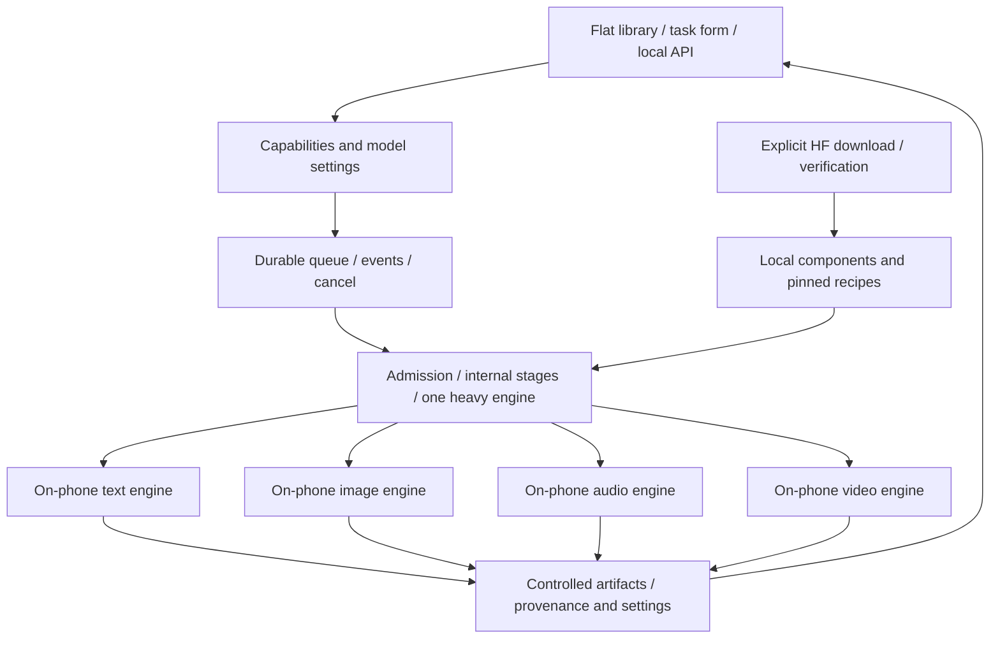

# Android local jobs and internal execution stages

[中文](WORKFLOWS.md) · [Current requirements/releases](MULTIMODAL_RELEASE_PLAN.en.md) · [Foundation](FOUNDATION.en.md) · [Current architecture](ARCHITECTURE.en.md)

Status: **v0.3.0 requirements with partial development implementation, 2026-10-27**. Parts of jobs/artifacts, asset management and UI are implemented; see [development progress](DEVELOPMENT.en.md). Complete engines/model coverage, the unified API and physical-device acceptance remain unfinished. This document describes target behavior, not a claim that every feature is available. The latest scope uses model selection, task forms, a queue and artifacts. No ComfyUI wiring, infinite canvas, user node/plugin ecosystem or graph import. The [update requirements](MULTIMODAL_RELEASE_PLAN.en.md) require the complete foundation and all 01–14/16/17/frozen subtargets together in v0.3.0, without split releases or automatic deferral. Every stage executes on the same Android phone, without ROOT, Docker, WSL, VMs or emulators.

## Interaction and execution boundary

Choose a model/recipe from one flat library, fill its capability-specific form, submit a local job and inspect the result. Task tags filter the common pool rather than creating four downloaders or model hierarchies. Preserve Recommended, Local and settings keyed by model ID.

This does not imply these engines are packaged. Current single-file `.gguf` downloading and the single text process need migration. Tokenization, encoding, sampling, codecs and media processing remain on-phone, without external execution providers or resource-related offloading. Discovery/downloads and execution are separate; missing assets, unknown operators and resource failures produce specific local errors.

Installation/upgrades update the foundation only; recommendations/catalogue entries contain no weights. Browsing, selection or a task missing assets does not implicitly download models. An explicit download action creates only the chosen bundle job and disclosed dependencies. Preserve existing models/settings; users manage asset updates/deletion. Developer test assets stay out of the APK and are not user prerequisites.

## Bundles and internal engines

Separate model, components and recipe: `ModelRecord → pinned recipe → complete components → compatible engine/device`. These are technical dependencies, not model ranks.

- Pin source/revision, license, roles, paths, sizes and SHA256, including mandatory backbone, tokenizer/dictionary, text encoder, VAE/codec, voice and adapter assets.
- Recipes declare ABI/minSdk/engine build/operators/backend. QNN also pins SoC/Hexagon, QAIRT and compiled shapes.
- Keep installation, compatibility, capability and evidence separate. Atomically publish a bundle only after component verification; downloaded main weights do not mean executable.
- Share components by content hash/reference count with resume/pause, space budgets and deletion protection. Do not clean active task inputs.
- Budget file, bundle, staging and output space separately. Current single-file limits are not new bundle limits.

| Internal route | On-phone responsibility | Boundary |
| --- | --- | --- |
| `llama_text` | Existing text GGUF/tokens | Do not send non-text GGUF to the generic text interface |
| `sd_cpp` / `wan_sd_cpp` | Matching image architectures, LoRA and Wan pipelines | Validate compiled architecture, operators, sampler, text encoding and VAE |
| `mnn_diffusion` | Sana/specific mobile image packages | Match converted graphs, text processing and versions |
| `sherpa_tts` / `moss_nano_ort` | Small TTS and complete Nano pipeline | Declare language/voice/tokenizer/codec; pretokenized samples are insufficient |
| Qwen TTS / Stable Audio | Talker/MTP/codec or short-sound pipeline | Validate API/backend/host loop and measured speed separately |
| Dedicated MOSS/SoulX adapters | Complete architecture-specific audio pipelines | Port individually; generic graph runtimes are insufficient |
| Native LTX routes | Older 2B Vulkan or legally integrable QNN | Match license, compiled bundle, SDK/device; incompatible QNN packages stay disabled on Z20 |

The engine contract is `probe / validateBundle / estimateResources / load / run / cancel / unload`, with ordered progress, previews, artifacts and errors. Heavy workers may run in separate processes owned by a foreground service, independently of Activity/WebView lifetime.

Versioned native modules ship/load through ordinary signed APK releases, without a user-installable plugin system. Model descriptors cannot execute scripts or arbitrary expressions. Use JNI/argument-array `ProcessBuilder`; do not run HF Python/`trust_remote_code`. Workers receive controlled local handles/IDs; internal HTTP is loopback-only and never an external inference connection.

## Jobs, internal stages and data

A job holds `task_type / model_id / recipe / inputs / settings / idempotency_key`. Encoding, sampling and decoding can be internal stages. No public node-type system, wiring ports or editable-graph schema is required. All jobs use the same scheduler.

Artifacts are controlled local references with MIME, dimensions/duration, sample rate/fps, hash and source. Keep large tensors/PCM in native workers and bound audio/preview queues. Exchange decoded media across engines; arbitrary latent interoperability is not promised.

Validate task, declared capabilities, inputs, complete bundle, device recipe and settings. Preview controlled artifacts without executing model-produced code/HTML. Validate structured model outputs too. Still-image MP4 encoding does not qualify as generative motion video, and automatic narrated composition is not mandatory scope.

## Per-model settings and joint constraints

Local edits use editable preset selectors by model ID, with explicit recipe subprofiles. Jobs snapshot effective settings, revision, engine build, seed, component hashes and device. Global settings manage application preferences.

Above a known model hard maximum, return the highest legal value and explain the correction. Jointly validate backend shapes, dimension multiples, pixel budget, frame form, batch, sampler and distilled steps; reject when no legal combination exists. Unknown maxima remain unknown; resource estimates are not model maxima. Wan frame rules such as `4n+1` belong to specific recipes. QNN exposes compiled shapes rather than implying arbitrary editable dimensions.

Validate LoRA base families/component versions and TTS language, voice, text and required reference audio. Segment/stream only with real engine support. Editable fields do not bypass native constraints.

## Scheduling, background and recovery

Default to one heavy-engine lease; stage encoders, backbone and VAE/codec by recipe. Measure shared RAM, drivers and heat before concurrency. Downloaded models need not remain resident.

SQLite `jobs / stages / events / artifacts` persists inputs, snapshots, states, event sequences and outputs. States include `queued / validating / waiting_assets / running / cancelling / succeeded / failed / cancelled / interrupted`. Bind cancellation to process launch generation. Reconcile outputs after restart; resume only actual engine checkpoints, otherwise explicitly rerun the stage/job and retain attempts.

Foreground services, visible notifications, stop actions and scoped locks need no ROOT. Closing UI unsubscribes without cancelling an explicitly started job. Power policy, heat and OS termination may interrupt work; pause only at supported boundaries. Neither permanent survival nor 24/7 full load is guaranteed.

For Android 15+, target 35+, `dataSync` and `mediaProcessing` each have an aggregate background six-hour allowance per 24 hours. This is not a universal limit for all services or Android 9 Z20. Choose service types according to real work; current `specialUse` does not establish unlimited execution. [Android documentation](https://developer.android.com/develop/background-work/services/fgs/timeout) WorkManager may restore scheduling/downloads, not guarantee unlimited inference.

## API, historical drafts and acceptance

Propose local async `POST /v1/jobs`, query/cancel, ordered SSE and authenticated artifact reads, preserving existing text APIs. Distinguish tokens, diffusion steps, audio chunks and artifact-ready events. **Multimodal endpoints are not implemented.** Serving API callers or using internal loopback does not move computation off-phone.

The earlier [narrated-image JSON](proposals/local-narrated-image.workflow.json) and [Wan JSON](proposals/local-wan-video.workflow.json) are **historical, non-executable dependency examples**, not current import formats, mandatory combined tasks or release contracts. They are not successful execution evidence. The current structured scope is [multimodal-release-scope.json](proposals/multimodal-release-scope.json).

Use the [current release plan](MULTIMODAL_RELEASE_PLAN.en.md) to accept complete components, settings isolation, admission, cancellation/unload, crashes, migration, shared deletion and fresh offline generation. Images, audio and video each require real output and background evidence. No phone is available; fixtures/JSON checks cannot substitute. Increase the actual APK version and record feature media only when new functionality ships.
