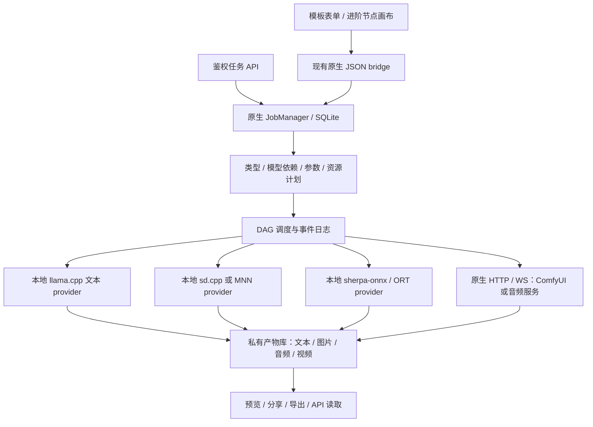

# Android 多模态工作流框架方案

[English](WORKFLOWS.en.md) · [模型可行性与来源](MULTIMODAL.md) · [现有架构](ARCHITECTURE.md)

状态：**2026-10-27 的设计提案，尚未在 APK 中实现**。附带的 [JSON 草案](proposals/hybrid-video.workflow.json) 用于讨论数据契约，不是可导入当前 LMA 或 ComfyUI 的运行文件。无需 ROOT，不依赖 Docker、WSL、虚拟机或模拟器。

## 框架选择

可以构建类似 ComfyUI 的有类型节点图、连线、模板、队列、预览和结果管理。建议 **LMA 自有轻量 DAG 执行层 + 本地原生 provider + 远程 ComfyUI adapter**。节点和连线表示依赖关系；执行器按依赖顺序运行，不能只画一个没有实际调度的画布。

不把完整 Python / PyTorch / CUDA 与任意 ComfyUI 自定义节点打包进 Android。手机端独立实现任务和节点契约，GPU 侧保留原有 ComfyUI 生态；同一框架允许工作流全本地、全远程或混合执行。复用上游代码时分别处理代码许可，不能因为图形交互相似就声称已经兼容全部节点。

手机默认使用“选择模板 → 选择模型与执行位置 → 修改参数 → 运行 → 查看结果”的表单；进阶用户再编辑节点。工作流可复用模板，但每次任务都保存实际使用的版本与参数快照。继续保留原“推荐” `m08 → m06 → m01`、标签和顺序，多模态新增条目由“全部 / 搜索”和“本地”管理。

## 模型包替代单文件假设

当前 [Store.java](../app/src/main/java/com/lma/app/Store.java) 按模型 ID 对应一个 `.gguf`；[Downloads.java](../app/src/main/java/com/lma/app/Downloads.java) 的单文件上限为 12GiB。多模态扩展须先新增独立的模型包层，不能给现有下载器塞一个 Safetensors URL 就算完成。

| 对象 | 必要记录 |
| --- | --- |
| ModelBundle | 稳定 ID、任务类型、架构、provider 及最低版本、来源、许可证、支持状态 |
| Component | 组件角色、HF repo + 固定 revision + 相对路径、字节数、SHA256、格式、量化；含 tokenizer / config / 外部 ONNX data 等 |
| Dependency | 文本编码器、VAE、codec、词典、LoRA 的精确依赖，必需 / 可选，基础模型兼容性 |
| RuntimeCapability | ABI、最低 Android、CPU/GPU/NPU 后端、算子要求、可用任务与参数约束 |
| ModelProfile | 该模型的持久化配置，独立于其他模型；本地 / 远程配置也分别保存 |
| Artifact | 私有 URI、MIME、大小、哈希、关联任务和生成参数，不把绝对路径作为跨设备协议 |

按包预估剩余磁盘空间和峰值运行内存。逐文件续传 / 校验，全部必需组件满足后才标为可加载；中断或损坏显示缺失的组件。用内容哈希共享依赖并计引用，删除一个包不能破坏另一个包。保留旧 GGUF 记录与参数迁移，新的分片 / 包能力单独验收，不改写原推荐来源。

“全部 HF”继续是发现入口。明确显示“本机候选 / 本机实验 / 仅远程 / 尚不支持”，下载前列出整包依赖及大小；远程模型通常下载到服务器，而不是先在手机存一套数十 GB 权重。HF 中带 `custom_code` 的仓库也不自动变成可在手机执行的代码。

## Provider 与节点契约

以下接口名称是提案：`capabilities`、`validate`、`prepare`、`estimateResources`、`run`、`cancel`、`unload`。Provider 声明它能做的任务、输入 / 输出类型和限制，调度器根据真实能力放行；失败应给具体组件、算子或内存原因。

| Provider | 负责的工作 | 边界 |
| --- | --- | --- |
| llama.cpp | 现有文本生成 | 保留当前文本 API；TTS GGUF 需要专用实现，不能仅凭扩展名交给它 |
| sd.cpp | 首批 SD 1.5 / LoRA；后续逐架构增加 | 原生 NDK 编译与 ARM64 CPU 基线；GPU 通过驱动 / 算子测试后开启 |
| MNN | 转换好的 SD / Sana 等移动配方 | 转换资源和版本单独锁定，与 sd.cpp 能力不可混写 |
| sherpa-onnx / ORT | 明确的 TTS 包、Nano 图及音频解码 | 包含文本前端 / 音素 / tokenizer，CPU 先行；不能将任意 ONNX 标为端到端支持 |
| ComfyUI adapter | 远程 GPU 上的整个工作流或子图 | 服务端安装的模型、节点和算力决定实际能力 |
| 音频服务 adapter | 不在 ComfyUI 中的 MOSS / SoulX / YuE2 等服务 | 对接各自真实协议，不强称为统一 ComfyUI 原生节点 |
| Android 媒体 | 图像尺寸处理、PCM 播放、兼容编码 / 封装、分享 | MediaCodec / MediaMuxer 等按设备能力使用；视频编码不等于模型生视频 |

节点端口采用 `Text`、`ImageArtifact`、`AudioArtifact`、`VideoArtifact`、`ModelBundleRef` 等明确类型；`Latent` 属于特定 provider 内部，不允许误连不同 VAE、采样率或架构。大张量留在原生引擎或 GPU 服务内；WebView bridge 传 ID / 私有 URI / 小型状态，不传整段视频 base64 或张量。

首版只支持无环图。提交前验证节点类型、必需输入、边、环、输出类型、provider、模型依赖和参数。迭代 / 批量作为有界节点参数，后续再设计循环，避免没有取消边界的无限执行。节点缓存键至少包含内容哈希、模型 / 引擎版本和实际参数；含随机性的任务记录有效 seed，不能只按节点名称复用旧输出。

## 参数跟随模型

沿用用户要求的“本地模型内设置 + 可编辑选择输入框 + 超限自动归位”。不同任务使用不同的参数表，不能复用文本模型的上下文长度来限制所有媒体任务。

| 任务 | 典型模型配置 |
| --- | --- |
| 文本 | 上下文、输出 token、线程、温度、思考、系统提示词，保留现有独立存储 |
| 图像 | 宽 / 高、batch、steps、sampler、scheduler、CFG、seed、VAE 模式、LoRA 与强度 |
| TTS | 语言、音色、语速、分块、采样率 / 声道、引用音频、该架构的长度限制 |
| 音乐 / 视频 | 音频秒数或帧数 / 时长、fps、分辨率、步数、参考素材、编码策略 |

有效值取模型元数据、provider 支持和设备预算的交集；不仅检查单字段上限，还检查宽 × 高 × batch、帧数、对齐步长等联合约束。可编辑数值超出范围自动回填并说明；未知限制标成应用 / 配方临时上限，不能伪称来自模型。枚举及不支持的组合应提示选择，不静默替换模型。

任务启动时保存配置快照及回填后的实际值。修改模型默认设置只影响后续任务，正在执行的任务保持其快照；模板覆盖参数也经过同一套校验。远端默认值与最终实际使用值都应记录。

## 远程 ComfyUI 接入

官方协议允许提交图、读取节点信息、跟踪队列和领取结果；因此 Android 客户端不必内置 ComfyUI 服务端。[官方路由](https://docs.comfy.org/development/comfyui-server/comms_routes) · [官方 WS 示例](https://github.com/Comfy-Org/ComfyUI/blob/master/script_examples/websockets_api_example.py)

| 协议 | Adapter 的用途 |
| --- | --- |
| `GET /object_info` | 检查所需节点 / 输入存在，配合模型清单核对依赖 |
| `POST /prompt` | 提交 **API prompt graph**，持久化返回的 `prompt_id` |
| `/ws` | 事件、进度与预览；按任务归属关联，断线不表示远端停止 |
| `GET /history/{prompt_id}`、`GET /queue` | 重连对账，恢复任务状态 |
| `POST /upload/image`、`GET /view` | 按模板上传已选参考图、获取产物 |
| `POST /interrupt` | 不是无条件安全的单任务取消；共享服务应经隔离网关处理 |

**画布 workflow JSON 与 API prompt JSON 不同**。导入先识别格式，保留布局；本地只转换有显式映射的节点。Python 自定义节点必须在远端安装并锁版本，未知节点显示原因，不宣称任意 ComfyUI 工作流可离线执行。[服务端执行说明](https://docs.comfy.org/development/comfyui-server/comms_routes)

远端子图尽量整体执行，避免每一步把 latent 来回传到手机。用户填写自己的 HTTPS/WSS 服务地址；局域网 HTTP 属于明确配置。原生层负责网络和凭据引用，保留 WebView 的离线 CSP；导出的工作流不得含真实密钥。跨设备传输的是经用户选择的素材和可定位的产物，不将手机 `content://` URI 原样传给服务器。

保存客户端任务 ID、远端实例 / `prompt_id`、事件序号和结果引用。提交后响应丢失应进入“提交结果待确认”，先对账；原生 ComfyUI 不保证所有请求幂等，不能自动重复提交计费任务。取消按所属实例和任务处理；对共享 ComfyUI 的全局中断不能误杀别人的任务。需要明确单用户实例或具备任务隔离和幂等支持的网关。

## 后台、资源与持久化

原生服务持有执行任务，Activity/WebView 关闭只移除界面订阅。建议新增 SQLite 的 jobs、nodes、events、artifacts 表，保存状态与配置。典型状态为 `queued → preparing → running → succeeded / failed / cancelled`，另有 `cancelling`、`submission_unknown`、`interrupted`；正在下载的模型显示组件进度。

低内存设备以一个大型引擎为默认资源租约，先卸载 LLM 再生图；不要同时常驻文本、图像、TTS 和视频全套。只有测得剩余内存充足才开放并行。文本到 TTS 可采用有界短句队列，逐段播放并施加背压，不无限缓存 token 或 PCM。热限制或低电量时可降并发 / 暂停 / 停止，并保留可解释的任务状态。

无需 ROOT 可以使用前台服务、用户可见通知和按需唤醒锁，但不能保证永不被杀。服务类型按真实任务和 Android 版本选取；当前 LMA 的 `specialUse` 声明不能作为任意无限后台工作的证明。特别是 Android 15+、target 35+ 的 `dataSync` / `mediaProcessing` 在后台有每类累计 6 小时 / 24 小时限制；不能把它错误套成 Z20 或所有服务的统一上限，也不能靠更名规避。[Android 官方超时说明](https://developer.android.com/develop/background-work/services/fgs/timeout)

进程死亡后恢复的是任务记录；本地推理只有引擎明确支持 checkpoint 时才能继续中间步，否则重启该节点并记录重试。已完成节点的产物可以复用。远端任务在服务器仍存活时可继续，手机恢复后查询领取；不能承诺手机断电后本机模型仍运行。WorkManager 可用于恢复调度和结果同步，不承担“无限运行”的保证。

## 对外接口与示例

建议先提供异步 `POST /v1/jobs`、`GET /v1/jobs/{id}`、`POST /v1/jobs/{id}/cancel`、带序号的 SSE 事件和鉴权产物读取，再按真实语义适配 `/v1/images/generations`、`/v1/audio/speech` 等子集。**这些多模态端点尚未实现**，不能列入当前 API 使用手册的已支持项。

任务事件区别文本 token、diffusion step、音频 chunk 和 artifact-ready。手机上的 API 可先返回任务 ID，让调用者订阅；长视频不保持一个必然跨小时成功的同步 HTTP 请求。外部接口继续默认本机监听、携带认证，LAN 由用户开启。

[混合视频工作流 JSON](proposals/hybrid-video.workflow.json) 描述：文本输入 → 本地 LLM 编写视频提示与旁白 → 远程已配置的 Wan 模板 + 本地 TTS → 手机合并音视频 → 保存产物。节点间有显式的类型与依赖；示例使用未绑定的模型 / 服务引用，真正执行前必须解析为固定版本及能力。它不下载权重、不启动服务器，也不声称已经有这些实现。

## 首版验收边界

先交付模板、真实执行和可恢复队列，再补画布。最小验收链为“离线 TTS”“SD 1.5 单图 + 合法兼容的 LoRA”“远程 ComfyUI 一个固定视频模板”，每条都有实际产物、错误 / 取消、后台和重启证据。另测错端口类型、有环图、缺失依赖、模型间设置独立、联合参数回填、共享依赖删除、远程去重和共享服务取消隔离。

结构正确的草案不能证明引擎可用。当前只有文档 / JSON 结构核对，不新增手机推理通过项；发布新 APK 时应单独提升版本、更新双语手册和真实功能演示，保留既有发布附件。
