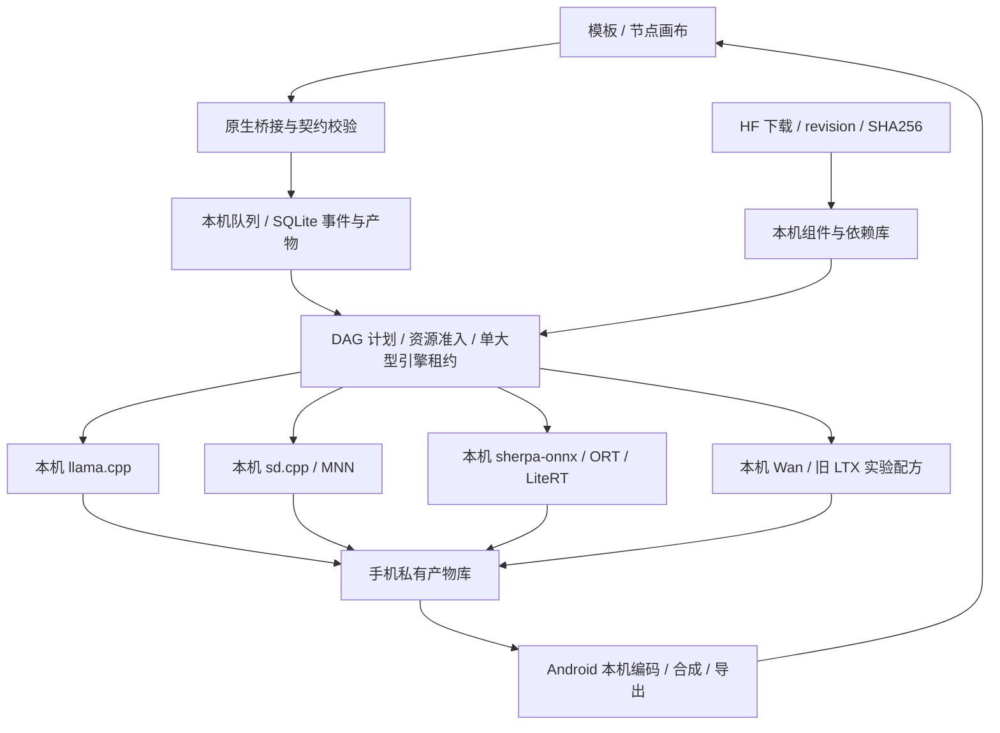

# Android 纯本地工作流框架方案

[English](WORKFLOWS.en.md) · [共用基座评估](FOUNDATION.md) · [本地模型可行性](MULTIMODAL.md) · [当前架构](ARCHITECTURE.md)

状态：**2026-10-27 设计提案，尚未在 APK 中实现**。两个 JSON 草案用于评审契约，不可导入当前 LMA 或直接作为 ComfyUI 执行文件：[本地图片旁白短片](proposals/local-narrated-image.workflow.json)、[本机 Wan 生视频实验](proposals/local-wan-video.workflow.json)。所有步骤在同一 Android 手机执行，无需 ROOT，不使用 Docker、WSL、虚拟机或模拟器。

## 执行边界

采用 **LMA 自有有类型 DAG + Android 原生任务执行器 + 本机 provider**。节点图表达真实依赖和数据类型；先做可运行模板、队列和预览，再补进阶节点画布。

模型下载是生成前独立、用户可见的操作。进入执行阶段后，文本处理、编码器、采样、codec、媒体合成、产物保存均只在手机进行；不提供外部推理 provider、服务地址配置或自动转出路径。资源不足、算子不支持或文件缺失时，显示具体失败 / 缺失组件，让用户下载或选择设备可用的本地配方。

这是执行架构提案，不是已经安装了以上引擎。当前 LMA 的单文件 `.gguf` 下载器和单文本进程不能直接承担全部任务。[当前实现](ARCHITECTURE.md)

## 模型包与 provider

将模型 ID 与多组件包分开：`模型 → 固定 revision 配方 → 组件 → 兼容 provider / 设备档位`。模型包至少记录：

- 模型来源、任务、精确版本 / revision、许可、标签及证据等级；各文件路径、大小、SHA256 和依赖角色。
- 主干、文本编码器、tokenizer / 词典、VAE / codec、音色、可选适配器；缺任一必需项时不显示“可运行”。
- provider 及 ABI / minSdk / 引擎版本、后端、所需算子；QNN 额外固定 SoC / Hexagon、QAIRT 库与编译图形状。
- 每模型可编辑参数、上限、枚举、联合约束、默认值；参考下载大小、测量过的峰值内存和耗时分开记录。
- 状态 `available → downloading → verifying → ready`，另有 `paused / incomplete / incompatible / failed`；显示逐组件及总进度。

下载到私有 `.part`，校验后原子发布。组件共享采用内容哈希与引用计数，删除模型前列出仍被引用的组件；保留空间给临时文件和产物，取消 / 重启可续传。当前单文件下载大小限制不等于新多组件模型包的总上限，需要分别设计文件、包和设备可用空间检查。

| 拟建 provider | 本机职责 | 限制 |
| --- | --- | --- |
| `llama_text` | 保留兼容文本 GGUF 引擎，产出结构化文本 / token | 不将任意音视频 GGUF 交给通用文本接口 |
| `sd_cpp` | SD 1.5 / 匹配 LoRA；后续原生图像、Wan 等精确配方 | 分开校验架构、算子与组件；默认 CPU，Vulkan 经实际探测启用 |
| `mnn_diffusion` | 特定 SD / Sana 移动包 | 仅支持匹配转换图、文本处理和模型版本；Wan bring-up 不算已经交付 |
| `sherpa_tts` / `ort_tts` | 小型 TTS，语言包、Nano tokenizer / codec | 声明支持的声音 / 语言、chunk、取消与采样率 |
| `litert_audio` / 专用 Qwen TTS | 完整 Talker / MTP / codec 或短音效链 | 验证 host loop、API 28、量化与实际速度，不自动声称实时 |
| `ltx_native` | 旧 LTX 2B Vulkan 或可合法集成的芯片特定 QNN | QNN 包、SDK、形状与授权严格匹配；Z20 不用不匹配的 NPU 包 |
| `android_media` | 图片 / 音频 / 视频读取，MediaCodec / MediaMuxer 合成导出 | 探测容器、编解码器和尺寸；失败时说明，不调用网络转码 |

provider 契约包括 `probe / validateBundle / estimateResources / load / run / cancel / unload`，统一输出有序进度、预览、产物和错误。重型引擎可由独立原生工作进程承载，前台服务持有生命周期；不能依赖 Activity 或 WebView 存活。

运行器和依赖必须随 APK / 已审核的发行组件分发，模型目录只放数据。使用 `ProcessBuilder` 参数数组或 JNI，不拼接 shell 命令，不执行 HF 仓库的任意 Python / `trust_remote_code`。原生网络入口区分下载客户端与执行器；执行器不接收外部 URL，只接收已校验的本机文件句柄 / ID；若引擎使用 HTTP，仅允许本机回环地址。静态调用审计和断网实测共同验证边界，不能只靠 JSON 写着 local。

## 有类型节点和数据

基础类型为 `Text`、`ImageArtifact`、`AudioArtifact`、`VideoArtifact`、`ModelBundleRef` 和对应家族的 `LoRARef`。产物是本机受控引用，带 mime、尺寸 / 时长、采样率 / fps、hash 和来源任务，不向 JavaScript 传大 tensor、PCM 或文件系统任意路径。

首批节点：文本输入、LLM 结构化写稿、图像生成、TTS、媒体合成、预览与保存。实际生视频节点单独标为实验，不能把一张图编码成 MP4 就声称模型生成了运动视频。

执行前校验 schema 版本、唯一节点 ID、端口 / 类型、必需输入、单输入连线唯一性、无环图、模型绑定、完整依赖、设备配方与参数。模型引用必须解析为确定的本地包；JSON 不携带令牌、密码或外部服务地址。禁止 HTTP 推理 / 外部执行节点；无法映射的节点明确拒绝。

LLM 输出用于节点参数时采用结构化结果并校验，解析失败返回错误，不执行生成的代码。预览只显示受控本机产物；不执行模型生成的 HTML。图编辑不隐式启动下载或生成。

## 每模型设置与联合约束

沿用用户要求：参数跟随模型 ID，在“本地”的模型设置中编辑，使用可编辑预设；工作流只保存引用和允许的覆盖。任务启动时保存 **有效参数快照、模型 revision、provider、seed、依赖哈希和设备信息**，避免改设置后无法复查。

超出模型已知硬上限的数值回填为最大合法值，并显示调整结果；设备内存策略可能要求更低的有效值，但应说明依据。未知模型上限显示未知，不编造为模型额定最大值。原始输入、调整后的值和原因应可查看。

图像 / 视频不是每个数字独立设上限：宽高倍数、像素预算、帧数形式、batch、采样器 / 蒸馏步数要联合校验。Wan 参考配方的帧数为 `4n+1`；选最接近且不超过请求值的合法档位并回填，若没有合法值就拒绝。固定 QNN 图只允许其已编译的形状选择，不用自由输入伪装成可变图。

LoRA 校验基础家族及组件版本。TTS 校验文本长度、语言、声音、参考音频与 codec；输出长度有限制时分段并施加背压。允许任意编辑不等于允许越过原生引擎的真实约束。

## 本机调度、后台与恢复

低内存设备默认只有 **一个大型引擎租约**。LLM 写完稿卸载，再跑生图 / 生视频；TTS 完成后再合成。图上的独立分支可以等待就绪，但不能因此同时常驻所有模型。编码器、主干和 VAE 也按配方分阶段加载；只有测量证明足够时才开放并行。

使用 SQLite 的 `jobs / nodes / events / artifacts` 保存输入引用、配置快照、状态、事件序号和产物。状态包括 `queued / validating / waiting_assets / running / cancelling / succeeded / failed / cancelled / interrupted`。恢复时先验证已完成产物，未完成节点只有引擎支持 checkpoint 才能续步，否则明确从该节点重跑并记录重试。

前台服务、可见通知、按需唤醒锁和取消操作无需 ROOT。Activity 关闭只取消界面订阅，不取消用户明确启动的任务。热限制 / 低电量可暂停在支持的边界或停止；不支持暂停的引擎不能伪造暂停后续步。系统杀进程、发热和厂商省电仍可能中断，不能保证永不退出或全天满载。

Android 15+、target 35+ 的 `dataSync` / `mediaProcessing` 有每类后台累计 6 小时 / 24 小时限制；这不是所有服务或 Android 9 Z20 的统一上限。按真实用途选择服务类型，当前 `specialUse` 也不证明任意无限后台工作。[Android 官方说明](https://developer.android.com/develop/background-work/services/fgs/timeout) WorkManager 可恢复调度 / 下载，不承担无限推理承诺。

下载结束后使用断网验收任意新提示，覆盖 tokenizer、编码器、所有生成阶段和导出，而不是只播放事先生成的样例。失败只给出本地错误或可用的本地替代模型选项，不更换执行位置。

## 类 ComfyUI 的范围

可实现相似的节点交互、模板、队列、预览、重跑节点和产物追踪。**不要求手机安装完整 Python / PyTorch / CUDA 服务，不运行任意 ComfyUI custom nodes。** 现有节点的名字相同也不代表参数和采样行为等价。

导入分两步：识别 ComfyUI 编辑器图与 API prompt 两种结构，再仅把白名单内可等价实现的节点转换为 LMA 本机节点；列出未支持类型、缺失模型和语义差异。整张图不能完成本地映射就停止导入执行。先发布自有 schema 和可验证模板，再逐项增加兼容层。

这不是完整 ComfyUI 兼容声明，也没有外部服务 adapter。[ComfyUI](https://github.com/Comfy-Org/ComfyUI) 的 GPL-3.0、其他节点和引擎许可分别处理；图形概念不意味着可以复制全部实现。

## 示例、接口与最小验收

[本地图片旁白草案](proposals/local-narrated-image.workflow.json)：文本 → 本机 LLM 生成提示 / 旁白 → 本机 SD 1.5 + 本机 TTS → Android 把**静态图**和旁白编码成短片 → 保存。它演示多模态依赖和调度，**不是生成式运动视频**。

[本机 Wan 草案](proposals/local-wan-video.workflow.json)：文本 → 本机 LLM 写稿 → 本机 Wan 1.3B + 本机 TTS → 本机合成 → 保存。采用上游参考的 CPU 文本编码 / VAE、Vulkan diffusion、磁盘参数与 tiling；参数和设备准入仍未获 Z20 验证。两份草案都明确 `design_only_not_executable`、模型未绑定、单引擎和禁止外部推理，不能当作已经跑通。

拟提供本机异步 `POST /v1/jobs`、任务查询 / 取消、带序号的 SSE 与鉴权产物读取；文本 token、diffusion step、音频 chunk 和 artifact-ready 分别报告。**这些多模态端点尚未实现**。模型引擎内部回环通信、当前 LMA 向调用者提供接口，都不等于把推理交给其他设备；所有生成仍发生在手机。

首批验收链为离线 TTS、SD 1.5 + 匹配 LoRA、静态图旁白工作流；本机 Wan / 旧 LTX 分开作实验验收。另测环图 / 类型错误、缺失组件、独立参数 / 联合约束、资源排队、取消卸载、共享组件删除和进程中断恢复。保存实际产物、资源数据及锁屏证据。草案结构检查不替代引擎测试；新功能进 APK 时再提升版本、重录真实功能演示。
