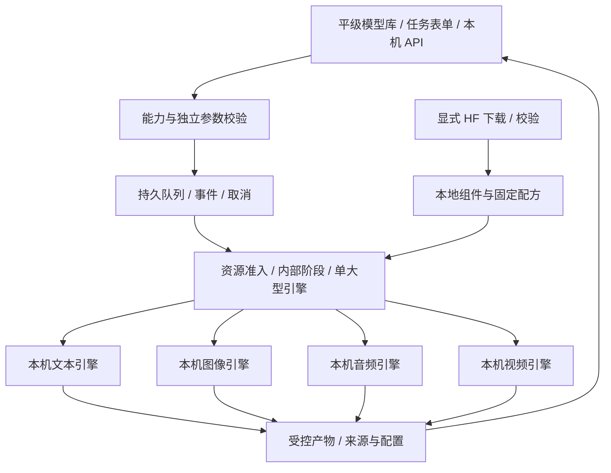

# Android 本地任务与内部执行阶段

[English](WORKFLOWS.en.md) · [现行需求与发版](MULTIMODAL_RELEASE_PLAN.md) · [共用基座](FOUNDATION.md) · [当前架构](ARCHITECTURE.md)

状态：**2026-10-27，v0.3.0 需求与部分开发实现**。任务 / 产物、下载管理和界面已有部分实现，见[开发记录](DEVELOPMENT.md)；已实现的任务接口见 [API](API.md#030-dev2独立接口任务与结果)；完整引擎、模型覆盖、文本调度统一与真机验收尚未完成。本文件描述目标行为，不代表全部已经可用。本文件按最新要求收敛为模型选择、任务表单、队列与结果；不建设 ComfyUI 连线、无限画布、用户节点、插件生态或图导入。下一版本 v0.3.0 一次完成全部基座及 01–14 / 16 / 17 与冻结子目标；完整范围以[版本更新需求](MULTIMODAL_RELEASE_PLAN.md)为准，不拆版或默认顺延。全部阶段在同一 Android 手机执行，无需 ROOT，不使用 Docker、WSL、虚拟机或模拟器。

## 使用与执行边界

用户从同一平级模型库选择模型 / 配方，填写其真实能力对应的表单，提交本机任务并查看结果。功能标签用于筛选，不建立四套下载器或模态模型层级。模型选择保留推荐与本地管理；设置跟随模型 ID。

这是提案，不表示上述引擎已装入 APK。当前单文件 `.gguf` 下载和单文本进程需要迁移。所有分词、编码、采样、codec 和媒体处理在手机进行；没有外部执行 provider 或资源不足时的外部回退。模型搜索 / 下载与执行分开，缺组件、未知算子或资源不足时返回明确本机原因。

安装 / 升级仅更新 App 基座，推荐与目录条目不含权重。浏览、选中或提交缺资产任务不隐式下载模型；用户点击下载时为所选包及已展示依赖创建任务，不附加其他模型。已有模型与设置保留，模型更新 / 删除由用户管理。开发测试资产不进入 APK，也不是用户必装条件。

## 模型包与内部引擎

模型、组件和运行配方分开：`ModelRecord → 固定配方 → 完整组件 → 兼容引擎 / 设备`。这是依赖关系，不是模型等级。

- 包固定来源 / revision、许可、角色、路径、大小和 SHA256，包含主干、分词 / 字典、文本编码器、VAE / codec、音色和适配器等必需项。
- 配方声明 ABI / minSdk / 引擎构建 / 算子 / 后端；QNN 还固定 SoC / Hexagon、QAIRT 和编译形状。
- 安装与兼容、功能与实测分别记录。组件完成校验后才原子发布包状态，主权重下载完成不等于可执行。
- 组件按内容哈希共享并引用计数，支持续传 / 暂停、空间预算和删除保护；任务持有的输入不能被清理。
- 文件、整包、临时和产物空间分别预算；现有单文件上限不是新组件包上限。

| 内部路线 | 手机上的职责 | 约束 |
| --- | --- | --- |
| `llama_text` | 现有文本 GGUF / token | 非文本 GGUF 不送入通用文本接口 |
| `sd_cpp` / `wan_sd_cpp` | 匹配图像架构、LoRA 与 Wan 管线 | 构建架构、算子、采样器、文本编码 / VAE 全部校验 |
| `mnn_diffusion` | Sana / 特定移动图像包 | 转换图、文本处理和版本必须配套 |
| `sherpa_tts` / `moss_nano_ort` | 小型 TTS 与完整 Nano 管线 | 明确语言 / 音色 / 分词 / codec，不只播放预分词示例 |
| Qwen TTS / Stable Audio 路线 | Talker / MTP / codec 或短音效 | API / 后端 / 主循环与实测速度分别验证 |
| MOSS / SoulX 专项适配器 | 各自完整音频管线 | 架构逐项移植，不能用通用图运行器冒充支持 |
| LTX 原生路线 | 旧 2B Vulkan 或合法集成的 QNN | 许可、编译包、SDK 和设备匹配；不让 Z20 加载不适配 QNN 包 |

引擎协议为 `probe / validateBundle / estimateResources / load / run / cancel / unload`，报告有序进度、预览、产物和错误。重型引擎可用独立工作进程，由前台服务持有，不依赖 Activity / WebView。

原生模块随正常签名 APK 发行、按需加载；不建设用户安装插件的系统。数据描述不能执行脚本或携带任意表达式。JNI / `ProcessBuilder` 使用结构化参数；不执行 HF Python / `trust_remote_code`。运行器只接收受控本地句柄 / ID；内部 HTTP 仅回环，不能连接外部推理服务。

## 任务、内部阶段与数据

任务持有 `task_type / model_id / recipe / inputs / settings / idempotency_key`，可以内部按编码、采样、解码等阶段组织。没有公共节点类型系统、端口连线或图编辑 schema；每个任务仍独立调用同一调度器。

产物是带 MIME、尺寸 / 时长、采样率 / fps、hash 和来源的受控本机引用。大 tensor / PCM 留在原生层，有界音频 / 预览队列防止前端积压。跨引擎只交换已解码的图片 / 音频 / 视频，不承诺任意 latent 互通。

校验任务类型、已声明能力、输入、完整包、设备配方和参数。预览只展示受控产物，不执行模型生成的代码 / HTML。模型生成的结构化参数仍需校验。编码静态图成 MP4 不能计为模型生成运动视频；自动旁白合成不是本轮必做功能。

## 模型独立参数与联合约束

“本地”按模型编辑可输入的预设选择框；配方差异独立保存，任务保存有效配置、revision、引擎构建、seed、组件哈希和设备信息。全局设置只管理应用偏好。

已知模型硬上限超出时回填最高合法值，显示调整原因。后端固定形状、宽高倍数、总像素、帧数形式、batch、采样器和蒸馏步数联合验证；不存在合法组合就拒绝。未知上限显示未知，设备内存估算不能冒充模型上限。Wan 参考帧数按 `4n+1` 等具体配方约束，QNN 提供已编译形状，不能以可编辑框暗示任意尺寸。

LoRA 校验基础家族和组件版本；TTS 校验语言、音色、文本和所需参考音频，按实际引擎能力分段 / 流式输出。输入可编辑不绕过原生约束。

## 调度、后台与恢复

默认一个大型引擎租约；按配方分阶段加载文本编码器、主干、VAE / codec。开启并发前先测共享内存、驱动和热表现，不能让全部已下载模型常驻。

SQLite `jobs / stages / events / artifacts` 记录输入、快照、状态、事件序号和产物。状态包括 `queued / validating / waiting_assets / running / cancelling / succeeded / failed / cancelled / interrupted`。任务取消绑定启动代次，避免杀到后续任务。重启先核对产物；只有引擎真实提供 checkpoint 才续步，否则明确重跑阶段或任务，保留尝试记录。

前台服务、可见通知、停止入口和按需锁不需要 ROOT。界面退出只取消订阅，不取消用户明确启动的任务。省电、发热、系统终止仍可中断；只在引擎真实支持的边界暂停，不保证永久运行或 24/7 满载。

Android 15+、target 35+ 的 `dataSync` / `mediaProcessing` 类型分别受每 24 小时累计后台六小时规则约束；这不是 Android 9 Z20 或所有服务的统一时限。真实工作决定服务类型，当前 `specialUse` 也不自动证明无限运行。[Android 官方说明](https://developer.android.com/develop/background-work/services/fgs/timeout) WorkManager 可协助恢复调度 / 下载，不承诺无限推理。

## API、旧草案与验收

计划本机异步 `POST /v1/jobs`、查询 / 取消、顺序 SSE、鉴权产物读取；现有文本 API 继续兼容。token、采样步骤、音频块和产物就绪用不同事件。**多模态接口尚未实现。** 手机对调用者提供 API 或内部回环均不转移计算地点。

早期[图片旁白 JSON](proposals/local-narrated-image.workflow.json)和[Wan JSON](proposals/local-wan-video.workflow.json)仅保留为**历史、不可执行的依赖讨论示例**，不是当前导入格式、必做组合任务或发版契约，也不是成功运行证据。最新结构化范围见 [multimodal-release-scope.json](proposals/multimodal-release-scope.json)。

按[现行发版计划](MULTIMODAL_RELEASE_PLAN.md)验收完整组件、参数隔离、资源准入、取消 / 卸载、崩溃、迁移、共享删除和真实离线生成。生图 / 生音频 / 生视频必须有各自实际结果，记录锁屏与持续服务证据；当前没有真机，不以桌面替身或 JSON 检查替代。新功能进入 APK 时才提升实际版本并录制功能媒体。

Nano 实现仅将持有租约的已校验资产硬链接到私有执行目录。正常成功 / 失败 / 取消在 worker 退出后清理，启动时清理上次遗留目录；缺少 ONNX 外置数据直接本机失败，不创建下载或回退。见[实现及证据边界](MOSS_NANO_ENGINE.md)。

dev.7 新增通用包的[独立版本更新 / 回退](MODEL_UPDATES.md)：用户核对组件与目标参数，下载与启用分开确认；保留旧资产 / 设置，排队与运行任务保护固定版本引用。当前偏好不重定向 API / 既有任务；旧记录统一和真机验收继续纳入同一完整版本。

dev.8 新文本包可通过同一表单和队列执行 `text.generate`，以经验证的正文 / 思考 JSON 入库，提供纯文本预览和导出。公开任务事件是阶段事件；旧常驻文本路径尚未全量接入调度。详见[文本任务](TEXT_ENGINE.md)。
