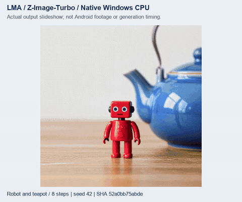

# Z-Image-Turbo: complete local model and user flow

This guide retains the exact dev.38 host experiment and archived reports. See [Wan](WAN_VIDEO.en.md) for current development.

[中文](ZIMAGE_TURBO.md) · [Model selection](CURATED_DIFFUSION.en.md) · [Component suggestions](COMPONENT_SUGGESTIONS.en.md) · [API](API.en.md) · [Current delivery/full pending scope](releases/v0.3.0-dev.38.md)

Applies to dev.38/code42. The App updates foundation code; this is an optional image model, equal to other model records. Installation, upgrades and browsing never acquire it automatically. Recommended m08→m06→m01 remains intact. Source, actual Windows CPU execution, UI fixtures and Android ARM64 compilation are distinct evidence. Complete independent numerics, image quality, resource and physical-phone acceptance remain pending; these records cannot establish Nubia Z20 execution or sustained background operation.

## 1. Select and acquire components

Open Models → All, filter images and inspect **Z-Image-Turbo · Q4_0 + Qwen3-4B**. Review all four components, fixed revisions, sizes and hashes, then explicitly download or select a complete local import folder. Alternatively use HF search and the `z_image_turbo_split_cpu_v1` recipe: select matching files, declare the model, then independently choose download.

The complete runtime files total **6,349,991,011 bytes**. This profile uses original Qwen3-4B (official 40960 context/rope_theta 1000000 configuration) and the original full 16-channel VAE. It does not silently substitute Instruct-2507, a FLUX.2 VAE or a smaller decoder. Other variants require their own checked pairing. The context configuration identifies the encoder version; image prompts remain subject to pipeline and App input limits. Filename hints help select files; they do not establish tensor compatibility, licenses or phone capability.

| No. | Role | Pinned source / file | Bytes | SHA-256 |
|---|---|---|---:|---|
| 1 | `diffusion` | [z_image_turbo-Q4_0.gguf](https://huggingface.co/leejet/Z-Image-Turbo-GGUF/resolve/c61c0e422dc8b541b7548cf33a4ef8302b0f8085/z_image_turbo-Q4_0.gguf) | 3,683,370,944 | `2bc57986874c84f7ec6d02d9d7070a53b0029954a0e38a6e1342eb91095572f5` |
| 2 | `llm` | [Qwen3-4B-Q4_K_M.gguf](https://huggingface.co/unsloth/Qwen3-4B-GGUF/resolve/22c9fc8a8c7700b76a1789366280a6a5a1ad1120/Qwen3-4B-Q4_K_M.gguf) | 2,497,281,312 | `f6f851777709861056efcdad3af01da38b31223a3ba26e61a4f8bf3a2195813a` |
| 3 | `vae` | [vae/diffusion_pytorch_model.safetensors](https://huggingface.co/Tongyi-MAI/Z-Image-Turbo/resolve/f332072aa78be7aecdf3ee76d5c247082da564a6/vae/diffusion_pytorch_model.safetensors) | 167,666,902 | `f5b59a26851551b67ae1fe58d32e76486e1e812def4696a4bea97f16604d40a3` |
| 4 | `qwen_merges` | [tokenizer/merges.txt](https://huggingface.co/Tongyi-MAI/Z-Image-Turbo/resolve/f332072aa78be7aecdf3ee76d5c247082da564a6/tokenizer/merges.txt) | 1,671,853 | `8831e4f1a044471340f7c0a83d7bd71306a5b867e95fd870f74d0c5308a904d5` |

Image/text-to-image/distilled-sampling and sd_cpp/z_image/CPU tags are separate from installation and content classification. No unverified uncensored label is added. Missing components fail locally, without implicit downloads or another device executing a stage.

## 2. Local management and independent settings

Use Models → Local for installed state, pause/resume, import, update/rollback and deletion. Editable presets belong to the immutable model ID. Values beyond a declared ceiling clamp without changing another profile.

| Parameter | This profile | Meaning |
|---|---|---|
| Width / height | Default 1024; 64–2048, aligned to 16 | Pipeline alignment and App guard, not full size/quality/memory acceptance |
| Steps | Default 8; 1–8 | Current distilled sampling policy |
| CFG / negative prompt | Fixed 1 / unsupported | No negative conditioning or implicit adapter |
| Sampler / scheduler | Euler / discrete | Bound to the selected pipeline |
| Threads | Default 4; 1–64 | Application range; actual performance is device-dependent |
| Seed | Default −1; −1–2147483647 | −1 requests randomness; effective seed is recorded |
| Flow shift / VAE tiling | Default 0 automatic / enabled | Shift 0–32; every stage stays on-device |

Active assets and settings are lease-protected and become editable after completion. Later edits cannot mutate a submitted job's prompt, model, parameters or components.

## 3. Submit, cancel, recover and manage results

Select an installed model, enter a prompt, review preflight and submit through the shared local queue. Existing foreground service, notifications, resource checks and task APIs apply; submission never acquires model assets. PNGs are inspected before publication with immutable provenance. Failed/cancelled tasks publish no partial result. Retrying is a new explicit submission. Restart retains committed results, and model deletion preserves completed outputs and retained independent settings.

Exact content hashes allow component reuse. Already acquired matching Qwen3-4B weights and merges need no duplicate object copy. Reuse neither installs another declared catalogue model nor starts generation. Plans disclose reusable and missing bytes.

## 4. Tokenizer, evidence and reproduction

The official Z-Image full tokenizer.json SHA exactly matches the independently validated Qwen reference, as do the complete merges bytes. The shared reader handles the HF header, BOM/CRLF and NFC in memory without changing installed files. The reference covers 151,643 base IDs, 26 special IDs, 33 texts and three representations:117 checks. This is not full-model numerical or image-quality acceptance.

- [Actual native execution](../verification/history/0.3.0-dev.38/zimage-trained.json): complete components, prompt/step changes, real sampling cancellation, errors, recovery and Windows process observations.
- [Production Java/native flow](../verification/history/0.3.0-dev.38/zimage-app-host.json): full imports, independent settings, leases, immutable jobs, actual generation/cancel/recovery, PNG provenance, restart and deletion.
- [Actual output media](media/development/zimage-trained/manifest.json), [labelled UI recordings](media/development/curated/manifest.json), [independent tokenizer comparison](../verification/history/0.3.0-dev.38/qwen-tokenizer.json).



GIF/MP4 files display real PNGs and do not establish generation timing or phone performance. UI recordings carry fixture labels. Every full-v0.3.0 target and previous failure remains mandatory.

```powershell
python tools/fetch_zimage_trained.py --download --reference-tokenizer
python tools/test_zimage_trained.py
python tools/test_zimage_app_host.py
python tools/render_zimage_trained.py
```

Without `--download`, acquisition only verifies local files. Tests cannot download. `--execute-only` saves actual Java capture; `--verify-run build/zimage-app-host-tests/run-…` later verifies source/build/raw outputs against direct execution without repeating inference. Native Windows development uses no Docker/WSL/emulator. The additional complete tokenizer.json is a developer reference, outside the four runtime components and outside the APK.

Apache-2.0 declarations come from the matching pinned publisher pages. Retain the [official model card](https://huggingface.co/Tongyi-MAI/Z-Image-Turbo/blob/f332072aa78be7aecdf3ee76d5c247082da564a6/README.md), quantized-model attribution and separate App/engine licenses.


## 5. Host observations in this checkpoint

512×512, seed42, six CPU threads; a / b / recovery-a use eight steps and one-step uses one. Development tests ran concurrently. These Windows process measurements do not establish Nubia Z20 minimum memory, speed, thermals or screen-off endurance.

| Case | Seconds | Observed peak working set (MiB) |
|---|---:|---:|
| a | 867.06 | 5912.2 |
| b | 1099.03 | 5911.6 |
| one-step | 316.90 | 5911.3 |
| recovery-a | 1327.24 | 5912.6 |

Cancellation at sampler step 1/8 leaves no partial result. Recovery matches the original PNG byte for byte; changed prompts and step counts produce different actual images. This does not constitute complete quality or independent numerical acceptance.
