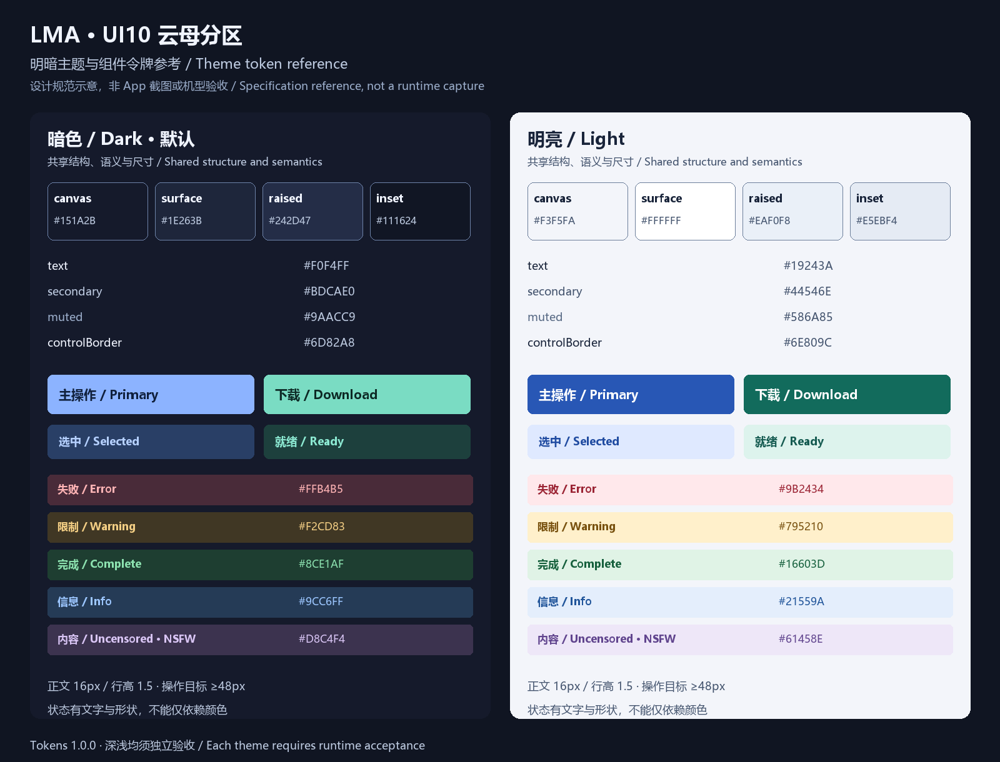

# LMA Mica Bento · Design specification 1.0.0

[中文](MICA_BENTO.md) · [Index](README.md) · [Components](COMPONENTS.en.md) · [Adaptive layout](RESPONSIVE.en.md) · [Tokens](tokens.json)

## 1. Accepted direction and authority

**UI 10, Mica Bento, is accepted. Dark is the default; light receives a complete specification.** The user selected this direction on 2026-11-03 and explicitly required light/dark differences and narrow/wide phone adaptation. Logo 21 and slogan 04 remain separate approved decisions. v1.0.0 integrates this design; see the [implementation and scoped checks](../MICA_V100.en.md).

The [original concept](../../output/imagegen/lma-home-ui-selection-20261103/10-fluent-bento.png) and [decision record](decision.json) establish provenance. Use opaque blue-gray planes, resource tiles, cobalt selection, mint actions, fine outline icons and restrained corners. Mica describes visual layering, not a dependency on Windows Mica APIs, wallpaper sampling or live blur. Do not mix in neon, raised/recessed skeuomorphic controls, inflated clay, pixels, terminals or liquid glass from other proposals.

“Must” and “must not” are requirements. Tokens are the numeric source for colors, dimensions and breakpoints; these documents define semantics and behavior. Resolve discrepancies by updating both before implementation. Explicit user requirements take precedence. The reference CSS is not imported by the app. Generated Chinese text, fake resource figures and image-cropped controls are not implementation assets.

## 2. Product invariants

| ID | Behavior to preserve | Design requirement |
| --- | --- | --- |
| B01 | Inference on the same Android phone; model-free APK | No remote providers, cloud actions or automatic weight downloads; explain downloads and LAN API access accurately |
| B02 | Startup at Model Library → Recommended; all models are peers | Preserve `m08 → m06 → m01` and existing multimedia recommendations; image/video models are not subordinate plugins |
| B03 | Recommended / Local / Lightweight / Advanced / All | Local manages every downloaded source and unfinished transfer; All/HF search discovers additional models; Local search stays offline |
| B04 | Text, image, video, audio and 3D capabilities | Separate task, engine dependency, content label, installation state and evidence; architecture is not device evidence |
| B05 | Editable presets stored per model ID | Preserve valid values; clamp context/output to applicable limits with their source; do not move these fields to global settings |
| B06 | Five destinations | Models → Chat → Tasks → Server → Settings; wider navigation keeps the same order and destinations |
| B07 | Original jobs, artifacts and W01–W06 sequential templates | Preserve cancellation, failure, recovery and provenance; no infinite canvas, user nodes or plugin marketplace |
| B08 | API default 52187 | Preserve custom ports and credentials; LAN access is not remote inference; describe the public OpenAI text subset accurately |

## 3. Brand and composition

Use the approved [Logo 21 assets](../BRANDING.md). Do not redraw, recolor, desaturate or filter the logo. The header mark is 40 CSS px, optionally 36 on narrow phones, with at least 8px clear space. Use a dedicated brand backing if needed. Reuse existing transparent derivatives for their intended purpose; do not place the whole README banner in the header.

Preserve the exact wording **把无审查 AI，装进口袋。** / **Uncensored AI, right in your pocket.** The phone header prioritizes the mark, LMA name and actions. Move the full slogan to About/brand details or a separate wrapping region when it does not fit. Never make it illegibly small or truncate it into a different claim.

Each page has a clear main purpose: model choice/management, conversation, job handling, API service or app preferences. Resource/status information is secondary, not a marketing hero. Each local action group has at most one primary action. Cancel, Stop and Delete use distinct explicit labels.

## 4. Complete semantic themes

The values below are opaque sRGB colors. Components use semantic tokens rather than independent approximate colors. Theme changes do not alter information priority, action placement, icon meaning or typography. Dark mode avoids pure black/white glare; light mode retains blue-gray divisions rather than inverting an image.

| Token | Dark | Light | Purpose |
| --- | --- | --- | --- |
| canvas | `#151A2B` | `#F3F5FA` | Page background; no default gradient |
| surface | `#1E263B` | `#FFFFFF` | Cards, header, navigation |
| raised | `#242D47` | `#EAF0F8` | Resource and secondary overlay sections |
| inset | `#111624` | `#E5EBF4` | Inputs, code and media placeholders |
| text | `#F0F4FF` | `#19243A` | Body, titles and important values |
| secondary | `#BDCAE0` | `#44546E` | Field descriptions and secondary content |
| muted | `#9AACC9` | `#586A85` | Noncritical metadata; still meets body contrast |
| separator | `#3E4E6E` | `#CED8E6` | Decorative lines, never the only control boundary |
| controlBorder | `#6D82A8` | `#6E809C` | Input outlines and essential boundaries |
| primary | `#8CB3FF` | `#2857B5` | Primary actions, links, selected markers |
| onPrimary | `#10203C` | `#FFFFFF` | Solid primary button foreground |
| primaryHover | `#A8C7FF` | `#214A9C` | Pointer hover; never required for touch operation |
| primaryPressed | `#729DF4` | `#1C3F85` | Primary pressed state |
| primarySoft | `#293F66` | `#DFE9FF` | Selected segments and navigation backing |
| onPrimarySoft | `#B5D0FF` | `#214CA1` | Selected text/icons |
| mint / onMint | `#7ADCC3` / `#0D2925` | `#126B5C` / `#FFFFFF` | Download/ready action emphasis |
| mintSoft / onMintSoft | `#1D403D` / `#8CE9D2` | `#DDF3ED` / `#155B51` | Quiet download/ready emphasis |
| danger / dangerSoft | `#FFB4B5` / `#492B39` | `#9B2434` / `#FFE8EB` | Failures and destructive notices |
| warning / warningSoft | `#F2CD83` / `#403724` | `#795210` / `#FFF0CB` | Resource limits and recoverable constraints |
| success / successSoft | `#8CE1AF` / `#1E3E31` | `#16603D` / `#E0F3E6` | Completed and verified states |
| info / infoSoft | `#9CC6FF` / `#253B56` | `#21559A` / `#E4EEFC` | Informational and active-stage messages |
| content / contentSoft | `#D8C4F4` / `#3C334F` | `#61458E` / `#EEE7F8` | Uncensored/NSFW properties, not an error level |
| focus | `#8CB3FF` | `#2857B5` | Outer focus indicator |
| scrim | `#050914` at 64% | `#19243A` at 40% | Modal backdrop; no body text directly on it |

Status foregrounds sit on their corresponding Soft backgrounds; arbitrary inversion or white text is not allowed. Dark-mode light-blue/mint solid buttons require the dark `onPrimary`/`onMint` foregrounds. Charts, rings and progress also provide labels or values. Selection, status and failures must remain understandable without color.

### 4.1 Required differences

| Concern | Dark | Light | Shared rule |
| --- | --- | --- | --- |
| Hierarchy | Dark canvas, progressively lighter planes | Blue-gray canvas, white cards, recessed gray-blue fields | Inputs identifiable without shadows |
| Primary action | Light blue with ink text | Deep blue with white text | Independent press and focus feedback |
| Download accent | Light mint with dark green text | Deep mint with white text | Explicit Download/Ready wording |
| Shadow | `0 2px 8px rgb(0 0 0 / .16)` | `0 2px 8px rgb(25 36 58 / .08)` | At most one quiet layer; optional for lists |
| Lines and fields | Dark decorative lines, brighter control outlines | Light decorative lines, darker control outlines | Decoration alone cannot identify interaction |
| Images/video | Original media colors | Original media colors | No inversion or blanket dimming; checkerboard for transparency |
| Code/logs/3D | Deep inset backing | Light inset backing; neutral 3D scene backing allowed | App-themed toolbar; scene lighting is not inverted |
| Android bars | Dark backgrounds, light icons | Light backgrounds, dark icons | Correct Android icon-appearance flags |

### 4.2 Preference and first paint

New installs default to `dark`. Settings offer Dark, Light and System, preserving existing valid preferences. `system` is a preference; effective `data-theme` is always `dark` or `light`. Resolve stored/system preference before first paint. Coordinate the WebView/window background, splash, status/navigation bars and native pickers/dialogs where supported. Theme changes must not restart models or jobs.

Update all visible and subsequently created components, including overlays, toasts, code, media controls and errors. No white flash, half-switched page or leftover dark text on a dark surface. User-triggered color transitions may last up to 160ms; startup, system changes, reduced motion and constrained devices switch directly. Acceptance includes cold launch and switching while a dialog is open.

### 4.3 Contrast

Body text, secondary text and labels require **4.5:1**. This project does not use the large-text exception to lower title contrast. Essential control boundaries, meaningful icons and focus indicators require **3:1** against adjacent base surfaces. Focus uses a 2px outline with a 2px gap painted in the external base surface. Decorative separators cannot be the sole cue for an interactive or selected state. Do not reduce an entire disabled group’s opacity and make explanatory text unreadable.

See [W3C text contrast](https://www.w3.org/WAI/WCAG22/Understanding/contrast-minimum.html) and [non-text contrast](https://www.w3.org/WAI/WCAG22/Understanding/non-text-contrast.html). [Static validation](validation.json) checks specified flat pairs; it does not verify antialiasing, overlays, image backings or physical displays. Recheck the actual composited colors after implementation.

## 5. Type, spacing and shape

| Element | Specification | Constraint |
| --- | --- | --- |
| Typeface | Local system-ui / Roboto / Noto CJK fallbacks | No font downloads; support mixed scripts and model IDs |
| Page title | 26px, 600–700, line-height 1.25 | May use 24px in narrow mode; still scales with user text settings |
| Section/card title | 20px / 18px, 600, line-height 1.35 | Wrap model names; do not clip actions with fixed card heights |
| Body/input/action | 16px, 400/500/600, line-height 1.5 | Do not shrink long input values to 12px |
| Secondary/labels | 14px, line-height 1.45–1.5 | Compatibility, errors and limit sources are substantive content |
| Tertiary metadata | Minimum 12px, line-height 1.5 | Noncritical timestamps only; scales with text settings |
| Numbers/code | Monospace fallback; tabular numbers | Preserve URLs, hashes and quantization labels; contain long strings |
| Spacing | 4 / 8 / 12 / 16 / 24 / 32 / 48px | 4px adjustments, 8px main rhythm |
| Corners | Tags 6, controls/segments 8, model cards 10, resources 12, dialogs 16px | Mechanical switch tracks may be pill-shaped; ordinary cards are not inflated pills |
| Icons | 20px, emphasized 24px, approximately 1.75–2px strokes | One local outline SVG family; no emoji system icons |
| Hit areas | At least 48 × 48 CSS px; native at least 48dp | Verify density/text zoom mapping on WebView; small glyphs may have larger nonoverlapping hit areas |
| Adjacent targets | Prefer 8px gaps | Wrap five catalogue filters at 320px if needed; never shrink targets |

Use scalable typography/WebView text scaling, not a whole-page `transform: scale()`. At 200% text size users must still download, edit parameters, compose, cancel and control the server. [Adaptive rules](RESPONSIVE.en.md) define reflow and removal of line clamps.

## 6. Material and performance

Base planes are opaque. Mica character comes from blue-gray hierarchy, tile proportions and optional static local diagonal tints. No `backdrop-filter`, live wallpaper, animated noise, continuous glow or parallax. Optional tint alpha is at most 4% over an opaque base; text and essential boundaries retain verified flat backings, or their worst composited contrast is measured separately. Diagonal resource accents do not encode progress or capacity.

An idle page must not run decorative rendering loops, repeatedly scan the full catalogue or recreate lists. Update only changed regions; streamed tokens update the active message without rebuilding the whole conversation/homepage. Preserve bounded message rendering (currently approximately 60 visible entries), lazy media and incremental updates. Decode images at display-appropriate sizes. Do not autoplay previews or instantiate every video/audio/3D renderer in a list. Release invisible previews when leaving a page without destroying jobs or persisted records.

Animate progress only for real visible activity; use stage text when inactive, backgrounded or under reduced motion. Visual updates do not change background inference policy or promise to bypass Android restrictions. Compare idle CPU, memory, scrolling and typing on the same device/data/theme. This documentation round claims no measured FPS, battery or latency improvement.

## 7. States, copy and feedback

| State | Presentation | Interaction |
| --- | --- | --- |
| Not downloaded | Format, size, compatibility, Download | Explicit asset/dependency choice; no silent prefetch |
| Downloading/paused | Real byte counts; percentage only with known total | Pause/resume/cancel; retain recoverable failure details |
| Verifying/loading | Real stage text; no fabricated percentage | Prevent duplicates; preserve available cancellation |
| Ready/running | Full model name, engine and actual state | Ready is not proof of every input or verified quality |
| Queued/executing/finalizing | Original job ID, stage and known progress | No UI timeout or decorative countdown masquerading as execution |
| Failed | Failed step, cause and valid next action | Retry/configuration/dependency repair only where implemented |
| Completed/cancelled | Result or explicit cancellation and provenance | Incomplete failures are not successful assets; cancellation is not a red failure |
| Empty/offline | Distinguish no local models, no matches and network error | Appropriate download/filter-clear/retry action; keep local operations available |

Use specific copy: “Context limit is 8192 (model metadata); adjusted to 8192.” Capability labels distinguish native, adapter and unreviewed support; filenames alone are not evidence. Uncensored/Abliterated/NSFW labels expose declaration source and confidence without renaming the whole catalogue around them.

Toasts are for brief feedback. Important failures and parameter corrections remain inspectable at the field/job. Use restrained accessibility live regions, never one announcement per token. Downloads, service controls, cancellation and deletion need immediate feedback. Explain referenced-artifact deletion impact and retain existing safeguards.

## 8. Consistency and acceptance

Apply the same tokens/components to Models, Chat, Tasks, Server, Settings and all secondary overlays. Preserve offline management, HF import, per-model settings, manual multimedia, original job cards, provenance, templates and API behavior. Show engineering detail when needed for a user decision rather than expanding every internal detail into the main flow.

[Components](COMPONENTS.en.md) define C01–C30 and source anchors. [Adaptive layout](RESPONSIVE.en.md) defines R00–R06 and A01–A20. Static color/provenance/document checks do not establish WebView interaction, device adaptation or performance. Existing v0.4.0 device, projector, codec and output-quality gaps remain open.
