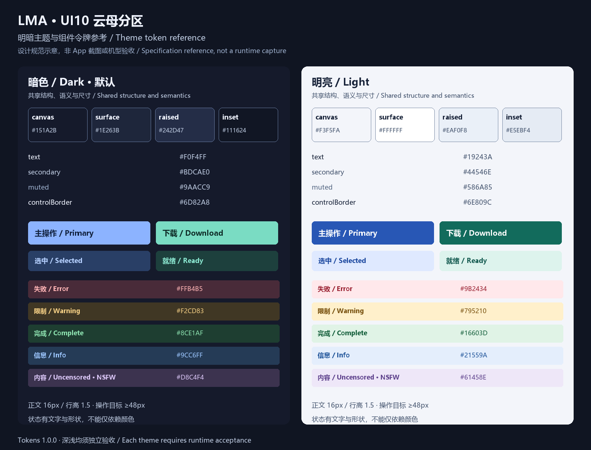

# LMA 云母分区 · 设计风格约束 1.0.0

[English](MICA_BENTO.en.md) · [总目录](README.md) · [组件](COMPONENTS.md) · [宽窄屏适配](RESPONSIVE.md) · [Tokens](tokens.json)

## 1. 定稿与实施边界

**UI 采用 10 号「云母分区」；默认暗色，同时完整定义明亮主题。** 2026-11-03 用户已选择该方向，并要求约束明暗差异及不同宽窄机型。Logo 21 与标语 04 独立保留，不能误用 UI 选型编号更换 Logo。v1.0.0 已将本规范接入 APK；实现与有界验收见 [本版指南](../MICA_V100.md)。

基准是[原始概念图](../../output/imagegen/lma-home-ui-selection-20261103/10-fluent-bento.png)，身份及哈希见 [decision.json](decision.json)。采用不透明蓝灰平面、分区资源块、钴蓝选中、薄荷操作色、细线图标和克制圆角。云母是视觉分层语言，不依赖 Windows Mica API、壁纸采样或真实毛玻璃。不能将其他候选的霓虹、拟物凹凸、厚塑料、像素、终端或液态玻璃混入通用控件。

强制规则使用“必须／不得”；建议使用“宜”。规范与 tokens 共同约束实现：颜色、尺寸及断点以 tokens 的命名值为唯一数值来源，语义与交互以本文和组件文档为准，发现差异必须同步修订。参考 CSS 不直接加载；运行时 CSS 由 tokens 编译并通过 mica.css 接入。实施不得把 AI 图中的中文、模型名称、容量或按钮直接裁图使用。

## 2. 产品结构与业务不变量

| 编号 | 必须保留的行为 | 设计约束 |
| --- | --- | --- |
| B01 | 同一 Android 手机完成推理，APK 不含权重 | 不增加远程供应商、云端按钮或自动下载；联网下载与局域网 API 访问应准确说明 |
| B02 | 首页为模型库 → 推荐；模型平级 | 保留 `m08 → m06 → m01` 推荐前缀及已有多媒体推荐，不将生图／视频降为附属插件 |
| B03 | 推荐／本地／轻量／进阶／全部 | 本地管理所有已下载来源及未完成传输；全部／HF 搜索支持其他模型发现；本地搜索离线 |
| B04 | 生文、生图、生视频、生音频、生 3D 等能力 | 功能、运行基座、内容属性、安装状态和验证证据分开标记；架构标签不能冒充手机运行证明 |
| B05 | 模型 ID 独立参数，可编辑预设 | 上下文与输出上限跟随模型；合法值不被风格调整重置；超限归位说明约束来源 |
| B06 | 五个一级入口 | 模型库 → 对话 → 任务 → 服务 → 设置，宽屏只改变导航形式，不改变入口和顺序 |
| B07 | 原始任务、素材、W01–W06 顺序模板 | 保留取消、失败、恢复和来源记录；不引入无限画布、用户节点或插件市场 |
| B08 | API 默认端口 52187 | 保留自定义端口、凭证和配置；局域网访问不是远程推理；公共 OpenAI 文本子集如实说明 |

## 3. 品牌与版面气质

品牌素材使用 [Logo 21 的现有文件](../BRANDING.md)，不得 AI 重绘、调色、去色或对其使用滤镜。顶栏 Logo 为 40 CSS px，窄屏可为 36；四周净空至少 8。与背景不协调时使用独立品牌底座，不用降低整个 Logo 透明度解决。已有透明前景衍生资产按其原用途复用，不将整张品牌横幅塞入页面顶栏。

完整标语逐字保留：**把无审查 AI，装进口袋。** / **Uncensored AI, right in your pocket.** 手机顶栏优先 Logo、LMA 和操作入口；空间不足时将完整标语移到品牌说明／关于页，或放在独立可换行区域，不用缩到难以阅读的小字，也不截成改变含义的片段。

每页首屏只有一个主要目的：模型库选择与管理；对话输入与生成；任务查看和处理；服务启停与接口；设置调整应用偏好。资源与状态是次级信息，不做营销 Hero。主操作每个局部区域至多一个；取消、停止和删除各自使用清晰文字，不用颜色暗示其差异。

## 4. 明暗主题：完整语义配色

所有下列值均为 sRGB、不透明颜色。用语义 token，不在业务组件硬编码另一套近似色。光照模式只改变色彩、阴影和遮罩，不改变内容优先级、操作位置、图标含义或字号。暗色不使用纯黑底加高亮白字；明亮主题保留蓝灰分区，不把暗色截图反相。

| Token | 暗色 | 明亮 | 用途 |
| --- | --- | --- | --- |
| canvas | `#151A2B` | `#F3F5FA` | 页面底色，默认无渐变 |
| surface | `#1E263B` | `#FFFFFF` | 常规卡片、顶栏、导航 |
| raised | `#242D47` | `#EAF0F8` | 资源、弹层中的次级分区 |
| inset | `#111624` | `#E5EBF4` | 输入、代码、媒体占位 |
| text | `#F0F4FF` | `#19243A` | 正文、标题、关键值 |
| secondary | `#BDCAE0` | `#44546E` | 字段说明、次级内容 |
| muted | `#9AACC9` | `#586A85` | 时间、非关键说明；仍满足正文对比度 |
| separator | `#3E4E6E` | `#CED8E6` | 装饰性分隔，不能单独承担控件边界 |
| controlBorder | `#6D82A8` | `#6E809C` | 输入轮廓、必要分组界限 |
| primary | `#8CB3FF` | `#2857B5` | 主操作、链接、选中标识 |
| onPrimary | `#10203C` | `#FFFFFF` | 主色实心按钮文字与图标 |
| primaryHover | `#A8C7FF` | `#214A9C` | 有指针设备悬停；触屏不依赖悬停 |
| primaryPressed | `#729DF4` | `#1C3F85` | 主操作按下 |
| primarySoft | `#293F66` | `#DFE9FF` | 分段选中、选中导航背景 |
| onPrimarySoft | `#B5D0FF` | `#214CA1` | 选中背景上的文字与图标 |
| mint / onMint | `#7ADCC3` / `#0D2925` | `#126B5C` / `#FFFFFF` | 下载、就绪操作的强调组合 |
| mintSoft / onMintSoft | `#1D403D` / `#8CE9D2` | `#DDF3ED` / `#155B51` | 下载／就绪的柔和组合 |
| danger / dangerSoft | `#FFB4B5` / `#492B39` | `#9B2434` / `#FFE8EB` | 失败、破坏性提示 |
| warning / warningSoft | `#F2CD83` / `#403724` | `#795210` / `#FFF0CB` | 资源不足、可修复限制 |
| success / successSoft | `#8CE1AF` / `#1E3E31` | `#16603D` / `#E0F3E6` | 已完成、已校验 |
| info / infoSoft | `#9CC6FF` / `#253B56` | `#21559A` / `#E4EEFC` | 信息与处理中说明 |
| content / contentSoft | `#D8C4F4` / `#3C334F` | `#61458E` / `#EEE7F8` | 无审查／NSFW 内容属性，绝非错误等级 |
| focus | `#8CB3FF` | `#2857B5` | 焦点外环 |
| scrim | `#050914` × 64% | `#19243A` × 40% | 模态背景遮罩；禁止在遮罩上排正文 |

状态色用于相应 Soft 背景上的文字／图标，不可随意反转后放白字。暗色浅蓝、浅薄荷实心按钮必须用 `onPrimary`／`onMint` 深色字。圆环、进度、图表亦必须提供文字／图例。色盲、灰度及屏幕低亮度下仍能通过标签、勾选、形状或数值辨别状态。

### 4.1 两种主题的具体差异

| 项目 | 暗色 | 明亮 | 两者共同约束 |
| --- | --- | --- | --- |
| 层级 | 底层深、卡片逐级提亮 | 灰蓝底、白卡片、灰蓝嵌入区 | 不依赖阴影才能识别输入 |
| 主按钮 | 浅蓝配墨色字 | 深蓝配白字 | 按下与焦点状态独立 |
| 下载强调 | 浅薄荷配深墨绿 | 深薄荷配白字 | 就绪／下载状态仍写文字 |
| 阴影 | `0 2px 8px rgb(0 0 0 / .16)` | `0 2px 8px rgb(25 36 58 / .08)` | 每个面至多一层轻阴影，列表可不用 |
| 分隔与输入 | 装饰线暗蓝灰，输入边界更亮 | 装饰线浅蓝灰，输入边界更深 | 不能把装饰线当唯一交互轮廓 |
| 图片与视频 | 原始媒体色彩保留 | 原始媒体色彩保留 | 不对预览反相／统一压暗；透明图像使用棋盘格 |
| 代码、日志、3D 预览 | 深嵌入底 | 浅嵌入底；3D 场景可自选中性底 | 工具栏按 App 主题；场景照明不随文字反色 |
| 系统栏与弹层 | 深底系统栏与浅图标 | 浅底系统栏与深图标 | Android 图标明暗标志须与背景匹配 |

### 4.2 默认、用户偏好和首次绘制

新安装默认 `dark`。设置可选暗色／明亮／跟随系统；已有合法选择必须保留。`system` 为偏好值，`data-theme` 为已解析的 `dark` 或 `light`，不能把第三套未定义颜色应用到控件。冷启动在首帧前解析已存偏好及系统状态，WebView、窗口底色、启动页、状态栏、导航栏、原生文件选择／对话框尽可能一致；主题切换不重建正在运行的模型／任务。

切换立即更新所有已挂载与随后创建的组件，包括弹层、toast、代码、媒体控制和错误横幅；不得出现半页浅色、暗色文本留在浅底或先闪白再变暗。只在用户主动切换时可作不超过 160ms 的颜色过渡；系统跟随、冷启动、低性能或减少动画设置下直接切换。截图验收同时包含冷启动与在弹层打开时切换两种主题。

### 4.3 对比度约束

正文、次要文字和标签以 **4.5:1** 为最低值；本项目不靠“大字例外”降低标题要求。识别交互所需边界、图标、焦点相对相邻基础面至少 **3:1**。焦点为 2px 线 + 2px 留白，留白使用该控件外部的基础面，避免焦点与实心按钮混在一起。分隔线只作装饰，不能作为可点击／选中状态的唯一提示。禁用控件不通过整组降透明度影响错误说明；理由用正常可读文字。

依据 [W3C 文字对比度](https://www.w3.org/WAI/WCAG22/Understanding/contrast-minimum.html) 与 [非文本对比度](https://www.w3.org/WAI/WCAG22/Understanding/non-text-contrast.html)。本轮 [validation.json](validation.json) 检查指定纯色组合，未证明实际控件的抗锯齿、叠加、图片背景或设备显示效果；实现后须再核对最终合成色。

## 5. 字体、尺寸、间距与形状

| 项目 | 规格 | 约束 |
| --- | --- | --- |
| 字体 | 本地 system-ui／Roboto／Noto CJK 等系统回退 | 不下载字体；中英文、标点、罕见模型名有回退 |
| 页面标题 | 26px，600–700，行高 1.25 | 窄屏可 24px；文字放大继续随用户比例增长 |
| 分区／卡片标题 | 20px / 18px，600，行高 1.35 | 模型名可换行，不能固定卡片高度截掉动作 |
| 正文／输入／按钮 | 16px，400／500／600，行高 1.5 | 字段内容不缩到 12px 以塞入长数值 |
| 次要文字／标签 | 14px，行高 1.45–1.5 | 关键兼容性、错误和参数来源不得降为装饰小字 |
| 极次要说明 | 最小 12px，行高 1.5 | 只用于非关键时间等；随系统文字缩放 |
| 数字／代码 | 等宽回退；数值启用 tabular-nums | API、hash、量化名不得变形；长文本在自身区域处理 |
| 间距 | 4 / 8 / 12 / 16 / 24 / 32 / 48px | 4 为微调，8 为主要节奏；不随机堆叠近似值 |
| 圆角 | 标签 6、控件／分段 8、模型卡 10、资源块 12、弹层 16px | 开关轨道可按机械结构为胶囊；普通卡片不全做大圆药丸 |
| 图标 | 20px，重点 24px，描边约 1.75–2px | 统一一套本地线性 SVG；不以 emoji 充当系统图标 |
| 点击范围 | 最小 48 × 48 CSS px，原生至少 48dp | WebView 密度与文字缩放后核实实际触控尺寸；图形可小，命中区不能相互覆盖 |
| 相邻操作 | 命中区间距宜 8px | 320px 下分段 5 项放不下就换行，绝不缩小命中区 |

字号实施用可随文字设置增长的单位／WebView 字体缩放，不能用整页 `transform: scale()`。文字放大到 200% 仍可完成下载、参数、对话、取消和服务启停。适配规则及放大时去除行数截断见 [RESPONSIVE](RESPONSIVE.md)。

## 6. 云母材质与性能约束

基础面必须不透明。云母感来自灰蓝层级、块面比例和可选静态局部对角色调；不使用 `backdrop-filter`、实时壁纸、动态噪点、常驻光晕和视差。局部 tint 透明度最多 4%，先画在不透明底上；正文和必要边界区域仍使用已验证纯色，若 tint 与文字重叠则单独计算最不利合成对比度。资源 tile 的斜向分区是装饰，不承载进度或容量含义。

没有模型或任务运行时，页面不得为装饰启动循环绘制、持续扫描全目录或反复重建列表。只更新变化的状态区域；流式 token 只更新活动消息，不重绘全部首页／会话。保留已有有界消息呈现（当前约 60 条视图）、延迟媒体加载和增量更新措施。图片按显示尺寸解码；视频、音频、3D 不因列表出现而自动播放或创建全部渲染上下文。切走页面时释放不可见预览，保留任务和持久化记录。

进度动画只在真实活动且可见时运行；静止、后台、减少动画时使用文字／阶段反馈。材质升级不修改下载／推理后台机制，也不保证绕过 Android 后台限制。性能验收应同设备、同数据、同主题对比空闲 CPU、内存、滚动和输入延迟；本轮不编造 FPS、耗电或卡顿改善数据。

## 7. 状态、文案与反馈

| 状态 | 展示 | 交互 |
| --- | --- | --- |
| 未下载 | 格式、体积、兼容条件、下载 | 用户主动选择依赖后下载，不做后台预下载 |
| 下载中／暂停 | 真实字节、总量、百分比（总量已知时） | 暂停／继续、可访问的取消；失败保留可恢复信息 |
| 校验／加载 | 阶段文字；未知时不显示假百分比 | 禁止重复提交；允许已有取消路径 |
| 就绪／运行 | 模型全名、基座和真实状态 | 就绪不等于支持全部输入或质量已验证 |
| 排队／执行／收尾 | 原任务 ID、阶段、已知进度 | 不用 UI 倒计时或动画代替真实执行状态 |
| 失败 | 失败步骤、原因、已有有效下一步 | 重试、改配置、补依赖等只在真实支持时出现 |
| 完成／已取消 | 结果或明确取消状态、来源 | 失败结果不冒充成功素材，取消不显示失败红色 |
| 无数据／离线 | 区分没有本地模型、搜索空、网络失败 | 就近提供下载入口／清空筛选／重试；本地操作仍可用 |

提示使用用户语言：“上下文上限为 8192（模型元数据），已调整为 8192”，避免只写“非法输入”。模型能力写“图像输入：原生／适配器／未核对”，不把文件名猜测当作标签证据。Uncensored／Abliterated／NSFW 写明声明来源与核对等级；不强制重命名整个产品为无审查模型库。

toast 用于短反馈，关键错误和参数修正须在相关字段／任务卡可回看；读屏使用适度 live 区域，不能每个 token 播报。模型下载、启停、取消、删除均有明确触控反馈；删除正在被引用的素材先告知影响并按现有保护逻辑处理。

## 8. 页面一致性与验收

模型库、对话、任务、服务、设置和全部二级弹层共用 token 与组件；不能只美化首页。页面重排不删除技术必要的信息，也不把工程详情铺到普通操作主线。保留推荐、离线本地管理、HF 导入、模型参数、手动多媒体、原任务卡、素材来源、模板、接口与设置的现有行为。

实施定位与 C01–C30 详见[组件规范](COMPONENTS.md)，R00–R06 及 A01–A20 详见[适配与验收](RESPONSIVE.md)。本轮静态颜色／来源／文档检查不能替代 WebView 交互、不同机型和真实性能验收；既有 v0.4.0 真机、视觉组件、编解码和模型质量欠项继续保留。
