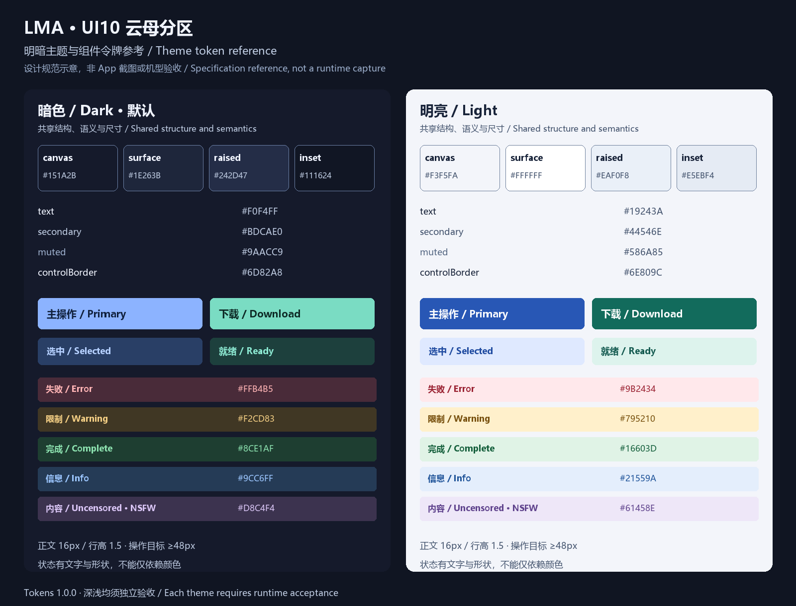
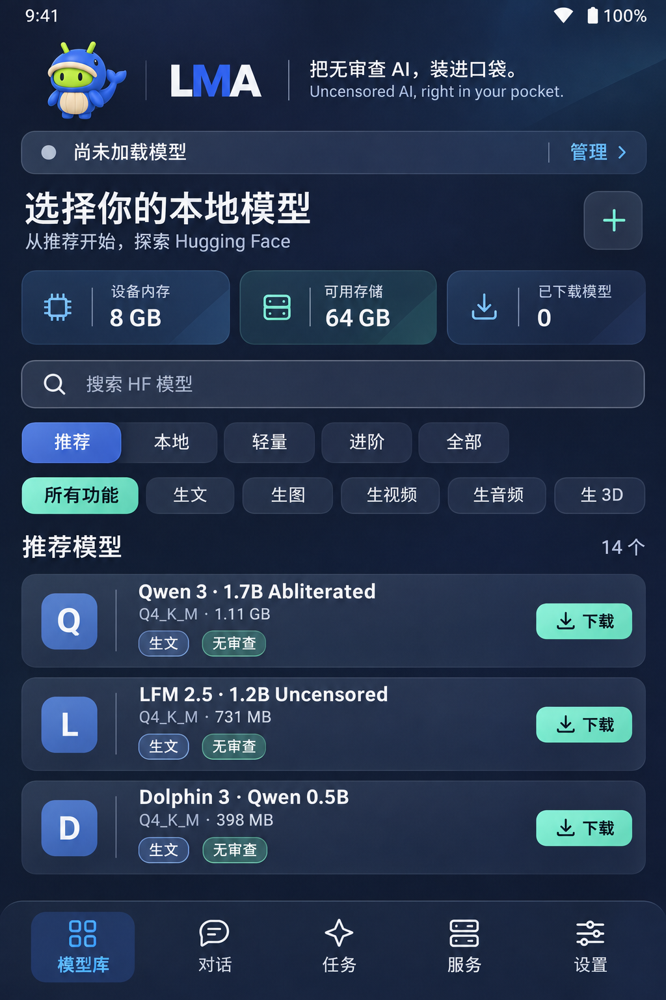

# LMA 云母分区设计系统 / Mica Bento design system

**2026-11-03 定稿：UI 10「云母分区 / Mica Bento」。** Logo 仍为 **21**，标语仍为 **04**。默认暗色，完整支持明亮主题及系统跟随；适配按可用窗口宽度、剩余高度和文字大小判断。

**Accepted on 2026-11-03: UI 10, Mica Bento.** Logo **21** and slogan **04** remain approved. Dark is the installation default; light and system preference are equally specified. Layout responds to available window space and text scale.

| 阅读顺序 / Order | 中文 | English | 内容 / Coverage |
| --- | --- | --- | --- |
| 01 | [设计总规范](MICA_BENTO.md) | [Design specification](MICA_BENTO.en.md) | 风格、品牌、明暗色值、字体、材质、状态、性能 / Identity, themes, geometry, states, performance |
| 02 | [30 类组件](COMPONENTS.md) | [30 component contracts](COMPONENTS.en.md) | 结构、尺寸、状态、操作、无障碍、页面对应 / Structure, metrics, behavior, accessibility, source mapping |
| 03 | [机型与窗口适配](RESPONSIVE.md) | [Adaptive layout](RESPONSIVE.en.md) | 7 档宽度、短屏、横屏、折叠、键盘、安全区、验收 / Width bands, height, foldables, IME, acceptance |
| 04 | [Tokens](tokens.json) | [Reference CSS](tokens.css) | 双主题、断点、尺寸、对比度组合；CSS 仅供实施参考 / Machine-readable reference, not loaded by the app |
| 05 | [定稿记录 / Decision](decision.json) | [静态检查 / Static checks](validation.json) | 用户决策、原图 SHA256、检查结果及未验收范围 / Provenance, checks, explicit pending evidence |

上图由规范 tokens 绘制，[来源与哈希 / Provenance](../media/design/mica-theme-reference.json)。它用于对照颜色和状态，不是浅色 App 已实现的证据。下图仍是用户选定的原始概念图。

概念图只表达方向，图中文字、假数据和触控尺寸不能直接作为产品实现。后续实现以三份规范及 tokens 为准；文档与 tokens 有冲突时先修正冲突，不能静默选用其中一份。用户明确要求优先于文档。其他 19 套稿及旧选型包保留为档案；原清单中的等待选型状态是生成当时的历史元数据，当前决策以 [decision.json](decision.json) 为准。

The concept establishes visual direction. Its generated text, demonstration statistics and dimensions are not production data. Implement from the specifications and tokens; resolve any discrepancy before implementation. Explicit user requirements take priority. Other proposals and original selection packages remain historical records; this decision supersedes their original awaiting-selection metadata.

| 编号 / ID | 本轮交付 / Delivery | 状态 / State |
| --- | --- | --- |
| C01 | UI 10 定稿、双语设计／组件／适配规范、主题 tokens / Decision and bilingual specifications | 已定义 / Defined |
| C02 | 原图来源、对比度及文档完整性检查 / Provenance, contrast and documentation checks | [检查记录 / Report](validation.json) |
| P01 | 按规范改造模型库、对话、任务、服务、设置及弹层 / Integrate all five pages and overlays | v1.0.0 已实施 / Implemented |
| P02 | 真实 WebView 的双主题、各种窗口／字体／键盘及性能验收 / WebView themes, adaptive layouts, accessibility, performance | 520 程序布局＋本版真机检查；硬件边界单列 / Scoped program and phone checks |
| P03 | v0.4.0 既有真机编解码、后台、视觉配对和视频／3D 质量问题 / Existing device, codec, endurance, projector and quality gaps | 保留 [原版本限制](../CONVERSATION_V040.md) / [Original limits](../CONVERSATION_V040.en.md) |

v1.0.0 已完成应用接入、原签名构建和新版实机演示；[实现与使用 / Implementation](../MICA_V100.md)、[English](../MICA_V100.en.md)、[运行时状态 / Runtime status](runtime-v1.0.0.json)。原设计阶段记录保留为历史：[维护说明 / Maintenance note](../releases/v0.4.0-mica-bento-design.md)。
