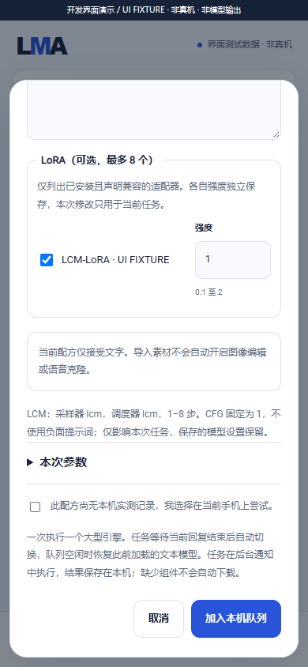
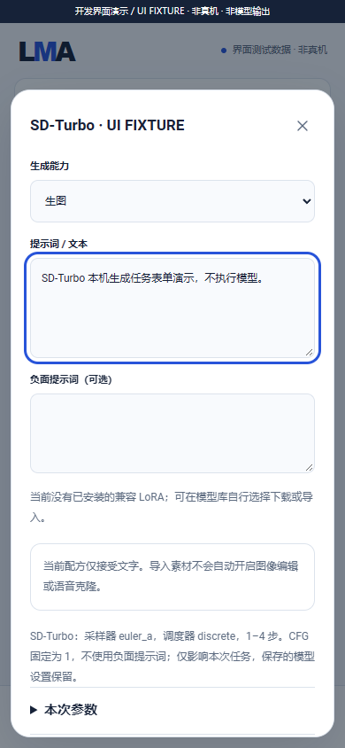

# v0.3.0-dev.12 · 扩散组件与采样 / Diffusion components and sampling

2026-10-28 · 内部检查点 / Internal checkpoint · **无新 Release / No new Release**

本次把 SD1.5 / SDXL 分离组件、SD-Turbo、LCM checkpoint 与两种架构的 LCM-LoRA 接入共用基座。用户明确选择模型后，低步数任务固定采样策略、CFG 与步数保护，保留普通基础模型的独立设置。App 更新只提供代码、标签和配方，模型 / LoRA / 编码器 / VAE / 词表仍由用户自行选择下载。

This checkpoint integrates split SD1.5/SDXL components, SD-Turbo, LCM checkpoints and both matching LCM-LoRA architectures. Explicitly selected low-step jobs freeze sampling policy/CFG/step guards while preserving ordinary base-model settings. App updates provide code/tags/recipes; users independently select/download model, adapter, encoder, VAE and vocabulary assets.

## 变更 / Changes

- 新增七种数据模板，总计十六种；完整 checkpoint 可选匹配的替代 VAE，分离 SDXL 必须选齐双 CLIP / VAE；元数据登记不下载。Seven additional data-only recipes; complete dependency selection remains explicit.
- `diffusionPlan` 分开保存请求参数、有效参数与调整原因，JSON 数值稳定落盘；重试重新派生，启动前用完整租约核对，拒绝错误 / 变更快照。Stable, reviewable task plans without overwriting saved model parameters.
- 专用 `sampling:lcm` 声明触发 LCM-LoRA 策略，拒绝跨架构、多个加速来源、无效强度和负面提示；原生复核策略并检查加载张量架构。Explicit adapter semantics and independently enforced native checks.
- 界面显示本次 LCM / Turbo 策略，步数超限归位，取消 LCM 选择恢复表单原值；推荐和平级功能标签保留。Task-scoped UI policy and unchanged user asset ownership.

## 产物 / Artifact

内部 APK 路径 / Internal APK: `dist/LMA-0.3.0-dev.12-arm64-v8a.apk`，**25,267,861 bytes**；versionCode **16**，Android 9+ / ARM64 / CPU。

```text
SHA256 7602011cfdf1ed49e072a3ce541ef0fed726690bd1122365f787491719f5e6b6
Signing certificate SHA256 90444a717a55549e2094364d8d7d005cf8b7f4df24562da62cc1884a2f341c17
```

58 个生产 Java 文件（构建含生成 R 共 59）、19 个原生文件，沿用原升级签名，无模型权重或模型专用数据。重新编译的扩散 worker 为 **8,831,736 bytes**，SHA256 `c3555afee4cfa765e19bc0cfdfef0e8ee53d0680694b56446fe7d077caff2d06`。包 / ELF / API 28 / 16 KiB 对齐、依赖闭合和资产白名单通过；Lint 0 错误 / 13 警告。

The original signing identity is retained. Native/API/alignment/assets checks cover this exact build; no phone or model execution is inferred from successful packaging.

## 验证 / Verification

| 范围 / Scope | 结果 / Result | 证据边界 / Evidence |
| --- | --- | --- |
| 新增扩散 / Added diffusion | 83：Java 56 + C++ 27 | 生产计划 / 绑定、实际主机协议子进程、执行共享 C++ 策略；输出为 JSON 字节，不是图片 |
| 基座 / Foundation | 381 | 配方 / 完整性 189、适配器 45、独立更新 62，均为限定主机检查 |
| 输入 / 调度 / 迁移 | 64 / 49 / 69 | 主机文件、HTTP、生产任务与真实子进程，非 Android |
| Text / TTS / Nano | 66 / 62 / 190 | 既有主机回归；不证明语音或模型输出 |
| API / Backend / HF | 67 / 98 / 76 | 本机 HTTP、测试端口、元数据；HF 含在线检查 |
| UI / Media | 194；32 PNG + MP4 + GIF | 实际界面与显式 UI FIXTURE；浏览器已关闭 |
| Physical Android / actual model images | 0 | 未实测 / Not tested |

[中文扩散指南](../DIFFUSION_ENGINE.md) · [English guide](../DIFFUSION_ENGINE.en.md) · [当前状态](../DEVELOPMENT.md) · [验证索引](../../verification/development/status.json)





F-01–F-12、既有文本、01–14 / 16 / 17 与全部冻结子目标的实际执行、完整固定配方 / 许可、质量 / 资源、物理 Android 离线新输入、加载释放、15 分钟锁屏和一小时交替服务及升级门槛仍须在同一完整 v0.3.0 完成。没有创建标签或 GitHub Release；公开 v0.2.0 保留。

Every selected architecture/subtarget and full physical-device/quality/resource/lifecycle/upgrade gate remains in the same complete v0.3.0. This internal checkpoint neither shrinks scope nor completes the requested Release.
