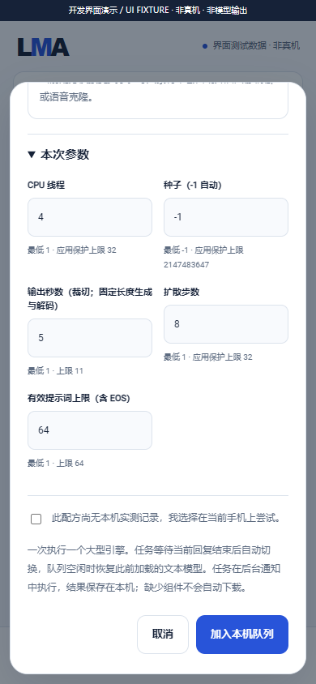

# v0.3.0-dev.20 · Stable Audio 本地基座 / local audio foundation

内部开发检查点，**未发布**；公开版本仍为 v0.2.0。This is not complete v0.3.0 acceptance and creates no tag/Release. App updates ship the foundation; users still choose, download/import and manage all model assets.

## 本轮已实现 / Implemented this round

| 编号 / ID | 事项 / Work | 完成与证据 / Evidence |
| --- | --- | --- |
| 20-01 | Stable Audio Open Small CPU 原生管线 / native pipeline | 同机 T5 → DiT → 解码器顺序生命周期；固定 Arm 导出，实际 C API，未执行整模型 / same-phone stages, not a full model test |
| 20-02 | 四组件与 HF TFLite 发现 / assets and discovery | 三个用户自选 TFLite + SentencePiece；第 33 个平级元数据配方；不自动下载 / explicit transfers only |
| 20-03 | 独立参数与校验 / model parameters | 1–11 秒、64 有效 token 含 EOS、可编辑归位；固定 256 latent / 524288 解码帧成本、seed / 阶段回执；未消费字段不展示 |
| 20-04 | 原生构建与许可 / native build and notices | 官方 LiteRT 2.2.0、固定源与 SHA、CPU / API28 / 16 KiB；Apache / 第三方 notice，模型许可独立 |
| 20-05 | 144 项限定检查 / scoped assertions | Java 51（6 实际子进程）+ C++ 93；6 次真实 LiteRT 微型图、每图三次加载运行释放、Arm 采样比对；非训练 checkpoint |
| 20-06 | 包、双语文档与媒体 / package, docs and media | 原签名开发包、561 foundation / 287 UI；新增 56–58 截图，录屏 / GIF 全部 UI FIXTURE |

## 开发包与检查 / Development package and checks

- APK `dist/LMA-0.3.0-dev.20-arm64-v8a.apk`，**34,608,778 bytes**；version/code **0.3.0-dev.20 / 24**。
- SHA256 `147f55848a46c26e5ad68c2d02c8d51b5da54043e4030feadedd73f51ac8ae5b`。
- 原证书 / original certificate `90444a717a55549e2094364d8d7d005cf8b7f4df24562da62cc1884a2f341c17`。
- **26** native files / **71** Java compilation units；worker 817,888 bytes + LiteRT 5,508,376 bytes；ABI ARM64、worker API28 / runtime API23、16 KiB APK / ELF 与依赖解析检查通过。
- Stable Audio **144**、RQ **178**、openmoss **514**、Delay **176**、Qwen **81**、diffusion **174**、MNN **74**、Nano **190**、TTS **62**、text **66**、migration **69**、inputs **64**、scheduler **49**、backend **98**、HF host **79**、live HF Mirror metadata **5**、API **67**。Foundation **561** includes recipe/integrity **369**, adapter **45**, updates **62**. UI **287**；Lint **0 errors / 13 warnings**.

WAV children produce structural silent fixtures. LiteRT runs two 604/536-byte synthetic ADD/CAST graphs, without trained weights; full-model/physical-device acceptance remains zero. [Stable Audio 回执 / receipt](../../verification/development/stable-audio.json) · [APK](../../verification/development/package.json) · [status](../../verification/development/status.json) · [source lock](../../third_party/stable-audio-source-lock.json) · [publisher metadata](../../catalogue/evidence/stable-audio-publisher.json).

## 页面、录屏与 GIF / Media

  

[MP4](../media/development/foundation-ui.mp4) · [GIF](../media/development/foundation-ui.gif) · [media manifest](../media/development/manifest.json). **58 screenshots / 60 media files**, with visible UI FIXTURE labels. They show production forms and simulated bridge state; no phone or full-model generation. All task browser pages/contexts/processes are closed.

## 待处理 / Pending in the same complete v0.3.0

| 编号 / ID | 待处理事项 / Remaining work | 验收条件 / Gate |
| --- | --- | --- |
| P-01 | Stable Audio 四文件完整资产和新输入本地音频 / complete SAO pipeline | 整模型、质量、资源、离线 / 取消 / 装卸证据；14 尚未完成，不把微型图当支持证明 |
| P-02 | SoulX-Podcast 1.7B / 旧 LTX-Video 2B 0.9.8 distilled | 补齐完整原生管线与许可 / 后端条件。旧 LTX 不用新 LTX 替代；社区参考仓库的非商业 / 应用分发限制未关闭，不混入 App 源码许可 |
| P-03 | 全部模型与冻结子目标 / all targets | 既有生文、01–14 / 16 / 17，包括 SD1.5 / SDXL 两类 LoRA、Turbo / LCM / LCM-LoRA、Kokoro / Piper / Matcha、九种 MOSS、Wan / 旧 LTX 等逐项验收；已有源码路线不等于手机支持 |
| P-04 | 完整 F-01–F-12 与 A1–A11 / R-01–R-05 | 真机新输入断网生成、产物质量 / 资源、每模型三次装卸、锁屏 15 分钟、1 小时交替 API、升级保留资产与设置、零模型启动与显式下载等；物理设备 0 |
| P-05 | 最终系统性交付与正式 Release | 全范围通过后更新原签名包、证据、双语媒体与文档，再发布同一个完整 v0.3.0；不拆版或默认顺延 |

[中文实现、使用与重建](../STABLE_AUDIO_ENGINE.md) · [English implementation, workflow and rebuild](../STABLE_AUDIO_ENGINE.en.md) · [完整需求 / requirements](../MULTIMODAL_RELEASE_PLAN.md).
