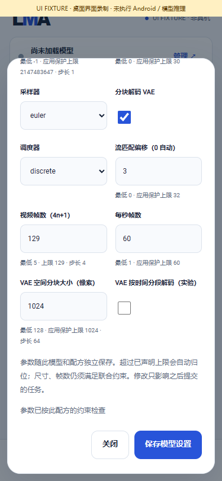

# 0.3.0-dev.40 · 按模型视频解码 / Per-model video decoding

这是同一完整 v0.3.0 的内部开发交付，**不创建正式 Release**。App 只交付基座，模型仍由用户明确选择、下载 / 导入、更新和管理。推荐 m08→m06→m01、完整 HF 发现、本地管理、模型平级标签和所有冻结目标保持约束。

Internal checkpoint in one complete v0.3.0 scope. No reduced Release, bundled weights, implicit retrieval, off-device inference, ROOT or ComfyUI graph/plugin ecosystem.

## 本轮实现 / Implemented

| 编号 | 实现事项 / Work | 具体结果与边界 / Result and scope |
|---|---|---|
| D01 | 按模型 VAE 配置 / Per-model VAE settings | 128–1024像素 /64对齐，实验性时间分段，配方生成与旧安装引擎schema均接通；自填超限归位，原生独立拒绝非法值 |
| D02 | 旧任务与用户资产保护 / Legacy jobs and assets | 缺少新字段继续旧128 /关闭行为，旧任务真实RGB SHA精确回归；设置重启保存，任务冻结，与模型文件 /结果各自独立 |
| D03 | 共用进度与取消 / Shared progress and cancellation | 修复快速采样被500ms节流漏掉首个完成步骤的问题；新阶段 /首个完成步骤 /最终进度及时可见，其他节流保留；真实失败保留，新增子进程回归后重跑实际模型取消 |
| D04 | 原生与生产Java实际业务 / Actual runtime and business flow | 九场景 /五份RGB，实际取消与恢复；Java显式导入四组件、三次模型子进程、两份MP4，编码输入与原生RGB逐字节一致；同手机MediaCodec仍待验收 |
| D05 | 五组完整几何实验 / Full-geometry experiments | 原版、关闭分块、两种时间分段、flow8均保留原请求、编译身份、原始产物和资源观测；后段伪影继续失败，512 /时间分段开不改为默认 |
| D06 | 独立上游VAE诊断 / Independent official VAE | 隔离保存真实采样latent，未注册或打包诊断程序；完整同权重 /严格加载 /CPU F32，所有帧最大差1字节，伪影仍在；完整扩散数值 /画质未通过 |
| D07 | APK、双语文档和媒体 / Package, documentation and media | 原签名dev.40/code44、35原生文件、受影响页面截图/GIF/MP4和实际对照；页面夹具、主机推理、Android编译分别标注 |
| D08 | 不可变历史与完整范围 / History and full scope | dev.39的40份报告及状态按原字节归档，七份诊断原报告保留实际来源；LCM/Sana/旧LTX失败不改写，全部必需目标仍阻塞同一完整版本 |

## 包与验证 / Package and validation

- Local development APK: `LMA-0.3.0-dev.40-arm64-v8a.apk`, code44, **61,329,930 bytes**.
- APK SHA256: `4825f84fce6537765fc4ff265fcef3f048c7d7b29773ba0d5b7906da00951103`.
- Original certificate SHA256: `90444a717a55549e2094364d8d7d005cf8b7f4df24562da62cc1884a2f341c17`.
- **22组 /22 suites、3,085项通过 /passed checks**：19组共用控制2,817项 + 官方分词117项 + 完整Wan原生49项 + 实际生产Java业务102项。诊断报告不重复计为业务通过项。
- APK签名、依赖、16KiB ELF /ZIP对齐和页面源码一致性通过；Lint0错误 /17警告。全部本轮自建浏览器页面 /上下文 /进程关闭。
- 首次准备流程控制遇到Windows临时目录占用，原失败日志保留；未改测试或门槛，后续完整重跑通过。The first preparation control run hit a Windows temporary-directory sharing violation; the original failure log is retained, and the unchanged full rerun passed.
- Windows真实输出不代表手机质量、资源、后台或Android编码通过。No numerical/quality/resource/physical-phone or complete Release acceptance is claimed.

[中文操作与全部实验](../WAN_DECODER.md) · [English workflow and experiments](../WAN_DECODER.en.md) · [当前证据](../../verification/development/status.json) · [诊断聚合](../../verification/development/wan-quality.json)

[页面GIF](../media/development/wan/wan-ui.gif) · [页面MP4](../media/development/wan/wan-ui.mp4) · [相同真实latent的两个解码器](../media/development/wan-quality/vae-comparison.png) · [原始失败画质GIF](../media/development/wan-quality/legacy-default.gif)

## 完整待处理范围 / Full remaining scope

| 编号 | 冻结范围 | 待完成事项 |
|---|---|---|
| P01 | F01–F12、既有生文 | 全业务在 Android 完整闭环、升级与接口；保留推荐 m08→m06→m01、HF 全部 / 搜索、本地、独立设置及不可变快照 |
| P02 | 01–08 生图及 LoRA | 01 SD1.5；02 SD1.5 **及 SDXL** LoRA；03 SD-Turbo / LCM checkpoint / LCM-LoRA；04 Sana **文生图**；05 SDXL；06 Z-Image-Turbo（已接通完整主机业务，仍待完整数值 / 质量 / 资源 / Android 验收）；07 FLUX.2-klein 4B（完整主机业务已接通，质量 / 完整数值 / Android 未验收）；08 Qwen-Image 2.1。逐一完整资产、运行、质量、资源及 Android；Sana Edit 固定风格图片编辑已接通并完成实际主机闭环，但**不替代 04 文生图目标**；旧 13 组件文生图分类及灰图失败原样保留；LCM 产品准备 / 关联 / 运行已接入，但原生候选像素 maximum 8 > 5 仍失败，完整官方采样、质量与手机未完成 |
| P03 | 09–11 语音 | 09 MOSS Nano 100M；10 Kokoro 82M **54 音色** / Piper Lessac / Matcha LJS；11 Qwen3-TTS 0.6B Base。桌面运行不能替代质量、许可、资源或 Android 验收 |
| P04 | 12 MOSS 九个子目标 | TTS 1.0、TTS v1.5、旧 LocalTransformer、LocalTransformer v1.5、TTSD v1、VoiceGenerator、旧 SoundEffect、SoundEffect v2、Realtime，逐一完整本机管线与产物验收；Realtime 增量音频的生产源码 / 接口 / 页面已接通；完整训练语音、数值 / 质量 / 资源 / Android 仍需验收 |
| P05 | 13–14 音频 | SoulX 1.7B 的公开用户资产 / 质量 / Android；Stable Audio 匹配完整训练资产与推理，保留访问授权阻塞，不绕过门控 |
| P06 | 16–17 视频 | Wan2.1 T2V 1.3B Q4（CPU 编码器 / VAE 与 Vulkan 扩散，完整主机业务已接通；默认后段块状伪影待修复，完整数值 / 视频质量 / 资源 / 同手机推理与编码尚未验收）；**旧 LTX 2B 0.9.8 distilled**。Google/community T5 Q5 单尺度生成变体已接入生产队列与手机编码源码，并完成完整训练主机链路；官方 PixArt T5 / 多尺度目标、原数值失败、公开用户资产取得、视频质量 / 资源 / Android 同手机编码仍待验收，保留全部失败 |
| P07 | 用户资产独立管理 | 所有目标的选择、下载、导入、暂停 / 续传、版本更新 / 回滚 / 删除、重启暂停、升级保留；App 不附权重，不自动下载或静默替换 |
| P08 | 所有冻结目标实际验证 | 实际输出、质量、参数、资源、取消、错误恢复；全部阶段同一 Android，无 ROOT / 外部执行回退，无 ComfyUI 连线 / 画布 / 用户节点与插件生态 |
| P09 | 真机与完整 Release | 每模型 3 次加载、15 分钟锁屏、1 小时 API、升级 A1–A11 / R01–R05；物理手机验收未完成。所有要求通过后才完整签名、源码 / APK SHA、双语真实媒体并发布正式版本 |

English scope: P01 F01–F12/existing text and Android business/API/upgrades; P02 every selected image target 01–08, both LoRA architectures and all SD-Turbo/LCM variants; P03 Nano 100M, all 54 Kokoro voices, Piper, Matcha and Qwen3-TTS 0.6B Base; P04 all nine frozen MOSS targets; P05 complete public SoulX assets and authorized matching Stable Audio assets; P06 Wan2.1 1.3B Q4 (CPU encoder/VAE and Vulkan diffusion) and exact old-LTX 2B 0.9.8 distilled, official PixArt/multiscale and original failed gates; P07 every user's independent asset lifecycle and model-free upgrades; P08 trained outputs/quality/resources/parameters/cancel/recovery with all stages on the same no-ROOT Android phone; P09 per-model three loads, 15-minute screen-off, one-hour API, A1–A11/R01–R05, signed artifacts, exact source/APK identities, bilingual actual media and formal release. No external execution or ComfyUI canvas/nodes/plugins. Physical-phone acceptance remains pending.
