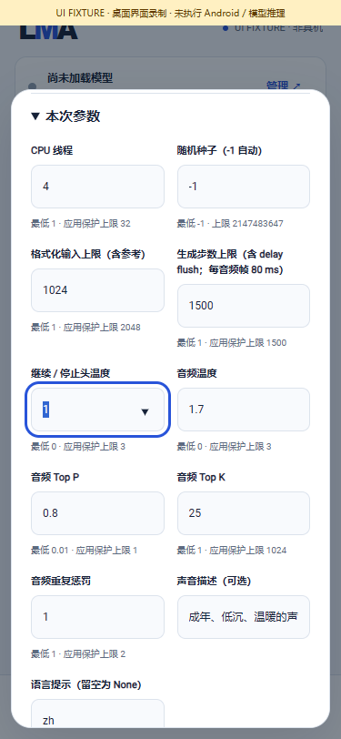

# 0.3.0-dev.41 · MOSS 本地语音功能闭环 / Local MOSS speech workflow

This is a development checkpoint within the single complete v0.3.0 scope. It is not a formal Release or a reduced delivery line.

| 编号 / ID | 本轮实现 / Implemented | 说明 / Detail |
|---|---|---|
| D01 | 完整用户资产 / Complete user-owned assets | 固定公开修订、两个完整文件、大小与 SHA；保留 BF16 codec / FP32 量化统计；下载与导入仍须用户选择 |
| D02 | 可选模型组合 / Optional model bundle | 21 个候选组合；新增 MOSS-TTS 1.5 平级模型，标记生音频 / 语音 / CPU / GGUF；原推荐顺序及 HF 搜索保留 |
| D03 | 真实进度与结束原因 / Actual progress and termination | 采样循环报告真实步骤；正常结束与输出截断分别记录；解码 / 保存阶段独立 |
| D04 | 模型参数与结果 / Parameters and results | 参数随模型保存、越界归位；任务快照固定；最终结果保留实际参数和种子、参考帧、音频样本及耗时 |
| D05 | 编译与界面 / Package and UI | 原签名 dev.41/code45；35 份原生库通过核对；Lint 0 错误 / 17 警告；530 项 MOSS 专项与 490 项页面检查通过；12 组截图 / GIF / MP4 更新，界面演示均标为模拟桥接 |
| D06 | 实际完整资产执行 / Actual full-asset execution | 原生 5 个 WAV / 6 项控制的业务检查通过；生产 Java 87 项 / 5 次实际运行 / 3 个 WAV，完整 SHA 关联两文件、独立配置、真实取消 / 预算错误 / 恢复与清理；参考正常结束失败保留；流式复制超时另记 |
| D07 | 历史与范围 / History and scope | dev.40 证据按原字节归档；原 Wan / LCM / Sana T2I / 旧 LTX 失败保留；全部冻结范围仍在同一 v0.3.0 |
| D08 | CPU 权重加载 / CPU weight loading | 按实际权重区间建立私有映射，保持原始字节与算法；25 项真实 GGML 计算 / 文件不变 / 大文件偏移 / 释放检查通过；中英文输出与原始上传方式逐字节一致 |
| D09 | 输出上限提示 / Output-limit notice | 从任务与素材打开结果时读取原始执行记录，显示可能不完整；可编辑后再次生成，不自动重试；正常结束清除旧提示；56 项 MOSS 页面检查、五张截图 / GIF / MP4 |

Android APK: **61,338,122 bytes**; SHA-256 `33f78573d5658fea7ee0e7983c5e0779c0bf00fc0c2a0ff17eb17c8d52326af7`. Persistent update certificate retained; API 28 and 16 KiB alignment verified. No model, tokenizer or voice data is bundled.

[中文使用方式](../MOSS_TTS15.md) · [English workflow](../MOSS_TTS15.en.md)

[界面 GIF](../media/development/openmoss/openmoss-ui.gif) · [界面 MP4](../media/development/openmoss/openmoss-ui.mp4)

[实际原始 WAV / 波形 / 视频与报告](../MOSS_TTS15.md#实际产物与报告) · [Actual artifacts and reports](../MOSS_TTS15.en.md#actual-artifacts-and-reports)

## 完整待完成事项 / Complete remaining scope

| 编号 | 冻结范围 | 待完成事项 |
|---|---|---|
| P01 | F01–F12、既有生文 | 全业务在 Android 完整闭环、升级与接口；保留推荐 m08→m06→m01、HF 全部 / 搜索、本地、独立设置及不可变快照 |
| P02 | 01–08 生图及 LoRA | 01 SD1.5；02 SD1.5 **及 SDXL** LoRA；03 SD-Turbo / LCM checkpoint / LCM-LoRA；04 Sana **文生图**；05 SDXL；06 Z-Image-Turbo（已接通完整主机业务，仍待完整数值 / 质量 / 资源 / Android 验收）；07 FLUX.2-klein 4B（完整主机业务已接通，质量 / 完整数值 / Android 未验收）；08 Qwen-Image 2.1。逐一完整资产、运行、质量、资源及 Android；Sana Edit 固定风格图片编辑已接通并完成实际主机闭环，但**不替代 04 文生图目标**；旧 13 组件文生图分类及灰图失败原样保留；LCM 产品准备 / 关联 / 运行已接入，但原生候选像素 maximum 8 > 5 仍失败，完整官方采样、质量与手机未完成 |
| P03 | 09–11 语音 | 09 MOSS Nano 100M；10 Kokoro 82M **54 音色** / Piper Lessac / Matcha LJS；11 Qwen3-TTS 0.6B Base。桌面运行不能替代质量、许可、资源或 Android 验收 |
| P04 | 12 MOSS 九个子目标 | TTS 1.0、TTS v1.5、旧 LocalTransformer、LocalTransformer v1.5、TTSD v1、VoiceGenerator、旧 SoundEffect、SoundEffect v2、Realtime，逐一完整本机管线与产物验收；TTS-v1.5 参考模式正常结束失败仍待解决；Realtime 增量音频的生产源码 / 接口 / 页面已接通；完整训练语音、数值 / 质量 / 资源 / Android 仍需验收 |
| P05 | 13–14 音频 | SoulX 1.7B 的公开用户资产 / 质量 / Android；Stable Audio 匹配完整训练资产与推理，保留访问授权阻塞，不绕过门控 |
| P06 | 16–17 视频 | Wan2.1 T2V 1.3B Q4（CPU 编码器 / VAE 与 Vulkan 扩散，完整主机业务已接通；默认后段块状伪影待修复，完整数值 / 视频质量 / 资源 / 同手机推理与编码尚未验收）；**旧 LTX 2B 0.9.8 distilled**。Google/community T5 Q5 单尺度生成变体已接入生产队列与手机编码源码，并完成完整训练主机链路；官方 PixArt T5 / 多尺度目标、原数值失败、公开用户资产取得、视频质量 / 资源 / Android 同手机编码仍待验收，保留全部失败 |
| P07 | 用户资产独立管理 | 所有目标的选择、下载、导入、暂停 / 续传、版本更新 / 回滚 / 删除、重启暂停、升级保留；App 不附权重，不自动下载或静默替换 |
| P08 | 所有冻结目标实际验证 | 实际输出、质量、参数、资源、取消、错误恢复；全部阶段同一 Android，无 ROOT / 外部执行回退，无 ComfyUI 连线 / 画布 / 用户节点与插件生态 |
| P09 | 真机与完整 Release | 每模型 3 次加载、15 分钟锁屏、1 小时 API、升级 A1–A11 / R01–R05；物理手机验收未完成。所有要求通过后才完整签名、源码 / APK SHA、双语真实媒体并发布正式版本 |

English scope: P01 F01–F12/existing text and Android business/API/upgrades; P02 every selected image target 01–08, both LoRA architectures and all SD-Turbo/LCM variants; P03 Nano 100M, all 54 Kokoro voices, Piper, Matcha and Qwen3-TTS 0.6B Base; P04 all nine frozen MOSS targets; P05 complete public SoulX assets and authorized matching Stable Audio assets; P06 Wan2.1 1.3B Q4 (CPU encoder/VAE and Vulkan diffusion) and exact old-LTX 2B 0.9.8 distilled, official PixArt/multiscale and original failed gates; P07 every user's independent asset lifecycle and model-free upgrades; P08 trained outputs/quality/resources/parameters/cancel/recovery with all stages on the same no-ROOT Android phone; P09 per-model three loads, 15-minute screen-off, one-hour API, A1–A11/R01–R05, signed artifacts, exact source/APK identities, bilingual actual media and formal release. No external execution or ComfyUI canvas/nodes/plugins. Physical-phone acceptance remains pending.
