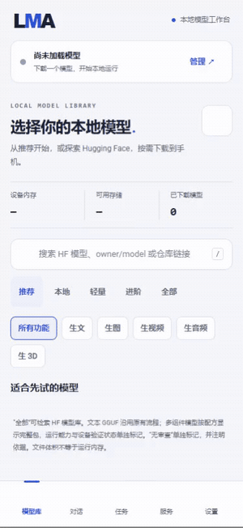

# LMA v0.3.2 · 语音与本地生 3D / Speech and local 3D

本版在原有完整本地基座上加入四类语音与单图生 3D。App 只更新程序：安装、升级和浏览不下载模型；权重、词典、tokenizer、音色与配套组件继续由用户选择、下载或导入。全部运算在同一 Android 手机完成，无需 ROOT 或外部推理。

This release extends the complete local foundation with four speech families and single-image 3D. The APK contains code, not model assets. Users explicitly acquire every weight, dictionary, tokenizer and voice. All execution stays on the same phone, without ROOT or external inference.

[中文完整方案](../SPEECH_3D_EXPANSION.md) · [English guide](../SPEECH_3D_EXPANSION.en.md) · [中文 README](../../README.md) · [English README](../../README.en.md) · [机器矩阵 / Matrix](../../catalogue/release-0.3.2-implementation.json)

## 本轮实现 / Implemented

| 编号 / No. | 事项 / Item | 完成结果 / Result |
| --- | --- | --- |
| 01 | Kokoro PyTorch 系列 | 匹配 INT8 英文 ONNX、复用既有 54 音色；不直接执行任意 `.pth`。Matched ONNX, not raw PyTorch execution |
| 02 | MeloTTS Chinese | INT8 / FP32、声调词典与四份 FST，扩展真实 sherpa-onnx 中文前端。Actual Chinese frontend and optional pinned components |
| 03 | F5-TTS v1 | 原版 safetensors / Vocos、本地 C++、参考 WAV / 文本、外置拼音前端；中文完整发音等价性未验。Experimental Chinese adaptation, explicit missing-pronunciation errors |
| 04 | OmniVoice | Q8 GGUF / 原版＋codec 两种选择，auto / clone / design、语言与时长参数，完整 WAV。Two asset layouts and per-model voice controls |
| 05 | TRELLIS.2 / Pixal3D | 真实 CPU C++ 后端、五个单图几何 / 贴图包、PNG / JPEG 输入与 GLB；Pixal 512 关闭贴图。No multiview or exact benchmark-workflow parity claim |
| 06 | 共用生命周期 / Lifecycle | 3D 参数、硬上限归位、独立设置、预检、草稿、队列、取消、结果库、GLB 校验 / 旋转预览 / 导出和既有 API |
| 07 | 来源与标签 / Provenance | 测评 16 条配置逐项编号；修正 PartCrafter 项目链接；HF 生 3D 标签、任务 / 基座 / 内容标记独立，新增模型不推定 NSFW |
| 08 | 完整既有范围 / Preserved scope | F-01–F-12、生文、01–14 / 16 / 17、九个 MOSS 子目标与社区 44 包保留；推荐仍 `m08 → m06 → m01` |
| 09 | 文档与交付 / Delivery | 完整双语 README 保留并扩展为 22 场景、25 组检查入口；完整扩展指南、来源身份、原签名 APK、15 张当前截图、三组 GIF / MP4 和校验清单 |

当前目录 **78 包＝23 原有＋44 社区＋11 新增语音 / 3D**，**44 数据模板、14 扩展引擎＋文本**。模型平级，安装状态与生文 / 生图 / 生视频 / 生音频 / 生 3D 标签独立。

Current counts distinguish bundles, templates and engines; these are not counts of phone-tested models. Existing uncensored / NSFW labels retain their separate evidence and meaning.

## 验证与安装包 / Validation and APK

遵循用户“后续只做程序验证”的指令，本轮 **没有完整模型下载、复制、推理、ASR 或耐久实跑，没有物理 Android、Docker、WSL、VM 或模拟器**。真实主机子进程使用合成 WAV / GLB 与微型字典。全部浏览器上下文在结束后关闭。

The release is published as a prerelease to identify untested phone / model quality. This does not split or defer the completed original program scope. Historical model failures remain failures; desktop benchmark success is not converted into Android acceptance.

| 项目 / Item | 结果 / Result |
| --- | --- |
| 版本 / Version | `0.3.2` / code `52` / `com.lma.app` |
| 平台 / Platform | ARM64 / Android 9 API 28+ / target 35 |
| APK | `LMA-0.3.2-arm64-v8a.apk` |
| 字节 / Bytes | `66100175` |
| SHA256 | `bed58cb59324e8ec1a786026378a55767d28c5a76ba9fa56544506c10145d140` |
| 原签名 / Original certificate SHA256 | `90444a717a55549e2094364d8d7d005cf8b7f4df24562da62cc1884a2f341c17` |
| 新增专项 / Added contract suite | 173 assertions; five actual host fixture child routes, synthetic GLB and native F5 frontend |
| 新增页面 / Added UI flow | 32 checks / 5 screenshots / GIF / MP4, explicitly labelled UI FIXTURE |
| 程序总计 / Program totals | [25 suites / 4,727 assertions — 当前精确记录](../../verification/history/v0.3.2-program/status.json) |
| 原生文件 / Native payload | 37 libraries, independently checked dependencies, signatures and 16 KiB ELF / APK alignment |
| Lint | [完整结果，警告保留 / Full results](../../verification/history/v0.3.2-program/lint.json) |

Release 附 **18 项**同版资料：APK 与独立 SHA、源码 ZIP 与 SHA、验证 / 截图 ZIP、三组 GIF / MP4、构建 / 源码 / 发布清单、验证摘要、说明和 SHA256SUMS。源码与附件不包含签名材料或训练模型。原 v0.3.1 标签 / 附件不覆盖，程序记录按原 Git blob [归档](../../verification/history/v0.3.1-program-archive.json)。

All 18 assets have matching identities; original release tags and assets remain immutable. Source archives exclude native build caches, weights and signing material. See [rebuild](../BUILD.en.md) and [release workflow](../RELEASING.md).

## 页面与录制 / Pages and recordings

[语音选择 / Speech](../media/history/v0.3.2/expansion/01-speech-models.png) · [3D 模型 / Models](../media/history/v0.3.2/expansion/02-3d-models.png) · [表单 / Form](../media/history/v0.3.2/expansion/03-3d-form.png) · [队列 / Queue](../media/history/v0.3.2/expansion/04-3d-queue.png) · [GLB](../media/history/v0.3.2/expansion/05-glb-preview.png) · [MP4](../media/history/v0.3.2/expansion/expansion-ui.mp4) · [身份与检查 / Manifest](../media/history/v0.3.2/expansion/manifest.json)

## 待处理与未测试 / Remaining and untested

| 编号 / No. | 事项 / Item | 当前边界 / Boundary |
| --- | --- | --- |
| R01 | 完整语音模型 / Trained speech | 音质、语言覆盖、F5 中文分词 / 变调等价性与官方数值未验；本轮按指令不实跑 |
| R02 | 完整 3D 模型 / Trained 3D | RAM、耗时、材质与几何效果、Z20 可运行性未验；文件大小不等于 RAM |
| R03 | 其他测评配置 / Other benchmark routes | 多视图、UltraTex、UniForge、UltraShape、Hunyuan、SAM / MV-SAM、SUPRA、TripoSG、PartCrafter 尚需独立移植；[D01–D16](../SPEECH_3D_EXPANSION.md)逐条说明 |
| R04 | 原有冻结范围的质量 / Original frozen scope quality | 既有程序实现保留，全部原有模型的真机质量、速度与长线后台能力仍未验；旧失败不抹去 |
| R05 | 真机 / Device endurance | 无可用 Android 真机，锁屏、温控、系统杀进程与长期输出未验；不以远程方案替代 |

These are explicit integration limits or unperformed model / device measurements. They do not turn unavailable architectures into executable catalogue choices, nor restore the full-model validation gate canceled by the user.
