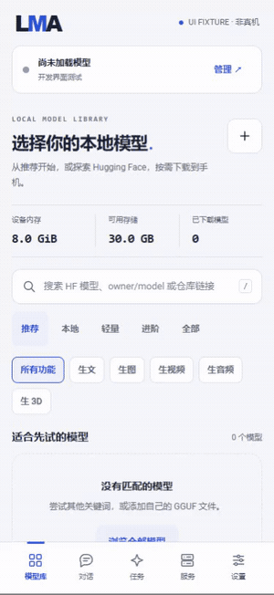

# LMA v0.3.4 · Local RF Shape and part geometry

[中文 / full bilingual notes](v0.3.4.md) · [Complete English design](../RF_SHAPE.en.md) · [Numbered delivery and remaining work](../IMPLEMENTATION_V034.en.md)

Adds a native matched-export shape pipeline, not only catalogue entries. Independent part nodes share model coordinates. No public complete matched ONNX download package has been verified; use explicit export/import or compatible custom HF selections. Models are never bundled, automatically acquired or executed off-device.

[中文完整方案](../RF_SHAPE.md) · [English design](../RF_SHAPE.en.md) · [中英实现矩阵](../IMPLEMENTATION_V034.md) / [English](../IMPLEMENTATION_V034.en.md) · [README](../../README.md) / [English](../../README.en.md)

## 本轮实现 / Implemented

| 编号 / ID | 实现 / Implementation | 边界 / Boundary |
| --- | --- | --- |
| 01 | ARM64 / API28 `rf_shape_ort`、四张 ONNX 图、RF / part attention、VAE cache / query、均匀网格与内部多部件 GLB | Shape only; no texture, VLM, point-cloud encoder or auto segmentation |
| 02 | TripoSG / PartCrafter object / scene 三个平级自选配方，任务、能力、引擎、依赖、格式分别标记 | FP32 / opset17 matched exports; no fabricated download packages or inferred NSFW labels |
| 03 | 离线 safetensors 导出、逐文件 SHA256 清单、data 角色和严格配置检查 | No online loading, pickle fallback or overwrites; full trained checkpoint export untested |
| 04 | PNG 输入、逐模型可编辑归位、存储导入、草稿 / 恢复、预检、共用队列、防重复提交、取消与 GLB 导出 | Existing production lifecycle; no partial publication or external fallback |
| 05 | 固定源码对照与真实 native 夹具流程、私有路径 / 缺件 / 维度 / 空曲面 / 三角面保护 | Tiny random / analytic graphs, not trained output quality |
| 06 | 保留 F-01–F-12、生文、01–14 / 16 / 17、九 MOSS 子目标、两种 LoRA、44 社区项、全部语音 / 单图 / 四视图；推荐 m08 → m06 → m01 | 48 templates / 82 catalogue bundles / 16 extensions plus text; user-controlled assets |
| 07 | 中英完整 README 扩至 C01–C27，H01–H18 案例保留；五组当前媒体，v0.3.3 证据原字节归档 | 25 screenshots / five GIFs / five MP4s, explicitly labelled desktop UI fixtures |

## 程序验证与安装包 / Program checks and package

遵循用户仅程序验证指令，完整训练模型下载 / 复制 / 运行均为 0，无真机、ASR 或长时耐久；不使用 Docker、WSL、VM、模拟器。所有拥有的浏览器资源 finally 关闭。Complete trained checkpoint conversion, phone RAM / speed / model quality and background endurance remain untested; no earlier failures are rewritten as passes.

| 项目 / Item | 结果 / Result |
| --- | --- |
| Version / package | 0.3.4 / code54 / com.lma.app |
| Platform | ARM64 / Android 9 API28+ / target35 |
| APK | LMA-0.3.4-arm64-v8a.apk |
| Bytes | 67424948 |
| SHA256 | fdf2fbd72e7bf12d1f6eb4f7de71b566d1250489e5ab990c7b365c36c9cbc522 |
| Original signer SHA256 | 90444a717a55549e2094364d8d7d005cf8b7f4df24562da62cc1884a2f341c17 |
| Program totals | **27 suites / 5,306 assertions**; [37 records plus status](../../verification/program/status.json) |
| RF Shape | **161 assertions**: 68 graph / math / preprocessing comparisons and 30 actual native processes |
| Shared expansion / foundation | **428 / 963 assertions** |
| Complete UI | **633 assertions**, labelled simulated bridge |
| Native package | **39 libraries**, dependency closure, original signature, 16 KiB ELF / ZIP alignment |
| Lint | **0 errors / 16 retained warnings** |
| Current capture checks | Community34 / workbench8 / speech-3D32 / MV19 / RF17 |

## 剩余事项 / Remaining work

| 编号 / ID | 事项 / Item | 状态 / Status |
| --- | --- | --- |
| 08 | D04 UltraTex、D05 UniForge3D、D06 UltraShape、D07 Hunyuan3D 2.1、D08 SAM 3D / D09 MV-SAM3D、D10 SUPRA-Tex | 七配置 / 六组实际原生移植；[逐项算子与输入输出缺口](../../research/portability/audit-v0.3.4.json) |
| 09 | 已匹配 MV / RF Shape 的公开可核验下载端点 | Import/custom routes exist; no invented one-click downloads |
| 10 | 自动抠图、VLM 部件识别、纹理、点云输入、原始 Flash / octree | Outside the implemented shape subset; additional source work |
| 11 | F5 官方完整中文前端等价 | Existing frontend remains experimental; no equivalence claim |
| 12 | 完整训练权重导出 / 推理、手机性能 / 质量 / 锁屏耐久 | Not run under the user policy; never recorded as accepted |

D11 / D12 / D15 / D16 对应匹配导出形状子集，**不是原测评完整 workflow 复刻**。冻结原范围继续完成，`all_benchmark_architectures_integrated=false` 与 D04–D10 开发缺口分开保留。没有 ComfyUI 连线、无限画布或用户插件体系。

## 页面、附件与历史 / Media, assets and history

[模型](../media/development/shape/01-shape-recipes.png) · [组件](../media/development/shape/02-selected-assets.png) · [部件参数](../media/development/shape/03-part-settings.png) · [任务](../media/development/shape/04-shape-queue.png) · [TripoSG](../media/development/shape/05-triposg-form.png) · [MP4](../media/development/shape/shape-ui.mp4) · [身份](../media/development/shape/manifest.json)

Release 提供 **22 项附件**：APK / SHA、源码 ZIP / SHA、构建 / 源码 / 发布清单、验证摘要与 ZIP、截图 ZIP、五组 GIF / MP4、双语说明与 SHA256SUMS。源码与 APK 不带签名、权重、词典、音色、tokenizer 或 codec 数据。原有已发布标签和附件不覆盖。

[原 v0.3.3 的 36 份 JSON](../../verification/history/v0.3.3-program-archive.json)与四组媒体保留 Git 原身份；更早案例、失败与归档继续保留。Current-source checks and historical identity checks stay separate. [Build](../BUILD.md) / [English](../BUILD.en.md) · [Release workflow](../RELEASING.md)
